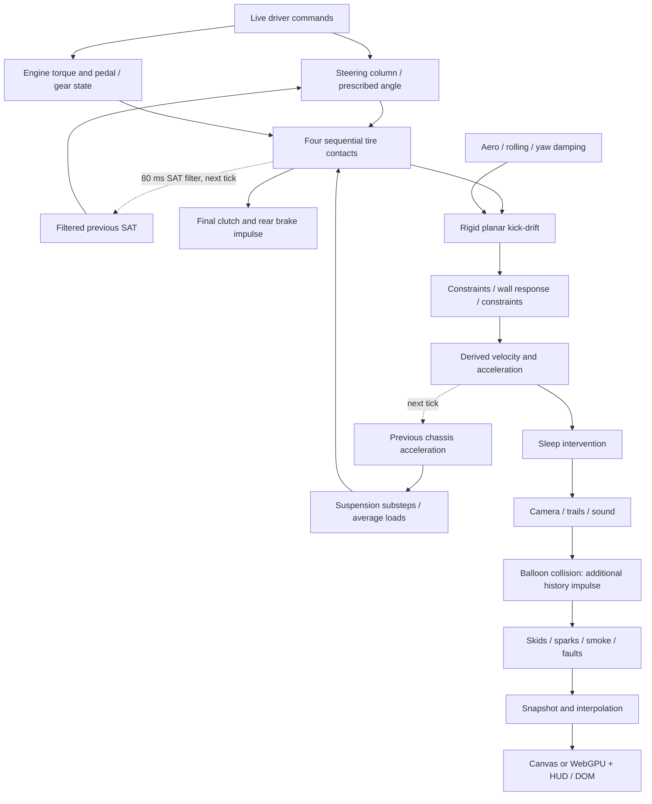

# Mission 10 — Full-system physics and performance forensics

Investigation branch: `research/full-system-forensic-audit`. Target: `fix/engine-torque-model` (`ec72edf`). Protected references were read through Git archives; none was checked out, modified or merged. Production code and calibration are unchanged by this investigation.

## 1. Executive diagnosis

The strongest explanation is **incompatible subsystem interfaces plus insufficient browser frame-budget headroom**, not simply an engine with too little torque. The rear contacts solve a shared rotational system sequentially, invalidate each other's state, and then undergo a final clutch projection. The tire law is much stiffer than its named peak-slip parameters suggest. Tire force memory and delayed steering feedback amplify transient behavior. The renderer and thousands of contact evaluations compete on the same main thread.

A material new finding changes Mission 9's acceptance assessment: **its engine model introduces stalls in two additional driving attempts that its smaller loaded matrix omitted**. At 100 Hz, steering reversal stalls at 2.50 s and handbrake recovery at 3.97 s; `fix/cornering-performance` remains running in both. The engine change is not adequately validated for promotion into a playable baseline. Keep its isolated torque work as research evidence; do not treat it as a completed whole-vehicle recovery.

Another newly isolated intervention is the balloon collision kick. A rear overlap while moving away adds **8396.68 J** in the probe and leaves cached speed inconsistent with position history. This cannot explain balloon-free failures, but disproves the assumption that all vehicle impulses are confined to the mechanical prefix.

The cloud does not reproduce every user symptom at ordinary resolution. At 1280×900/DPR1, short real-RAF runs sustain approximately 100 physics steps/wall-second. At 1920×1080/DPR2, straight driving falls to **88.32 steps/s**, drops **42 ticks**, and reaches **44.5 ms p95 CPU frame time**. These are software Canvas/browser measurements, not RTX 5090 presentation measurements. No FPS-resolution claim is made for the user's GPU.

## 2. Evidence and reproducibility

All new experiments, definitions, machine-readable results and the plot live in [research/full-system-forensic](../research/full-system-forensic/data/summary.json). Scripts reuse the existing audited adapters and serve profiling transformations in memory. Source remains unchanged.

- `driving.mjs`: 33 driving attempts × four branches, plus 12 timestep runs/branch (three scenarios × four rates), repeat-determinism checks, undamped/damped free-yaw probes and a current-branch wheel-order experiment. Fresh browser defaults, matched initial poses/speeds/events. Expanded maps isolate mechanical driving from wall/balloon contacts; this is an experimental boundary condition, not a production parameter change.
- `schedules.mjs --grid`: four branches × three workloads × 60/120/240 prescribed rendering schedules, with actual application tick/render code and solver counters. These schedules are **synthetic**, not measured monitor refresh rates.
- `interactive.mjs`: real browser RAF, actual keyboard/right-mouse input, five workloads/branch; CDP timeline/GC summaries, delivered-event-to-next-steering-tick latency, heap samples, dropped ticks and actual RAF timestamps. A separate current-branch 1920×1080/DPR2 run repeats the workloads.
- `ledger.mjs`: stage-level generalized chassis/shaft kinetic energy, momentum, engine work/loss, overlapping clutch/joint heat counters, synchronizer heat, frozen-kinematics tire work, endpoint brake work, small-angle suspension energy and yaw-damping work. Includes a boundary-contact case.
- `model-probes.mjs`, `balloon-probe.mjs`, `inventory.py`, `check.mjs`: source-bound tire/units/control probes, separating-balloon reproduction, searchable intervention inventory, and ordinary failing forensic acceptance checks.
- `plots.py`: standalone scientific plot, [forensic-summary.png](../research/full-system-forensic/data/forensic-summary.png).

Browser: system Chromium 154, Node 24, AMD EPYC 9V74 cloud CPU. Normal viewport 1280×900/DPR1; high-DPI case 1920×1080/DPR2. Canvas benchmarks disable hardware GPU and use quiet diagnostic logging. Profiling adds calls, objects and timer overhead; small stage times quantize around 0.1 ms. Short runs and one retained sample per workload are not a statistical guarantee. The four comparison refs and full SHAs are recorded in `data/summary.json` and `data/schedules.json`.

The 33 definitions include idle/start, neutral revs, gentle/aggressive launch, acceleration, clutch-open travel, coast/engine braking, up/down/loaded shifts, hard brake, brake-stop/stall/restart, wheelspin/burnout, low/moderate turns, reversal/release, lift-off, power-oversteer, weight-transfer/flick, countersteering, donut, drift transitions/lift and handbrake. A donut or drift label means an **attempt**, not a successfully sustained drift. Constant-speed closed-loop cruise and a long human-driven drift session were not validated; fixed-throttle travel is not equivalent to constant-speed regulation.

## 3. Physical architecture and full tick



`js/main.js:runPhysicsStep` is the execution authority. Time n means the beginning-of-tick physical state; h is simulated dt, which can differ from wall-clock tick spacing through Time Scale.

|Order|Functions / state read|State written, time level and later invalidation|
|---|---|---|
|0|Main accumulator, Physics Hz, Time Scale|Up to six steps/frame; 250 ms wall-time cap and dropped backlog. h enters mechanics; counters retain lost time.|
|1|Handbrake command|Pressure ramps over 0.25 s on / 0.15 s off; current tick's brake capacities use it.|
|2|`updateSteering`, live command or old filtered SAT|Current road-wheel angle and column derivatives. Dragging prescribes angle; released column uses delayed feedback.|
|3|`updateEngine`, old signed crank, gear request, shaft/wheel state|Pedal travel, synchronizer impulse, free crank torque kick, running/starting/stalled state. Wheel/contact and final clutch subsequently change the shafts.|
|4|`updateSuspension`, **previous tick** chassis acceleration|At most 1 ms internal steps; tick-average wheel loads. Chassis acceleration is not updated inside these substeps. Disabled suspension selects `computeWeightTransfer`, not an additional simultaneous transfer application.|
|5|`computeTireForces`, current angle/loads, old chassis twist, carried force/rotor state|FL, FR, RL, RR contact solves. Average impulses supply chassis force; endpoint force feeds memory/diagnostics. Each rear solve also changes the other rotor. Later rear contact and clutch invalidate earlier slip/contact assumptions.|
|6|`synchronizeEngineWithWheels`|Finite clutch or joint clutch/brake impulse; final shaft speed, heat, stall flags. Tire force is not reevaluated after this.|
|7|`computeDragForces`; tire-force sum; yaw damping|Aero/rolling force from old chassis speed, explicit yaw torque `−γ I ω`. Chassis brake-force vector is zero; wheel brakes own braking.|
|8|`verletIntegrateAllPoints`|Generalized velocity kick then exact rigid rotation/translation; current/previous corner poses and history interval. Despite its name this is rigid planar symplectic Euler under force, not Cartesian position Verlet.|
|9|Constraints → map boundary → constraints|Distance projection, previous-position corrections and per-corner restitution. These can alter momentum/energy.|
|10|`computeBodyDerivedState`|Current chassis twist and acceleration for next tick's suspension, camera and diagnostics.|
|11|`applySleepIfNeeded`|Below speed/yaw thresholds, history and angular motion are zeroed. Not an external physical contact solve.|
|12|Camera, trail spawn/age, engine sound|Presentation state, using current derived values; camera has its own Verlet-like history.|
|13|`checkBalloonCollisions`, splats, combo, respawn|**Additional chassis velocity/history kick after derived acceleration/speed were computed**; score, paint and effects.|
|14|Skids/age, shake decay, sparks, smoke, physics faults|Mostly visual/event state; skid lifetime mixes wall-clock age with simulation-step alpha decay. Faults may affect execution policy.|
|15|Snapshots, render interpolation, world/HUD/gauges/debug/info/DOM|Temporary presentation ownership. Mission 6 preserves pending live steering and restores on exit; two current Canvas/software-WebGPU regression tests pass.|

This is a partitioned collection of explicit, implicit and projection updates. It does **not** implement one simultaneous coupled mechanical solve. Different methods are not inherently wrong; missing exchange contracts and stale inputs are the problem.

## 4. Energy, momentum and units

Use `Kbody = m|v|²/2 + Iω²/2`, `Kwheels = Σ Iw Ω²/2`, `Kengine = Ie ωe²/2`, and separate gearbox-input `Ji ωi²/2`. Do not count reflected wheel inertia a second time as physical stored energy. Gear housing reactions mean engine-plus-wheel scalar angular momenta cannot simply be added across different ratios without generalized coordinates and support reactions.

Engine drive and passive work obey the Mission 9 operator accounting. Static-clutch heat still fails its independent zero-work contract. `clutchHeatJ` overlaps `frictionHeatJ`; adding them double-counts dissipation. The joint brake/clutch solver does not expose a complete uniquely attributed work ledger. Synchronizer heat is tracked separately. Contact work at frozen chassis kinematics and brake power at endpoint wheel speed are diagnostic quantities, **not exact discrete dissipation**. Chassis/shaft kinetic changes are recorded at each stage.

Suspension small-angle deviation energy includes heave/pitch/roll kinetic energy, springs and anti-roll bars. The ledger explicitly excludes bump/droop potential and does not close the acceleration-driven chassis/suspension exchange. Tire force memory has no defined recoverable-energy state. Therefore a closed total vehicle work residual cannot honestly be reported as passing: the storage/port definitions must be established first. Positive tire power during a slip reversal alone does not prove energy creation if elastic release is possible; the present model supplies no contract to verify that release.

The head-on boundary probe dissipates approximately 135 kJ through boundary response over its run; projection changes are near rounding error in that particular case. Sleep removes another approximately 2.89 J. That does not validate oblique/corner collisions or every restitution configuration. The separating-balloon probe independently demonstrates positive external kick work and a stale cached speed: true history speed becomes about 10.677 m/s while `body.speed` remains 10 m/s.

|Quantity / conversion|Finding|
|---|---|
|World position, velocity, force|Metres, m/s, N; rendering applies pixels-per-metre. Normal-load and force transforms are consistent with this convention in reviewed paths.|
|Heading / steering|Radians; screen/world y points down; forward at zero heading is negative y. Visual wheel travel ±2.5π maps to road-wheel lock. No demonstrated missing degree conversion in the primary force path.|
|Crank RPM / rad/s|Signed rad/s owns mechanics; absolute RPM is a display cache. Conversions use 60/(2π). Negative cranking is preserved.|
|Force / torque / impulse|Brake input is an equivalent force converted with wheel radius; contact torque is force×radius; impulses multiply dt. Rear gearbox mobility must use ratio squared and cross terms.|
|Yaw inertia / mass distribution|Centered symmetric rectangle: `m(L²+W²)/3`, consistent with that chosen model, not a measured real vehicle inertia. Geometry presets from other branches are not present here.|
|FMEP / pumping pressure|Pa × displacement/(4π) gives Nm for four stroke; source coefficients remain provisional.|
|Aero coefficient|`aeroDragCoeff × v²` requires an aggregate kg/m coefficient (½ρCdA), not a dimensionless Cd alone. Naming/meaning is ambiguous; no measured CdA identified.|
|Damping / relaxation|Yaw damping is 1/s; suspension N/m and N s/m; trail metres×lateral force gives Nm; relaxation length/speed gives seconds. SAT's 80 ms filter is time based, grip EMA is per tick.|
|Simulation / wall time|History owns its interval; Mission 1 preserves velocity on dt changes. Rendering wall time, skid wall-clock age, simulated effect decay and dropped wall-time backlog must not be treated as one clock.|

## 5. Tire/contact, steering and drivetrain findings

**Rear symmetry fails.** In the current second-gear straight coast, reversing the rear evaluation order reverses yaw: peak 0.277616 rad/s, with mirror residual only 1.68e−9 rad/s. The final heading is ±0.0051965 rad. This is causal evidence of order-selected direction, not a hypothesis based on visual wobble. The off-diagonal mobility update in `js/physics/tires.js:278` changes a previously solved rotor without solving its contact again.

**Tire parameter meanings are wrong for calibration.** `pacejkaForce` divides by `sin(C atan(B))`, setting force at the named scale, not placing the maximum there. Defaults yield a raw peak around **2.945 × μ × N**, at slip ratio **0.013** and angle **0.869°**, despite named scales 0.12 and 8°. The friction cap begins around **0.00221** / **0.1475°**. Combined-force projection bounds magnitude but cannot repair the intended peak/stiffness semantics. Some allowed C values make the normalizer change sign; the supported tuning domain needs a mathematical sign audit before new presets.

**Transient memory and column feedback remain untrusted.** Tire force is relaxed with distance-derived tau and carried across ticks; loss of load projects carried force to the new friction circle. No physical storage model accompanies those operations. SAT combines average lateral force with endpoint slip-dependent trail, filters it for 80 ms, then drives the next tick's column. Implicit viscous damping stabilizes the viscous term, not the delayed tire stiffness. Hard column stops remove velocity at limits. These are separate mechanisms from Mission 6's corrected input ownership.

**Clutch/differential coupling is not globally coherent.** The input-shaft mobility includes off-diagonal rear response, while engine inertia is exchanged in a later projection. Free crank impulse followed by static-clutch locking creates fictitious heat. This remains visible in all four existing static-hold tests. Gear synchronization is finite and load-dependent; a refused shift can be mechanically reasonable, but its inputs depend on the unreliable contact/shaft state. Reverse requests are not evidence of an automatic arcade gear gate.

**Brakes/handbrake are wheel-based.** The active force path uses per-wheel capacities and a joint rear brake/clutch solve when geared. Handbrake pressure ramps; locked-tire contact blends toward sliding patch friction. No maneuver-specific handbrake yaw impulse was found. `computeBrakeForce` and `clampParticleDisplacements` remain exported but are inactive in the production tick. They should not be counted as duplicate active brake/clamp applications.

**Suspension is a delayed partition, not duplicate weight transfer.** Enabled suspension uses springs/dampers, geometric and unsprung transfer, anti-roll contribution and nonnegative normal loads. Disabled suspension selects the static-transfer fallback. Previous-tick acceleration is clamped to ±2g; internal 1 ms steps do not make the chassis/load loop current-time implicit. Small-angle model validity during unloading/bump stops remains limited. No broad suspension rewrite is justified before tire/shaft ports are corrected.

## 6. Coupled convergence and newly exposed regressions

Current steering-reversal attempt, same initial conditions and event times:

|Physics Hz|Final heading rad|Final speed m/s|Final engine mode|
|---:|---:|---:|---|
|50|1.9344|8.868|running|
|100|2.4399|8.805|stalled|
|200|−0.7794|8.433|running|
|400|−0.6018|11.356|running|

This is not an acceptable converged driving response. Higher Hz is not declared physical truth. The cornering branch's corresponding 100/200/400 Hz headings are −0.5444/−0.5440/−0.5492; it also has a substantial 50 Hz departure. Mission 9 introduces further instability in this broader context. Its neutral engine convergence still holds, but that cannot certify the coupled vehicle.

New 100 Hz stalls relative to cornering are steering reversal at 2.50 s and handbrake recovery at 3.97 s. Conversely, two lift-off attempts that previously stalled remain running with the new engine. The change is not uniformly worse or better; this is precisely why one-direction calibration claims are unsafe. Telemetry includes the earliest state divergence and transition windows; final speed alone is not used as a causal test.

The 60 and 120 Hz synthetic rendering schedules produce identical final coast telemetry at equal simulated time on all four branches. The 240 Hz endpoint includes one extra physics tick (2.31 rather than 2.30 s), so comparing its final pose directly would falsely claim frame dependence. Driver commands in these workloads are applied at RAF boundaries; arbitrary timestamped input replay across all refresh rates still requires exact event-to-tick assignment tests. Two rendering-path tests protect pending steering state, but they are not a complete proof of frame invariance.

## 7. Performance and rendering

The adaptive solver performs one full and two half advances at each recursion node; each rotor root solve can execute 40 bisections. A depth-12 full binary tree permits 8191 nodes, up to 982,920 bisections **per wheel** before accounting for early exits. This is bounded algorithmically but inappropriate as a real-time worst-case bound. Refinement resolves a local wheel/force error with frozen chassis inputs; it cannot fix cross-wheel order dependence or make the whole vehicle accurate.

Current moderate turn, 100 Hz physics with 120 Hz synthetic render schedule: **12,168 mean / 16,800 p95 / 18,960 worst bisections per tick**, roughly 13,388 mean target evaluations, maximum recursion depth 7. Reversal averages 12,666 bisections/tick. Even neutral coast averages 9239. Targets allocate objects and are recalculated separately for longitudinal/lateral callbacks. Tire computation dominates physics; steering, suspension, constraints and engine are small by comparison. Replacing engine arithmetic cannot solve this bottleneck.

Canvas work includes background, world/effects, cached vehicle lighting, ghosts, HUD/gauges and DOM information. The Mission 7 heading-independent lighting cache is still present and helps; it does not eliminate particle, raster, compositing or physics costs. Source inspection of WebGPU finds texture/buffer uploads, smoke/airflow/liquid passes and asynchronous device-loss fallback. CPU submission duration is not GPU execution time. Per-effect isolation and hardware GPU timestamps are still required before assigning GPU stalls to a particular smoke/shadow pass.

The table below uses actual RAF, not manually supplied timestamps. Tick timing covers the full application tick including effects. Input latency is **delivered right-mouse event → next steering tick**, a CDP-aligned browser measurement; it excludes device/OS delivery and display presentation, and cannot establish end-to-end human latency.

|Branch / workload|CPU frame median / p95 / p99 / max ms|Render p95 ms|Tick mean / p95 / max ms|RAF p95 ms|Steps/s|Dropped|Input event→tick p95 ms|
|---|---:|---:|---:|---:|---:|---:|---:|
|realtime / straight|8.90 / 16.00 / 18.00 / 26.60|9.10|2.19 / 3.50 / 16.80|33.40|99.60|0|n/a|
|realtime / countersteer|7.40 / 12.60 / 14.00 / 25.30|9.10|1.63 / 2.80 / 13.20|33.30|99.82|0|0.30|
|steering-input-continuity / straight|8.50 / 16.40 / 20.50 / 30.40|8.70|2.38 / 3.40 / 14.70|33.40|99.51|0|n/a|
|steering-input-continuity / countersteer|8.70 / 15.60 / 24.10 / 26.60|8.90|2.13 / 3.30 / 16.50|33.40|99.61|0|0.30|
|cornering-performance / straight|9.50 / 14.60 / 17.70 / 25.80|7.00|2.48 / 3.80 / 8.50|33.40|99.77|0|n/a|
|cornering-performance / countersteer|8.20 / 12.90 / 15.90 / 18.00|6.80|1.90 / 3.00 / 8.80|33.40|100.40|0|0.20|
|engine-torque-model / straight|9.90 / 14.20 / 15.60 / 24.20|6.70|2.62 / 3.70 / 13.80|33.30|99.64|0|n/a|
|engine-torque-model / countersteer|9.00 / 13.40 / 18.60 / 35.50|7.40|2.07 / 3.50 / 18.80|33.40|99.99|0|0.30|
|highdpi / straight|23.60 / 44.50 / 46.80 / 50.00|22.70|3.13 / 5.30 / 23.80|83.40|88.32|42|n/a|
|highdpi / countersteer|15.70 / 21.60 / 22.70 / 26.70|9.50|2.10 / 3.30 / 6.00|50.10|100.19|1|0.40|

`highdpi` is the current branch at 1920×1080/DPR2; others are 1280×900/DPR1. Actual RAF p95 is around 33.4 ms in normal runs and reaches 83.4 ms in high-DPI straight driving. The high-DPI straight run loses simulation time; its 42 dropped ticks are not merely a visual frame counter. This directly demonstrates a resolution-sensitive main-thread playability limit in the cloud.

Current normal-resolution countersteering records 87 MinorGC events (52.85 ms total, maximum 3.05 ms) and 3 MajorGC events (34.22 ms total, maximum 16.51 ms). These named top-level trace categories are reported separately; nested V8 trace durations must not be summed again. Heap delta can be negative after collection and is not a leak test. Profiling itself retains samples and allocates wrappers, so these counts identify scheduling pressure, not production allocation bytes per tick. High-DPI countersteering has seven observed long tasks. Raw trace-category summaries, heap changes, input observations, p99/worst statistics and all five workloads are preserved in `analysis.json` and the interactive archives.

Two current Canvas/software-WebGPU steering-render tests pass. Hardware rendering on the user's RTX 5090, physical 120/240 Hz displays, OS event latency, compositor/presentation timing and the previously observed Vulkan external-memory failure are **UNKNOWN here**. The user's successful X11/Vulkan launch is relevant environment evidence, not proof the JavaScript budget problem disappeared.

## 8. Intervention and obsolete-code inventory

`data/mechanism-inventory.json` records source locations for clamps, resets and velocity/history changes. Reviewed active classes:

|Mechanism|Purpose and operating condition|Physical status / duplication / removal consequence|
|---|---|---|
|Yaw damping `−γIω`|Continuous yaw attenuation|Empirical external resisting torque; overlaps tire damping behavior. Record its work; removing it can expose contact/feedback instability.|
|Sleep speed/yaw thresholds|Settle near rest without input|Deletes history energy/momentum; could conceal low-speed contact chatter. Keep until low-speed contract passes.|
|Constraint corrections and damping floor|Restore rectangle distances|Velocity/history projection, not a material damper. Benign free-rigid tests do not establish collision work.|
|Independent wall restitution|Prevent leaving map|Simplified contact response followed by projection; oblique manifold/energy properties remain unverified.|
|Balloon radial kick|Game collision response after mechanics|External imposed velocity, not momentum exchange with a modeled balloon; can add energy on separation and stale derived caches.|
|Slip denominator floor / angle cap / lateral low-speed fade|Regularize near zero|Numerical/empirical choices; interact with true tire stiffness and stopping. Removal without a contact contract is unsafe.|
|Combined cap / load projection / sliding blend|Bound tire traction and represent lock/wheelspin|Necessary physical envelope, but cannot correct raw curve meaning or define transient storage.|
|SAT filter / column friction / fallback spring / stops|Smooth feedback, return wheel near rest, limit lock|Distinct delays and dissipative interventions; no validated coupled stability proof. Prescribed steering is a driver constraint, not passive free-column motion.|
|Suspension acceleration/mass/rate limits, nonnegative normal loads, bump/droop|Keep small-angle support model feasible|Different physical/numerical purposes; limits can conceal invalid load input. Substep rate does not cure coupling lag.|
|Clutch capacity / synchronizer capacity / dog-load release|Finite friction and gear engagement|Mechanically motivated but evaluated on partitioned shaft states; not arbitrary key gates.|
|Idle, starter, stall threshold, limiter|Engine operating modes|Provisional physical/control calibration; no speed-based stall exemption. Do not increase reserve to hide failed contact coupling.|
|Six-step catch-up / wall-dt cap / dropped backlog|Prevent browser spiral of death|Scheduling compromise, not a physical integration correction. Must remain visible in playability acceptance.|
|Reset/import/control edits|Explicit user intervention|May change masses/inertias or reset histories; exclude from conservation tests unless the intervention work is defined.|
|Camera shake/blur/trails/skids/smoke/dust/liquid|Presentation/gameplay effects|Generally presentation state, but balloon callback is an exception. Wall-time aging and per-tick EMA can change appearance with rate.|
|Inactive chassis brake helper / displacement clamp / unused SAT approximation|Historical paths|Not active duplicate forces. Remove only after call-site and parity review; misleading comments are a maintenance risk.|

No automatic removal was performed. A threshold is not automatically a bug, and a sophisticated-looking projection is not automatically physically justified.

## 9. Ranked defect register

The complete [machine-readable register](../research/full-system-forensic/data/defects.json) gives source, reproduction, symptom, explanation, confidence, severity, frequency, performance effect, dependencies, proposed correction, validation and implementation risk for each item.

|Priority / IDs|Classification|Decision|
|---|---|---|
|1 — F01, F02, F05|CONFIRMED|Repair shared rear-contact/shaft interfaces and static-clutch work; withhold engine promotion after broader regressions.|
|2 — F03, F04, F06|CONFIRMED curve/cost; PROBABLE transient-energy failure|Define tire peak/stiffness and storage/dissipation contracts, then reduce solver cost without changing those contracts.|
|3 — F07, F10|Delayed inputs confirmed; causal adequacy PROBABLE|Validate steering and suspension feedback timing after contact inputs are trustworthy.|
|Independent — F08|CONFIRMED|Correct game collision ownership/separating impulse before using the simulator for conservation or AI data.|
|Budget — F13|CONFIRMED|Real main-thread/resolution budget failures; profile and enforce whole-frame limits.|
|Calibration — F11|CONFIRMED missing calibration|Low-RPM torque remains synthetic; calibrate after coupling fixes.|
|Maintenance/diagnostics — F09, F12, F16|CONFIRMED mechanisms; not all physics bugs|Account for stabilizers, fix grip diagnostic semantics, remove inactive misleading paths safely.|
|Validation gaps — F14, F15|POSSIBLE / UNKNOWN|Oblique rigid collision validity and target hardware GPU behavior need specific experiments.|

## 10. Recovery architecture and trade-offs

Retain the Mission 1 planar pose/history representation, finite signed engine state, explicit starter, wheel inertias and separate renderer. They have useful validated contracts. Replace incompatible interfaces before replacing every model.

Use a **partitioned system with explicit impulse/work ports**: assemble external engine/brake torques and current normal loads; solve shared rear shaft/contact/clutch conditions consistently; accumulate exactly the same tire impulses into chassis and rotor momentum; reconstruct derived state once; publish presentation snapshots. Declare which quantities are frozen within a solve and which require reevaluation. Treat balloon/map contacts as explicit external contact events before derived-state publication.

A tiny coupled rear rotational solve can be appropriate; a global nonlinear vehicle/steering/suspension solver is not automatically necessary. Explicit chassis integration is cheap and acceptable when force stiffness is controlled. Implicit contact integration helps stiffness but requires a correct shared mobility and a meaningful residual. Fixed substeps give predictable cost but may waste work; adaptive substeps need a validated bounded error/cost contract and a diagnostic failure path. Never return a silently truncated unconverged force to satisfy a frame budget. Force relaxation needs physical storage or a demonstrated dissipative formulation; adding states without a work balance makes validation harder.

Do not promote the rejected Mission 4 coupled solver. Do not fit a “real” tire curve to contacts whose shaft speeds depend on loop order. Do not add stronger SAT, realistic engine braking, more clutch capacity, lower inertia, more aero yaw damping or more aggressive idle torque to compensate for existing interface errors. Each can amplify another loop or conceal a failure. Drifting and AI training require deterministic timestamped inputs, consistent contact work, observable assistance/reset events, stable maneuver outcomes and a reproducible scenario envelope; attractive animation is insufficient.

## 11. Proposed engineering budgets

These are **targets**, not measured hardware capabilities. Validate on an agreed target CPU/browser/GPU/display, at fixed 100 Hz physics and unchanged fidelity.

|Budget|Initial gate|
|---|---|
|Physics|Mean ≤0.7 ms, p95 ≤1 ms, p99 ≤2 ms; investigate every >4 ms tick rather than hiding it in average FPS.|
|Rendering + HUD|p95 ≤5 ms at 60 Hz, ≤3 ms at 120 Hz, ≤1.5 ms at 240 Hz; separately measure GPU completion/presentation.|
|Input|Delivered event to authoritative next tick ≤10 ms normally, p99 ≤20 ms; separately measure OS/device-to-presentation.|
|Backlog|No dropped ticks in 60 s normal driving; explicit overload behavior for adversarial events.|
|Solver operations|Provisional target ≤1024 force evaluations/tick typical; establish hard validated limits from error analysis. This is not permission to reduce iteration count blindly.|
|Allocation|No per-root-iteration objects; bounded particle/history buffers; stable retained heap after repeated sessions. Record bytes/tick and GC stalls before setting a defensible byte limit.|
|Rare cases|No uncontrolled recursion explosion; finite error reporting with reproducible failing state; normal physics must not silently change under overload.|

At 100 Hz even 2 ms average physics consumes 20% of a core before render/UI work. At high refresh, several physics ticks can land in one frame. “Each tick is below 10 ms” is therefore an inadequate acceptance criterion.

## 12. Ordered recovery missions and rollback gates

Each mission branches from a reviewed recovery candidate, never directly merges into `recovery/realtime`. Keep an independently runnable prior revision at every step. No simultaneous unrelated physics rewrites, silent calibration changes or convenience assists.

|Mission / branch|Expected files and mathematical contract|Fail first / pass afterward|Performance and regression gate / risk / rollback|
|---|---|---|---|
|A — `research/impulse-contracts`|`tires.js`, `engine.js`, `wheel.js`, rotation helpers, audit harness. Specify generalized rear momentum and one work ledger.|Existing symmetry, order and static-clutch-work failures must become normal passing tests under the chosen solve.|No new timestep/maneuver stalls; preserve 46 chassis tests and input/render ownership. High risk; rollback on order bias or energy residual outside justified bounds.|
|B — `fix/tire-contact-contract`|Tire curve/load/transient modules only. Define peak, zero-slip slope, sign, combined envelope and storage/dissipation.|Fail current peak-location/sign and closed-cycle/storage contracts; pass full supported parameter domain, reversal/unloading cycles.|No blind grip tuning; compare complete 50–400 Hz maneuvers and shaft invariants. Medium/high risk; rollback on hidden gain or unexplained transient energy.|
|C — `perf/bounded-contact-solve`|`wheel.js`, target evaluation plumbing. Equivalent physical model, explicit error and deterministic cost bounds.|Current operation-count budget fails; reference accuracy/impulse/work tests plus budget must pass together.|p95 tick ≤1 ms target on named hardware, no tolerance weakening or trajectory changes beyond numerical error. High risk; reject cheaper but different physics.|
|D — `fix/feedback-time-levels`|Steering/SAT and then suspension exchange, in separate reviewed changes. Compatible time levels and declared input/energy ports.|Released-column stability, load-transfer energy/convergence and unchanged pending input ownership.|No artificial extra damping as a fix; no loss of countersteering authority. High risk; rollback on growing oscillation or nonconvergent maneuvers.|
|E — `fix/game-contact-boundary`|`balloon.js`, collision/derived-state interface. Explicit approach/restitution/external impulse and single derived-state publication.|Separating-balloon work and stale-speed tests fail now; must pass; add oblique/map contact sweep before wider collision changes.|No scripted yaw; preserve effects and score behavior. Medium risk; rollback on collision energy gain or stale caches.|
|F — `calibration/reference-vehicle`|Engine torque data and identified vehicle calibration; only after A–D gates.|Measured unloaded and loaded reference behavior, successful ordinary manual launches/shifts, all 33 attempts and extensions.|No anti-stall helper, auto-clutch, automatic rev matching or new grip correction. Roll back on newly failing corner/handbrake tests; Mission 9 currently fails this broader gate.|
|G — `perf/render-budget`|Renderer/effect/UI modules, independent from physical changes. Preserve all mechanical telemetry for timestamped input.|Pixel/backend parity where applicable, current steering-state tests and whole-frame/high-DPI benchmarks.|Lossless caches/culling/batched updates first; disclose any visual quality change. Target-machine 60/120/240 Hz validation required; rollback on physics state leakage or worse tail latency.|

A minimal playable recovery prioritizes A, B and C, with independent lossless rendering work as appropriate. E prevents gameplay impulses from corrupting the physical training/validation boundary. Advanced vehicle realism follows validated ports and a playable budget, not the reverse.

## 13. Test outcomes and limitations

Existing unit suite rerun: **335 passed, seven failed**. Four static-clutch heat assertions and three existing wheel-omega audit expectations remain visible. No assertions were relaxed or marked passing. New `check.mjs` gates: repeat determinism and finite/no-exception scenarios pass; straight symmetry, rear-order invariance, separating-balloon passivity and post-balloon derived speed **fail**. Both current Canvas and software-WebGPU steering-render ownership tests pass. Production JS tree is unchanged.

Known limits: no real vehicle reference dataset; no target RTX 5090 timing; no physical 120/240 Hz presentation test; no exhaustive parameter-domain/contact-root uniqueness proof; no closed global energy ledger because tire storage and suspension/joint-work attribution are undefined; no complete oblique collision validation; no human-confirmed sustained drift or long-duration AI-driver session. These are explicit open gates, not implied successes. The broad scenario matrix is deterministic and finite but cannot certify every maneuver.

Reproduce, serializing performance jobs to avoid competing workloads:

```sh
node research/full-system-forensic/driving.mjs
node research/full-system-forensic/schedules.mjs --grid --out=research/full-system-forensic/data/schedules
# Repeat for the four named refs; each command serves that ref read-only.
AUDIT_REF=fix/engine-torque-model node research/full-system-forensic/interactive.mjs --out=research/full-system-forensic/data/interactive-engine-torque-model
AUDIT_WIDTH=1920 AUDIT_HEIGHT=1080 AUDIT_DPR=2 AUDIT_REF=fix/engine-torque-model node research/full-system-forensic/interactive.mjs --out=research/full-system-forensic/data/interactive-highdpi
node research/full-system-forensic/model-probes.mjs
node research/full-system-forensic/ledger.mjs
node research/full-system-forensic/balloon-probe.mjs
python3 research/full-system-forensic/inventory.py
python3 research/full-system-forensic/register.py
node research/full-system-forensic/summarize.mjs
python3 research/full-system-forensic/plots.py
node research/full-system-forensic/check.mjs # expected nonzero: unresolved physical gates
npm test # seven known failures remain
```

## 14. Direct recovery decisions

1. **Why unplayable?** Coupled contact/shaft order bias, stiff/misparameterized tire feedback and delayed steering/load loops make driver outcomes unreliable; main-thread/render cost removes timing headroom. The user's exact GPU failure remains separate and unverified here.
2. **Worst handling defects?** Rear order dependence, nonconvergent combined maneuvers, static-clutch work inconsistency and untrustworthy transient/steering feedback; new engine losses expose additional failures.
3. **Worst FPS defects?** Adaptive contact workload, repeated target allocation, raster/effect/UI cost and GC scheduling. High-DPI overload is reproduced; the engine evaluator itself is not dominant.
4. **Trustworthy components?** Restricted Mission 1 free rigid motion/history contract, finite signed isolated engine mechanics, bounded elementary friction impulses, corrected input continuity and renderer ownership within tested paths.
5. **Untrustworthy components?** Whole-vehicle contact/shaft energy and symmetry, transient tire storage, coupled released steering stability, universal launch/drift behavior and hardware performance claims.
6. **Realistic-looking but inconsistent?** Shared differential mobility applied through independent scalar contacts; static clutch solved after free kicks; locally accurate adaptive tire solve with stale global inputs; delayed SAT plus “implicit” damping marketed as a fully stable column.
7. **Smallest likely recovery?** Keep pose/render/input foundations; correct shared impulse interfaces, establish tire constitutive meaning, replace pathological numerical cost under the same contract, and enforce full-frame budgets.
8. **First, second, third?** Shared rear contact/clutch contract; tire force/storage contract; bounded contact computation. Do not promote current engine calibration meanwhile.
9. **Premature harmful improvements?** Stronger realistic braking/SAT, larger clutch/idle reserve, finer suspension, blindly higher Hz or a large nonlinear solver before coherent ports; each can magnify invalid inputs or worsen runtime.
10. **Proof of improvement?** Failing physical invariants first, full work/momentum and convergence accounting, matched before/after driving attempts, target-machine real RAF/input/GPU timings, and no new stalls or hidden calibration/assistance changes. Retain a playable rollback branch after every gate.
