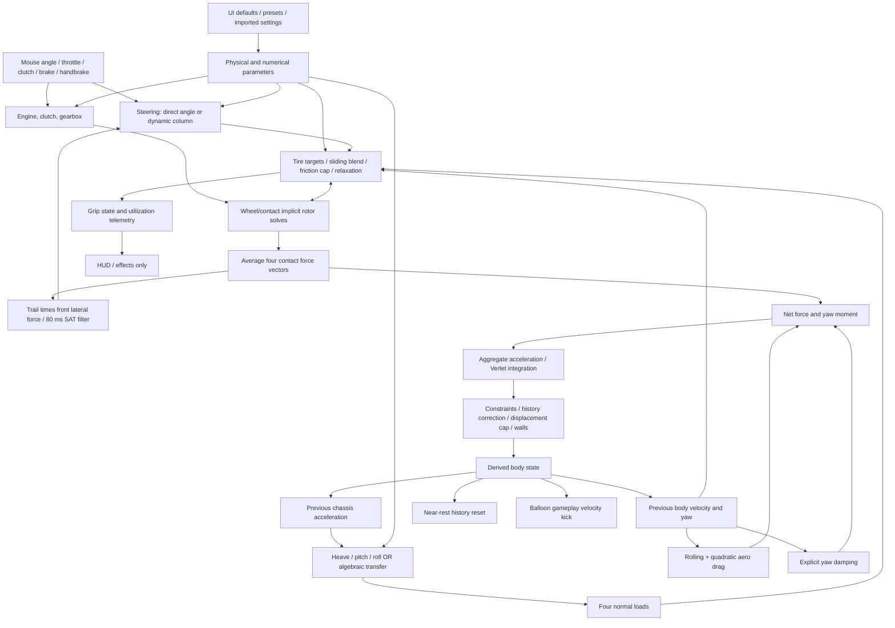
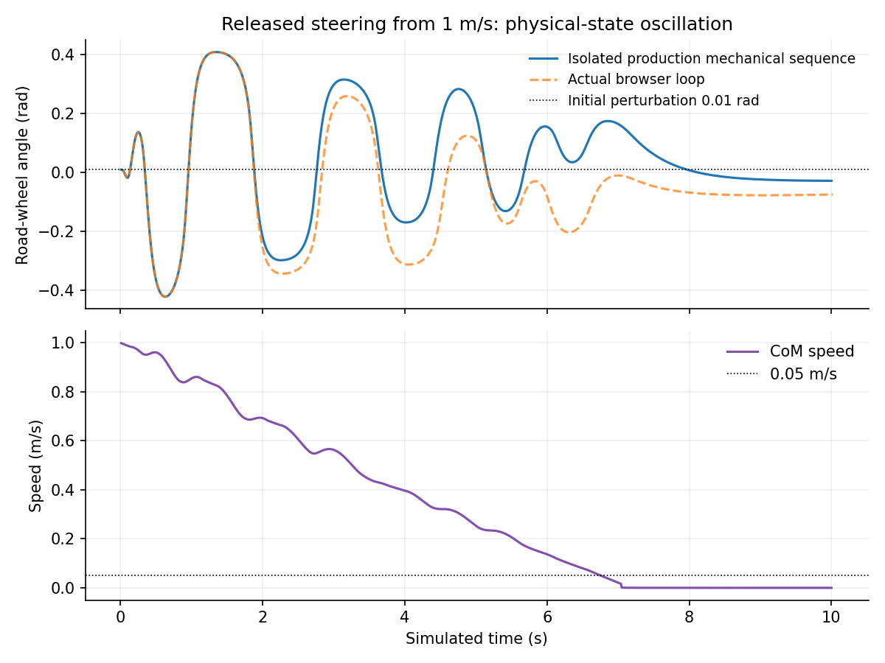
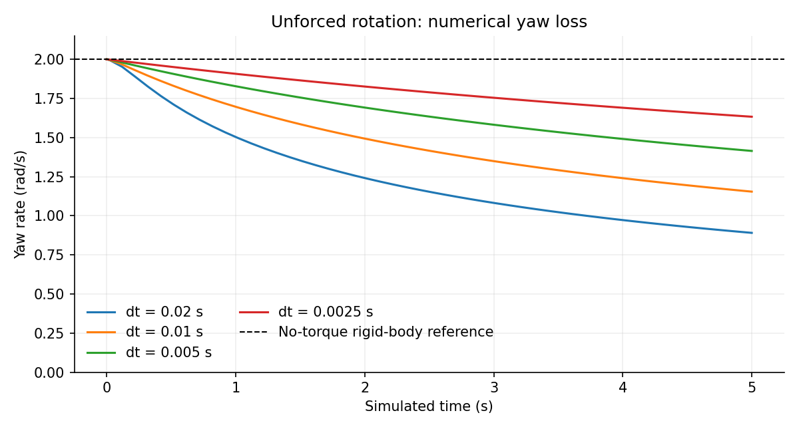

# VerletDrift physics forensics and stability audit

**Investigated revision:** `a3887306c3c83a88466bd5aecb4c3c384841a595` on `verlet_gpt_v35_smoke_airflow`. **Date:** 2026-10-21. **Scope:** vehicle mechanics, their configuration and numerical execution, and telemetry needed to interpret them. Rendering/fluids/audio are examined only at their interface with vehicle state. No production source, parameter default, UI, or existing test was changed.

This report uses **R** for runtime evidence, **S** for a source/analytical finding, and **H** for an unresolved hypothesis. Confidence is independent of priority. Measurements below are from this revision, not the earlier onboarding branch. “Default” means the parameters read from a fresh browser after UI initialization, unless explicitly identified as module defaults. All experiment artifacts are in [this directory](.).

## A. Executive diagnosis

The vehicle is a **hybrid 2.5D approximation**: a planar four-particle constrained chassis; four independent wheel-spin states; one common front steering angle; an engine/clutch model; and a separate three-degree-of-freedom sprung-body model supplying four tire normal loads. It is neither a full 3D rigid-body vehicle nor four independent wheel/suspension assemblies.

The two reported symptoms have substantial mechanical explanations, but the evidence does not support a single universal “stability controller” diagnosis.

| Finding | Evidence and confidence | Consequence | Priority |
|---|---|---|---|
| F1. The unforced planar rotation loses substantial yaw energy, with strong timestep dependence. | **R+S, high.** At initial yaw 2 rad/s, no tire friction/drag/yaw damping, 100 Hz: yaw becomes 1.1544 rad/s after 5 s; body yaw energy falls 66.69%. At 400 Hz it becomes 1.6333 rad/s, a 33.31% energy loss. | Numerical damping exists independently of physical resistance. Constraint/history treatment must be understood before handling is calibrated. | P0 |
| F2. Live timestep changes reinterpret the displacement history as a new velocity. | **R+S, high.** Changing the next step from 0.01 to 0.005 s turns approximately 20 m/s into 39.9987 m/s. | Physics Hz and Time Scale can inject/remove energy merely through a control change. | P0 |
| F3. The tire curve does not have the advertised peak-slip calibration. | **R+S, high.** Default lateral force reaches its friction cap by about 0.15°, although the “Peak Slip Angle” value is 8°. The raw analytic peak is at 0.869°. | Very large small-slip stiffness, a wide clipped plateau, and misleading calibration influence both yaw and steering feedback. | P0/P1 |
| F4. The free steering/SAT loop is unstable in a reproducible low-speed release maneuver. | **R+S, high for the reproduction and causal SAT path.** At 1 m/s, initial steer 0.01 rad, no subsequent input: road-wheel angle grows to 0.4214 rad in the isolated production sequence. The actual browser reaches 0.4211 rad. | The reported near-stationary oscillation has a physical-state reproduction. It is not explained by display sign conventions alone. | P1 |
| F5. A separate Coulomb-friction implementation defect permits chatter at exact standstill for allowed settings. | **R+S, high.** With friction 2 N·m, damping 0.1 N·m·s/rad, initial angle 0.3 rad: 324 angle sign changes and 857 rate sign changes in 10 s at 100 Hz. | Explicit friction is not a proper sticking/zero-crossing solve. This is distinct from the default low-speed SAT instability. | P1 |
| F6. Explicit yaw damping is an additional, substantial stabilizing torque. | **R+S, high.** `−yawDamping × Iz × yawRate`; default 1 s⁻¹. In the low-friction comparison, yaw after 6 s is 0.6086 without it versus 0.01385 rad/s with it. | Stability is partly imposed by an uncalibrated residual damping term. Its effect does not prove that tire recovery is itself wrong. | P1 |
| F7. Drivetrain locking lacks a momentum/energy-consistent transition, and reflected crank inertia is wrong for differential motion. | **S, high; R for synchronization jump.** A frozen-wheel lock probe jumps crank energy by +29.38 kJ with no wheel change. Independent rear-wheel inertia additions resist the differential mode that should not spin the crank. | Gear/clutch transitions and asymmetric wheel response are not a trustworthy mechanical energy model. | P0/P1 |
| F8. Grip-state UI defaults reverse the intended hysteresis. | **R+S, high.** Loss 0.70, recovery 0.85: constant utilization 0.80 alternates stable/slipping each call. | A real diagnostic defect, but these states do **not** modify tire forces. They are not a hidden physical grip-restoration controller. | P3 |
| F9. Suspension has four distinct corner loads but only three vertical generalized coordinates. | **R+S, high.** Compression is derived from heave/pitch/roll, not integrated independently at four wheels. | Shared front/rear coefficients are coherent with this architecture; four extra sliders would not create four independent suspension dynamics. | P2/P3 |
| F10. Contact and low-speed approximations have important scope limits. | **S+R, high for code/probes.** Lateral fade uses center speed; a pivoting body can have 2.408 m/s wheel lateral speed yet zero lateral tire force. Displacement clamp limits history velocity. Balloon impacts add prescribed velocity kicks. | Some apparent resistance/stability is numerical or gameplay behavior; some real contact resistance is absent. | P1/P2 |

**Important negative results:** a fresh browser at exact rest stayed at zero angle/rate/SAT. Ten simulated seconds of exact-rest tests also stayed still. A small steering displacement at rest decayed without sign reversal at defaults. No active direct “align velocity with heading” correction, global lateral-velocity scaler, ABS, or explicit yaw-target controller was found. The legacy body-level brake force is not added in the current main loop. Dynamic suspension and algebraic weight transfer are alternatives, not simultaneous forces.

**What is not established:** the exact parameter/input history of the user's observed event; real-vehicle calibration of tires, trail, inertia or damping; a closed total-energy balance for the entire coupled vehicle including compliant tire energy and clutch transitions; and correctness over every extreme combination of supported controls. The reproduced near-rest instability is a strong explanation, not proof that every visible sign flip has the same cause.

## B. Architecture map

### B1. Actual degrees of freedom and representations

| Component | State/representation | Physical interpretation and limits |
|---|---|---|
| Chassis in plane | Four `(x,y,prevX,prevY)` wheel particles; six distance constraints | Nominal rigid planar pose `(X,Y,ψ)` with velocity encoded in history. Shape errors and history distortions are numerical states, not suspension compliance. |
| Derived chassis cache | Center, heading, linear velocity, yaw rate, accelerations/jerk | Recomputed once at end of mechanical step. Yaw comes from successive current headings, not directly from the adjusted particle histories. |
| Wheel rotation | Four `wheelOmega` values | Independent rotor inertias, tire reaction and braking. No wheel-hop vertical coordinates. |
| Steering | One road-wheel angle and rate; both fronts use that angle | Effective common steering column/rack. No Ackermann, separate kingpins, caster/jacking, compliance steer or toe/camber. |
| Suspension | Heave, pitch, roll and their velocities | Small-angle flat-road sprung-body motion. Four corner compressions are dependent outputs of these three coordinates. |
| Unsprung system | Mass per wheel; algebraic load-transfer terms | Unsprung mass is included in loads and sprung-mass subtraction, not integrated as four vertical masses. |
| Engine | RPM and clutch pedal/engagement/mode | Free crank has inertia; locked crank RPM is overwritten from mean driven-wheel speed. |
| Road/contact | Flat support and nonnegative computed normal loads | No road-height sampling, geometric flight/recontact, vertical tire stiffness, bumps, slopes or rollover contact. |

Primary definitions: [state.js:86](https://github.com/QuantumEther/VerletDrift/blob/a3887306c3c83a88466bd5aecb4c3c384841a595/js/state.js#L86), [state.js:132](https://github.com/QuantumEther/VerletDrift/blob/a3887306c3c83a88466bd5aecb4c3c384841a595/js/state.js#L132), [state.js:336](https://github.com/QuantumEther/VerletDrift/blob/a3887306c3c83a88466bd5aecb4c3c384841a595/js/state.js#L336), [kinematics.js:81](https://github.com/QuantumEther/VerletDrift/blob/a3887306c3c83a88466bd5aecb4c3c384841a595/js/physics/kinematics.js#L81), [suspension.js:49](https://github.com/QuantumEther/VerletDrift/blob/a3887306c3c83a88466bd5aecb4c3c384841a595/js/physics/suspension.js#L49).

### B2. Authoritative step order

[main.js:552](https://github.com/QuantumEther/VerletDrift/blob/a3887306c3c83a88466bd5aecb4c3c384841a595/js/main.js#L552) executes:

1. Ramp handbrake pressure: 0.25 s application, 0.15 s release.
2. `updateSteering(dt)` using the **previous step's filtered SAT** and chassis speed.
3. `updateEngine(dt)` using previous wheel speeds and engine state.
4. `updateSuspension(dt)` using **previous chassis acceleration**, internally substepped to at most 1 ms; or exclusive algebraic transfer if disabled.
5. `computeTireForces(dt)`: current steering, cached body velocities/yaw, new loads; independent implicit wheel/contact solves; update filtered SAT for next step.
6. Synchronize locked engine RPM to new rear-wheel speeds.
7. Compute global rolling/aerodynamic drag; add tire forces and tire yaw moment; add explicit yaw damping.
8. Convert aggregate forces/torques to accelerations; advance all particles with position Verlet.
9. Six-distance constraint solver; displacement-history cap; boundary collision response; second constraint solver.
10. Derive body pose/velocity/yaw/acceleration; apply near-rest sleep by resetting histories.
11. Camera/effects, then balloon collisions that **can change vehicle velocity/history after derivation**; diagnostics.

The old comment calling for a pre-force `computeBodyDerivedState` is obsolete. The active loop deliberately omits it; calling that function repeatedly without moving the particles would erase heading-change yaw and acceleration. The isolated experiments use the actual executable main-loop prefix through sleep, rather than the older comparison script's slightly different sequence.

### B3. Dependency map



**Key shared quantities:** tire force and yaw damping both affect yaw; SAT, fallback spring, friction and driver authority all affect steering; springs/dampers/bars/geometric transfer all contribute to corner support; constraints, clamps, collisions, sleep and balloons change histories. That overlap is a map for testing, not in itself evidence of double-counting.

## C. Complete physics parameter inventory

The following inventory covers every vehicle-physics parameter consumed by the inspected mechanical path, the input/timing controls, and relevant hidden coefficients. Camera, fluid, sound and cosmetic controls are excluded except the balloon contact mechanism and misleading physical telemetry. Parameter defaults were captured from the running browser in [browser-defaults.json](browser-defaults.json). Raw control metadata is in [controls.json](controls.json); that raw discovery file intentionally includes some subsequently excluded visual candidates.

Classification: **A** physical configuration; **B** derived quantity; **C** dynamic state; **D** diagnostic; **E** numerical setting; **F** intentional/nonphysical control or assistance. “Physical basis” describes the intended relationship, not empirical validation.

### C1. Vehicle, tire, resistance and numerical controls

| Parameter (live default) | Source | Physical basis | Implementation | Dependencies | Assessment | Recommendation |
|---|---|---|---|---|---|---|
| Mass `carMassKg` (1200 kg) | [state:453](https://github.com/QuantumEther/VerletDrift/blob/a3887306c3c83a88466bd5aecb4c3c384841a595/js/state.js#L453), [main:600](https://github.com/QuantumEther/VerletDrift/blob/a3887306c3c83a88466bd5aecb4c3c384841a595/js/main.js#L600) | A, inertial mass | Divides aggregate force; determines plate yaw inertia and static/reference loads | Geometry, unsprung mass, suspension, grip | Legitimate; static distribution fixed 50/50 | Expose; configure longitudinal CoG separately if asymmetry is intended |
| Tire Friction `tireFrictionCoeff` (1) | [tires:158](https://github.com/QuantumEther/VerletDrift/blob/a3887306c3c83a88466bd5aecb4c3c384841a595/js/physics/tires.js#L158) | A, peak contact coefficient | Multiplies load-sensitive force bound | Normal load, tire curve, sliding ratio | Meaningful calibration; no surface map or water feedback | Expose; separate tire/surface data when adding surfaces |
| Sliding Grip `tireSlidingFrictionRatio` (0.85, displayed 85%) | [tires:283](https://github.com/QuantumEther/VerletDrift/blob/a3887306c3c83a88466bd5aecb4c3c384841a595/js/physics/tires.js#L283) | A, kinetic/peak ratio | Smoothly blends toward slip-velocity-directed force as longitudinal slip approaches lock/spin | Slip ratio, patch velocity, peak ratio | Valid empirical form; does not set pure lateral sliding asymptote | Expose with accurate scope; calibrate jointly with lateral curve |
| Tire Load Sensitivity (0.12) | [tire-load:3](https://github.com/QuantumEther/VerletDrift/blob/a3887306c3c83a88466bd5aecb4c3c384841a595/js/physics/tire-load.js#L3) | A, sublinear load/grip relationship | `μ N (N/Nref)^(-s)` with multiplier bounds 0.5–1.5 | Reference `mg/4`, transfer | Coherent approximation; not fitted tire data | Expose or Advanced; specify load range |
| Peak Slip Angle (8°) | [tires:58](https://github.com/QuantumEther/VerletDrift/blob/a3887306c3c83a88466bd5aecb4c3c384841a595/js/physics/tires.js#L58), [tires:133](https://github.com/QuantumEther/VerletDrift/blob/a3887306c3c83a88466bd5aecb4c3c384841a595/js/physics/tires.js#L133) | A, intended curve scale | Divides slip, then multiplies normalized slip by B; force divided by value at normalized slip 1 | B,C, friction cap, SAT | F3: not actual raw peak or saturation onset | Correct calibration/label before tuning |
| Peak Slip Ratio (0.12) | [tires:245](https://github.com/QuantumEther/VerletDrift/blob/a3887306c3c83a88466bd5aecb4c3c384841a595/js/physics/tires.js#L245) | A, intended longitudinal scale | Same miscalibrated curve; also sliding-blend start | Rotor speed, B,C, sliding ratio | Two roles with inconsistent “peak” meaning | Consolidate coherent curve and sliding transition definition |
| Pacejka B (10) | [tires:58](https://github.com/QuantumEther/VerletDrift/blob/a3887306c3c83a88466bd5aecb4c3c384841a595/js/physics/tires.js#L58) | A, empirical stiffness factor | Controls slope and peak together with supplied slip scale | C and normalized amplitude | Extremely stiff default after normalization | Advanced; fit curve rather than independently tuning redundant scales |
| Pacejka C (1.9) | [tires:58](https://github.com/QuantumEther/VerletDrift/blob/a3887306c3c83a88466bd5aecb4c3c384841a595/js/physics/tires.js#L58) | A, empirical shape | `sin(C atan(...))`; denominator `sin(C atan B)` | B, allowed UI range to 3 | Allowed values can zero the whole rolling curve (F11 in D1) | Restrict/validate valid model domain after choosing parameterization |
| Relax Length (0.3 m) | [tires:256](https://github.com/QuantumEther/VerletDrift/blob/a3887306c3c83a88466bd5aecb4c3c384841a595/js/physics/tires.js#L256) | A, tire transient distance | Time constant `length/max(abs(vLong),0.5)`; floor 0.02 m | Rotor solve; 25 ms input filter; SAT filter | Physical motivation, but aggregate lag not calibrated | Advanced; preserve one interpretable transient model |
| Wheel Radius (0.35 m) | [tires:238](https://github.com/QuantumEther/VerletDrift/blob/a3887306c3c83a88466bd5aecb4c3c384841a595/js/physics/tires.js#L238), [suspension:84](https://github.com/QuantumEther/VerletDrift/blob/a3887306c3c83a88466bd5aecb4c3c384841a595/js/physics/suspension.js#L84) | A, effective rolling radius | Torque/force, slip, crank coupling; also unsprung transfer height | Wheel inertia, gearing, sprung CoG calculation | Shared radius differs from separate visual tire geometry | Expose, distinguish effective physical radius from artwork |
| Wheel Inertia (1.2 kg·m² each) | [tires:145](https://github.com/QuantumEther/VerletDrift/blob/a3887306c3c83a88466bd5aecb4c3c384841a595/js/physics/tires.js#L145) | A, rotor inertia | Four independent contact solves | Reflected engine inertia, brakes | Good explicit state; must repair locked differential coupling | Expose/Advanced |
| Roll Resist. (0.012) | [tires:511](https://github.com/QuantumEther/VerletDrift/blob/a3887306c3c83a88466bd5aecb4c3c384841a595/js/physics/tires.js#L511) | A, empirical rolling resistance | Constant `Crr mg` opposite total body velocity above 0.001 m/s | Speed, mass | Reasonable straight-line approximation; also resists sideways sliding and acts without load/contact check | Preserve with clearly stated scope; refine per rolling contact if needed |
| Aero Drag (0.4 N·s²/m²) | [tires:517](https://github.com/QuantumEther/VerletDrift/blob/a3887306c3c83a88466bd5aecb4c3c384841a595/js/physics/tires.js#L517) | A, aggregate `ρ Cd A/2` | Quadratic speed drag, at CoM | Body speed | Dimensioned coefficient, not dimensionless Cd; no yaw aero moment/downforce/wind | Expose with correct units; do not infer airflow shader feedback |
| Yaw Damping (1 s⁻¹) | [main:591](https://github.com/QuantumEther/VerletDrift/blob/a3887306c3c83a88466bd5aecb4c3c384841a595/js/main.js#L591) | F or calibrated residual resistance | `τ=−d Iz ω` | Current yaw, chosen Iz | Correct dimensions, no empirical basis or source decomposition supplied | Advanced / explicitly labeled assistance until calibrated |
| Brake Force (9810 N nominal rim-force sum) | [tires:69](https://github.com/QuantumEther/VerletDrift/blob/a3887306c3c83a88466bd5aecb4c3c384841a595/js/physics/tires.js#L69) | A, brake torque capacity expressed as force | 40% each front, 10% each rear, times radius | Rotor/contact solve, load/friction | Capacity, not guaranteed chassis deceleration | Expose as capacity; expose front bias if needed |
| Bounciness (0.3) | [constraints:144](https://github.com/QuantumEther/VerletDrift/blob/a3887306c3c83a88466bd5aecb4c3c384841a595/js/physics/constraints.js#L144) | A/approximation, wall restitution | Reflect normal particle history independently | Map dimensions, constraint reprojection | No mass/inertia-consistent whole-body contact solve | Advanced; collision validation needed |
| Constraint Iters (6 per pass, two passes) | [constraints:92](https://github.com/QuantumEther/VerletDrift/blob/a3887306c3c83a88466bd5aecb4c3c384841a595/js/physics/constraints.js#L92) | E | Rounded/clamped 1–12; cap 8 in determinism mode | Geometry, solver order | Not a vehicle property; old comments/state default 12 differ from live 6 | Advanced |
| Constraint Damp (0.8) | [constraints:64](https://github.com/QuantumEther/VerletDrift/blob/a3887306c3c83a88466bd5aecb4c3c384841a595/js/physics/constraints.js#L64) | E, history correction | Fraction of pair correction also added to previous positions; floor 0.05 even at UI zero | Timestep, rotation, constraints | F1: large numerical effect; not physical damper | Advanced; replace with validated history/velocity treatment after investigation |
| Physics Hz (100) | [main:436](https://github.com/QuantumEther/VerletDrift/blob/a3887306c3c83a88466bd5aecb4c3c384841a595/js/main.js#L436) | E | Wall tick `1/Hz`, sim dt divided by Hz | Time Scale, Verlet history | Live change violates history timestep assumption | Advanced; fix transition and test convergence |
| Time Scale (1; UI 0.1–3) | [main:456](https://github.com/QuantumEther/VerletDrift/blob/a3887306c3c83a88466bd5aecb4c3c384841a595/js/main.js#L456) | E | Multiplies integration dt, not wall tick cadence | All integrators, displacement cap | Also changes accuracy and caps; live change causes F2 | Retain slow-motion feature with coherent history policy |
| Max Substeps/Frame (6) | [main:445](https://github.com/QuantumEther/VerletDrift/blob/a3887306c3c83a88466bd5aecb4c3c384841a595/js/main.js#L445) | E, scheduling budget | Caps ticks, discards full remaining backlog | Renderer load, wall clock | Not a smaller mechanical dt; can slow sim relative to wall input timing | Advanced; record dropped ticks in reproducibility metadata |
| Map Width / Height (300 / 240 m) | [constraints:148](https://github.com/QuantumEther/VerletDrift/blob/a3887306c3c83a88466bd5aecb4c3c384841a595/js/physics/constraints.js#L148) | A, boundary geometry | Axis-aligned particle boundary | Rest shape, contact restitution | Shrinking map can create arbitrary contact corrections | Expose as world configuration; isolate walls in free tests |

### C2. Steering and suspension controls

| Parameter (live default) | Source | Physical basis | Implementation | Dependencies | Assessment | Recommendation |
|---|---|---|---|---|---|---|
| Self Center Rate (5) | [steering:100](https://github.com/QuantumEther/VerletDrift/blob/a3887306c3c83a88466bd5aecb4c3c384841a595/js/physics/steering.js#L100) | F / possible low-speed restoring approximation | `−δ I rate (1−clamp(v/3))`; units of rate are s⁻² | Column inertia, speed, SAT | Intentional extra spring below 3 m/s; not measured caster torque | Advanced; name as fallback natural-frequency-squared or define actual spring |
| Column Inertia (0.08 kg·m²) | [steering:83](https://github.com/QuantumEther/VerletDrift/blob/a3887306c3c83a88466bd5aecb4c3c384841a595/js/physics/steering.js#L83) | A, effective inertia at road-wheel coordinate | Divides explicit torque; changes fallback spring too | Damping, SAT, lock stops | Plausible effective parameter; needs common coordinate calibration | Expose/Advanced |
| Viscous Damp (5.5 N·m·s/rad) | [steering:130](https://github.com/QuantumEther/VerletDrift/blob/a3887306c3c83a88466bd5aecb4c3c384841a595/js/physics/steering.js#L130) | A, mechanical damping | Backward/implicit viscous term only | I, dt, lagged SAT | Helps local integration; does not guarantee feedback-loop stability | Expose/Advanced, validate dynamic loop |
| Coulomb Friction (0.05 N·m) | [steering:107](https://github.com/QuantumEther/VerletDrift/blob/a3887306c3c83a88466bd5aecb4c3c384841a595/js/physics/steering.js#L107) | A, dry friction intention | Thresholded sign torque with conditional omission; no sticking solve | Rate threshold 0.01, dt, I, viscous term | F5; wrong zero-crossing behavior for allowed settings | Correct friction complementarity/projection before calibrating |
| Pneumatic Trail (0.035 m) | [tires:475](https://github.com/QuantumEther/VerletDrift/blob/a3887306c3c83a88466bd5aecb4c3c384841a595/js/physics/tires.js#L475) | A, empirical aligning-moment arm | `t0 exp(−abs(α)/(π/12))`; times front force, then 80 ms filter | Tire curve, filtered slip, steering loop | Sign locally restoring; magnitude/transients unvalidated | Preserve concept; calibrate Mz and loop consistently |
| Max Steer (0.52 rad) | [steering:135](https://github.com/QuantumEther/VerletDrift/blob/a3887306c3c83a88466bd5aecb4c3c384841a595/js/physics/steering.js#L135) | A, mechanical limit | Clips angle; zeros outward rate | Driver mapping, column | Legitimate ideal hard stop, dissipates steering energy | Expose; account stop work |
| Steer Drag Range (150 screen px) | [input:203](https://github.com/QuantumEther/VerletDrift/blob/a3887306c3c83a88466bd5aecb4c3c384841a595/js/input.js#L203) | Input mapping | Pixel displacement to visual wheel ±2.5π to road-wheel lock | Max steer, event timing | Not mechanical steering geometry or torque | Input settings |
| Dynamic suspension (on) | [suspension:49](https://github.com/QuantumEther/VerletDrift/blob/a3887306c3c83a88466bd5aecb4c3c384841a595/js/physics/suspension.js#L49) | Model choice | Three-DOF suspension versus algebraic transfer | Reset, normal loads | Exclusive paths; no double-counting between them | Advanced A/B diagnostic |
| Front / Rear Spring (35000 / 35000 N/m per corner) | [suspension:67](https://github.com/QuantumEther/VerletDrift/blob/a3887306c3c83a88466bd5aecb4c3c384841a595/js/physics/suspension.js#L67) | A, wheel rate | Shared coefficient per axle, four force calculations | Sprung mass, heave/pitch/roll, travel stops | Appropriate shared tuning; no extra motion ratio | Expose; add per-corner override only for asymmetric vehicle use |
| Front / Rear Damper (2500 / 2500 N·s/m per corner) | [suspension:68](https://github.com/QuantumEther/VerletDrift/blob/a3887306c3c83a88466bd5aecb4c3c384841a595/js/physics/suspension.js#L68) | A, linear wheel damping | Force on derived corner compression velocity | Same three generalized states | Linear symmetric compression/rebound approximation | Expose; separate bump/rebound only when fidelity requires |
| CoG Height (0.5 m) | [suspension:18](https://github.com/QuantumEther/VerletDrift/blob/a3887306c3c83a88466bd5aecb4c3c384841a595/js/physics/suspension.js#L18), [weight:43](https://github.com/QuantumEther/VerletDrift/blob/a3887306c3c83a88466bd5aecb4c3c384841a595/js/physics/weight.js#L43) | A, whole-vehicle geometry | Used to derive sprung height or algebraic transfer | Unsprung mass/radius, roll centers | Meaningful; clamped effective height can diverge at extreme values | Expose, validate combinations |
| Front / Rear Bar (12000 / 8000 N·m/rad per axle) | [suspension:69](https://github.com/QuantumEther/VerletDrift/blob/a3887306c3c83a88466bd5aecb4c3c384841a595/js/physics/suspension.js#L69) | A, axle roll stiffness | Equal/opposite corner support proportional to common roll | Track width, corner loads | Correct axle roll-moment scaling in small-angle contact regime | Expose; preserve load-sensitive tire dependency |
| Grip Loss / Recovery (0.70 / 0.85) | [tires:345](https://github.com/QuantumEther/VerletDrift/blob/a3887306c3c83a88466bd5aecb4c3c384841a595/js/physics/tires.js#L345), [controls:22](https://github.com/QuantumEther/VerletDrift/blob/a3887306c3c83a88466bd5aecb4c3c384841a595/js/ui/controls.js#L22) | D, state classifier | Stable exits above loss, slipping exits below recovery | Target utilization | F8: inverted hysteresis, UI enforces wrong ordering for these predicates | Consolidate as diagnostics; correct ordering/meaning |
| EMA Alpha Stable / Slip (0.15 / 0.35 per tick) | [tires:362](https://github.com/QuantumEther/VerletDrift/blob/a3887306c3c83a88466bd5aecb4c3c384841a595/js/physics/tires.js#L362) | D, smoothing | Filters utilization into `smoothedGrip` | Grip classifier, tick frequency | No force feedback; timestep-dependent display smoothing | Read-only diagnostic settings; use time constant if needed |

### C3. Engine, clutch, transmission and gameplay inputs

| Parameter (live default) | Source | Physical basis | Implementation | Dependencies | Assessment | Recommendation |
|---|---|---|---|---|---|---|
| Peak Torque (350 N·m) | [engine:153](https://github.com/QuantumEther/VerletDrift/blob/a3887306c3c83a88466bd5aecb4c3c384841a595/js/physics/engine.js#L153) | A, engine calibration | Parabolic RPM curve times throttle; also scales friction/clutch/governor | RPM, redline-idle range, fixed peak RPM | Multiple physical roles tied to one value | Expose; decouple engine map, clutch capacity and losses when calibrating |
| Idle RPM (800) | [engine:165](https://github.com/QuantumEther/VerletDrift/blob/a3887306c3c83a88466bd5aecb4c3c384841a595/js/physics/engine.js#L165) | A, controller setpoint | Governor torque proportional to RPM error with capacity limit | Crank inertia, gear, idle creep | An explicit engine controller, legitimate if modeled as fuel input | Expose |
| Redline RPM (7000 live; 9000 module) | [engine:174](https://github.com/QuantumEther/VerletDrift/blob/a3887306c3c83a88466bd5aecb4c3c384841a595/js/physics/engine.js#L174) | A, fuel-cut threshold | Stops combustion/rev-match torque; does not clamp wheel-driven RPM | Torque curve normalization, actual RPM | Useful overspeed visibility; timestep lag possible | Expose; unify defaults |
| Stall RPM (600) | [engine:201](https://github.com/QuantumEther/VerletDrift/blob/a3887306c3c83a88466bd5aecb4c3c384841a595/js/physics/engine.js#L201) | A/empirical engine behavior | Compared to scaled threshold at speed <0.5, throttle <0.05, engagement >0.01 | Stall resistance | Binary approximation; snaps crank RPM to zero | Expose/Advanced with event energy accounting |
| Stall Resist. (0.5 live) | [engine:201](https://github.com/QuantumEther/VerletDrift/blob/a3887306c3c83a88466bd5aecb4c3c384841a595/js/physics/engine.js#L201) | F, stall assistance | Threshold multiplier `1−0.8 resistance` | Stall RPM | Intentional assistance, not torque or inertia | Label assistance; optional training policy |
| Idle Creep (200 N nominal wheel effort) | [engine:161](https://github.com/QuantumEther/VerletDrift/blob/a3887306c3c83a88466bd5aecb4c3c384841a595/js/physics/engine.js#L161) | Engine idle control calibration | Caps locked governor effort through gear/radius conversion | Friction, gear, clutch mode | Not a second wheel motor; disconnected governor has different cap | Expose/Advanced |
| Engine inertia (0.25 kg·m²; hidden) | [engine:155](https://github.com/QuantumEther/VerletDrift/blob/a3887306c3c83a88466bd5aecb4c3c384841a595/js/physics/engine.js#L155), [tires:146](https://github.com/QuantumEther/VerletDrift/blob/a3887306c3c83a88466bd5aecb4c3c384841a595/js/physics/tires.js#L146) | A | Free crank integration or reflected rear rotor inertia | Lock mode, gear ratio squared | Physical parameter; F7 coupling defect | Expose in advanced engine setup after coupling correction |
| Gear ratios 1–6 (3.5, 2.1, 1.4, 1.0, 0.75, 0.58) | [engine:28](https://github.com/QuantumEther/VerletDrift/blob/a3887306c3c83a88466bd5aecb4c3c384841a595/js/physics/engine.js#L28), [state:517](https://github.com/QuantumEther/VerletDrift/blob/a3887306c3c83a88466bd5aecb4c3c384841a595/js/state.js#L517) | A, gearbox geometry | Torque multiplication and mean-shaft RPM mapping | Final drive, clutch, inertia | Ratios valid; gear transition not mechanically synchronized | Expose all six; repair shift work/impulses |
| Final Drive (4.1) | [tires:117](https://github.com/QuantumEther/VerletDrift/blob/a3887306c3c83a88466bd5aecb4c3c384841a595/js/physics/tires.js#L117) | A | Multiplies gear and reflected inertia squared | Gear/radius | Standard role | Expose |
| Reverse ratio (hidden: negative first ratio) | [engine:30](https://github.com/QuantumEther/VerletDrift/blob/a3887306c3c83a88466bd5aecb4c3c384841a595/js/physics/engine.js#L30) | A | `−gearRatio1`; legacy constant says −3.0 but is bypassed | First gear | Two definitions, active one unambiguously follows first | Expose separate reverse ratio or document linkage; remove obsolete constant |
| Bite Point / Slip Zone / Bite Sharpness (0.35 / 0.20 / 2.5) | [engine:64](https://github.com/QuantumEther/VerletDrift/blob/a3887306c3c83a88466bd5aecb4c3c384841a595/js/physics/engine.js#L64) | Input-to-capacity calibration | Pedal power curve; capacity = peak torque × engagement | Pedal, clutch-slip speed | Meaningful pedal mapping; end-of-zone combinations can exceed pedal range | Advanced; validate bitePoint + range and lock transition |
| Engage Time (0.30 s) | [engine:105](https://github.com/QuantumEther/VerletDrift/blob/a3887306c3c83a88466bd5aecb4c3c384841a595/js/physics/engine.js#L105) | Input actuation | Symmetric pedal slew rate ±1/time | Clutch key | No separate release/application times | Input/Advanced |
| Automatic rev match (hidden, 0.2 s) | [engine:144](https://github.com/QuantumEther/VerletDrift/blob/a3887306c3c83a88466bd5aecb4c3c384841a595/js/physics/engine.js#L144), [engine:243](https://github.com/QuantumEther/VerletDrift/blob/a3887306c3c83a88466bd5aecb4c3c384841a595/js/physics/engine.js#L243) | F, driver assistance | Positive torque blip on downshift; target from total speed | New gear, redline, engine inertia | Uncommanded assistance; total speed is wrong proxy in sideslip | Expose enable/policy; base target on relevant shaft kinematics |
| Throttle / brake / clutch / handbrake input | [input:101](https://github.com/QuantumEther/VerletDrift/blob/a3887306c3c83a88466bd5aecb4c3c384841a595/js/input.js#L101), [main:553](https://github.com/QuantumEther/VerletDrift/blob/a3887306c3c83a88466bd5aecb4c3c384841a595/js/main.js#L553) | Driver controls | Binary keyboard; analog mouse throttle; handbrake ramp | Engine/rotor/steering path | Explicit input state; no hidden yaw controller here | Preserve; log exact event times for AI replay |
| Balloon count/respawn (240 / 0.5 s⁻¹) | [main:916](https://github.com/QuantumEther/VerletDrift/blob/a3887306c3c83a88466bd5aecb4c3c384841a595/js/main.js#L916), [balloon:209](https://github.com/QuantumEther/VerletDrift/blob/a3887306c3c83a88466bd5aecb4c3c384841a595/js/balloon.js#L209) | F, world/gameplay | Creates collision opportunities; velocity kick on hit | RNG, spawn positions, contact speed | Visual gameplay object feeds mechanics | Separate mechanical-contact policy; disable in controlled vehicle tests |

### C4. Hidden coefficients, derived quantities and dynamic states

| Parameter / quantity | Source | Physical basis / implementation | Dependencies | Assessment | Recommendation |
|---|---|---|---|---|---|
| Half wheelbase 1.204 m, half track 0.7945 m; six rest lengths | [constants:39](https://github.com/QuantumEther/VerletDrift/blob/a3887306c3c83a88466bd5aecb4c3c384841a595/js/constants.js#L39) | A/B, mean front/rear track, rectangular chassis | Constraint geometry, yaw/suspension inertia | Geometry is meaningful; front/rear track difference collapsed | Expose vehicle geometry; derive distances |
| `Iz=m(L²+W²)/3` (832.3385 kg·m² at defaults) | [main:601](https://github.com/QuantumEther/VerletDrift/blob/a3887306c3c83a88466bd5aecb4c3c384841a595/js/main.js#L601) | B, uniform plate over contact rectangle | Mass and axle geometry | Plausible approximation, not measured chassis inertia; differs from literal four-corner point masses | Advanced measured-inertia override, or documented derivation |
| Gravity 9.81 m/s² | [constants:69](https://github.com/QuantumEther/VerletDrift/blob/a3887306c3c83a88466bd5aecb4c3c384841a595/js/constants.js#L69) | A/world constant | Loads, heave, acceleration caps | SI-consistent | Keep Internal/world setting |
| Static mass distribution 50/50, equal left/right | [weight:39](https://github.com/QuantumEther/VerletDrift/blob/a3887306c3c83a88466bd5aecb4c3c384841a595/js/physics/weight.js#L39), [suspension:71](https://github.com/QuantumEther/VerletDrift/blob/a3887306c3c83a88466bd5aecb4c3c384841a595/js/physics/suspension.js#L71) | Model assumption | Normal loads, CoM, all moment arms | Cannot represent rear-heavy/front-heavy vehicle through mass slider alone | Expose CoG position only with matching force geometry and statics |
| Unsprung mass 35 kg/corner; clamp to m/8 | [suspension:15](https://github.com/QuantumEther/VerletDrift/blob/a3887306c3c83a88466bd5aecb4c3c384841a595/js/physics/suspension.js#L15) | A, flat-road algebraic approximation | Sprung mass/height, load transfer | No independent unsprung motion | Advanced; validate mass combinations |
| Roll centers front/rear 0.08 / 0.12 m | [state:464](https://github.com/QuantumEther/VerletDrift/blob/a3887306c3c83a88466bd5aecb4c3c384841a595/js/state.js#L464), [suspension:22](https://github.com/QuantumEther/VerletDrift/blob/a3887306c3c83a88466bd5aecb4c3c384841a595/js/physics/suspension.js#L22) | A, geometry estimate; clamped [0,sprung height] | Immediate lateral transfer, roll equilibrium | Important hidden physical configuration | Advanced |
| Bump/droop travel 0.08 / 0.10 m | [suspension:75](https://github.com/QuantumEther/VerletDrift/blob/a3887306c3c83a88466bd5aecb4c3c384841a595/js/physics/suspension.js#L75) | A, displacement relative to ride height | Spring force beyond travel | Soft additional linear stop, not hard positional limit or actual wheel travel constraint | Advanced; report stop force/compression |
| Extra stop rate 4k; minimum spring 1000 N/m; mass floor 100 kg | [suspension:15](https://github.com/QuantumEther/VerletDrift/blob/a3887306c3c83a88466bd5aecb4c3c384841a595/js/physics/suspension.js#L15), [suspension:67](https://github.com/QuantumEther/VerletDrift/blob/a3887306c3c83a88466bd5aecb4c3c384841a595/js/physics/suspension.js#L67) | A approximation / E guards | Extreme settings and contact | Stop called “progressive” but piecewise linear | Advanced stop calibration; keep validity guards internal |
| Pitch/roll inertia uses sprung mass and fixed 0.25 m half-height | [suspension:26](https://github.com/QuantumEther/VerletDrift/blob/a3887306c3c83a88466bd5aecb4c3c384841a595/js/physics/suspension.js#L26) | B, box/plate approximation | Body geometry | Separate vertical model inertia; no 3D tensor coupling | Advanced measured values; keep derived by default |
| Suspension internal dt ≤0.001 s; acceleration input clamp ±2g | [suspension:59](https://github.com/QuantumEther/VerletDrift/blob/a3887306c3c83a88466bd5aecb4c3c384841a595/js/physics/suspension.js#L59) | E | Corner loads | Stabilization and fidelity limits, not springs or road properties | Keep Internal with diagnostics for cap activation |
| Algebraic transfer clamps to nonnegative axle/corner loads | [weight:51](https://github.com/QuantumEther/VerletDrift/blob/a3887306c3c83a88466bd5aecb4c3c384841a595/js/physics/weight.js#L51) | Approximation / E | Extreme accelerations | Conserves total mg but limits both axles by lighter axle; cannot model general one-wheel lift | Keep Internal/diagnose; use dynamic path for intended fidelity |
| Lateral-velocity EMA 25 ms | [tires:208](https://github.com/QuantumEther/VerletDrift/blob/a3887306c3c83a88466bd5aecb4c3c384841a595/js/physics/tires.js#L208) | E/noise filter | Slip angle, force, SAT | Additional lag before tire relaxation | Consolidate only after closed-loop analysis |
| Slip speed floors 0.5 m/s; ratio clamp ±1 | [tires:217](https://github.com/QuantumEther/VerletDrift/blob/a3887306c3c83a88466bd5aecb4c3c384841a595/js/physics/tires.js#L217), [tires:239](https://github.com/QuantumEther/VerletDrift/blob/a3887306c3c83a88466bd5aecb4c3c384841a595/js/physics/tires.js#L239) | E/regularization | Low-speed angle/ratio | Removes singularity; modifies low-speed model and opposite-rotation slips | Keep Internal but expose diagnostics for regime |
| Lateral fade below center speed 2 m/s | [tires:232](https://github.com/QuantumEther/VerletDrift/blob/a3887306c3c83a88466bd5aecb4c3c384841a595/js/physics/tires.js#L232) | E, zero-speed regularization | Total CoM speed, not contact speed | Incorrectly suppresses pivot contact (F10) | Replace with validated low-speed contact formulation, not extra slider |
| Load-sensitivity multiplier bounds 0.5–1.5; sensitivity bound 0–0.3 | [tire-load:5](https://github.com/QuantumEther/VerletDrift/blob/a3887306c3c83a88466bd5aecb4c3c384841a595/js/physics/tire-load.js#L5) | Empirical extrapolation guards | Peak bound | Reasonable bounded approximation if documented | Keep Internal / calibration metadata |
| Trail decay angle π/12; SAT filter 80 ms | [tires:478](https://github.com/QuantumEther/VerletDrift/blob/a3887306c3c83a88466bd5aecb4c3c384841a595/js/physics/tires.js#L478), [tires:500](https://github.com/QuantumEther/VerletDrift/blob/a3887306c3c83a88466bd5aecb4c3c384841a595/js/physics/tires.js#L500) | A empirical trail / E filter | Slip/SAT loop | Major hidden loop parameters | Advanced identification tools, then consolidate with tire transient model |
| Coulomb rate gate 0.01 rad/s; torque comparison factor 2 | [steering:110](https://github.com/QuantumEther/VerletDrift/blob/a3887306c3c83a88466bd5aecb4c3c384841a595/js/physics/steering.js#L110) | E/ad hoc | Friction switching | No physical sticking justification | Replace in future friction correction |
| Low-speed spring fade over 0–3 m/s | [steering:100](https://github.com/QuantumEther/VerletDrift/blob/a3887306c3c83a88466bd5aecb4c3c384841a595/js/physics/steering.js#L100) | F/approximation | SAT and fallback spring overlap | Not proved redundant; distinct purpose but no calibration | Advanced model policy |
| Visual range ±2.5π; throttle drag 120 px | [input:49](https://github.com/QuantumEther/VerletDrift/blob/a3887306c3c83a88466bd5aecb4c3c384841a595/js/input.js#L49) | Input/display mapping | HUD, driver input | Visual wheel amplifies road-wheel rotation ~15.10× at default lock | Keep Input settings; separate telemetry units |
| Service brake bias 80/20; rear handbrake 0.5 brakeForce each | [tires:73](https://github.com/QuantumEther/VerletDrift/blob/a3887306c3c83a88466bd5aecb4c3c384841a595/js/physics/tires.js#L73) | A, brake configuration | Front/rear load and lockup | Physically meaningful hidden distribution | Expose front bias and separate handbrake capacity |
| Wheel root solve 40 bisections; adaptive tolerances and depth 12 | [wheel:46](https://github.com/QuantumEther/VerletDrift/blob/a3887306c3c83a88466bd5aecb4c3c384841a595/js/physics/wheel.js#L46), [wheel:90](https://github.com/QuantumEther/VerletDrift/blob/a3887306c3c83a88466bd5aecb4c3c384841a595/js/physics/wheel.js#L90) | E | Rotor/relaxation stability | Good bounded numerical solve; nonmonotone force may admit multiple roots; depth failure throws | Keep Internal, add convergence/branch diagnostics |
| Crank torque peak 4500 RPM; parabola factor 2.5 | [engine:42](https://github.com/QuantumEther/VerletDrift/blob/a3887306c3c83a88466bd5aecb4c3c384841a595/js/physics/engine.js#L42) | A empirical engine map | Idle/redline normalization | Not measured engine curve; peak can lie outside chosen range | Advanced engine map |
| Engine friction `0.035 Tpeak + 0.01 Ωe`; governor gain 0.05 N·m/RPM | [engine:158](https://github.com/QuantumEther/VerletDrift/blob/a3887306c3c83a88466bd5aecb4c3c384841a595/js/physics/engine.js#L158) | A empirical loss/controller | Torque scale and RPM | Credible roles, uncalibrated constants | Advanced separate loss/governor definition |
| Clutch capacity `Tpeak × engagement`; viscous slip gain `Tpeak/100` | [engine:191](https://github.com/QuantumEther/VerletDrift/blob/a3887306c3c83a88466bd5aecb4c3c384841a595/js/physics/engine.js#L191) | A clutch approximation | Engine peak torque, shaft speed | Capacity improperly inseparable from engine calibration; hard lock >0.99 | Expose capacity; correct coupled lock |
| Rev-match gain 8 s⁻¹, cap 0.5 Tpeak; stall/restart thresholds | [engine:144](https://github.com/QuantumEther/VerletDrift/blob/a3887306c3c83a88466bd5aecb4c3c384841a595/js/physics/engine.js#L144), [engine:133](https://github.com/QuantumEther/VerletDrift/blob/a3887306c3c83a88466bd5aecb4c3c384841a595/js/physics/engine.js#L133) | F/controller and state transitions | Crank speed, gear, throttle/clutch | Energy source and state resets must be logged | Expose policy, keep low-level gains advanced |
| Max particle displacement 0.71505 m/step | [constants:85](https://github.com/QuantumEther/VerletDrift/blob/a3887306c3c83a88466bd5aecb4c3c384841a595/js/constants.js#L85), [constraints:192](https://github.com/QuantumEther/VerletDrift/blob/a3887306c3c83a88466bd5aecb4c3c384841a595/js/physics/constraints.js#L192) | E | dt, translation, rotation | Alters stored velocity, does not undo traveled position; not continuous collision detection | Replace with collision/substep policy; diagnostic activation counter |
| Sleep thresholds 0.02 m/s and 0.02 rad/s | [engine:306](https://github.com/QuantumEther/VerletDrift/blob/a3887306c3c83a88466bd5aecb4c3c384841a595/js/physics/engine.js#L306) | E, settling | Input gate and histories | Small nonphysical energy deletion; incomplete state synchronization | Keep Internal with consistent reset and ledger |
| Frame clamp 0.25 s, tick-drop policy | [main:420](https://github.com/QuantumEther/VerletDrift/blob/a3887306c3c83a88466bd5aecb4c3c384841a595/js/main.js#L420) | E | Real-time scheduling | Does not directly damp one step, but changes real-time trajectory/input timing | Keep Internal; record simulation time and dropped ticks |
| Determinism mode/seed (false/1337) | [constraints:97](https://github.com/QuantumEther/VerletDrift/blob/a3887306c3c83a88466bd5aecb4c3c384841a595/js/physics/constraints.js#L97), [random.js:1](https://github.com/QuantumEther/VerletDrift/blob/a3887306c3c83a88466bd5aecb4c3c384841a595/js/random.js#L1) | E | Solver cap and balloon RNG | Mode changes mechanics cap as well as randomness | Consolidate reproducibility configuration; log resolved iterations |
| Balloon contact radius (balloon radius + half-track ×0.5), body kick direction and fastest contacted wheel speed | [balloon:174](https://github.com/QuantumEther/VerletDrift/blob/a3887306c3c83a88466bd5aecb4c3c384841a595/js/balloon.js#L174) | F, point/circle gameplay contact; spawn radius 0.6–1.8 m | Map/spawn RNG, particle history | No rigid shell or finite balloon mass; off-center hit does not directly add yaw | Keep gameplay geometry separate from mechanical collision validation |
| Balloon velocity kick `min(0.08 hitSpeed,1.5)` m/s | [balloon:209](https://github.com/QuantumEther/VerletDrift/blob/a3887306c3c83a88466bd5aecb4c3c384841a595/js/balloon.js#L209) | F | Balloon collision geometry | Not momentum exchange with a finite-mass balloon | Expose gameplay on/off; separate from vehicle validation |
| Corner loads/compression/contact; slip/force/utilization; yaw moments; energy residual | [state:132](https://github.com/QuantumEther/VerletDrift/blob/a3887306c3c83a88466bd5aecb4c3c384841a595/js/state.js#L132), [tires:320](https://github.com/QuantumEther/VerletDrift/blob/a3887306c3c83a88466bd5aecb4c3c384841a595/js/physics/tires.js#L320) | B/C/D | Outputs, not independent inputs | Clamping/averaging changes meaning; some necessary observables not stored | Read-Only Diagnostic |

The `cylinderCount` control belongs to sound configuration, not combustion torque calculation. Visual wetness, smoke-airflow settings and painted surfaces do not enter the tire friction law. They must not be presented as evidence of a physically different road surface.

## D. Physical mechanism assessment

### D1. Tires, combined slip and saturation

The active model is a simplified, separable Magic-Formula-style target, projected onto a circular friction bound, blended into kinetic patch friction at large **longitudinal** slip, then force-relaxed while solving wheel rotation implicitly. This is not a calibrated Pacejka tire dataset, and not the full combined-slip Magic Formula.

For each corner, [tires.js:167](https://github.com/QuantumEther/VerletDrift/blob/a3887306c3c83a88466bd5aecb4c3c384841a595/js/physics/tires.js#L167) constructs

`v_contact = v_CoM + ω_z × r`,

`vLong = v_contact · forward(ψ+δ)`, `vLat = v_contact · right(ψ+δ)`.

Only front wheels have δ. The axes are consistent with x right, y down, heading zero toward negative y. Positive heading/steer rotates toward the right. The actual calculations are SI despite obsolete “pixel-scaled” comments in weight/kinematics.

Lateral velocity passes through a 25 ms EMA. Slip angle is `atan2(filtered vLat, max(abs(vLong),0.5))`; slip ratio is `clamp((RΩ−vLong)/max(abs(RΩ),abs(vLong),0.5),−1,1)`. These are finite at zero speed. The angle represents a regularized signed lateral-slip measure, not an unmodified geometric velocity angle near rest/reverse. Oppositely rotating wheel/vehicle states can have an unclamped symmetric ratio beyond ±1; clamping loses that distinction.

The actual scalar curve is

`F(s) = μ_eff N / sin(C atan B) × sin(C atan(B s / s_config))`.

At B=10, C=1.9:

- `sin(C atan B) = 0.33956095`.
- Raw maximum occurs at `s/s_config = tan(π/(2C))/B = 0.10862896`, not 1.
- Raw peak is about **2.945 × μ_eff N** and is subsequently clipped.
- It first crosses `μ_eff N` at `s/s_config ≈ 0.01843903`.
- With 8° configured, first saturation is approximately **0.1475°**, raw peak **0.8690°**, and force remains clipped through 8° in pure lateral steady conditions.
- For longitudinal scale 0.12, corresponding first saturation is roughly **0.00221**, raw peak **0.01304**, before considering blend/rotor/transient effects.
- At infinitely large normalized slip the default raw curve tends to about **0.4607 μ_eff N**. Thus 85% “Sliding Grip” does not govern all lateral sliding.

These are consequences of the code, not a claim about which empirical tire curve is universally correct. A scale may intentionally denote a descending-side point, but the UI and diagnostics repeatedly call it a peak. Here that interpretation is mathematically false. The very early friction cap makes “small steering angle” a poor proxy for “linear tire regime.”

**R:** a frozen-body 20 m/s force-curve probe, calling the production tire function for 2 s at each angle, produced 205.8 N per front tire at 0.01°, 2028.8 N at 0.1°, 2943 N at 0.15° and through 8°, and 2001.5 N at 20°. Static normal load was 2943 N per wheel. This isolates steady force response, not free vehicle handling.

**F11 — supported parameter-domain failure:** UI C can reach 3. At B=10, `sin(C atan B)` becomes nonpositive once C passes approximately 2.136. `pacejkaForce` returns zero when that denominator is below 0.0001. **R:** C=2.2 and C=3 yielded zero force in a high-lateral-slip, pure-rolling probe where C=1.9 yielded −1504.9 N laterally per wheel. Kinetic sliding blend can still generate force when longitudinal slip is high, so this does not mean all contact force disappears in every state. **Confidence high, P1.**

**Combined slip:** [tires.js:272](https://github.com/QuantumEther/VerletDrift/blob/a3887306c3c83a88466bd5aecb4c3c384841a595/js/physics/tires.js#L272) caps the vector of independent longitudinal/lateral targets to the current load-sensitive bound. A smoothstep in |κ| transitions toward the kinetic friction vector along `(RΩ−vLong,−vLat)`. Both endpoints are bounded; convex blending and common relaxation retain the bound. Previous force is projected to the **current** bound before the solve, immediately removing carried force at zero load. These are coherent protections. Independent Magic-Formula shapes plus radial projection are an approximation, not a measured combined-slip surface.

**Load sensitivity:** `N^0.88` locally at defaults makes unequal loading reduce the axle's summed peak capacity for fixed total load; the 0.5–1.5 multiplier clamp limits extrapolation. This provides a physically motivated path from bar/spring/load distribution to handling. It should be preserved, with calibration data and a declared operating range.

**Transient limitations:** 25 ms velocity filtering, distance relaxation and 80 ms SAT filtering are three separate lags. Tire compliance can physically produce transient forces and short periods of positive contact power, but these filter states have no explicit elastic-energy model. A force lag is not itself proof of a defect; the coupled instability is the evidence requiring identification of the model's actual phase/gain.

**Low-speed pivot defect:** fade is based on **CoM speed**, not each contact's speed. In the production probe with CoM stationary, yaw 2 rad/s and wheel spin initialized to longitudinal rolling, every wheel has 2.408 m/s lateral speed, yet all four tire force vectors are exactly zero. This is an inappropriate suppression of contact resistance for an otherwise moving contact patch. It could make an explicit yaw term appear necessary; that does not validate the magnitude of that term.

### D2. Steering mechanics and coordinates

[steering.js:49](https://github.com/QuantumEther/VerletDrift/blob/a3887306c3c83a88466bd5aecb4c3c384841a595/js/physics/steering.js#L49) has two mutually exclusive modes:

- **Dragging:** the driver directly prescribes road-wheel angle. Rate is the finite difference of this prescribed angle; SAT, damping and friction do not oppose the input. This is an infinite-authority position actuator, not a driver torque model. Its work must be treated as external and generally unmeasured.
- **Released:** a common effective road-wheel-coordinate rotor integrates SAT, a low-speed spring and friction; viscous damping is implicit. Angle limits remove outward rate.

With θ=road-wheel angle and ν=its rate,

`ν_next = [ν + dt(−SAT_filtered − I k θ (1−speedFade) − T_C_selected)/I] / [1+c dt/I]`,

`θ_next = clamp(θ + dt ν_next, ±maxSteer)`.

The added/subtracted explicit viscous term in the code cancels algebraically; viscous damping is **not applied twice**. The friction selection, however, uses the old viscous net torque before this cancellation and is not a physical sticking law.

SAT uses `Σ Fy_i t0 exp(−|α_i|/α0)` and the column applies its negative. For forward motion with positive small steer, contact lateral velocity in the steered frame is negative, tire force along wheel-right is positive, and column torque is negative: **the local restoring sign is correct**. The prose comment about negative steering in lines 88–94 is confusing, but is not evidence that the actual code has the opposite sign.

There is no explicit steer-ratio reflection of torque/inertia. The constant says column inertia is effective at road-wheel angle, so this can be an internally coherent reduced model if all torque/friction parameters share that coordinate. HUD wheel angle is simply θ/maxSteer × 2.5π. It should not be mistaken for a mechanically derived steering ratio with a driver handwheel inertia.

Pneumatic moment acts on steering but is not also explicitly added as tire aligning moment to the chassis yaw sum. A more complete model should decide where contact aligning moment, rack reaction and driver reaction enter yaw. The present point-force vehicle approximation omits that torque accounting; its quantitative significance has not been measured.

### D3. Suspension and transfer

[suspension.js:66](https://github.com/QuantumEther/VerletDrift/blob/a3887306c3c83a88466bd5aecb4c3c384841a595/js/physics/suspension.js#L66) uses longitudinal corner coordinate x=±L and lateral y=±W:

`d_i = heave + x_i pitch + y_i roll`,

`dDot_i = heaveRate + x_i pitchRate + y_i rollRate`.

Corner support before the ground-force clamp is

`m_s g/4 + k_i d_i + c_i dDot_i + 4k_i(bump_i+droop_i) + Kbar_axle roll y_i/(2W²)`

plus geometric sprung transfer `−m_s ay rc_i y_i/(4W²)` and unsprung contribution

`m_u g + m_u ax R x_i/L² − m_u ay R y_i/W²`.

These have force units. Summing corner support produces heave force and pitch/roll moments. Generalized acceleration is integrated semi-implicitly with h≤1 ms. A bar contributes equal/opposite corner forces and total axle roll stiffness Kbar; there is no heave force from a symmetric bar in normal contact.

**No baseline double-counting found:** the sprung-height formula removes unsprung height moment from whole-vehicle m h. Geometric transfer enters normal reaction and therefore subtracts its share of required spring/bar roll response. Total steady load-transfer moment recovers the intended whole-vehicle m a h when all contacts remain valid and the height floor/clamps do not bind. The algebraic weight model is called only when dynamic suspension is disabled.

**R:** holding ax=3 m/s² and ay=4 m/s² for 1 s gave total N=11772 N=mg, rear-minus-front load ≈1495.0 N and left-minus-right ≈3020.8 N. The expected steady differences are `2 m ax h / wheelbase ≈1495.0 N` and `2 m ay h / track ≈3020.8 N`. The signs and magnitudes agree. This is a DC balance check, not validation of nonlinear contact or measured suspension response.

Limitations: flat-road mass/roll-center approximation, equal static corner support, no unsprung vertical inertia, no vertical tire stiffness, no camber effects, small angles, no rollover or full airborne body. Bump/droop are extra **linear** stiffness branches beyond ride-height travel, despite “progressive” wording. The state can exceed a travel threshold; it is not a hard travel constraint. `contact` is normal>0 on the last internal substep while `wheelLoads` is the tick average, so the two can legitimately disagree in a changing-contact tick. Springs/geometry changes live recalculate preload/effective height without conserving prior spring energy.

### D4. Engine, clutch, gearbox and differential

The free crank has explicit torque balance with nonnegative angular speed. Combustion is a throttle-scaled parabola; friction and idle governor supply losses and external fuel work. A slipping clutch is a bounded viscous coupling based on crank-minus-mean-shaft speed. Those roles are credible simplified mechanisms, but their coefficients are tied to peak engine torque rather than separate engine/clutch data.

**Locked mode:** engagement >0.99 sets `drivetrainLocked` regardless of actual shaft-speed mismatch. Rear tire solves add `Ie G²/2` to **each** independent wheel inertia; after them, crank RPM is overwritten from the average rear Ω. See [engine.js:120](https://github.com/QuantumEther/VerletDrift/blob/a3887306c3c83a88466bd5aecb4c3c384841a595/js/physics/engine.js#L120), [engine.js:178](https://github.com/QuantumEther/VerletDrift/blob/a3887306c3c83a88466bd5aecb4c3c384841a595/js/physics/engine.js#L178), [engine.js:212](https://github.com/QuantumEther/VerletDrift/blob/a3887306c3c83a88466bd5aecb4c3c384841a595/js/physics/engine.js#L212), [tires.js:146](https://github.com/QuantumEther/VerletDrift/blob/a3887306c3c83a88466bd5aecb4c3c384841a595/js/physics/tires.js#L146).

For a symmetric ideal differential, `Ωe=G(ΩL+ΩR)/2`. Engine kinetic energy requires rear-wheel mass-matrix contribution

`Ie G²/4 [[1,1],[1,1]]`.

The implementation instead uses `diag(Ie G²/2, Ie G²/2)`. It matches equal-wheel/common-mode acceleration but incorrectly adds inertia to the antisymmetric differential mode. Its equivalent energy exceeds the proper crank energy by

`Ie G² (ΩL−ΩR)² / 8`.

At first gear G=14.35, Ie=0.25, each wheel gets about **25.74 kg·m²** extra versus a physical wheel inertia of 1.2. This is a large asymmetric-response modeling issue, not a small rounding effect. There is no actual LSD/welded-diff controller; the extra differential inertia is an unintended consequence of the approximation. **S, high confidence; dynamic effect on a specific cornering recovery not separately measured.**

**Lock/shift energy:** with rear wheels held at 57.1429 rad/s (20 m/s rolling), second gear requires 4698.25 RPM. A function-level probe takes an 800-RPM crank directly to that RPM on synchronization, adding 29.38 kJ without a wheel change. Starting at 5000 RPM instead deletes 4.01 kJ. This probe deliberately isolates the assignment; it is **not** a measurement of an entire normal pedal release. It proves that synchronization itself supplies no equal-and-opposite impulse. The missing coupling at entry remains after considering the independent wheel step.

Gear selection is accepted without clutch disengagement; changing gear changes reflected inertia and shaft RPM algebraically. Automatic downshift rev match adds fuel torque and uses **total vehicle speed**, which is not driven-wheel speed in wheelspin/sideslip. It is driver assistance, not passive synchronization. Engine off sets lock false and zero torque; stalled mode can retain `drivetrainLocked` and reflected inertia while RPM remains zero and synchronization returns early. These mode boundaries need a consistent mechanical definition.

### D5. Braking, drag and resistance

The current service brake is per-wheel rotor torque capacity: 80% front/20% rear. Handbrake adds rear capacity through a pressure ramp. Road force is generated by contact slip, not an independent body deceleration. Wheel solver static brake friction can stop and hold Ω=0 without reversing spin; braking can stop an unloaded wheel independently of tire-road force. These are important correct separations.

`computeBrakeForce()` remains exported at [tires.js:534](https://github.com/QuantumEther/VerletDrift/blob/a3887306c3c83a88466bd5aecb4c3c384841a595/js/physics/tires.js#L534), but [main.js:584](https://github.com/QuantumEther/VerletDrift/blob/a3887306c3c83a88466bd5aecb4c3c384841a595/js/main.js#L584) sets body brake force to zero. **No active double application of service braking was found.**

Global rolling drag `Crr mg` and aero drag `k v²` oppose the CoM velocity. Their work is nonpositive above the cutoff. Rolling drag does not know wheel contact/rotation and therefore is an approximate whole-vehicle resistance, including during lateral slides. It is not duplicated as a separate explicit rolling-resistance rotor torque. Braking and engine drag can legitimately add to it.

Yaw damping has correct torque dimensions and dissipation `P=−d Iz ω²`, but no identified aerodynamic distribution or empirical fit. A speed-independent one-second yaw decay can represent residual physics **only if calibrated**; calling it “realistic aerodynamic-like” in a comment is not evidence. It acts even with zero road friction, while actual tire stabilization is already present. Preserve it as an explicit comparison parameter until the missing/numerical effects are separated.

### D6. Integration, constraints, walls and gameplay contact

Position Verlet advances each point by its old displacement plus common linear acceleration and linearized angular acceleration. The body-force/moment calculation uses a plate inertia; the points are best interpreted as kinematic proxies, not literally four masses m/4 with that same inertia. Literal corner point masses would have three times the plate inertia.

Each pair distance projection splits displacement equally and shifts history by fraction cd. The equal/opposite correction preserves summed position and summed history displacement, hence CoM linear momentum in the absence of other operations. It does **not** establish preservation of rigid-body yaw momentum or energy. Free-rotation tests in H demonstrate the failure. Raising iteration count is not the cure for this already-converged symmetric case.

The displacement cap changes **previous** positions, not the new traveled position. It can limit future/history velocity but does not by itself prevent tunneling. At dt=0.01, 0.71505 m/step implies 71.505 m/s per particle; at dt=0.1, 7.1505 m/s. Rotation consumes some of that budget. Boundaries separately clamp crossed particle coordinates and reflect their normal history velocities, then reproject shape. There is no general rigid-body impact impulse/friction solver, shell contact, swept collision detection or obstacle contact model.

Balloon contact is a nonphysical world impulse: every wheel receives the same prescribed velocity increment away from the balloon, capped at 1.5 m/s, independent of balloon/vehicle mass. An off-center impact applies no explicit yaw impulse. It can add or remove kinetic energy; it is legitimate gameplay if declared, but should be absent from physics benchmarks and optional for AI training. Because it runs after body derivation, cached speed/acceleration are temporarily inconsistent with the modified velocity/history.

## E. Cross-system conflict report

| Interaction | Finding and reasoning | Evidence / confidence |
|---|---|---|
| Tire lateral response + three filters + free steering column | High gain with lag is a demonstrated unstable closed loop in the low-speed maneuver. Implicit viscous damping stabilizes its own term, not the delayed tire feedback. | **R+S high**, G |
| Pneumatic trail + fallback spring | Both act below 3 m/s; distinct purposes. Eliminating fallback spring does not remove the reproduced oscillation. No proof that the spring is the primary cause. | **R high** for isolation; physical justification of fallback remains limited |
| Coulomb friction + implicit damping | Friction selection uses an old explicit net-torque estimate, then damping is integrated differently. No sticking or bounded stop impulse; separate chatter mechanism. | **R+S high**, G |
| Tire yaw moment + explicit yaw damping + particle constraints | Three sources change yaw. Tire contact torque is legitimate; explicit residual damping is uncalibrated; solver produces force-free loss. Their contributions cannot be represented by one “grip” number. | **R+S high**, H |
| Suspension + algebraic weight transfer | Exclusive branches, not double-counted. Within suspension, geometric and unsprung transfer are separated from spring reaction with appropriate baseline moment balance. | **S+R high** in flat, all-contact regime |
| Spring damping + planar constraint damping | They act on different coordinates. No direct duplicate damping of the same vertical state. Load-mediated tire effects couple them indirectly. | **S high** |
| Friction cap + load sensitivity + Sliding Grip | Peak/load scaling, combined-force limiting and kinetic reduction have distinct roles. They can be coherent. Pure lateral force and longitudinal-lock blend have different sliding asymptotes, needing calibration. | **S+R high** |
| Grip-state thresholds/EMA + physical force | Classification occurs after force calculation; no force consumer uses state/EMA. Incorrect hysteresis can falsely suggest grip recovery without causing it. | **S+R high** |
| Driver angle override + free-column dynamics | Position authority bypasses resisting torques; derivative can be enormous on a jump. Releasing soon after an input jump can inherit finite-difference rate. | **S high**; release timing sensitivity not exhaustively swept |
| Reflected engine inertia + independent wheels | Correct common-mode approximation, wrong differential mode; lock/shift transitions lack balancing impulses. | **S high + isolated synchronization R** |
| Per-wheel brakes + legacy body brake | Legacy function is inactive; current loop avoids double braking. | **S high** |
| Rolling drag + speed attenuation | No general body-speed multiplier found. Drag is active force; displacement cap/sleep are separate history edits. | **S high**, cap/sleep R |
| Sleep + cached body/tire/SAT state | Histories snap; body speed/velocity, wheel spin, force-memory and SAT are not all cleared together. Next step can use stale low-speed cache/force memory. | **S high**, residual-SAT and near-stop R; contribution not fully decomposed |
| UI initialization + module defaults | Live controls overwrite selected state defaults. This changes solver damping/iterations, thresholds, redline, etc. A headless state-only test can validate a different default vehicle. | **R+S high** |
| Time Scale/Hz + Verlet history + cap | Changing dt changes inferred momentum; cap threshold also changes in m/s. Fixed-rate refinement and live rate changes are different experiments. | **R+S high** |
| Render interpolation + input state | Render temporarily writes pose/steer and restores the last snapshot. At a frame with no physics tick, a newly received mouse `wheelAngle` can be overwritten by old `snapCurr`. | **S medium/high**; exact event-timing reproduction not performed |
| Telemetry coordinates + handling judgment | Axle forces stored in world coordinates are labeled longitudinal/lateral without transformation; grip polarity/target-vs-average are inconsistent. | **S high**, J |

## F. Four-corner suspension assessment

**Answer: D, with an important aspect of C.** This is a three-DOF sprung-body model with **four corner support calculations**, used to supply tire loads to a planar vehicle. It is not one spring/damper per axle, and it is not four independent wheel vertical suspensions. It is more dynamic than instantaneous load distribution alone.

| Quantity | FL | FR | RL | RR | Independence |
|---|---|---|---|---|---|
| Compression stored by name | yes | yes | yes | yes | Derived from common heave/pitch/roll plus axle preload; not four independent DOFs |
| Compression velocity calculated | yes | yes | yes | yes | `hDot+x pitchDot+y rollDot`; computed, not separately stored/integrated |
| Spring/damper force calculated | yes | yes | yes | yes | Four distinct values; front/rear shared coefficients |
| Anti-roll contribution | yes | yes | yes | yes | Opposite left/right forces on each axle |
| Soft bump/droop force | yes | yes | yes | yes | Shared travel thresholds, four displacement evaluations |
| Normal load and contact flag | yes | yes | yes | yes | Loads tick-averaged independently; flags last-substep normal>0 |
| Unsprung z / vertical velocity | no | no | no | no | Unsprung contribution algebraic |
| Geometric road contact / wheel travel constraint | no | no | no | no | Flat-road approximation and force clamp |

With corner displacements relative to preload, `dFL+dRR=dFR+dRL`. **R:** the static transfer probe's corresponding compression residual was `1.39×10⁻17 m`. This algebraic relationship directly demonstrates that four stored compression numbers do not imply four independent states.

Front/rear spring and damper controls are an appropriate default interface for a symmetric car: they configure **per-wheel** rates shared by an axle. Four-corner coefficients would be useful for asymmetric preload, crossweight, damage, oval racing or identification experiments. They would require consistent asymmetric equilibrium/CoG support handling, but not necessarily a full new vehicle engine. They would not create road following, wheel hop or independent unsprung dynamics. Add those only if the intended scenarios require them.

## G. Stationary steering root-cause analysis

### G1. What actually reproduced

| Experiment | Physical steering outcome | Interpretation |
|---|---|---|
| Exact rest, zero θ/rate/SAT, default parameters, 10 s | θ=rate=SAT=0 throughout | No spontaneous exact-rest oscillation reproduced |
| Exact rest, θ=0.01 rad, default parameters, 10 s | θ→0.004832; no angle/rate sign reversals | Stable, slow fallback return |
| Exact rest, θ=0.3 rad, defaults, 10 s | θ→0.150895; no sign reversals | Default fallback is strongly damped, not an aggressive oscillator |
| 1 m/s, θ=0.01 rad, released, no further input | max abs(θ)=0.421376; 11 angle reversals in 10 s | Large physical steering growth from a small perturbation |
| Same scenario in actual browser loop | max abs(θ)=0.421141, max rate≈3.89421 rad/s; no page errors | Browser reproduction supports the isolated dynamics test |
| 0.5 m/s initial, θ=0.01 | max abs(θ)=0.143044; 11 reversals | Can be visibly oscillatory when speed appears almost zero |
| 2 m/s initial, θ=0.01 | reaches ±0.52 lock; 18 reversals | Strong low-speed loop instability |
| 15 m/s, initial θ=0.16, released steering, service brake after 1 s | reaches lock, 13 angle reversals over 12 s; final speed 0.000397 m/s | Near-stop history matters; clean exact rest is not representative of every stop |
| Exact rest with residual SAT=50 N·m | reaches lock, peak rate 6.1596 rad/s | Filter memory can move steering without fresh road force; not self-sustaining proof |
| Exact rest, Coulomb=2, viscous=0.1, θ=0.3 | 324 angle and 857 rate sign reversals at 100 Hz | Separate non-sticking friction chatter within allowed UI range |

Counts include the entire specified run; the brake-to-stop count is **not** a claim that all 13 reversals occurred after speed reached zero. In the default 1 m/s isolated trace, 325 samples had speed below 0.05 m/s; within that subset max abs(θ) was 0.1750 rad and max |rate| 0.2484 rad/s. Thus meaningful steering motion persists in a regime visually perceived as stationary.



The browser and isolated runs are separate initializations; their later phases differ. The matching growth magnitude and physical-state oscillation support the mechanism, not bit-for-bit replay equivalence.

The speed instrument rounds km/h to an integer ([instruments.js:18](https://github.com/QuantumEther/VerletDrift/blob/a3887306c3c83a88466bd5aecb4c3c384841a595/js/ui/instruments.js#L18)). It therefore displays zero below approximately 0.139 m/s. In the actual browser low-speed run, road-wheel angle still reached **0.2028 rad (11.62°)** within that zero-displayed-speed regime. This explains how a physically moving/settling state can appear stationary while its steering moves dramatically. It does not turn the observed oscillation into a display-only issue.

### G2. Causal isolation

Same initial 1 m/s, θ=0.01 rad, 10 s; only the listed parameter changed:

| Intervention | max abs(θ) (rad) | Angle reversals | Implication |
|---|---:|---:|---|
| Baseline | 0.421376 | 11 | Reference |
| Pneumatic trail=0 | 0.009998 | 0 | SAT path necessary for growth in this test |
| Coulomb friction=0 | 0.434944 | 13 | Default near-stop instability does not require Coulomb switching |
| Fallback self-center rate=0 | 0.425265 | 13 | Does not require fallback spring or its overlap with SAT |
| Relaxation length=0.02 m | 0.211865 | 22 | Lag affects response; shortening one lag does not establish stability |
| B=1, C=1.3 | 0.340760 | 17 | Reducing curve stiffness alone does not remove the entire loop problem |
| Tire friction=0 | 0.009998 | 0 | Road-force/SAT feedback origin supported |

These are diagnostic interventions, not recommended tuning changes.

### G3. Strongest supported diagnosis

**Default near-stationary behavior: an unstable delayed tire-force/SAT/steering feedback loop. High confidence in the causal path; incomplete identification of individual lag contributions.**

The loop is:

`steer → projected contact lateral speed → 25 ms EMA → extremely stiff/clipped tire target → force relaxation (0.3/max(|vLong|,0.5) s) → pneumatic trail → 80 ms SAT EMA → next-step torque → steering rate/angle`.

At 1 m/s, force relaxation is about 0.3 s; near zero it reaches 0.6 s. Those memories are long compared with the very stiff steering feedback they drive. The fallback spring fades by speed, and damping acts on current steering rate, but the tire torque remains delayed. Implicit treatment of damping does not make the remaining feedback implicit.

For frozen forward motion and infinitesimal slip at 20 m/s, the default per-tire lateral slope is approximately `2943×19/(0.33956×0.139626) ≈ 1.18 MN/rad`. The two-front-wheel quasi-static steering stiffness before trail decay is roughly **82.6 kN·m/rad**, or about half that with the 1 m/s center-speed fade. These are mathematical small-signal slopes, not measured real tire stiffness and not a complete loop eigenanalysis. They explain why 0.01 rad is already well into nonlinear force limiting and why the nominal I=0.08/c=5.5 constants alone do not establish “well-damped” behavior.

The local SAT sign is restoring. The observed growth can therefore arise from phase lag and gain without a simple sign error. Finite speed floors remove a division singularity; they do not prove low-speed dynamic validity. Steering memory can continue to drive the column as the chassis settles, and the HUD amplifies road-wheel angle by ~15.10×. Both the road-wheel state and browser HUD source are affected, so this is not merely a negative sign in a displayed torque.

**Exact-rest chatter at some configurations: flawed Coulomb zero crossing. High confidence.** Friction is omitted below 0.01 rad/s and sometimes omitted according to the sign/magnitude of another torque; otherwise its explicit impulse can cross zero. There is no static friction solve to hold a torque below capacity and no restriction of friction impulse to stopping rather than reversing motion. Under high allowed friction/low damping, finite-step friction can repeatedly overshoot. Finer steps reduce final oscillation amplitude but increase counted high-frequency rate switches. This should be fixed as friction mechanics, not concealed by more smoothing.

### G4. Recommended corrective approach, without implementing it

1. Preserve these reproductions and log **road-wheel angle, handwheel angle, rate, filtered/raw SAT, force memory, all torque terms and driver mode**.
2. Correct the tire parameterization so target stiffness/peak/saturation are interpretable; identify a tire transient law and aligning-moment law together.
3. Analyze the released steering loop across speed and timestep; determine whether it needs coupled/substepped torque integration or a physically justified reduced steering model. Do not simply remove trail.
4. Replace Coulomb selection with a sticking/impulse-limited friction solve; verify passive energy behavior through zero.
5. Specify sleep/restart memory behavior and driver position-to-free mode transition. Avoid simply zeroing every memory at arbitrary speed without testing continuity.
6. Re-run no-input exact-rest, low-speed coast, brake-to-stop and moving-release cases at multiple dt values and all presets.

The user's exact saved configuration and preceding maneuver were not supplied. Therefore the report identifies a reproducible default **near-rest** root cause and a separate configuration-dependent exact-rest defect, rather than falsely claiming spontaneous oscillation from the clean zero state.

## H. Energy, momentum and rapid-stabilization report

### H1. Appropriate energy model

A useful energy ledger must match the implemented DOFs rather than demand conservation in a vehicle with tires, brakes, combustion and damping.

For fixed parameters, start with

`E_body = ½ m (vx²+vy²) + ½ Iz ωz²`,

`E_rotors = Σ ½ Iwheel Ω_i²`,

`E_crank = ½ Ie Ωe²`,

`E_vertical,kinetic = ½ ms hDot² + ½ Ip pitchDot² + ½ Ir rollDot²`,

`E_steer,kinetic = ½ Icolumn ν²`.

For the all-contact, small-angle suspension, one can use full spring energy `Σ ½ k_i (compression_i)²`, bar energy `½(Kfront+Krear) roll²`, and gravitational potential `−ms g heave` (heave is positive down). Subtract the constant rest energy. The preload linear heave term cancels gravity at the equal-corner equilibrium, leaving the familiar incremental quadratic energy in corner displacements. Piecewise stop terms add `2k_i (bump_i²+droop_i²)` for the implemented 4k extra force. No independent unsprung potential/kinetic state exists to add beyond what the approximation defines.

The fallback steering spring has incremental energy `½ Icolumn k (1−speedFade) θ²` when its speed-dependent coefficient is held fixed. Changing speed changes this coefficient and hence must enter the energy bookkeeping; it cannot be assumed to be a passive constant spring for a whole maneuver.

Do **not** add reflected engine inertia energy on top of physical crank energy: that double-counts common-mode crank storage. Conversely, the current UI energy display omits crank energy altogether, not just duplicate reflected energy. [ui.js:106](https://github.com/QuantumEther/VerletDrift/blob/a3887306c3c83a88466bd5aecb4c3c384841a595/js/ui.js#L106) is accurately a limited kinetic-energy estimate, not a total mechanical-energy or dissipated-work audit.

### H2. Work and numerical residual

With fixed m and Iz, the executed harness accumulates the body-work ledger using midpoint *measured* velocities:

`W_tire = dt [ΣF_tire · (v_old+v_new)/2 + τ_tire (ω_old+ω_new)/2]`,

`W_drag = dt F_drag · (v_old+v_new)/2`,

`W_yaw = dt τ_yaw (ω_old+ω_new)/2`,

`R_body = ΔE_body − W_tire − W_drag − W_yaw`.

It also records `R_L = Iz Δω − (τ_tire+τ_yaw)dt` and linear impulse residual. This is an algebraic attribution of the **body** update. Tire work is a transfer into/out of the body, not automatically tire heat; wheel contact reaction must be combined with rotor work for a contact-dissipation estimate.

For a wheel, physical torque balance is `Iwheel ΔΩ = J_drive + J_brake − R J_long`. `wheel.js` returns averaged contact/brake impulses and enforces its chosen effective-inertia balance. A precise whole-system work ledger needs substep angular velocities/work as well as these impulses; the existing code does not return all such integrals. The harness's `patchWork`/`positivePatchWork` use tick-level approximations and are **not** an exact contact heat measurement. Likewise the stage `projectionDeltaK` uses a history-derived yaw diagnostic, which differs from the production heading-difference yaw during distorted histories. It is **not** interpreted as the physical constraint loss. In these tests that stage measure can even be positive while the full unforced body rotation loses energy. The trustworthy reported loss is the full-step, no-external-work result.

For suspension, generalized acceleration forcing from horizontal motion supplies `ms ax hs pitchDot − ms ay hs rollDot` in the simplified accelerating-frame model. That energy is not explicitly debited from an equal-and-opposite horizontal multibody coupling. Geometric support, unilateral clipping and parameter changes complicate the balance. Tire and SAT filter states also lack an explicit stored elastic-energy model. Therefore **a closed total-vehicle energy residual has not been established**; presenting the body ledger as total conservation would be incorrect.

### H3. All significant sources and sinks

| Mechanism | Energy/momentum effect | Status |
|---|---|---|
| Tire longitudinal/lateral contact | Body force and yaw moment; wheel reaction; slip dissipation and transient force-memory effects | Physical contact intention; load/friction caps verified in existing tests; transient passivity not fully closed |
| Service/handbrake torque | Rotor work opposing spin; contact redistributes body/wheel energy | Implicit static/kinetic brake solve is a strength |
| Engine combustion, idle governor, rev match | External mechanical work from fuel | Must be logged as sources; rev match is automatic assistance |
| Engine friction, slipping clutch | Intended losses; clutch transfers torque to wheels | Transition/locked approximation prevents complete mechanical consistency |
| Global rolling/aero drag | Negative translational work | Identifiable forces; scope approximation discussed above |
| Explicit yaw damping | `−d Iz ω²` power; external angular impulse | Quantifiable, uncalibrated residual/assist |
| Suspension dampers | `−Σ c_i dDot_i²` in valid unclipped support model | Physical damping; contact clipping/partitioned coupling need broader accounting |
| Steering viscous/Coulomb friction | Intended steering energy losses | Viscous term well-defined; friction can chatter/overshoot |
| Driver steering position override | Arbitrary externally prescribed angle/rate | Unmeasured actuator work; not passive steering mechanics |
| Constraint position/history update | Redistributes histories, changes rigid yaw response and numerical energy | Large unforced yaw loss measured; not a physical damper |
| Displacement cap | Deletes history velocity above threshold | Sudden nonphysical loss; depends on dt |
| Sleep | Deletes particle history motion below thresholds | Small local loss, incomplete cache reset; not high-speed stabilization |
| Wall projection/bounce/reprojection | External wall impulse and nominal restitution plus numerical effects | No complete body contact impulse/energy proof |
| Balloon kick | Prescribed velocity change, possible injection or removal | Gameplay, not two-body conservation |
| Live mass/inertia/spring/gear/timestep changes, stall/start | Change stored energy or mode algebraically | Must be explicit reset/work events in training/diagnostics |
| Dropped simulation ticks | Less simulated evolution per wall second | Scheduling artifact, not per-step physical damping |

### H4. Free-yaw experiment and quantitative numerical loss

Initial CoM rest, yaw 2 rad/s, exact rigid pose/history initialization, no tire friction, no rolling/aero drag, no explicit yaw damping, engine neutral, map far away, no balloons. Wheel spins are initialized to longitudinal rolling and remain unchanged. All cases run 5 simulated seconds with production constraints and sleep. At the reported nonzero endpoints the sleep threshold has not been reached.

| dt (s) | Effective Hz | Final yaw (rad/s) | Initial/final body yaw energy (J) | Unexplained loss as fraction of initial yaw energy |
|---:|---:|---:|---:|---:|
| 0.0200 | 50 | 0.890832 | 1664.677 / 330.26 | 80.16% |
| 0.0100 | 100 | 1.154386 | 1664.677 / 554.59 | 66.69% |
| 0.0050 | 200 | 1.414646 | 1664.677 / 832.85 | 49.97% |
| 0.0025 | 400 | 1.633316 | 1664.677 / 1110.22 | 33.31% |

This is **not** tire friction, aero drag or a physical yaw damper. No wall/clamp event is needed at these speeds. It is finite-step rotational behavior of the integrator/projection/history combination. The force-free translational control, 20 m/s for 5 s, stayed at 19.9999999997 m/s, separating the rotational failure from a universal speed decay.

At dt=0.01, varying constraint history coefficient gives:

| cd | Final yaw at 5 s | Effect of 1 vs 4 vs 12 iterations per pass |
|---:|---:|---|
| 0.05 | 1.677737 rad/s | Essentially identical across tested iteration counts |
| 0.85 | 1.043163 rad/s | Essentially identical |
| 1.00 | 0 by 5 s after sleep engages | Essentially identical |

The live default is cd=0.8, giving 1.154386. Increasing solver iterations does not remove this loss in the symmetric, quickly converged test. Simply setting cd=0 through the UI does not remove the floor of 0.05. Even at that floor the tested yaw loss is material. At cd=1, correction leaves instantaneous particle displacements unchanged rather than enforcing a correct rigid velocity field; interpreting it as “fully damped but physical” is misleading.

For small angular increments and cd below 1, the observed free decay is consistent with an approximate effective law `dω/dt ≈ −dt ω³/(1−cd)`, giving `ω(t)≈ω0/sqrt(1+2 dt ω0² t/(1−cd))`. This is an **analytical approximation to the symmetric scheme**, not an exact law for collisions or forced turning. It illustrates why the error grows with yaw and timestep, and why a simple linear damping correction would not fully characterize it.



### H5. Explicit yaw damping and rapid recovery

The explicit default d=1 gives a nominal isolated continuous half-life ln(2)/d≈0.693 s and yaw-energy half-life ≈0.347 s. At ω=2 and default inertia, torque is −1664.68 N·m and initial power −3329.35 W. That is a meaningful moment compared with vehicle tire yaw moments; it is not just numerical noise.

In the force-free yaw test **with** d=1, recorded yaw is approximately 0.7422 at 0.91 s, 0.2682 at 1.91 s, 0.0980 at 2.91 s, 0.0359 at 3.91 s, and zero after sleep near the end. The measured yaw-damper work is −1528.26 J, leaving about −136.42 J in the body residual, including the small final sleep removal. Both explicit and numerical damping matter; they are not interchangeable.

The real coupled response is nonlinear. Diagnostic comparisons:

| Maneuver | d=0 | d=1 | What it establishes |
|---|---|---|---|
| Low μ=0.1; initial forward 20 m/s, lateral 10 m/s, yaw 1 rad/s; steering held zero; 6 s | Final speed 19.5274, yaw 0.6086 rad/s, full signed sideslip 129.11° | Final speed 19.6624, yaw 0.01385 rad/s, sideslip −17.76° | Explicit damping strongly changes rotational persistence while prolonged translation remains. Not a universal zero-lateral-motion clamp. |
| Start 25 m/s; steer 0.16 from 0.5 s; handbrake from 1–2 s; 6 s | Max yaw 1.6091; final speed 3.5917, sideslip −29.58° | Max yaw 1.4117; final speed 10.0708, sideslip 3.92° | Handbrake can cause loss of control; yaw assistance changes the resulting force trajectory and total speed loss. |
| Start 30 m/s; steer 0.3 from 0.5–1.5 s then hold zero; 6 s | Max yaw 0.4444 | Max yaw 0.3839 | More ordinary maneuvers can recover through tire forces even with explicit damping absent. |

For the low-friction d=1 case, direct yaw-damper work is only about −374 J out of hundreds of kJ of translational energy, yet yaw trajectory changes greatly. Total energy fraction is therefore a poor metric of how much a damping torque affects handling. Small yaw energy and force redistribution can control large translational trajectories.

**Conclusion on rapid stabilization:** it is partly physically earned by tire forces and braking, partly explicitly imposed by yaw damping, and partly numerically imposed by the constrained Verlet rotation. Tire calibration and free-steering instability further change recovery. There is no basis for indiscriminately lowering friction or forcing spinouts. First remove ambiguity in these contributions, then calibrate a desired vehicle against data.

### H6. Straight-line ledger control

Neutral coast from 20 m/s, defaults, 5 s:

- Final speed **18.82195 m/s**.
- Body kinetic energy 240000 → 212559.50 J.
- Measured drag work **−28334.82 J**.
- Tire-to-body work **+894.31 J**; wheel kinetic energy changes **−894.42 J**. Wheel spin supplies part of the body force while the vehicle decelerates.
- Body-work residual is approximately **0.000077 J** in this symmetric no-collision run.

This is a useful positive control: the straight-line aggregate force balance is coherent, and positive tire-to-body work here is not free energy. It does not validate yaw, clutch transitions or the full vertical/steering energy model.

## I. Hidden parameter and interface recommendations

| Classification | Recommendation | Reason / dependencies |
|---|---|---|
| **Expose** | Brake front bias and separate handbrake torque capacity | Real vehicle configuration currently hidden behind one “Brake Force” value. Keep total capacity and per-wheel allocation unambiguous. |
| **Expose** | Vehicle geometry/longitudinal CoG or a coherent vehicle configuration object | Wheelbase, track, mass distribution and inertia need to agree; adding unrelated sliders would invite inconsistent vehicles. |
| **Expose** | Automatic rev-match and stall-assistance policy | AI training should know whether a controller is assisting clutch/gear behavior. |
| **Advanced** | Engine inertia, clutch capacity, engine-loss map, roll centers, unsprung mass, bump/droop stops | Physically meaningful but require configuration validation and calibration. |
| **Advanced** | Yaw residual damping, solver timestep/iterations/history scheme | Explicitly separate assistance and numerics from physical vehicle parameters. |
| **Advanced** | Tire/SAT transient identification settings | Useful for diagnosing the unstable loop; do not permanently expose every filter constant as a “physics improvement” knob. |
| **Keep Internal** | Bisection/adaptive tolerances, degenerate-distance guards, normal-force nonnegativity | Numerical/model validity rules. Add counters rather than casual user controls. |
| **Keep Internal** | Rest distances, nominal reference load, derived inertias if using a chosen mass model | Derive consistently; only expose physical inertia overrides as a deliberate model choice. |
| **Read-Only Diagnostic** | Per-wheel raw/filtered slip, target/average force, actual friction bound and utilization | Needed to distinguish model state, applied force and display effects. |
| **Read-Only Diagnostic** | Raw/filtered SAT; steering torque contributions and actuator mode | Needed to identify low-speed oscillation and friction chatter. |
| **Read-Only Diagnostic** | Four loads/compression velocities/stop forces/contact flags; heave/pitch/roll | Four values are useful even though only three generalized vertical DOFs exist. |
| **Read-Only Diagnostic** | Tire yaw moment, explicit damping moment, constraint angular impulse residual, cap/sleep events | Makes stability attribution measurable. |
| **Read-Only Diagnostic** | Extended energy ledger and physical simulation clock | Existing energy and Hz labels are insufficient for conservation/replay claims. |
| **Consolidate** | Peak slip scale, B/C and curve normalization | Avoid controls that imply a peak different from the implemented one. |
| **Consolidate** | Grip state/EMA presentation semantics | Actual utilization increases with force demand; do not call it remaining grip in one consumer and saturation in another. |
| **Consolidate** | Authoritative defaults and preset provenance | Browser defaults differ materially from headless module defaults; record the full resolved vehicle configuration. |
| **Replace or Remove** | Unused `computeBrakeForce` path, unused SAT approximations, stale reverse constant/comments | Verified inactive/obsolete portions invite accidental reintroduction of duplicate force or old assumptions. Separate cleanup task. |
| **Replace** | Steering Coulomb update, timestep history transition, nonphysical locked-clutch transition | Demonstrated correctness issues; replacement should preserve clear physical invariants. |
| **Reconsider after measurement** | Constraint history damping and center-speed lateral fade | Measured numerical yaw loss and pivot-force suppression justify redesign investigation; do not simply delete stabilizers without successor tests. |

Inverse-control issue: corner normal loads, slip angles, tire utilization, current roll/pitch and actual yaw rate are outputs, not independent sliders. Suspension travel is configuration but instantaneous compression is state. Constraint iterations are a solver choice, not chassis stiffness. A “Yaw % LIMIT USED” label does not create a physical yaw limit; the 2 rad/s instrument scale is only display normalization.

## J. Numerical integrity findings

### J1. Units and coordinates

- Physics lengths/forces are in SI; PIXELS_PER_METER is for presentation. Old `px/s` and “pixel-scaled” comments are stale, not active multiplications.
- Tire local/world transformations and yaw cross products are internally consistent in the inspected path.
- Aero coefficient has units N·s²/m². Yaw damping is s⁻¹. Steering self-center parameter is s⁻² in the current equation. Several UI labels omit these meanings.
- Suspension spring/damper/bar terms have consistent force/torque units and the correct baseline load-transfer signs.
- Steering torque comments contain misleading sign explanations, but the tested forward small-angle sign is restoring.
- Plate yaw inertia uses the contact rectangle, not the rendered full shell. That is a modeling approximation requiring calibration, not automatically a unit bug.

### J2. Integration and solver behavior

1. **F1/F2:** fixed-dt rotational dissipation and live-dt history rescaling are demonstrated. Ordinary Verlet assumes a compatible prior timestep; changing only dt in the acceleration/velocity calculations is insufficient.
2. **Per-step displacement cap:** 90 m/s with forces removed becomes **71.505 m/s** at dt=0.01. At the UI extreme 30 Hz×Time Scale 3, dt=0.1 and the cap is only **7.1505 m/s** per particle. This can look like mysteriously limited speed or energy loss.
3. **Second constraint pass resets the metrics:** `solveRigidBodyConstraints()` clears `constraintMaxCorr` on every call. The end-of-step diagnostic can describe the small second pass while concealing much larger first-pass corrections. The harness captures whole-step outcomes rather than treating this counter as total projection work.
4. **Suspension partitioning:** old horizontal acceleration drives new loads, while new loads drive current tires. This one-step feedback lag is deliberate explicit coupling; it needs convergence tests when stiffness, contact or acceleration changes rapidly.
5. **Wheel solver:** adaptive implicit integration is a considerable improvement over explicit wheel reaction torque. It preserves force/contact impulse linkage and a static brake solution. It still freezes body contact velocity during a chassis step, and a nonmonotone tire curve can yield multiple implicit roots. Step-doubling tests local consistency, not globally correct tire calibration or root selection.
6. **Steering:** only the viscous term is implicit. SAT and spring remain explicit/lagged. An arbitrarily large damping denominator is not a proof of coupled stability.
7. **Sleep:** history reset occurs after derivation; caches are not zeroed together. It is not a state-wide physically exact stop.
8. **Parameter changes:** mass, spring stiffness, gear ratio and lock mode can change energy definitions at runtime. Tests must hold parameters fixed or log intervention work separately.
9. **Numerical precision:** normal CPU mechanics use JavaScript double precision. The mechanical problems found do not require a GPU float-precision explanation. The harness initializes far from boundaries; the browser reproduction at ordinary map coordinates confirms the steering result is not an artifact of the large test map coordinates.
10. **No full 3D conservation claim:** vertical subsystem lacks complete reciprocal multibody coupling. This is a fidelity boundary to document before using its outputs as reference dynamics for learning.

### J3. Telemetry defects relevant to the investigation

- **Reversed grip hysteresis:** the browser defaults are loss 0.70 and recovery 0.85; predicates demand recovery below loss for a dead band. `controls.js` treats loss/recovery as a low/high pair, enforcing the opposite relationship. Constant 0.80 demand produces alternating states. State-only unit tests begin with 0.90/0.80 instead, unless UI defaults are applied.
- **Grip polarity:** [tires.js:343](https://github.com/QuantumEther/VerletDrift/blob/a3887306c3c83a88466bd5aecb4c3c384841a595/js/physics/tires.js#L343) initially assigns remaining lateral grip, then [tires.js:368](https://github.com/QuantumEther/VerletDrift/blob/a3887306c3c83a88466bd5aecb4c3c384841a595/js/physics/tires.js#L368) overwrites it with utilization. `smoothedGrip` also tracks utilization. [world.js:368](https://github.com/QuantumEther/VerletDrift/blob/a3887306c3c83a88466bd5aecb4c3c384841a595/js/renderer/world.js#L368) treats that field as stable-grip magnitude. It can color the wrong condition as grip loss. This does not feed tire force.
- **Target versus actual utilization:** utilization uses the final target, while applied tire force is a substep average; the target gauge is not applied-force utilization during a transient.
- **Axle axes:** [tires.js:450](https://github.com/QuantumEther/VerletDrift/blob/a3887306c3c83a88466bd5aecb4c3c384841a595/js/physics/tires.js#L450) stores world X/Y sums. [instruments.js:75](https://github.com/QuantumEther/VerletDrift/blob/a3887306c3c83a88466bd5aecb4c3c384841a595/js/ui/instruments.js#L75) divides those directly by μN and labels them longitudinal/lateral in lines 51–59. It needs a body/local frame transform. Even at heading zero, world X is lateral and world Y is negative-forward, so current labels do not match intended axes.
- **Axle limit denominator:** μΣN omits load sensitivity; per-wheel sum capacity generally differs. A nominal μN gauge is acceptable if labeled as such, not asserted to be the true remaining grip envelope.
- **Sideslip:** displayed beta uses `atan2(vLat,max(abs(vLong),0.25))`; it folds reverse-facing directions into ±90°. The audit reports full `atan2(vLat,vLong)` where needed, which is why 129° can appear in the low-friction result.
- **Yaw “limit”:** the instrument labels a 2 rad/s scale as a limit, but no matching physical yaw cap is applied there. Separately, the displacement-history cap does constrain high-speed rotational particle motion.
- **Driver/UI event timing:** a newly written input angle can be overwritten during snapshot restoration on a no-tick frame. This is an unexecuted event-order hypothesis grounded in source; it should have a dedicated UI replay before assigning observed input glitches to it.
- **Actual Hz:** [ui.js:101](https://github.com/QuantumEther/VerletDrift/blob/a3887306c3c83a88466bd5aecb4c3c384841a595/js/ui.js#L101) displays configured Hz and dropped counts, not a full actual-step histogram. Deterministic input/AI experiments need simulation timestamps, dt and completed-step counts.

## K. Validation experiments and reproducibility

### K1. What was executed

- **94 existing physics tests passed in 9 files**, no skips reported, using the external Linux Vitest installation and existing tests. Files: wheels, wheel-solver, wheel-omega-audit, engine-inertia, weight-transfer, tire-unloading, handbrake-handling, suspension, suspension-handling. See [physics-unit.log](physics-unit.log).
- **42 baseline controlled trajectories**, **14 follow-up trajectories**, **7 causal-isolation trajectories** through the production mechanical prefix, plus dedicated tire-curve, grip-state, suspension, clutch, pivot and live-dt probes. Raw results are retained, including unexpected outcomes.
- Fresh Chromium application load had **no page errors**. Exact-rest sampling and the default low-speed steering reproduction ran through the actual application loop.
- The full visual/GPU/fluid suites were not run for this vehicle audit. Earlier onboarding results concerned a different revision and are not used as validation here.

The harness [audit.mjs](audit.mjs) reads the exact text of `runPhysicsStep` from this revision through `applySleepIfNeeded`, then adds read-only snapshots around integration/constraint/cap stages in memory. It imports the production modules. It does **not** rewrite the checkout. Camera, rendering, sound, balloons and fault-freeze checks after that mechanical prefix are excluded; this is explicitly a no-obstacle vehicle test. Production mechanisms and parameters are changed only as declared per scenario. Raw torque/force histories are stored for selected steering cases. UI defaults come from the actual browser, not an assumed copy of constants.

**Limitations:** broad maneuver trajectories are diagnostic comparisons, not validated maneuvers of a specified real vehicle. Input authority is a prescribed wheel-angle sequence where stated; no human controller is simulated. No chassis trajectory is forced except initial pose/history. Tire-curve and clutch probes deliberately freeze kinematics to isolate mechanisms and are clearly distinct from integrated maneuvers.

### K2. Reproducible scenario specifications

Unless overridden: fresh browser defaults, engine neutral, initial steering rate/SAT/force memories zero, all wheels initialized to local longitudinal rolling, map boundaries moved far away, no balloons, dt=0.01 s, same resolved mass/geometries/suspension/tires, exact input times on the tick grid. Measurements include body velocity/yaw/full beta, steering angle/rate/SAT, each wheel's Ω/κ/α/load/force, suspension state, body/wheel energy, force-work ledger, angular/linear impulse residual, and per-stage history snapshots. Files record all overrides.

| Test | Initial conditions and inputs | Expected qualitative behavior / hypothesis discriminator | Executed result and limits |
|---|---|---|---|
| Stationary zero input | All mechanical motion zero; 10 s | Remain at equilibrium. Motion would indicate spontaneous excitation/reset/input defect. | Remains at rest; also confirmed in browser sampling. Does not cover stale force memories. |
| Small steering perturbation | At rest θ=0.01; no driver input, 10 s | Bounded return/settling; distinguish column spring/friction from road SAT. | Stable default return. |
| Low-speed steering release | Forward 0.01, 0.03, 0.1, 0.5, 1 or 2 m/s; θ=0.01; release for 10 s | A passive, stable reduced model should not amplify tiny perturbation into lock absent sufficient modeled energy/feedback explanation. | Growth at 0.5–2 m/s; 1 m/s reproduced in browser. Causal SAT isolation in G. |
| Small/high-Coulomb stationary test | θ=0.3; I=.08, Coulomb=2, viscous=.1; 10 s | Static friction should stick when driving torque below capacity; should not create alternating motion. | Chatter reproduced; dt sweep changes amplitude/frequency. |
| Straight-line coast | 20 m/s, neutral, steer zero; 5 s | Drag loss plus wheel/body energy exchange; no yaw. | 18.82195 m/s; body work ledger closes to ~0.000077 J. |
| Force-free translation | 20 m/s, μ=Crr=aero=yawDamping=0; 5 s | Constant translation within roundoff. | 19.9999999997 m/s. |
| Force-free yaw | CoM rest, ω=2; μ=Crr=aero=yawDamping=0; 5 s | No external torque: constant yaw/angular momentum to convergent numerical error. | Large nonphysical decay; improves with refinement. |
| Aggressive steering step | 30 m/s, steer 0.3 from .5–1.5 s then held zero; 6 s | Finite transient saturation and yaw; compare matched d=0,1,5, without assuming every turn must spin. | Max yaw 0.4444/0.3839/0.3645; nonlinear final yaw is not monotonically ranked by damping. |
| Free steering after step | Same start, release position authority after 1.5 s | Distinguish controlled angle from free SAT loop. | Lock-reaching oscillation, 13 reversals at 100 Hz; refinement does not remove it. |
| Sustained high-speed corner | 30 m/s start; θ=.16 after .5 s for 6 s | Saturation/load transfer; coast speed can fall, so not a constant-speed skidpad. | Final speed 24.3494 m/s, yaw .3722 rad/s; not a measured understeer-gradient calibration. |
| Lift-off in corner | 20 m/s, third gear, engaged pedal, θ=.16 after .5 s; full throttle then lift at 2 s; compare throttle held | Compare engine drag, rear slip, transfer and yaw with otherwise matched inputs. | At 6 s: lift speed20.7062/yaw.4582; throttle-held speed26.0592/yaw−.0283. Confounded by identified drivetrain/steering models; no real-car verdict. |
| Handbrake rotation | 25 m/s, θ=.16 after .5 s; rear handbrake 1–2 s, pressure ramps active | Rear lock should change combined-slip/yaw response; no need for an artificial spin command. | Large yaw and sideslip; d=0 vs1 differences in H. |
| Low friction | μ=.1; forward20/lateral10/yaw1; held steer0; 6 s | Prolonged sliding should be possible; compare explicit yaw resistance. | Sliding persists; strong difference in yaw persistence. |
| Timestep refinement | Identical fixed initial conditions and tick-aligned steer at .5 s; dt .02,.01,.005,.0025 | Separate integration error from changed input timing. | Held-steer final speed27.2571,27.2126,27.1912,27.1702 at3s; yaw .3472,.3540,.3357,.3427. Speed approaches a limit more clearly than oscillatory phase. Free yaw gives strong convergence warning. |
| Solver iterations/history coefficient | Free-yaw case; iters1,4,12; cd .05,.85,1 | If iteration error dominates, more iterations help; if history scheme dominates, cd/dt matter. | Iteration count does not materially change symmetric yaw decay; cd does. |
| Controlled parameter isolation | Matched low-speed run; trail0, friction0, spring0, Coulomb0, shorter relaxation, softer curve | Remove one mechanism at a time; do not call changed handling a fix. | Trail/tire force removal removes growth; spring/Coulomb removal does not. |
| Pivot contact | CoM0, yaw2, local longitudinal rolling; one tire call | Moving wheel contact should have lateral resistance even with CoM0. | Zero contact force despite 2.408 m/s lateral patch motion, due to center-speed fade. |
| Friction classifier | Frozen contact case utilization .8; thresholds .7/.85 | Hysteresis dead band should retain state. | Alternates every call; force is unaffected. |
| Suspension DC | ax3, ay4 held1s; dt .001 | Total mg and correct equilibrium moments | Passes baseline static/moment checks; does not test bumps/airborne landing. |
| Live timestep change | One initialized 20 m/s history at dt .01; next step .005 | Changing simulation clock control should not double physical velocity. | Approximately doubles velocity. |
| Displacement cap | 90 m/s force-free translation; dt .01 | Reveals cap event separate from drag. | 71.505 m/s; velocity cap not force resistance. |
| Clutch lock assignment | Frozen20 m/s rolling wheels, second gear, crank800 or5000 RPM; lock then synchronize | Locking should exchange momentum and dissipate relative motion with a defined impulse. | Crank-only energy jump; not whole maneuver work. |

### K3. Runnable commands and artifact map

From this workspace:

```bash
cd /workspace/VerletDrift
python3 serve.py
```

In another command session, while the server is running:

```bash
node /workspace/physics-audit/browser-check.mjs
node /workspace/physics-audit/audit.mjs
AUDIT_LIBRARY=1 node /workspace/physics-audit/followup.mjs
AUDIT_LIBRARY=1 node /workspace/physics-audit/isolation.mjs
node /workspace/physics-audit/browser-low-speed.mjs
```

The browser scripts use the already-installed system Chromium and external Playwright JS dependency. The module tests use:

```bash
cd /workspace/VerletDrift
node /workspace/.verletdrift-tools/node_modules/vitest/vitest.mjs run \
  --config /workspace/.verletdrift-tools/vitest.config.mjs \
  tests/wheels.test.js tests/wheel-solver.test.js \
  tests/wheel-omega-audit.test.js tests/engine-inertia.test.js \
  tests/weight-transfer.test.js tests/tire-unloading.test.js \
  tests/handbrake-handling.test.js tests/suspension.test.js \
  tests/suspension-handling.test.js
```

Artifacts:

- [results.json](results.json): 42 trajectory cases with parameters, sampled states and ledgers.
- [followup-results.json](followup-results.json): low-speed, friction and released-column refinement cases.
- [isolation-results.json](isolation-results.json): causal isolation and locked-clutch probes.
- [mechanism-probes.json](mechanism-probes.json): measured tire curves, grip toggling and suspension DC balance.
- [browser-low-speed.json](browser-low-speed.json): actual browser reproduction.
- [browser-stationary.json](browser-stationary.json): exact-rest browser observations.
- [timestep-change.json](timestep-change.json), [pivot-probe.json](pivot-probe.json): isolated numerical/contact probes.
- `*-trace.json`: selected per-step steering/force/load/torque traces. The trace labels `actual` torque as `I Δrate/dt`; stop impulses or driver overrides must be distinguished when interpreting it.
- [SUMMARY.csv](SUMMARY.csv): compact numerical index of trajectories.

### K4. Not executed / remaining validation

The following are **NOT EXECUTED**, not passing assumptions:

1. Real tire-data fitting and physical vehicle comparison (cornering stiffness, combined-slip surface, aligning moment, load sensitivity, steady skidpad/step steer/yaw decay). Requires a specified vehicle/tire and reference measurements.
2. Exact substep mechanical work ledger for tires/brakes/clutch and a reciprocal 3D/vertical energy audit. Requires added diagnostic work integrals or an isolated instrumented derivative of the modules.
3. Dedicated wall-impact matrix (centered/oblique/corner impact, multiple timesteps, restitution/linear/angular impulse balance) and geometric wheel lift/recontact tests. The latter is not representable by the current road model.
4. Full steering loop eigenvalue/frequency-response identification with each filter independently instrumented and parameter/preset grids. Current intervention tests establish a causal loop, not a unique minimal numerical fix.
5. Differential-mode inertia experiment with asymmetric rear-wheel impulses and a momentum-consistent comparator. The mass-matrix discrepancy is established analytically, but its effect across racing maneuvers remains unmeasured.
6. Scripted mouse events placed between no-physics-tick render frames, plus release immediately after versus several ticks after a step input.
7. Complete all-preset validation over UI extremes, all shift/reverse/stall/engine-off transitions, very long duration runs and renderer-load/dropped-tick reproducibility. These require targeted acceptance criteria rather than assuming a small set of passing unit tests covers the range.

## L. Prioritized recommendations

No recommendation below has been implemented. “Complexity” is an engineering estimate, not a schedule. Confidence applies to the finding; the exact corrective design can still require experiments.

| Priority / work item | Evidence and confidence | Expected physical benefit | Dependencies | Potential regressions | Validation strategy | Complexity / isolation |
|---|---|---|---|---|---|---|
| **P0: consistent timestep/history policy** | F2 live-change reproduction; high | Stop clock changes from injecting/removing momentum | Decide fixed mechanical dt vs rescaled history; define controller timing | Slow motion, input timing, cached derivatives | Step-change translation/yaw tests, work balance, UI runtime replay | Medium; isolated integrator/timing boundary with coordinated state conversion |
| **P0: correct constrained rigid rotation/history** | F1 force-free yaw loss/convergence; high | Preserve intended angular dynamics without artificial stabilization | Agree proxy representation/inertia; define velocity projection and constraints | Jitter, shape error, collisions, prior tuning | Force-free translation/yaw, applied angular impulse, high-yaw energy, walls, refinement | Medium–high; integration/constraint interface, no demonstrated need to replace entire engine |
| **P0: coherent tire curve parameterization/domain** | F3 measured saturation and F11 zero-force domain; high | Make stiffness, peak and sliding force identifiable | Choose calibrated curve definition and valid C/B range | Existing presets, grip telemetry, steering response, braking distances | Curve/slope/peak assertions, valid-domain sweep, combined-slip bounds, vehicle maneuvers | Medium; mostly tire target/configuration, broad downstream validation |
| **P0/P1: mechanically consistent clutch lock and rear coupling** | F7 crank-energy jump/mass matrix; high | Correct shift/clutch work and differential-mode inertia | Define ideal differential and clutch transition; separate physical crank storage | Launch, idle creep, wheelspin, engine braking, reverse, stalls | Closed-system impulse/work tests, common/differential modes, shifts and slip-energy loss | High; coupled drivetrain/wheel solver changes, not a tuning patch |
| **P1: stabilize a physically specified free-steering loop** | Default low-speed and browser reproduction, trail isolation; high | Bounded realistic steering feedback without hiding dynamics | Tire calibration; choose transient SAT model/effective coordinate | Countersteer feel, mouse release, presets | Exact-rest, low-speed, brake-to-stop, free return; phase/gain and dt convergence | Medium–high; steering/tire interface; isolate feature experiments |
| **P1: proper Coulomb sticking/zero crossing** | F5 exact-rest chatter; high | Passive friction and correct static hold | Defined torque units/column coordinate | Low-speed return threshold, handwheel feel | Zero-drive friction test, bounded impulse, energy nonincrease, timestep sweep | Medium; isolated column solve |
| **P1: classify/calibrate yaw damping** | Matched low-μ/yaw comparisons; high | Make recovery attributable; remove undocumented driver assistance if unwanted | Numerical yaw correction and tire calibration first | Persistent spins or jitter if removed too early | Record tire/damping/constraint moments, matched scenarios and real reference decay | Low code, substantial calibration; independent policy after prerequisites |
| **P1/P2: low-speed contact and cap policy** | Pivot zero force and dt-dependent cap; high | Correct contact resistance and high-speed continuity | Stable tire/rotor/steering model; collision policy | Rest jitter, braking near stop, performance | Pivot, creep, reverse, lock/release, cap counters, swept boundary tests | Medium–high; contact/integration boundary |
| **P2: define suspension fidelity and asymmetric configuration** | Four-corner map/DC tests; high within scope | Honest load transfer and coherent vehicle variants | Vehicle CoG/inertia data; decide whether wheel hop/road excitation is needed | Load peaks, tuning, contact transitions | Static/moment balance, spring/damper work, per-axle transients, load-lift cases | Medium for configuration; high for new unsprung/road DOFs; avoid unnecessary expansion |
| **P2: validate contact torque/wall impulse model** | Missing SAT chassis moment/accounting and proxy-wall response; high source confidence, magnitude unmeasured | Correct yaw/momentum during road moments and impacts | Rigid-history representation and steering linkage decision | Impact handling, steering response | Pure moment test, off-center impulses, restitution/energy matrix | Medium–high; subsystem-specific, potential coupling |
| **P2: separate engine map/losses/clutch capacity and assists** | Source tying capacities to peak torque, auto blip; high | Coherent powertrain calibration and transparent AI task | Coupled drivetrain correctness | Preset acceleration and stall feel | Torque-vs-RPM, neutral free rev, engine braking, clutch dissipation | Medium; configuration plus engine model |
| **P3: fix diagnostic semantics and axes** | Grip toggling, polarity, world-frame axes, partial energy; high | Avoid diagnosing UI artifacts as physical recovery | Clear target/applied-force definitions | UI thresholds and colors change | Constant utilization test, rotated vehicle force display, full beta, energy labels | Low–medium; isolated telemetry/UI |
| **P3: unify defaults and record resolved configuration** | Browser/state differences; high | Reproducible audits and learned-controller runs | Decide authoritative config schema | Saved presets/import compatibility | Browser/headless parity; export/import round trip | Medium; architecture/configuration |
| **P3: log numerical intervention/work events** | Missing stage/work observables; high | Explain energy and momentum per update | Stable state definitions | Overhead/log volume | Disabled-by-default counters, event sampling, impulse-work consistency | Medium; instrumentation can be isolated |
| **P3: retire verified legacy/dead paths and clarify documentation** | Unused body brake, SAT approximations, old comments | Reduce accidental duplicate mechanics and misleading assumptions | Separate reviewed coding task | External callers/tests may depend on exports | Reference search, API migration, existing suite | Low; isolated cleanup |

A sensible implementation sequence is to establish invariant tests/telemetry, correct timestep and rigid-rotation behavior, make tire calibration valid, then solve the steering and drivetrain coupling problems. Only afterward should residual yaw damping and vehicle feel be calibrated. The current code already contains useful pieces worth preserving: explicit wheel inertia, bounded current-load tire forces, contact/brake impulse linkage, separate pedal/engagement state, identifiable force contributions, and a coherent small-angle suspension DC balance.

### Reference framework and limits

The analytical comparisons use standard relationships from these technical references. They are bibliographic references for model structure and numerical principles; no claim is made that this revision was fitted to their empirical data or that their full text was retrieved during this audit.

1. T. D. Gillespie, *Fundamentals of Vehicle Dynamics*, SAE International, 1992, DOI [10.4271/R-114](https://doi.org/10.4271/R-114): tire/vehicle coordinates, load transfer, vehicle force/moment balance.
2. H. B. Pacejka, *Tire and Vehicle Dynamics*, 3rd ed., Butterworth-Heinemann, 2012, ISBN 978-0-08-097016-5: empirical tire force/aligning moment, combined slip and relaxation concepts. A recognizable “Pacejka” name alone does not validate the implemented normalization.
3. E. Hairer, C. Lubich and G. Wanner, *Geometric Numerical Integration*, 2nd ed., Springer, 2006, DOI [10.1007/3-540-30666-8](https://doi.org/10.1007/3-540-30666-8): long-time integration behavior, constraints and the distinction between structure-preserving methods and arbitrary projection/history edits.
4. M. Müller, B. Heidelberger, M. Hennix and J. Ratcliff, “Position Based Dynamics,” *Journal of Visual Communication and Image Representation* 18(2), 2007, DOI [10.1016/j.jvcir.2007.01.005](https://doi.org/10.1016/j.jvcir.2007.01.005): position constraints as a simulation approach, with limitations distinct from an impulse/momentum formulation.

The evidence supports correcting specific mechanics and making approximation boundaries explicit. It does not establish a need to migrate to another physics engine, nor does it justify making the vehicle deliberately harder to control.
