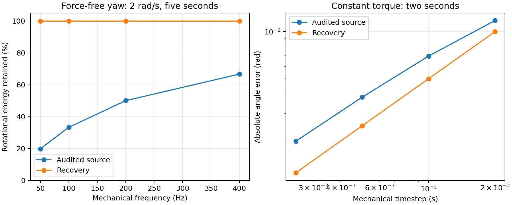

# Physics Recovery Mission 01 — numerical time and planar rotation

The two audited numerical defects are corrected on `recovery/mission-01-numerical-dynamics`, based directly on audited revision `a3887306c3c83a88466bd5aecb4c3c384841a595`. No merge into `verlet_gpt_v35_smoke_airflow` or main is part of this mission.

Baseline: [comprehensive audit, sections H and J](https://github.com/QuantumEther/VerletDrift/blob/ac86f81497f101c3da58c034ea6c9b56d87d1654/docs/physics-audit/2026-10-21/REPORT.md). The audit report was published after the audited source revision, so that document is linked at its publication commit rather than copied into the working branch.

The implementation replaces independent corner extrapolation with a rigid planar kick-drift update, stores the interval represented by the position history, and reconstructs angular velocity from the two stored wheel poses. It does not add an angular acceleration, damping cancellation, or energy rescaling. A related timestep-dependent history speed cap was removed from the production mechanical step after a separate failing regression exposed it.

At 100 Hz, the audited five-second free-spin experiment loses 66.69% of rotational energy. The corrected experiment preserves the initial 2 rad/s to about 1e-8 rad/s at a deliberately large 50 km coordinate offset. All 226 tests pass, including 46 new numerical regressions. This establishes the free planar model and its applied-load convergence; it does not validate all vehicle or collision physics.

## Model and scope

The physical body remains the existing uniform planar rectangle with mass `m = carMassKg` and `I = m * (CAR_HALF_LENGTH² + CAR_HALF_WIDTH²) / 3`. The four corner positions are geometric markers for three rigid degrees of freedom, not four independent masses. Energy and angular momentum here mean `K = m(vx²+vy²)/2 + Iω²/2`, `P = mv`, and `L = Iω` about the center. Summing four corner chord-velocity energies with mass m/4 would test a different inertia model.

The chassis coordinates use SI units. Experiments isolate a large map, away from boundaries. Free production-path cases set tire friction, rolling resistance, aero drag, and the existing explicit yaw damping to zero as test inputs. No production defaults were changed. The small-spin numerical matrix excludes the application sleep rule; the production free-spin check starts at 2 rad/s, safely above its threshold.

## Original defects and their interaction

### Position history had no interval

The old method used `(x - prevX) / dt`, with `dt` supplied for the next step. A displacement storing 20 m/s over 0.01 s is 0.2 m. Reinterpreting it at 0.005 s yields 40 m/s; at 0.02 s it yields 10 m/s. The application passes `dt = timeScale / simulationFps`, so both controls can trigger the defect. It is a change in interpretation, not a physical impulse.

Simply multiplying every corner displacement by a timestep ratio is insufficient for rotation: the history is a finite rotation of a rigid pose, not four independent tangent velocities. Scaling those chords can deform the previous pose and change the inferred angle.

### Cartesian extrapolation omits the geometry of rigid rotation

For a rotating arm r, let the preceding angular increment be δ. The old force-free prediction is `r_pred = 2r - R(-δ)r`. Its radius multiplier is `sqrt(5 - 4 cos δ)`, greater than one for nonzero small δ. Its angular increment is `atan2(sin δ, 2 - cos δ) = δ - δ³ + O(δ⁵)`, already smaller than δ.

The six pair constraints then shorten the stretched body. Each positional correction also shifts previous positions by `constraintDamping` times that correction. This alters the next implicit velocity/history and introduces a second, parameter-dependent evolution of the reconstructed motion. The cached body yaw was derived from the latest heading minus the previously cached heading, while the next integrator consumed the solver-modified previous corner positions. Those two angular histories need not agree. Re-reading the same derived pose could also erase cached yaw.

The following independent coordinate probe starts at 2 rad/s, dt 0.01 s, six iterations, damping 0.8. “Step yaw” is current heading minus the initial heading divided by dt. “History yaw” uses the actual previous corner pose after each stage.

| Stage | Before: step yaw | Before: history yaw | Before: max distance error (m) | After: history yaw | After: max distance error (m) |
| --- | --- | --- | --- | --- | --- |
| Integration | 1.999200399763 | 1.999200399763 | 1.154e-03 | 2.000000000000 | 7.550e-15 |
| First projection | 1.999200399762 | 1.999840156705 | 1.465e-14 | 2.000000000000 | 7.550e-15 |
| Second projection | 1.999200399762 | 1.999840156705 | 1.465e-14 | 2.000000000000 | 7.550e-15 |

In the baseline, projection repairs the geometry while leaving two different angular rates; subsequent Cartesian predictions continue to stretch and distort history. Increasing iteration count does not repair this architecture. At 100 Hz after five seconds, damping values 0.05, 0.8, and 1 give approximately 1.67774, 1.15439, and 0.000197 rad/s respectively in the constraint sweep. After correction, all nine tested combinations of 1/4/12 iterations and those damping values preserve 2 rad/s within regression tolerance. These are numerical sensitivity checks, not proposed vehicle settings.

## Implemented correction

1. [planar-motion.js](../../../js/physics/planar-motion.js) decodes the center velocity and finite relative orientation of the current and previous corner poses. The relative angle uses `atan2(cross(previousAxis, axis), dot(previousAxis, axis))`. It divides by `body.historyDt`, the interval associated with that history, rather than the next integration dt.
2. [integrator.js](../../../js/physics/integrator.js) kicks the generalized velocities: `v_next = v + a dt`, `ω_next = ω + α dt`. It then drifts the center by `v_next dt` and applies the exact rotation matrix `R(ω_next dt)` to all four current arms. Previous positions become the old current positions and the newly stored interval becomes dt. In exact arithmetic, a free rigid drift preserves all six distances, v, ω, P, L, and K.
3. [kinematics.js](../../../js/physics/kinematics.js) uses that same pose decoder for body state. Angular velocity no longer depends on how often cached heading was read. Initialization clears the history interval; the first supplied positive dt establishes the interval for an externally seeded history.
4. [state.js](../../../js/state.js) adds only `body.historyDt`. Existing endpoint velocities, acceleration/jerk samples, and EMA state remain in physical units. A timestep transition does not scale or reset them. Acceleration remains `(v_next - v_previous) / dt` for the actual new step; constant-load variable-dt regressions verify it. There is no angular-acceleration history in the planar integrator to rescale. Tire force relaxation, wheel/engine speeds, steering rates, and suspension velocities already use physical units and were left unchanged.
5. [main.js](../../../js/main.js) no longer calls the displacement-history cap. The old cap was a fixed distance per step, creating a speed ceiling proportional to 1/dt; for straight translation it was approximately 71.505 m/s at 0.01 s and 7.1505 m/s at 0.1 s. Retaining it would defeat timestep consistency at allowed coarse control settings. No replacement speed threshold was introduced. Map-edge crossing/clamping and restitution remain active. This cap never supplied general swept interior collision detection. Its legacy exported helper remains available for compatibility, but the production step does not call it.

The function name `verletIntegrateAllPoints` is retained for API compatibility. The algorithm is now first-order generalized-coordinate kick-drift (symplectic Euler for the appropriate conservative force model), not second-order Cartesian position Verlet. A second-order force integrator would require another force evaluation and a consistent treatment of the coupled dissipative subsystems; silently claiming second order here would be incorrect. The existing pair solver remains for collision/configuration repair. Free rigid motion arrives on its constraint manifold, so it needs only roundoff-level corrections.

The read interval is intentionally not rewritten at the beginning of a timestep transition. Old displacement is decoded with its old interval; the new displacement is created with its new interval. This avoids touching subsystem caches or fabricating derivative impulses.

## Test-first evidence

Commit `22ab38a` added the initial 41 regressions, measurement runner, and failing baseline before production edits. That initial baseline had 36 failures. Additional tests subsequently covered variable-step loading, reinitialization, the discovered history cap, and angular aliasing. The final suite run against a separate unchanged checkout of the audited source has **41 failures and 5 passes out of 46**; see [baseline-tests.log](baseline-tests.log).

After the first integrator correction, the two new production coarse-step regressions failed on the cap; [cap-regression-before.log](cap-regression-before.log) records that intermediate 43-pass/2-fail run. The cap was then removed from the production path. The final full suite has **226 passes across 24 files**, comprising all **180 pre-existing tests plus 46 numerical tests**; see [after-tests.log](after-tests.log). No existing test was relaxed or rewritten.

The new [numerical tests](../../../tests/numerical-chassis.test.js) exercise force-free translation; signed spins ±0.01, ±2, and ±20 rad/s; center invariance; all six distances; angular momentum; rotational and total kinetic energy; force and torque impulses and discrete work; constant-load and time-varying-torque convergence; repeated changes of dt; acceleration/jerk continuity under unchanged loads; history reset; repeated angular reads; constraint-control independence; distorted-shape repair; coarse production timesteps; and rejection of unresolvable angular steps.

At ordinary 100 m test coordinates, the free-motion bounds are 1e-7 m/s or rad/s absolute and 1e-7 relative energy/momentum over five seconds, with 1e-9 m distance bounds. Free SE(2) drift has no truncation error; those bounds allow accumulation of double-precision coordinate subtraction over up to 2,000 steps, rather than accepting a percentage of artificial damping. Applied impulses use 1e-5 N·s / N·m·s absolute bounds, discrete work 1e-4 J, and convergence ratios 0.5 ± 1e-5 for the constant-load case. The timed torque test requires approximately halved velocity error per refinement. The bounds were not widened to accommodate the original defects.

## Before and after: free rotation and momentum

Production mechanical-prefix runs, five seconds, initial ω = 2 rad/s, no physical resistance. Initial `L = 1664.677 kg·m²/s`, `K_rotation = 1664.677 J` (the identical numeric values follow from ω = 2). Coordinates are centered at 50,000 m to expose subtraction precision. These baseline results reproduce the audit F1 at all four frequencies.

| Hz | ω before (rad/s) | ω after (rad/s) | K before (J) | K after (J) | L before (kg·m²/s) | L after (kg·m²/s) |
| --- | --- | --- | --- | --- | --- | --- |
| 50 | 0.890831991 | 2.000000002 | 330.264275 | 1664.677003 | 741.473763 | 1664.677001 |
| 100 | 1.154386203 | 1.999999990 | 554.590267 | 1664.676984 | 960.840081 | 1664.676992 |
| 200 | 1.414645997 | 2.000000011 | 832.847598 | 1664.677019 | 1177.464327 | 1664.677009 |
| 400 | 1.633316310 | 2.000000016 | 1110.223934 | 1664.677026 | 1359.472047 | 1664.677013 |

At 100 Hz, baseline K retention is 33.3152%; corrected retention is 99.9999990%. For the full ±2 rad/s isolated stress matrix, the largest observed intermediate relative energy error is 4.51e-8. All measured six-distance errors in the large-coordinate free-spin matrix remain below 1.87e-11 m.

Roundoff is visible for the slowest spin at the deliberately extreme 50 km coordinate offset: the largest intermediate relative energy error across ±0.01 rad/s is 2.76e-5 (0.00276%); maximum final absolute rotational energy error is 1.13e-6 J. It is coordinate cancellation amplified by very small displacements, not monotonic timestep truncation. Refining indefinitely makes this history representation less well conditioned. A center-relative or explicit-momentum representation is the defensible next step if such coordinates and tiny spins must be supported to stricter relative accuracy. No claim of machine-precision preservation at arbitrary world coordinates is made.

Force-free translation at 20 m/s is also measured for five seconds at all four frequencies. The automated tests additionally use non-axis-aligned velocity and combined translation/rotation during repeated timestep transitions.

## Live timestep changes

The following isolated next-step transitions start from dt 0.01 s, vx 20 m/s, and ω 2 rad/s; compare [baseline.json](baseline.json) and [after.json](after.json).

| New dt (s) | vx before (m/s) | vx after (m/s) | ω after (rad/s) |
| --- | --- | --- | --- |
| 0.02 | 10.00000000 | 20.00000000 | 2.00000000 |
| 0.005 | 40.00000000 | 20.00000000 | 2.00000000 |
| 0.0025 | 80.00000000 | 20.00000000 | 2.00000000 |
| 0.001 | 200.00000000 | 20.00000000 | 2.00000000 |

A separate exact-production-prefix test starts with an already correctly initialized coarse history. With combined translation and rotation, dt 0.05 s gives baseline vx 14.2543 m/s and dt 0.1 s gives 7.1274 m/s because the most displaced corners trigger the old cap. Corrected values are 20 m/s and 2 rad/s at both intervals, including subsequent transitions through 0.0025, 0.1, and 0.01 s. Thus removal of the speed cap is necessary independently of storing history dt.

Cached derivative regressions verify that a free timestep change does not create acceleration/jerk, and that continuing the same physical force across a change yields the same acceleration. The physical onset of a force is allowed to produce jerk. Derivative/EMA updates still belong once at the end of each mechanical step; repeated rendering-time calls to the derivative routine are not a replacement for that scheduling contract.

## Applied force, torque, work, and convergence

A two-second test starts at rest, applies a = 1 m/s² along X and α = 0.5 rad/s². Analytic endpoint vx = 2 m/s, ω = 1 rad/s, displacement = 2 m, angle = 1 rad. Expected linear impulse is 2400 N·s and angular impulse 832.3385 N·m·s. Corrected kinetic energy is 2816.16925 J within about 1.4e-6 J in these measurements.

| Hz | X error after (m) | Angle error before (rad) | Angle error after (rad) | Angular impulse residual before (N·m·s) | Residual after (N·m·s) |
| --- | --- | --- | --- | --- | --- |
| 50 | 0.020000000 | -0.011781110 | 0.010000000 | -44.242905 | -1.263e-09 |
| 100 | 0.010000000 | -0.006978723 | 0.005000000 | -24.593864 | 1.914e-09 |
| 200 | 0.004999999 | -0.003808444 | 0.002500000 | -13.032573 | 3.333e-09 |
| 400 | 0.002499999 | -0.001991098 | 0.001250000 | -6.718913 | -3.355e-09 |

The corrected constant-load position and angle errors halve with dt, as required by the selected first-order method. The largest corrected linear impulse residual in this table is 6.58e-7 N·s; angular residual is below 3.36e-9 N·m·s. The tests also use nonzero initial translation and spin with both force components. They check `ΔK = Jx*(vx0+vx1)/2 + Jy*(vy0+vy1)/2 + Jangular*(ω0+ω1)/2` for constant impulses, rather than assuming all energy changes under external loading are numerical defects.

For time-dependent torque `τ(t) = I cos(t)`, integrated for two seconds from rest, analytic ω = sin(2):

| Hz | Absolute ω error after (rad/s) |
| --- | --- |
| 50 | 0.0141311582 |
| 100 | 0.0070731567 |
| 200 | 0.0035384727 |
| 400 | 0.0017697099 |

These errors also halve with timestep. In free rigid drift the truncation error is identically zero; its small residual fluctuates at a roundoff floor, so it should not be presented as a fitted convergence slope. Under physical forces, finite-step trajectory errors remain and converge at first order.



The same figure is available as [SVG](comparison.svg) and [PDF](comparison.pdf). The concise numerical table is available as [CSV](numerical-comparison.csv).

## Downstream handling checks

The runner uses the exact production `runPhysicsStep` prefix through suspension, tires, steering, engine synchronization, yaw damping, integration, both constraint passes, wall response, derived state, and sleep. It excludes camera, rendering, sound, and balloon/game steps. It uses the recorded [audited UI controls](audited-controls.json), with only the map enlarged to avoid contacts and engine gear set to neutral for controlled coasting comparisons. Rotor seeds are pure longitudinal rolling. These are controlled recovery comparisons, not a claim to reproduce every original audit maneuver's engine state.

Cornering holds road-wheel angle 0.22 rad for three seconds from 18 m/s. The handbrake comparison adds a 0.5–0.8 s command with the existing pressure ramps. Low-speed free steering starts at 1 m/s and 0.01 rad and runs ten seconds with no driver steering. Stationary steering starts at 0.3 rad. No force/feedback parameter is adjusted between versions.

| Hz | Cornering peak yaw, before → after (rad/s) | Handbrake peak yaw, before → after (rad/s) | Free-steering angle flips, before → after | Free-steering peak angle after (rad) |
| --- | --- | --- | --- | --- |
| 50 | 0.63429 → 0.62684 | 1.24822 → 1.25750 | 9 → 14 | 0.43637 |
| 100 | 0.64724 → 0.64254 | 1.35533 → 1.37755 | 9 → 13 | 0.48175 |
| 200 | 0.64635 → 0.64349 | 1.75268 → 1.77031 | 15 → 15 | 0.48729 |
| 400 | 0.65933 → 0.65937 | 1.81610 → 1.82688 | 15 → 15 | 0.48836 |

All these runs remain finite with nonnegative road loads. Stationary steering introduces no planar yaw in these cases. The existing low-speed free-steering oscillation persists. At 50/100 Hz it has more reversals after the correction even though peak lock is nearly unchanged. This is an exposed downstream problem; it was not masked with extra damping or trail/steering changes. Handbrake peak yaw generally increases here; cornering peak yaw can move either way because tire and load feedback respond to the changed trajectory. Restoring angular momentum does not imply every coupled maneuver must have a larger peak yaw.

Removing the cap also restores physical speeds above its previous cutoff. Separate one-second 90 m/s neutral runs at 50–400 Hz remain finite: straight-line final speed is about 87.35 m/s and held-steer final speed about 86.38–86.44 m/s. A 10 Hz coarse-step stress run remains finite but gives held-steer peak yaw about 1.17 rad/s versus about 0.18 rad/s at 100 Hz. This large full-vehicle timestep sensitivity is **not fixed by the rigid drift correction**. The 50–400 Hz handbrake/steering results likewise demonstrate remaining coupled-system sensitivity. Finite state and nonnegative loads are smoke checks, not validation of physically correct high-speed handling.

Expected downstream changes are longer unforced spins, less dependence of ordinary rigid motion on constraint damping/iteration count, more faithful response to applied torque, changed tire slip/load/steering trajectories as corrected yaw feeds back, and higher attainable speed after removing the numerical cap. The existing yaw-damping torque remains active with its original setting in normal handling, and no handling compensation has been added.

## Remaining limitations and deliberately unchanged systems

- Two sampled poses cannot identify arbitrary rotations differing by 2π. The integrator rejects a predicted angular increment with absolute value at least π before modifying corner coordinates. The caller must subdivide that mechanical step; automatic adaptive stepping of all coupled vehicle subsystems is not introduced here. Externally supplied histories must already be resolved below π and must be initialized with their actual interval. Explicit angular momentum plus unwrapped pose would remove that sampling ambiguity if a broader domain is needed.
- Corner wall restitution and pairwise post-contact projection are the original approximate collision scheme. Shape repair after an imposed deformation is tested for convergence and center preservation, but energy/momentum correctness of wall or balloon contacts is not established. Distorted previous configurations are not uniquely interpretable as a rigid physical velocity. A future generalized-coordinate contact impulse solve should use the same uniform-rectangle mass/inertia and reconstruct a consistent history.
- Sleep still deliberately zeroes histories below its original thresholds. Boundary contacts and balloon impulses are explicit interventions; the free-motion claims exclude them. Existing stale cached values immediately after sleep/late game impulses were not repaired by modifying those subsystems.
- Large world coordinates and very small motions amplify history subtraction error, as quantified above. A local-origin or explicit-velocity representation is preferable for a stricter large-world specification.
- The force method is first order. Tires, relaxation, steering feedback, wheel/clutch/drivetrain and suspension coupling retain their existing timestep characteristics; passing the chassis regressions does not certify their convergence. The audit's other defects remain open.
- The camera has its own independent Verlet history. It and all graphics were left unchanged as requested; its visual response to a timestep change is not part of the mechanical conservation claim. The existing interpolation/wall-clock scheduling and GUI layout are unchanged.
- The exported legacy `clampParticleDisplacements` still performs its original intervention if an external caller deliberately invokes it. It is excluded from the production path, and the isolated numerical helper invokes it only in its below-threshold test range. Production coarse-step regressions exercise the actual prefix rather than relying on that helper.

No tire law, grip setting, steering equation or feedback gain, suspension equation or setting, clutch/drivetrain equation, engine setting, UI control/layout, graphics implementation, or existing test was changed. In production, the only files changed are planar integration/kinematics, its new shared pose decoder, body interval metadata, and removal of the history cap call in the mechanical step. Constraint/collision equations themselves were left intact.

## Reproduction and artifacts

From this recovery checkout with Linux Node dependencies installed:

```bash
npm ci
npx vitest run
node scripts/mission01-compare.mjs docs/physics-recovery/mission-01/after.json
MPLCONFIGDIR=/tmp/mission01-matplotlib python3 docs/physics-recovery/mission-01/plot-comparison.py
```

Plotting additionally requires matplotlib. In the managed session the checkout contains tracked Windows dependency binaries, so tests used Linux dependencies installed outside the checkout, without changing tracked node_modules:

```bash
node /workspace/.verletdrift-tools/node_modules/vitest/vitest.mjs run   --config /workspace/.verletdrift-tools/vitest.config.mjs
```

The external config uses the repository root, Node environment, `tests/**/*.test.js`, excludes `tests/e2e/**`, limits workers to two, and places the Vite cache outside the checkout. No test equations or mechanics are mocked. Browser storage is stubbed only where required by existing state imports. This mission did not run browser/GPU e2e tests.

For baseline reproduction, create a separate checkout of audited revision `a3887306c3c83a88466bd5aecb4c3c384841a595`, copy only `scripts/mission01-compare.mjs`, `tests/numerical-chassis.test.js`, both `tests/helpers/*.js` mission helpers, and `docs/physics-recovery/mission-01/audited-controls.json` from this branch, and run the same commands with that checkout as the test root. Do not copy fixed production files. That is how the final baseline measurements/tests were taken. The runner reads the production step's mechanical source boundaries and fails if they move, so it does not maintain a second copy of the force equations.

[baseline.json](baseline.json) and [after.json](after.json) include source revisions, dirty-state context, source-file SHA-256 hashes, endpoint energy/momentum/geometry, free-spin extrema, applied-load residuals, timestep-change probes, constraint sweeps, stage probes, and handling/high-speed observations. Baseline dirty files are experiment scaffolding, not source edits. After measurements reference the source-fix commit; documentation/log updates explain any remaining dirty state at measurement time. [MANIFEST.json](MANIFEST.json) hashes the delivered evidence and records provenance.

Acceptance is met for resolved planar rigid motion and timestep transitions without physical interventions: free drift preserves the chosen invariants to the measured roundoff bounds, load response converges, and production timestep changes no longer reinterpret velocity or trigger a hidden per-step speed cap. Collision correctness, coupled handling convergence, and the explicitly documented sampling/coordinate limits remain separate work. No merge is performed.
