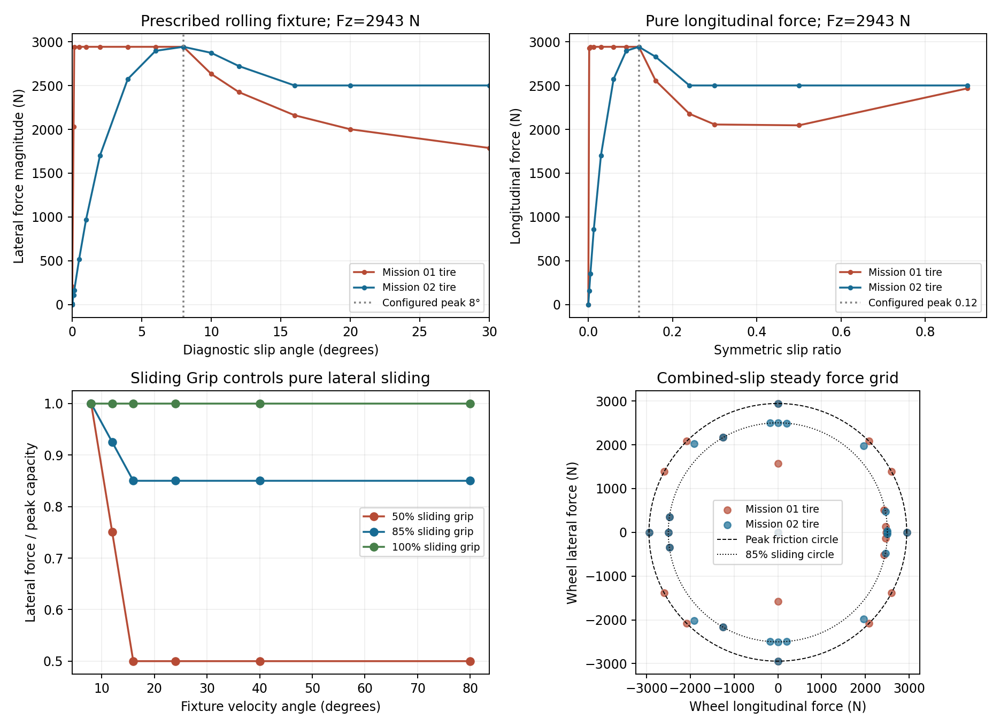
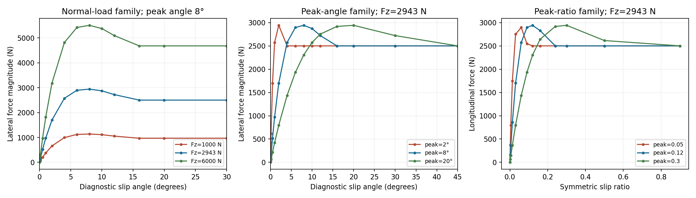
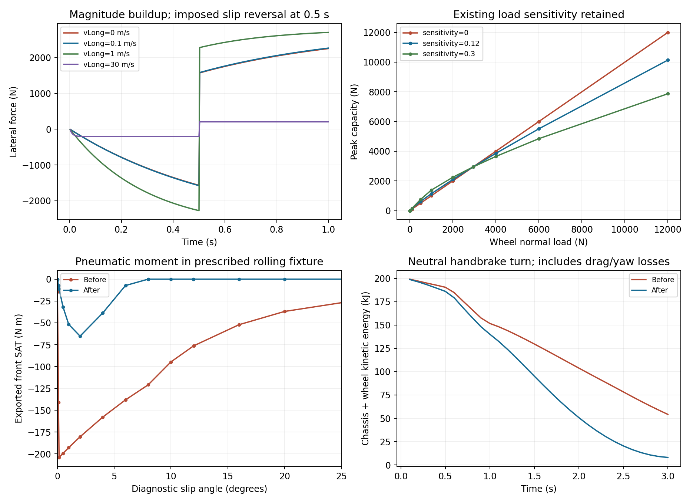
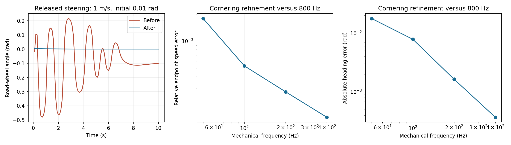

# Before and after: Mission 02

Before source: completed Mission 01 `74440cd`. After source: `dbd2d1e`. Same labeled peak inputs, peak friction, sliding ratio, loads, vehicle gains and controlled inputs unless the experiment explicitly overrides a parameter. These are code experiments, not measured tire calibration.

## Pure force curves

Prescribed body/wheel fixtures use vLong=20 m/s, Fz=2943 N per corner, peak angle label 8°, peak ratio 0.12 and Sliding Grip 85%. Infinite wheel inertia is used only to hold wheel kinematics for these steady force probes; no kinetic-energy claim is made about that fixture. Table angles are the imposed velocity angle; the diagnostic regularized angle differs slightly at finite speed.

| Fixture angle (degrees) | Lateral force before (N) | Lateral force after (N) |
| --- | --- | --- |
| 0.1 | 2028.8083 | 108.9551 |
| 0.15 | 2943.0000 | 162.4094 |
| 1 | 2943.0000 | 971.1560 |
| 2 | 2943.0000 | 1701.0343 |
| 4 | 2943.0000 | 2574.7813 |
| 8 | 2943.0000 | 2943.0000 |
| 16 | 2161.0644 | 2501.5505 |
| 20 | 2001.5358 | 2501.5500 |

The default old raw analytic peak was 0.8690° at 2.945 times available capacity, with cap onset 0.1475°. The corrected analytic/steady pure peak is the configured **diagnostic** alpha=8°, at D=2943 N. The first fully kinetic point is q=2, or alpha=16° in a pure-lateral diagnostic sweep. These are three different quantities; v2 does not call kinetic-plateau onset the peak.

Pure longitudinal peak is now |kappa|=0.12, at the same D. The old corresponding raw peak was 0.01304 and first cap onset about 0.002213. Changing the configured peak moves the actual peak; it does not renormalize the force by a potentially zero or negative sine.

Small-slip lateral stiffness changes from about 1.179 MN/rad to 63.233 kN/rad, and longitudinal stiffness from about 1.372 MN per unit kappa to 73.575 kN per unit kappa at this load. Peak capacity is unchanged. Sliding Grip controls pure lateral, longitudinal and combined fully sliding magnitude; it is no longer gated by longitudinal wheel slip alone.

[Analytic normalization diagnosis](legacy-curve-diagnosis.png) separates the old unclipped demand, cap and corrected prescribed-fixture measurements. [CSV force data](force-curves.csv) retains all configurations, loads, signs and measured diagnostic slips. Figures are also supplied as SVG and PDF.

## Local motion, load support and relaxation

- A zero-center-speed held pivot at yaw 2 rad/s now has lateral contact resistance. The initial 25-test baseline failed this case; the corrected contract passes. The same local velocity produces the same wheel force regardless of its decomposition into center translation and yaw.
- Current suspension loads remain authoritative; their nonlinear load-sensitivity law and peak capacity are unchanged. Unloaded contacts immediately have zero force and SAT. Recontact rebuilds magnitude rather than carrying unsupported force.
- A single magnitude buildup with local-speed time constant replaces the 25 ms velocity EMA + tire relaxation + 80 ms SAT stack. The exact frozen-target endpoint **and mean impulse** agree with the first-order lag solution at 50–400 Hz.
- A reversal cannot use stale force memory as a propulsive contact force. Body/rotor response is solved together, rather than assuming a passive start-of-tick force remains passive after an explicit chassis kick.

## Controlled handling

Cornering starts at 18 m/s with road-wheel angle 0.22 rad, engine neutral, and runs three seconds. Handbrake uses the same setup with a 0.5–0.8 s command and unchanged pressure ramps. Released steering starts at 1 m/s with angle 0.01 rad, then runs ten seconds with the original column mechanics. All comparisons use the recorded audited UI parameters, except the map is enlarged to avoid walls. Input times lie on every grid.

| Hz | Cornering peak yaw: before → after (rad/s) | Handbrake peak yaw: before → after (rad/s) | Release max angle: before → after (rad) | Release flips: before → after |
| --- | --- | --- | --- | --- |
| 50 | 0.62684 → 0.71172 | 1.25750 → 1.59507 | 0.436367 → 0.009994 | 13 → 0 |
| 100 | 0.64254 → 0.70459 | 1.37755 → 1.60579 | 0.481750 → 0.009998 | 13 → 0 |
| 200 | 0.64349 → 0.70078 | 1.77031 → 1.61053 | 0.487292 → 0.009999 | 15 → 0 |
| 400 | 0.65937 → 0.69914 | 1.82688 → 1.61240 | 0.488364 → 0.010000 | 15 → 0 |

Default released steering no longer develops the measured growing tire-feedback oscillation in these runs. Its peak angle stays at the initial 0.01 rad and the late motion decays. This is a result of the complete tire/contact correction; it does not identify one removed lag or one trail coefficient as the sole cause.

The unchanged column still has an independent mechanical defect. The stationary high-Coulomb reproduction sets initial road-wheel angle 0.3 rad, Coulomb capacity 2 N·m and viscous damping 0.1 N·m·s/rad, as an **experiment**, not new defaults. Tire SAT is zero throughout. It still chatters in both source versions:

| Hz | Angle flips before | Angle flips after | After max |angle| after 1 s (rad) | After max SAT (N·m) |
| --- | --- | --- | --- | --- |
| 50 | 210 | 210 | 0.070441 | 0 |
| 100 | 324 | 324 | 0.055935 | 0 |
| 200 | 424 | 424 | 0.034795 | 0 |
| 400 | 233 | 233 | 0.029278 | 0 |

Flips count sign changes when |angle| exceeds 1e-6 rad. They do not all have the initial amplitude. This isolates a Mission 03 column-friction dependency, not an excuse to remove tire torque or add yaw damping.

The dataset also includes acceleration/braking while cornering, sustained rear-slip handbrake response, countersteer after initial sideslip/yaw, pure and off-center yaw, very slow turning, reverse travel and movement to rest. All 53 handling runs are finite with nonnegative normal loads. They are behavioral smoke/convergence tests, not proof that every maneuver matches a real vehicle.

## Numerical refinement

The table uses the final state of the three-second production cornering run, compared with a separate 800 Hz numerical reference using the same controls/input. That reference is not real-world truth. Outer moving-geometry integration remains first order; internal contact refinement has separate error tolerances. A single fitted convergence order is not asserted for all coupled handling.

| Hz | Relative speed error (%) | Absolute heading error (rad) | Absolute yaw-rate error (rad/s) |
| --- | --- | --- | --- |
| 50 | 0.178392 | 0.01771454 | 0.00950165 |
| 100 | 0.052868 | 0.00784523 | 0.00428269 |
| 200 | 0.027213 | 0.00164255 | 0.00092795 |
| 400 | 0.014166 | 0.00037027 | 0.00024329 |

At the default 100 Hz, cornering endpoint speed differs from the 800 Hz reference by about 0.053%, heading by 0.00785 rad, and yaw rate by 0.00428 rad/s. Refinement reduces all three listed endpoint errors. More aggressive maneuvers remain nonlinear and require their own domain-specific convergence assessment; a benign corner is not a universal handling accuracy certificate.

## Numerical coupling control

The reproducible split-contact negative control uses the same final tire law but intentionally freezes chassis response inside the contact solve, then applies those impulses to the moving chassis. At 50 Hz, total chassis-plus-wheel kinetic energy grows from **6.195918 J to 9.272508 J** in three seconds, despite no drive input. The correct coupled path ends at **0.003335 J** with the same unchanged drag, yaw damping and sleep. [Raw control traces](split-contact-control.json) and [reproducer](../../../scripts/mission02-split-control.mjs) make the architectural dependency reviewable.

Passive isolated slow-turn/pivot tests remove drag, yaw damping, sleep and driver work from the balance, include all four rotor energies, and require nonincreasing kinetic energy at timesteps from 0.0025 to 0.1 s. This is stronger evidence than an easier-to-drift handling outcome.

## Expected changes and remaining limits

Small-slip steering/force response is substantially more progressive, full peak force remains available at the intended slips, and pure lateral sliding now has the selected kinetic ratio. Pivot contact dissipates yaw rather than being center-speed-faded away. Handbrake/countersteer trajectories change because force competition and kinetic sliding are explicit. The observed direction of a particular handling change is not imposed by an extra assistance controller.

No gain or friction parameter was adjusted to mask a problem. Default tire-feedback growth is absent in these release runs, while mechanical column chatter is still present in the isolated reproduction. Exact static tire sticking, stationary steering scrub, physical tire calibration, full rack/chassis aligning-moment reaction, complete vehicle energy closure, and inherited near-sleep cache behavior remain limitations. [VALIDATION.md](VALIDATION.md) separates these from demonstrated contact consistency.
