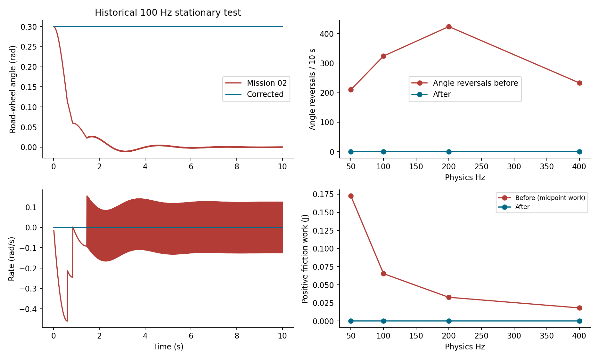
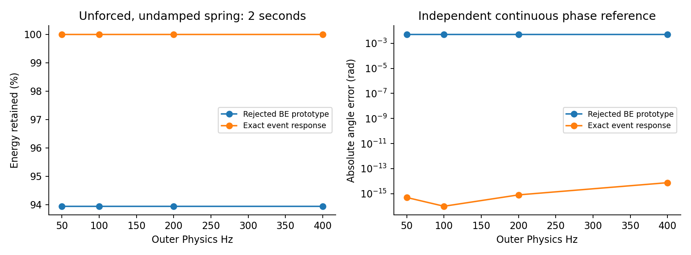
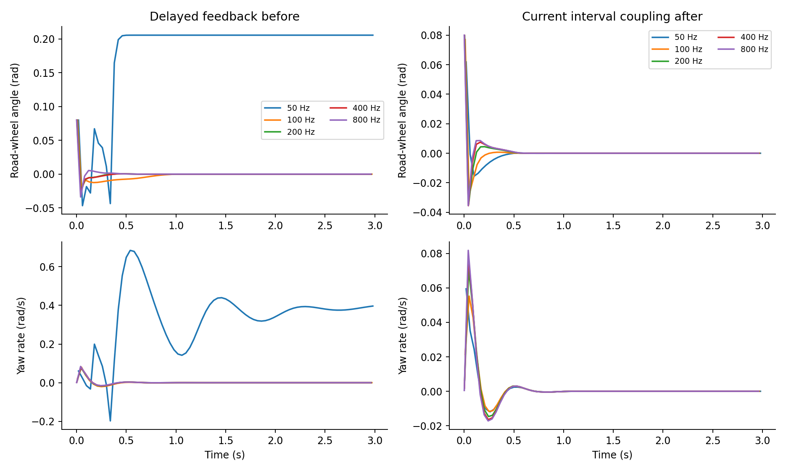
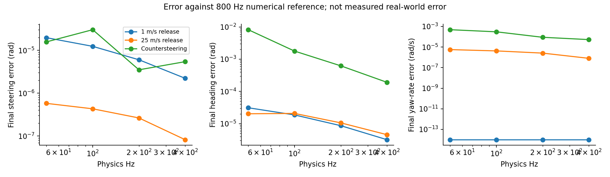
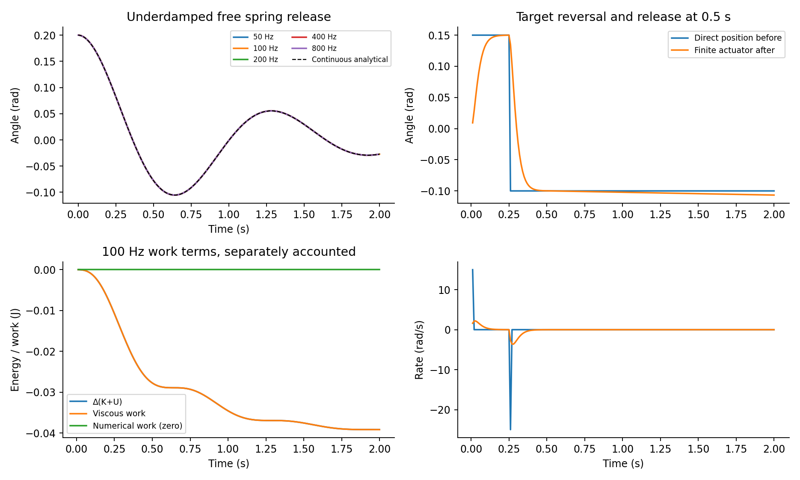

# Before and after — Mission 03

Baseline source: `8fba5b33d758e613e1745afab7b16bbe7bd85031` (test-only branch revision; production files match completed Mission 02). Corrected physics: `d41d674e6d2ce47f12b468dec99b812417d89cb8`. The final snapshot includes the independently tested input-button release and exact steering propagation.

## Historical stationary friction case

I=0.08 kg·m², k=0.4 N·m/rad, C=2 N·m, b=0.1 N·m·s/rad; initial δ=0.3 rad, ω=0; ten seconds; no driver or tire torque. Static spring load is 0.12 N·m < 2 N·m.

| Hz | Angle reversals before → after | Rate reversals before → after | Final angle before → after (rad) | Peak late angle before → after (rad) | Positive midpoint friction work before → after (J) |
| --- | --- | --- | --- | --- | --- |
| 50 | 210 → 0 | 439 → 0 | 0.00247165339 → 0.3 | 0.0704410251 → 0.3 | 0.172659133 → 0 |
| 100 | 324 → 0 | 857 → 0 | 0.000663427527 → 0.3 | 0.0559350576 → 0.3 | 0.065380577 → 0 |
| 200 | 424 → 0 | 1665 → 0 | 0.000135469856 → 0.3 | 0.0347950226 → 0.3 | 0.0327736925 → 0 |
| 400 | 233 → 0 | 3175 → 0 | -2.05248304e-05 → 0.3 | 0.0292776963 → 0.3 | 0.0181279432 → 0 |

The corrected case holds exactly: ω=0, friction torque +0.12 N·m, K=0, U=0.018 J, and every work/numerical/residual term is zero at all four rates. Its persistent 0.3 rad displacement is the correct static equilibrium, not a failed centering test. Baseline peak |ω| is approximately 0.46–0.49 rad/s. “Late” means after the first second. Midpoint kinetic-work decomposition and endpoint work are different discrete diagnostics; the raw baseline reconstruction retains both. Neither is calorimetric tire/rack heat.

## Undamped spring accuracy

With I=0.08 kg·m², k=2 N·m/rad, δ₀=0.2 rad, zero friction/damping/road moment and two seconds, the correct energy is 0.04 J and δ(t)=0.2 cos(5t). The rejected BE prototype passed work accounting but removed physical spring energy. Exact affine event propagation replaces it, without corrective torques or rescaling.

| Hz | Prototype energy retention (%) | Final retention (%) | Final absolute phase-position error (rad) |
| --- | --- | --- | --- |
| 50 | 93.941421 | 100 | 5e-16 |
| 100 | 93.941421 | 100 | 0 |
| 200 | 93.941421 | 100 | 8.05e-16 |
| 400 | 93.941421 | 100 | 7.58e-15 |

## Moving release and convergence

The vehicle begins at 25 m/s with δ=0.08 rad, neutral, freely released, three seconds. Same recorded audit controls, map/seed and tire parameters before and after.

| Hz | Final δ before (rad) | Final δ after (rad) | After steering error vs 800 Hz (rad) | After heading error (rad) | After yaw error (rad/s) |
| --- | --- | --- | --- | --- | --- |
| 50 | 0.205647134 | -7.14037899e-07 | 5.77671e-07 | 2.02175e-05 | 5.61574e-06 |
| 100 | -1.8067498e-06 | -5.67670981e-07 | 4.31304e-07 | 2.07357e-05 | 4.19311e-06 |
| 200 | -1.94252924e-11 | -4.00183552e-07 | 2.63816e-07 | 1.05698e-05 | 2.56492e-06 |
| 400 | -2.73269777e-11 | -2.18395211e-07 | 8.20281e-08 | 4.53778e-06 | 7.97682e-07 |

The 800 Hz run is a numerical reference, not a real-vehicle measurement. Final steering can reach the static-friction neighborhood, where endpoint differences have an internal/roundoff floor; heading/yaw and complete trajectories must also be inspected. Do not fit a universal convergence order to nonlinear stops or steering oscillations. Separate analytical viscous and spring tests reproduce the continuous affine response to roundoff; the undamped control also preserves phase and energy. The shared contact method additionally refines steering internally; outer body geometry and load splitting remain first order.

## Work and energy, corrected vehicle runs at 100 Hz

All values are accepted-substep sums in joules. Tire moment is external work on the effective steering coordinate; this is not a closed total-vehicle energy ledger.

| Scenario | Driver | Tire moment | Viscous | Coulomb | Stops | Numerical work defect | Max tick ledger residual |
| --- | --- | --- | --- | --- | --- | --- | --- |
| release-low | 0 | 0.00993545751 | -0.00944919177 | -0.000504582303 | 0 | 0 | 4.03e-19 |
| release-moving | 0 | 5.60644042 | -5.58532178 | -0.02239864 | 0 | 0 | 2.21e-15 |
| reverse | 0 | 10.8980226 | -10.5329171 | -0.0575912166 | -0.254714267 | 0 | 5.38e-15 |
| countersteer | -3.1697271 | 4.74665078 | -1.56597167 | -0.0122244765 | 0 | 0 | 4e-17 |
| drift | 0 | 7.48058819 | -7.45579653 | -0.0260716634 | 0 | 0 | 1.75e-14 |
| sleep-wake | 0.0127085517 | 1.17704247e-23 | -0.0110515531 | -0.000964944625 | 0 | 0 | 2.83e-18 |
| rest | 0 | 0 | -0.00469242691 | -0.00452055553 | 0 | 0 | 5.2e-18 |
| zero-capacity-recontact | 0 | 5.60645113 | -5.58532476 | -0.0224063697 | 0 | 0 | 2.21e-15 |

Affine steering roundoff residuals are separated from modeled losses; its numerical-work term is zero. Contact/body integration still has discretization error. Isolated Coulomb stopping reproduces the continuous stopping distance and friction work at all rates; the undamped spring preserves its energy and phase. The rejected prototype’s numerical attenuation is retained separately for review. Zero crossing, exact hold, applied-torque response, stop energy, and passive under/critical/overdamped responses have independent executable checks.

## Other behavior and limits

| Scenario | Final δ at 50 / 100 / 200 / 400 Hz (rad) | Interpretation |
| --- | --- | --- |
| release-low | 0.002908553 / 0.00290124 / 0.002894883 / 0.002891096 | Small low-speed release; off-center static hold is allowed. |
| reverse | 0.52 / 0.52 / 0.5159269 / 0.512571 | Reverse release can run to the mechanical stop; no automatic recovery is imposed. |
| countersteer | -0.006095156 / -0.006109685 / -0.006082964 / -0.006084886 | Finite driver authority, target +0.22 then −0.22 rad at 1 s. |
| drift | 1.965088e-06 / 6.837279e-07 / 2.608508e-07 / 2.07445e-07 | Initial 8 m/s lateral motion and 0.7 rad/s yaw, driver released. Tire saturation can remove pneumatic moment. |
| sleep-wake | 0.09929889 / 0.09929889 / 0.09929889 / 0.09929889 | Preserved steering through sleep and sampled driver target; neutral throttle input wakes the application policy, not an engine launch. |
| rest | 0.2095889 / 0.2095889 / 0.2095889 / 0.2095889 | Stationary spring/friction relaxation from 0.3 rad; not forced to zero. |
| zero-capacity-recontact | -1.25049e-06 / -8.953137e-07 / -6.24384e-07 / -4.325648e-07 | Contact capacity zero from 1–1.5 s (μ intervention); independent tests cover actual front Fz removal. |

Forward/reverse pneumatic signs are tested with matched ±20 m/s prescribed contact velocities, including zero transport, unloading and combined-slip saturation in the retained tire tests. The full forward-moving and reverse-release cases above have different speeds and must not be treated as a matched directional experiment. Reverse lock-seeking persists with current coupling; that bounds the present effective model, not evidence of validated real hardware behavior.

Full data: [handling/work CSV](handling-and-work.csv), [refinement CSV](refinement.csv), [before JSON](before.json), [after JSON](after.json), and [baseline friction reconstruction](baseline-friction-work.json). Every figure also has matching SVG and PDF exports.

## Same-model delayed-feedback negative control

This test-only helper keeps the final exact column model but restores previous-tick SAT delivery; it is not a production option. It isolates feedback scheduling from the other baseline changes.

| Hz | Final δ, delayed (rad) | Final δ, current coupled (rad) |
| --- | --- | --- |
| 50 | -0.137198471 | -7.14037899e-07 |
| 400 | 0.0165385753 | -2.18395211e-07 |

Full negative-control trajectories and source identities: [delayed-control.json](delayed-control.json).
