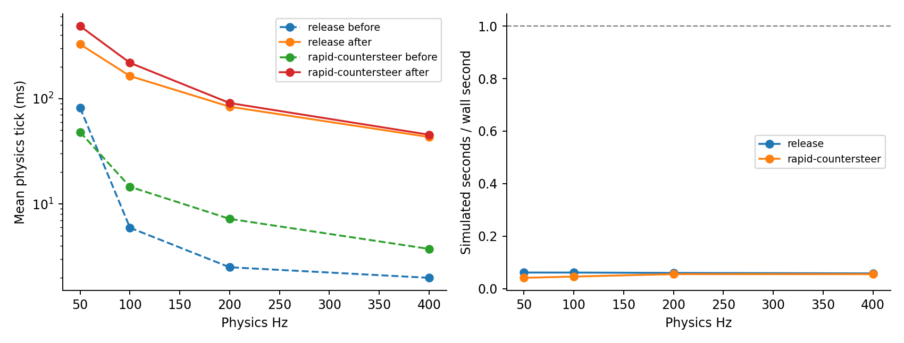

# Computational performance — Mission 03

Serialized matched benchmark on AMD EPYC 9V74 80-Core Processor, Node v24.19.0. Source 8fba5b33d758e613e1745afab7b16bbe7bd85031 before, d41d674e6d2ce47f12b468dec99b812417d89cb8 after. No concurrent physics/test/browser workload; no rendering. Five warmed 20,000-update column batches per mode; eight 0.8-s vehicle fixtures. One maneuver sample per setting, so these are observed costs, not hardware-independent estimates or confidence intervals.

## Column primitive

| Mode | Before median μs/update | After median μs/update |
| --- | --- | --- |
| Released steady state | 0.0281815 | 0.116723 |
| Driven steady state | 0.0467196 | 0.443533 |

This primitive benchmark measures settled states. It excludes the repeated column evaluations and tire solves inside Newton/adaptive retries. It is not representative of a full moving steering tick.

## Matched moving fixtures

| Scenario | Hz | Mean tick before → after (ms) | Cost ratio | Worst after tick (ms) | Peak accepted contact steps before → after | Sim s / wall s after |
| --- | --- | --- | --- | --- | --- | --- |
| release | 50 | 81.544 → 326.55 | 4.005× | 1298.5 | 68 → 542 | 0.061245 |
| rapid-countersteer | 50 | 47.942 → 485.95 | 10.14× | 894.13 | 94 → 492 | 0.041156 |
| release | 100 | 5.943 → 163.4 | 27.49× | 880.09 | 24 → 432 | 0.061198 |
| rapid-countersteer | 100 | 14.545 → 217.92 | 14.98× | 549.41 | 72 → 256 | 0.045889 |
| release | 200 | 2.5076 → 83.611 | 33.34× | 847.71 | 18 → 382 | 0.059801 |
| rapid-countersteer | 200 | 7.2146 → 90.567 | 12.55× | 275.94 | 46 → 128 | 0.055208 |
| release | 400 | 1.9915 → 43.103 | 21.64× | 444.81 | 8 → 216 | 0.058 |
| rapid-countersteer | 400 | 3.7424 → 45.339 | 12.12× | 203.2 | 30 → 64 | 0.05514 |

Both versions start at 25 m/s with road-wheel angle 0.08 rad, neutral, recorded audited controls and the same rotor/history seeds. Rapid countersteer requests +0.22 rad, then −0.22 rad at 0.4 s. Driver mechanics intentionally differ between versions; the measured cost includes the actual resulting trajectories, not identical frozen steering states.

## Solver work, final source

| Scenario | Hz | Attempted residual evaluations | Newton iterations | Rejected adaptive intervals | Accepted evaluations |
| --- | --- | --- | --- | --- | --- |
| release | 50 | 206274 | 37581 | 3036 | 65959 |
| rapid-countersteer | 50 | 324189 | 58790 | 5008 | 99796 |
| release | 100 | 214652 | 39100 | 3151 | 69622 |
| rapid-countersteer | 100 | 271630 | 49249 | 4183 | 83546 |
| release | 200 | 216067 | 39336 | 3151 | 71147 |
| rapid-countersteer | 200 | 242648 | 43937 | 3747 | 74384 |
| release | 400 | 214964 | 39112 | 3074 | 73033 |
| rapid-countersteer | 400 | 221683 | 40103 | 3368 | 69366 |

The longer 35-case sweep observed a worst tick of **1424.71 ms** in drift at 50 Hz. Its largest accepted subdivision count was **738** in drift at 50 Hz. These are observed maxima, not hard runtime bounds. The earlier Mission 02 figure of 1,016 steps came from a different historical maneuver matrix and must not be presented as a matched speed comparison.

The fourth root unknown and repeated tire response evaluations account for much of the extra cost. Steering trajectory error controls resolve rapid aligning-moment changes; exact affine column propagation avoids forcing subdivisions merely to integrate a constant linear spring/damper, but varying contact moment remains expensive. Rejected trials are real work; baseline had no counters for all attempted evaluations, so those fields cannot be compared numerically as if baseline work were zero.

This version does **not** meet a real-time or many-vehicle AI-training throughput target on this host. No contact tolerances, damping, friction or tire parameters were reduced to improve it. Preserve the current residual/energy/trajectory gates while investigating analytic Jacobians, a higher-order current-moment coupling, proven column elimination, event-aware stepping, and batched compiled kernels. Optimizing the inexpensive outer column call alone will not solve the contact bottleneck.

Raw data: [baseline](performance-before.json), [final](performance-after.json), [CSV comparison](performance.csv), and final-sweep counters/timings in [after.json](after.json). Timed measurements include host scheduling and garbage collection; repeat under controlled hardware before capacity planning.

## Reproduced Mission 02 historical stress case

The original 1,016-step tick is reproduced with the original maneuver: vx=5 m/s, vy=−18 m/s, yaw rate=0.5 rad/s, initial δ=0.22 rad, target +0.22 then −0.22 rad at 1.5 s, three seconds total. Same recorded controls and seeds. Finite driver authority changes the resulting corrected trajectory.

| Hz | Peak accepted steps before → after | Total wall time before → after (s) | Final δ after (rad) |
| --- | --- | --- | --- |
| 50 | 1016 → 422 | 6.6564 → 61.78 | -0.010409396 |
| 100 | 634 → 416 | 5.3289 → 56.072 | -0.010780761 |
| 200 | 388 → 254 | 5.1112 → 34.777 | -0.010727113 |
| 400 | 244 → 128 | 4.9749 → 38.652 | -0.010722427 |

The old peak is reproduced exactly at 50 Hz. Fewer peak accepted steps do not imply less total work: the fourth coupled unknown, additional evaluations and different trajectory increase elapsed time. [Historical baseline](historical-countersteer-before.json) and [corrected run](historical-countersteer-after.json) retain complete settings, source hashes, counters and samples.
