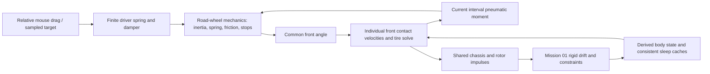

# Effective steering model

The dynamic coordinate δ is the **one common front road-wheel angle**, in radians. Both front contacts use it; rear contacts remain aligned with the chassis. ω = dδ/dt. Inertia I, damping b, Coulomb torque C, driver torque and the sum of the two front pneumatic moments are all expressed in this coordinate. I includes both sides of the effective mechanism. It is not the inertia of the visual handwheel.

The HUD coordinate φ = (2.5π / δ_max) δ is a visual mapping. At default lock 0.52 rad its ratio is 15.104. If interpreted as an ideal physical handwheel ratio r, virtual work requires Qδ = r Tφ, Iδ = r² Iφ, and bδ = r² bφ. No separately specified handwheel torque is applied directly to Iδ. The physical road-wheel inertia is empirical, uncalibrated, and neglects mass-matrix coupling to chassis yaw; it must not be mistaken for measured steering hardware.

## Dependency and scheduling

Engine/pedal updates and suspension loads remain once per outer tick. Drag/yaw acceleration is supplied to the contact forecast as in Mission 02. The shared nonlinear solve now includes δ along with the three body endpoint velocities; wheel roots remain eliminated. During each accepted contact interval h:

1. Candidate δ defines the two front axes; chassis pose, arms and normal loads remain frozen over the outer tick.
2. The unchanged Mission 02 wheel/contact constitutive functions compute impulses, slip, relaxation and trail.
3. Their integrated front pneumatic moment supplies the **same interval's** steering solve.
4. A fourth residual enforces agreement between candidate δ and the mechanical result. Friction and stops are inside this response.
5. Adaptive full/two-half comparisons check steering angle/rate in addition to all original body/wheel/force error checks. Failed roots subdivide; exhausted depth throws.

Steering root error is measured as angle residual / h in the velocity norm. Its physical angular residual is exposed separately. Front world impulses are accumulated in their respective substep frames, not rotated afterward using one final angle. The body receives exactly those integrated world impulses through Mission 01. The standalone `updateSteering(dt)` API integrates a prescribed torque cache for isolated tests; **production does not use that delayed API**. `computeTireForces` opts into steering coupling explicitly in main; standalone fixed-steering tire fixtures retain their original contract.

There is no remaining outer-tick SAT feedback delay in production. Normal load and moving chassis geometry still have outer first-order splitting error. The exported `selfAligningTorque` remains an interval average for display; it is not torsional stored energy. The column's tire work uses accepted internal moments and angular displacements, not that outer average multiplied by the final rate.

## Torques and discrete equations

Positive δ rotates the front forward axis from `(0,−1)` toward `(1,0)` at zero chassis heading (rightward on the display). The tire exports `M_export = F_lat * trail * vLong/hypot(vLong,0.5)`, integrated over its accepted contact steps; **physical column torque is `Q_tire = −sum(front M_export)`**. For straight forward travel and positive δ this gives a negative restoring torque. Reversing longitudinal transport reverses pneumatic trail relative to the same lateral force; it does not reverse the definition of δ or mechanical damping. No handwheel-coordinate torque is silently inserted.

The effective equation away from stops is

`I ω_dot = Q_tire + Q_driver − k δ − b ω + Q_friction`.

`k = I * steeringSelfCenterRate`, in N·m/rad. This is a declared **mechanical centering spring approximation**, not a caster model. Its potential is U = kδ²/2. It operates at every speed. The former `(1 − clamp(speed/3))` fade was removed: that fade changed potential energy as vehicle speed changed without specifying its source. Pneumatic trail and a mechanical spring have different origins. Keeping the existing normalized stiffness ID preserves settings and rest stiffness, while correcting its description; k still changes if a user edits I, and that intervention is accounted explicitly.

When dragging, the driver is an external finite impedance:

`Q_driver = Kd (δ_target − δ_next) − Bd ω_next`,

`Kd = I * 40²`, `Bd = 2 I * 40`.

Here Kd names driver stiffness, not damping. The 40 s⁻¹ undamped natural frequency specifies a critically damped unloaded input response with approximately 0.119 s to 95% in continuous time. This is an explicit input-response choice, not vehicle calibration or a tire stabilizer. No torque inferred from mouse-event velocity is applied. Mechanical damping adds to this driver damping. Authority is finite, so road torque and friction produce a steady tracking offset; the driver can compensate within the target/lock range. No automatic countersteering or torque cancellation is applied. Driver gains are documented constants rather than additional uncalibrated sliders.

For each interval of constant tire torque and target, let `K=k+Kd`, `B=b+Bd` and choose friction direction σ from the current nonzero rate, or from the net applied torque when starting from rest. With `F=Q_tire+Q_external+Kd δ_target−Cσ`,

`z_dot = A z + f`, `z=[δ,ω]`,

`A = [[0,1],[-K/I,-B/I]]`, `f=[0,F/I]`.

The implementation evaluates the **exact affine response** `z(h)=exp(Ah)z(0)+integral(exp(A(h−s))f ds)` through underdamped, critical and overdamped closed forms. Short-interval Taylor increments avoid cancellation; stable slow/fast eigenvalues and expm1 expressions avoid large-equilibrium subtraction. No energy or angular-velocity rescaling is applied.

At zero rate, a net applied torque with magnitude ≤C is exactly balanced by static friction. Otherwise sliding starts in its direction. While sliding, friction is constant at −Cσ. The first velocity zero is localized before changing that sign: the integrator advances exactly to rest, tests static holding again, and either sticks or departs under an above-threshold torque. Friction therefore cannot overshoot stopping and create its own opposite motion. A quarter-oscillation search interval detects extrema before testing stops, including trajectories whose endpoint would return inside a limit. Equal static and kinetic C use the existing setting, without a rate deadband or extra uncalibrated coefficient.

A useful limited linearization freezes forward body motion on the attached, small-slip branch. Mission 02 gives Cα≈63.23 kN/rad per front contact at Fz=2943 N. With trail 0.035 m, two fronts give quasi-steady steering stiffness about 4.43 kN·m/rad. At I=0.08 this suggests ωn≈235 rad/s (37.4 Hz) and ζ≈0.146 from b=5.5 alone. One old feedback tick contributes approximately 4.70/2.35/1.18/0.59 rad of phase at 50/100/200/400 Hz. At 25 m/s tire buildup time is about 12 ms. This explains why implicit column damping alone did not guarantee a safe delayed loop, and why current-moment resolution is expensive.

This is not a full gain/phase-margin calculation: body motion, magnitude buildup/release, changing trail, stops and saturation are nonlinear coupled states. Above q=1 the pneumatic moment disappears and that linearization no longer applies. The actual stability evidence is the controlled current/delayed interface comparison and numerical refinement, not a claimed universal Nyquist margin.

A first backward-Euler prototype passed friction and discrete-work checks but attenuated an undamped spring by 6.06% over two seconds in the adaptive production path. Five additional regressions failed on that implementation; their log and [prototype measurement](backward-euler-undamped.json) are retained. The analytic event response replaces that prototype, preserving the unforced undamped oscillator and its phase to roundoff at all required rates. Passing a work identity alone was not accepted as sufficient evidence of accuracy.

## Stops and parameter interventions

Stops are perfectly inelastic at ±δ_max. A monotone analytic segment that crosses a stop localizes its impact time by bisection, advances to contact, removes outward kinetic energy with impulse −Iω, then solves the remainder. Persistent outward loading is balanced by a unilateral stop impulse; inward torque permits departure. Impact loss is recorded separately. This is the continuous affine-response event for the held moment/target on that contact interval, up to floating-point root error; varying road torque still requires shared-step refinement. Live lock reductions project an initially invalid angle as an explicit configuration intervention; they are not silent mechanical impacts. No rebound coefficient or extra stop slider is introduced.

Live I/k changes contribute `W_config = (I_new−I_old)ω²/2 + (k_new−k_old)δ²/2`. This accounting cache does not alter dynamics. Angle and physical angular velocity persist across timestep changes; acceleration/jerk use the actual current interval.

## Energy ledger

For every accepted steering segment, `E = Iω²/2 + kδ²/2`. Work terms are:

- Driver: `Kd δ_target Δδ − Kd(δ_next²−δ_old²)/2 − Bd integral(ω² dt)`.
- Tire and prescribed external torque: `Q Δδ` for their respective held torques.
- Viscous: `−b integral(ω² dt)`.
- Coulomb: `−C |Δδ|` on each monotone sliding branch; zero at static hold.
- Stops: lost impact kinetic energy, with stop impulse recorded separately.
- Explicit live-configuration work.

The affine energy identity gives `B integral(ω² dt) = F Δδ − Δ(Iω²/2+Kδ²/2)`. At very short intervals the implementation instead evaluates the smooth squared analytic rate by three-point Gauss quadrature to avoid subtractive cancellation. An independent dense Simpson quadrature test checks both physical viscous and driver work against separately derived continuous rates. A tiny negative roundoff result may be clamped in the dissipation **diagnostic only**; physical angle/rate are never corrected from an energy ledger.

`numericalWork=0` for exact affine propagation; the residual retains floating-point/event-accounting error. This does **not** mean the coupled vehicle has no numerical error. Holding the current mean road moment over an accepted subinterval approximates a varying physical moment; tire/body endpoint integration, moving geometry and normal loads still have their measured truncation errors. Refinement and independent analytical tests assess those errors. No residual is silently classified as friction heat.

The shared solver sums work over accepted intervals only and discards trial ledgers during retries. Tire moment can do positive column work, so the moving column is not an isolated passive system. The standalone unforced column satisfies the continuous spring/damper/friction model through events; an undamped linear spring preserves both energy and phase rather than relying on artificial algorithmic damping.

## Input and sleep

Mouse down anchors the requested angle at the current physical angle. Relative travel adjusts `targetWheelAngle`, independently of HUD interpolation/restoration. Repeated events before the same physics sample cannot fabricate velocity. A held target acts every physics step; mouse up, leaving the canvas, blur and visibility release remove driver impedance without resetting δ or ω. The driver spring is an external actuator; its own internal storage is not included in E. Its work delivered to the column is included. Keyboard throttle, brakes, clutch and gears retain their existing mappings; this application had no keyboard steering mapping to preserve.

Sleep keeps its inherited thresholds and input condition. When it snaps chassis histories, it now also zeros cached body velocity/yaw and derivative inputs. Body kinetic energy removed by that intervention is exposed in `sleepDiagnostic`; it is not friction heat. The interval-average pneumatic cache is invalidated because stationary body transport has no pneumatic moment. **Steering angle/rate, driver state, wheel spin and tire-force magnitude history are preserved.** Current contact is resolved again on wake; there is no stale SAT input into the coupled column. Near-rest drag and lack of exact tire stiction remain separate limitations.

## Physical boundaries

Pneumatic trail is the unchanged Mission 02 load/slip/transport-dependent empirical moment. Forward/reverse signs, combined-slip decay, unloading and recontact retain their tests. It is not mechanical caster trail, kingpin friction, tire scrub or jacking. Exact stationary contact-patch steering scrub is absent.

Both fronts share δ but have separate contact velocities, forces, loads and moments, including yaw×arm and track effects. Ackermann geometry is absent. With wheelbase 2.408 m and track 1.589 m, ideal no-slip angles at a common 0.52 rad central request would be approximately 0.615 rad inside and 0.449 rad outside. This is material for tight parking turns. At 0.1 rad the split is about 0.1034/0.0968 rad. Geometry expansion would require a rack-to-wheel mapping and torque Jacobians, not simply changing the two angles independently. It is unnecessary for the diagnosed friction/time-delay defects and remains outside this mission.

The effective inertia ignores chassis/steering cross inertia. Tire aligning moments are received by the column, but there is no full finite-contact-patch/rack reaction and yaw-moment work model. The existing chassis arm×force equation remains unchanged. Consequently this is **not a closed total vehicle angular-momentum/energy model**. A defensible extension uses wheel absolute yaw `ψ+δ`, consistent generalized mass/torque mapping, and calibrated finite-patch moment/work exchange; ad hoc addition of an opposite yaw torque would not close that physics. No real steering hardware or tire-moment data have been fitted.
