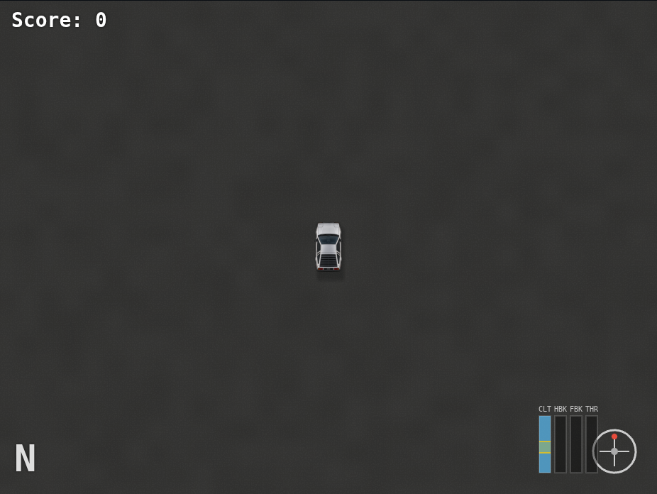
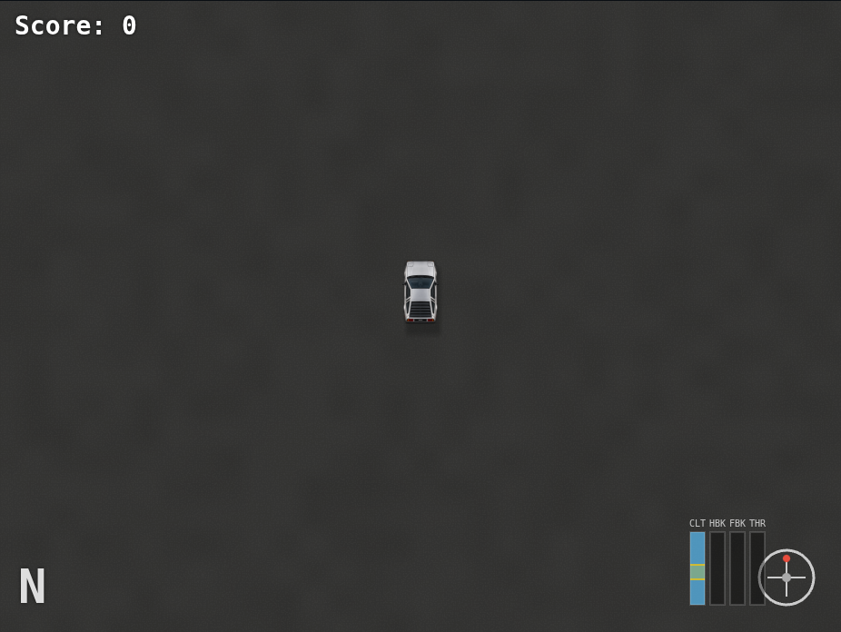
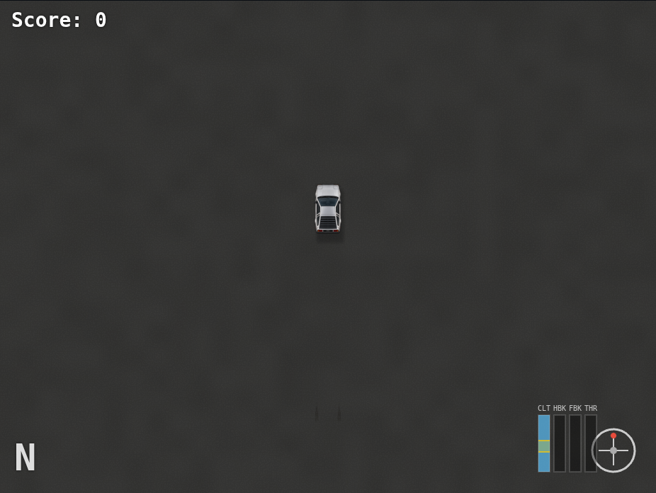
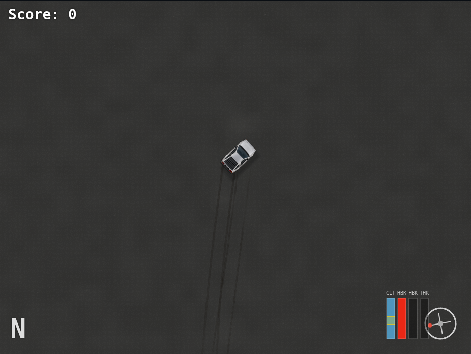
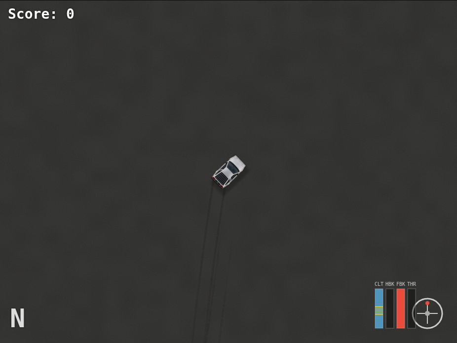
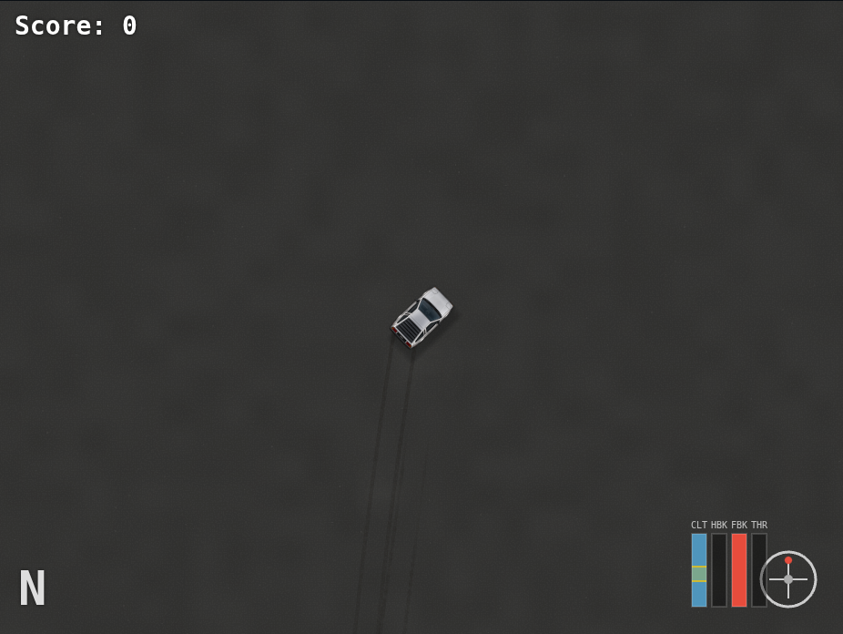
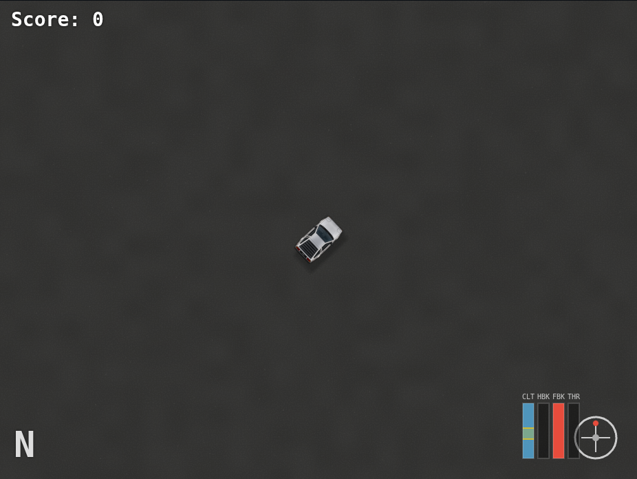

# Reactive atmospheric dust

Experimental branch: `verlet_gpt_v32_atmospheric_dust`. The recoverable simulator
baseline is `be6a43b` on `verlet_gpt_v31_wet_tire_liquid`; that branch is unchanged.
The initial procedural-field implementation is checkpointed in `03e7356`.

## Technique

This is a suspended, world-space atmosphere, separate from tire smoke. A sparse
1.25 m seeded lattice supplies fine motes; a 6 m lattice supplies faint, irregular
volumetric-looking patches in disturbed air. At rest, the globally distributed motes
supply the atmosphere; imperceptible broad veils are not rasterized. Only a camera-sized region with a conservative 10 m
motion/coverage guard is generated. Hashes use stable world-cell identities, not
screen pixels or the physics random generator. Wind advects the lattice; weak
analytical oscillation supplies gentle resting motion. Height varies from 0.15 to
1.95 m with restrained parallax against the road.

Airflow uses actual world velocity, body heading, lateral velocity relative to the
body and yaw rate. A local pressure/entrainment approximation displaces dust around
the body, with outward side flow, angular swirl and slip-dependent asymmetry.
A history of 96 observations sampled at 10 Hz retains disturbances along the actual
trajectory. Each observation produces a spreading, advecting, decaying disturbance.
Dust returns to its ambient field as these contributions settle. This is neither a
wheel emitter nor a CFD/fluid solver.

Observations happen after physics ticks, before rendering interpolation. A shared
simulation-time sampling grid interpolates observations when necessary; rendering
frequency does not decide where new wake samples are recorded. The observer does
not mutate the supplied body, wheels, forces, controls or RNG. Disabled dust stops
new observations; existing retained samples age normally. Reset, time rewind in the
observer and teleport detection clear stale history. Very large time jumps process
only the retained history horizon.

### GPU work and ownership

The original vertex prototype evaluated the same airflow four times per quad. The
refined version evaluates each eligible element once in a 64-thread compute dispatch,
then draws instanced four-vertex strips from the generated storage buffer. The compute
stage reconstructs analytical positions; it does not integrate particle state over
time. Invisible hashed motes skip airflow work before the history loop.

The draw joins an existing world render pass, after ground/puddle optics and before
upper-world objects/vehicle. Existing smoke, splashes, puddles, tire films, rubber and
artwork keep their rendering paths. Dust uses the shared scene light rig, muted mineral
scattering and premultiplied extinction, without additive glow. Soft patch coverage
comes from stable world-space grain. No dust texture or full-screen rendering pass
is introduced.

Three fixed GPU buffers are owned/destroyed by `AtmosphericDust`:

| Buffer | Bytes |
| --- | ---: |
| Frame uniforms | 128 |
| Wake observations, 96 × 32 bytes | 3,072 |
| Analytical element output, 6,400 × 32 bytes | 204,800 |
| Total | **208,000 (203.125 KiB)** |

Ordinary setting edits and camera resizing reuse these buffers and both pipelines.
History uploads occur only when observations change: 3 KiB per update at up to 10 Hz.
A rendered frame uploads 128 uniform bytes. There are no per-mote CPU updates,
production readbacks, per-frame texture allocations or new GPU devices.

The fine candidate budget follows the existing quality selection (1,800 / 3,000 /
4,600 / 6,000); coarse patches have a 320-cell ceiling. Zoomed-out views use a nested
power-of-two subset of the same lattice rather than generating the entire map.
A sustained CPU command-encoding overload smoothly thins the same hashed motes.
This measures CPU submission pressure, not GPU time; it is not a native GPU load
controller. Adaptive thinning does not modify physics or stored wake observations.

`getGPURenderStats().dust` exposes candidate counts, history, bytes, draw calls and
compute workgroups. Global `computeWorkgroups` includes both smoke and dust;
`smokeComputeWorkgroups` preserves a separate smoke-only count. Existing GPU timing
fields retain their scope: smoke compute and base world rendering. They do not
measure the new dust compute pass or every liquid/upper-world pass.

## Controls and compatibility

Expand **Rendering → Atmospheric Dust**:

- Atmospheric dust on/off.
- Ambient dust density (default 0.42).
- Vehicle disturbance strength (default 1).
- Wake persistence (default 4 seconds, range 0.5–8 seconds).
- Ambient wind speed (default 0.12 m/s).
- Wind direction (default 25°, world x-right/y-down axes).

These use the existing controls, local persistence, global reset and settings
export/import. Their storage prefix is `dustParam_`; vehicle presets do not silently
replace dust choices. `?dust=0` provides a rendering-only comparison switch.
Density zero or disabling dust skips its compute dispatch and draw. The atmosphere
is intentionally faint at default settings; higher density/disturbance is available
for inspection without changing the vehicle.

WebGPU is required for this effect. Canvas stays usable with its existing world
and smoke renderer. A thrown dust shader/allocation initialization failure is isolated from liquid and
base-world initialization. Renderer release/device loss destroys dust resources
along with the owning device. No automatic GPU reinitialization loop is added.
The new WGSL uses whole-vector writes to avoid the earlier Mac swizzle-write issue.
Native Metal and RTX 5090 testing are unavailable in this environment.

## Visual validation

The capture script drives the actual main loop using a deterministic test clock,
seeded initial conditions, neutral coasting, steering and handbrake. It exercises
resting, 16 m/s straight motion, 32 m/s motion, a sliding turn, an abrupt stop and
settling. A prescribed velocity change sets up each speed/stop scenario; no production
physics is changed. The camera is tightened for composition, diagnostic arrows and
smoke are hidden for clarity, and ghost intensity is set near zero in this capture
fixture. Ground and tire marks remain visible. Matched disabled/enabled captures
use the same physical state and simulation time.

The motion sequence is captured every five simulation render steps (approximately
12 frames/s). These are actual simulator images, not generated illustrations.
The default atmosphere is intentionally subtle; the car and tire marks should remain
visually dominant.

[Interactive on/off comparison and motion](atmospheric-dust/index.html).

| Scene | Off | On |
| --- | --- | --- |
| Stationary |  |  |
| Straight driving |  |  |
| High speed |  |  |
| Drifting |  |  |
| Just stopped |  |  |
| Settled |  |  |

## Measurement and regression results

The recorded drift contains **595 native tire-mark segments**. The isolated benchmark
reconstructs the same body/wheel/camera state, holds simulation time fixed and alternates
enabled/disabled rendering in ABBA order. Eight warmup frames precede 40 timed frames
(20 per state), with a 926 × 696 target. No tests or capture workloads run concurrently.
The timed loop excludes screenshot readback, Canvas vehicle/HUD drawing and browser
presentation. Active liquid and smoke are absent in this recorded dust benchmark;
their coexistence is covered by the browser regression suite.

**All values below are forced SwiftShader software results, not RTX 5090 or Metal GPU
execution times.** Encoding measures JS command submission; queue completion includes
CPU-observed waiting for the software backend. The latter is not a GPU timestamp.

| Variant | CPU encode median off / on | Queue completion median off / on | Queue completion p95 off / on |
| --- | ---: | ---: | ---: |
| Vertex checkpoint `03e7356` | 0.20 / 0.20 ms | 277.95 / 323.25 ms | 505.80 / 669.30 ms |
| Compute before sparse veil culling | 0.20 / 0.30 ms | 274.60 / 335.20 ms | 355.40 / 1041.20 ms |
| Final sparse field | 0.20 / 0.20 ms | 263.45 / 300.05 ms | 293.10 / 335.60 ms |

The vertex checkpoint uses the earlier 7 m guard (2,285 candidates); both compute
variants use the more conservative 10 m guard (2,744 candidates). These are
whole-path comparisons, not isolated arithmetic microbenchmarks.

Compute precomputation **did not establish a software speedup**. Its advantage
is one analytical flow evaluation per eligible element, rather than four repeated
vertex evaluations; it adds one dispatch and about 200 KiB of scratch storage. The
compute checkpoint is preserved in `979c564`. Avoiding broad, imperceptible resting
veils reduced the observed additional median queue time from 60.60 to 36.60 ms in these
runs. The final enabled/disabled difference is approximately **13.9%** on this software
backend. Host jitter and the short sample series limit conclusions, especially for
the variable tails. No native performance improvement or high-refresh-rate target is
claimed. Normal application startup selects Canvas on a software adapter; these runs
explicitly force WebGPU for validation.

Raw data: [vertex](atmospheric-dust/vertex-benchmark.json),
[compute before sparse culling](atmospheric-dust/compute-benchmark.json),
[final sparse field](atmospheric-dust/sparse-benchmark.json).

The final benchmark submits one instanced draw and 43 workgroups over 2,744 candidate
quads at the sampled view. Candidates include invisible/empty elements; they are not
an active particle count. Shader-side density and sparse-veil checks avoid expensive
flow work or rasterization for rejected candidates. Buffer ownership remains 208,000
bytes with dust enabled or disabled; disabling reuses the cached allocations.

Validation results:

- **175 unit tests passed**, including numerical physics and history/memory bounds.
- Full browser run: **106 of 108 passed initially**. Two fixture assumptions needed
  updates: the old smoke-only compute total, and a clean-ground comparison between
  different simulation times after adding moving ambient dust.
- The smoke assertion still requires exactly 32 smoke workgroups and no smoke steps
  without a physics tick; it now separately accounts for dust workgroups.
- The wet-film visibility assertion now compares hidden tracks against clean ground
  at the same simulation time, preserving pixel equality while allowing ambient motion.
- Corrected GPU-world, dust and wet-film checks are rerun after the final optimization;
  all **20 affected browser checks passed** in the final run. The [unit log](atmospheric-dust/unit.log),
  [initial full run](atmospheric-dust/browser-initial.log) and
  [final affected run](atmospheric-dust/browser-final-affected.log) are preserved. All **108 unique browser
  cases** are covered across the full run and affected reruns; no test is deleted or
  weakened, and numerical tolerances stay unchanged.
- Visual inspection covers stationary, straight, high speed, drift, stopped and settled
  states, including the lossless motion sequence. Matched pairs retain the same physical
  state. Quantified differences are [recorded separately](atmospheric-dust/visual-differences.json).


## Limits

The history covers at most 9.6 seconds, sufficient for the maximum 8-second wake.
Time reconstruction applies only to retained observations; this is not a full replay
recorder. Apparent mote sizes are visual proxies, not literal dust-grain diameters. Wind-setting edits resynthesize the analytical field under the new wind;
they do not solve a continuous meteorological transition. The airflow is a coarse
artistic approximation, not aerodynamics, particle collision or conservation of mass.

CPU-pressure thinning is deliberately adaptive and therefore can vary with machine
load. With a fixed budget/settings and retained history, analytical motion and seeking
are deterministic. Extreme zoom changes can change the nested lattice subset; no
camera-pan random reseeding occurs. The existing camera supports translation, zoom
and shake; no camera-rotation feature exists to validate or extend here.

No native 120/240 Hz, integrated-Mac sustained-load or RTX 5090 performance claim is
made. The feature needs user-side hardware inspection, especially for subtle visibility
on different screens and native frame pacing. Long-history tests prove bounded
storage; they are not a multi-hour native GPU soak test.

## Source and reproduction

New modules: `dust-controls.js` (registry), `dust-history.js` (fixed observations),
`atmospheric-dust.js` (GPU ownership) and `atmospheric-dust.wgsl` (flow/instancing).
Integration touches `gpu-renderer.js`, the read-only observer in `main.js`, visual
reset in `liquid-events.js`, and the existing state/UI registries. Physics algorithms,
vehicle dimensions/artwork, paint systems and numerical tolerances are untouched.

New tests are `tests/dust-history.test.js` and
`tests/e2e/atmospheric-dust.spec.js`. UI control-count fixtures include the six added
controls. The GPU smoke test now distinguishes its smoke-only and total workgroups.

With the development server at localhost:8000, Playwright and Chromium installed:

```bash
node scripts/capture-atmospheric-dust.mjs --output /tmp/dust-captures
node scripts/benchmark-atmospheric-dust.mjs --fixture docs/rendering/atmospheric-dust/fixture.json --output /tmp/dust-benchmark.json
```

The benchmark uses a real captured drifting state and retained skid geometry, with
interleaved enabled/disabled samples and no screenshot readbacks in the timed loop.
`--ref 03e7356` can benchmark the preserved vertex prototype without changing the
checkout. Raw samples identify their software backend and timing scope. Use `--native`
to omit forced SwiftShader flags and optionally select your browser through
`CHROMIUM_EXECUTABLE`. Native runs were not verified here; inspect the reported
adapter and use your existing OS/browser GPU configuration. Queue-completion results
still are not GPU execution timestamps, even on native hardware.
