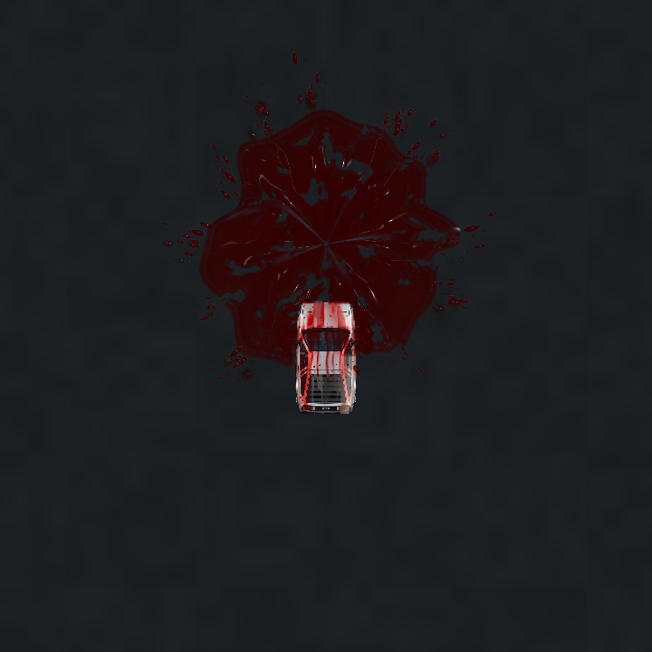
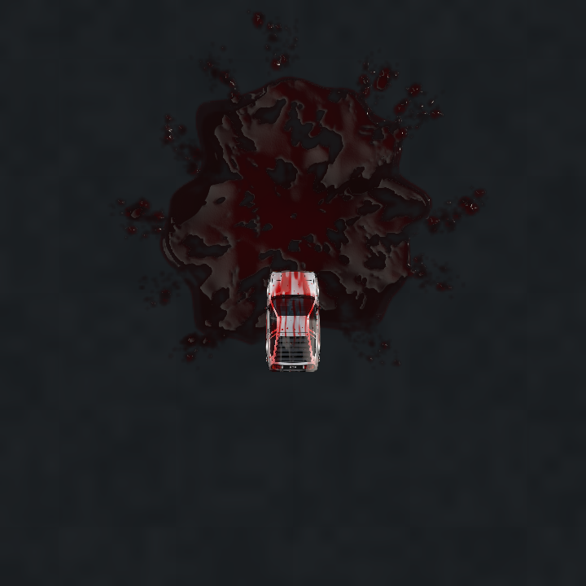
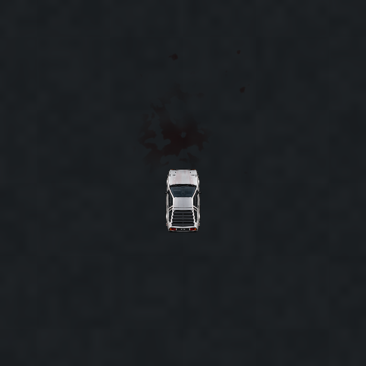
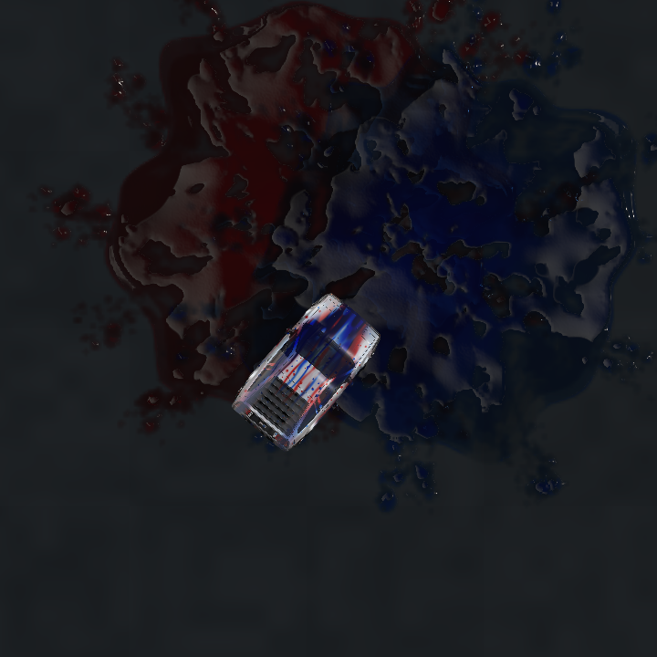

# Complete live liquid controls and residue integration

Branch: `verlet_gpt_v28_complete_liquid_integration`.
Base and recoverable checkpoint: `26c527c` on `verlet_gpt_v27_residue_weathering`, also retained locally as `backup/v27-before-full-liquid-integration`. The prior simulator checkpoint remains `3cc0dc5` on `verlet_gpt_v26_simulator_liquid`. No stable/UI branch is merged or replaced.

## Audit and resulting behavior

The earlier simulator integration already connected real balloon collisions to the lab's membranes, filaments, primary drops, secondary landing splashes, persistent ground atlas and car-local wet streaks. It shared the existing WebGPU device. Its missing pieces were runtime material controls, the latest ground dye erosion, and suppression of the legacy ground visual overlay. This change completes those connections rather than creating a second renderer.

Balloon events retain collision position, velocity direction, measured wheel impact speed, radius-derived volume, hue, simulation timestamp and an independent deterministic seed. Each of up to 24 events has its own uniform slot and atlas layer. Impact intensity multiplies measured speed; volume scales the radius-derived volume. Neither changes the collision response or scoring. Speed/volume have cosmetic safety caps of 120 m/s / 80 artistic litres after scaling (the recorded event is capped at 60 m/s / 40 litres).

The water now dries through damp asphalt into residual dye, which erodes and dulls using the same stable world-space model as the lab. Retained events reconstruct after backward time changes. Body wetness follows the current car pose; ground deposits remain fixed in world space.

Legacy CPU splats and decals still update and provide gameplay paint contact/pickup/depletion. In procedural GPU mode their old billboards and ground decals are not drawn or uploaded; this avoids double visual deposition and a permanent legacy stain masking cosmetic drying. Coloured tire trails, scoring, collision impulses, sound and screen shake remain in their existing systems. Drying cosmetic liquid does not erase the invisible remaining gameplay paint contact field, so tyres may still pick up colour there. Canvas and explicit legacy mode retain the old visible splats/decals.

## Controls and persistence

In the main simulator, select **Rendering** below the canvas. Four existing-style collapsible cards contain 27 controls:

| Card | Parameters |
| --- | --- |
| Splash Dynamics | Enable/legacy switch, impact intensity, balloon volume scale, membrane thickness, stretch/breakup, filament length, drop size |
| Liquid Appearance | Dye concentration, roughness, reflections, puddle depth, detail preset |
| Vehicle Interaction | Contact enable, body wetness, streaking/runoff, hood deflection, body drying duration, body dye residue |
| Ground Drying and Residue | Drying enable/duration/irregularity, absorption, residue amount, dye degradation enable/lifetime/irregularity/protected retention |

The material menu provides the lab's **Reference**, **Thin film** and **Deep pool** presets. **Reset liquid** restores only liquid controls. The ordinary global reset also includes them. Liquid settings persist locally using the same finite-value validation pattern as sound settings; the existing JSON export/import includes them under `params`. Imported older presets can omit the new values. Storage failure is tolerated.

Controls affect running/retained effects. Optical-only changes reuse the cached deposition. Shape changes intentionally reconstruct affected footprints, including settled ones, rather than silently leaving incompatible old geometry. Material presets leave dynamics, drying and gameplay tuning alone. Detail has four values: follow renderer, laboratory performance (1 sheet / 36 filaments / 650 drops), laboratory balanced (2 / 54 / 1200) and laboratory high (3 / 72 / 2000). Changing it reuses pipelines, meshes and existing atlas resolution; the global renderer quality selects the atlas resolution at initialization.

The lab imports the same pure defaults/presets module as the simulator. It retains its independent scene, timeline, controls, images and diagnostics; there are no simulator/gameplay imports in the lab.

## GPU work, bounds and lifecycle

The existing `WorldLiquid` owns the shared pipelines and uses the simulator's device and submission. No second GPU device, fluid solver, CPU droplet update, synchronous production readback, or extra deposition texture is added.

- One preallocated `rg16float` texture array contains 24 reusable event slots: 14.16 MB payload at performance (384²), 25.17 MB balanced (512²), 56.62 MB high/ultra (768²).
- Two reused refraction/composition targets cost eight bytes per backing pixel combined. They are needed while airborne liquid is present; settled effects render directly. Sprite textures, fixed meshes and small buffers are additional.
- The liquid detail override changes bounded sheets/filaments/drops, retaining the initialized atlas resolution. Geometry is prebuilt to allow switching without allocations.
- Only event uniforms/poses are uploaded each frame, not individual droplets. Settled atlases rebuild only for a time rewind, event replacement or deposition-shape change.
- Offscreen atlas layers and expired ground layers are skipped in the ground fragment loop; offscreen airborne events are not drawn. Extreme control values expand per-event world coverage without increasing texture allocations. A WGSL probe validates primary, secondary and sheet landings against the bound.
- Ground processing stops conservatively after 300 seconds under supported controls, unless water drying or dye degradation is disabled. Expired layers retain cached history so changing time or controls can reconstruct them. Body residue can remain indefinitely, matching the lab's optional body dye model; disabling body residue permits the liquid renderer to become fully idle after the ground lifecycle.
- The latest 24 visual impacts are retained; the oldest is evicted at capacity, including its visual residue/body contribution. This is a deliberate bounded visual history, not an unlimited world fluid atlas. It does not remove gameplay paint. A spatially tiled archival residue cache remains future work.
- Turning procedural liquid off immediately returns to legacy visuals and stops liquid draws/deposition work. Resources remain reusable for re-enabling. Reset clears events through the existing session reset. Device loss releases resources and uses Canvas; missing liquid shaders retain the base GPU world and legacy visuals.

`getGPURenderStats()` reports the active mode, quality/count budgets, ground layers, airborne events, evictions, allocation counts and payload estimates. These are not measured driver VRAM allocations. Existing GPU timestamps cover the base world/smoke scopes, not the complete liquid/compositor frame; no RTX speedup or native high-refresh claim is made. Tests and captures here use Chromium/SwiftShader/offscreen targets, not RTX hardware profiling.

## Visual review

Actual simulator shader captures with the lab default optical parameters:

| Airborne / wet car | Glossy deposited pools | Weathered residue | Independent colours |
| --- | --- | --- | --- |
|  |  |  |  |

The capture helper uses real simulator rendering with the simulation clock held for comparable frames. These images establish appearance/layering, not driving frame rate. The real-collision captures below also use the simulator's existing collision handler and score calculation; the animation loop is then held only for deterministic capture.

## Running this version

Run `python3 serve.py` from the checkout, open the main simulator root page, and drive through balloons in a hardware-WebGPU browser. Use the already working NVIDIA/PRIME browser configuration on hybrid Linux. The new controls are under **Rendering**, below the canvas. The standalone laboratory remains at `/experiments/splash-lab/`.

Use the **Procedural liquid** toggle, or `?liquid=0`, to compare legacy visuals; `?renderer=canvas` uses the existing Canvas renderer. A software adapter automatically chooses Canvas unless GPU mode is explicitly forced for diagnostics. Switching a Git branch does not itself redeploy GitHub Pages.

## Limitations

This remains an analytical visual model. Overlapping liquid colours layer optically; there is no mixed-fluid chemistry or exact mass conservation. Body contact is a coarse approximation of the hood/glass surface. Landing spray and body runoff are included; new wheel-generated spray and re-wetting when driving through an old puddle were not present in the lab and are not added here. Replay of a moving car also requires restoring authoritative car/pose-history state, as before. Existing ghost sprites retain their dry-art blur approximation. Hardware performance and very dense long-session traffic still require testing on the user's RTX/browser.

## Real collision captures and reproduction

[Actual collision, score 233](complete-liquid/simulator-0.7.png),
[settled puddle / wet car](complete-liquid/simulator-5.png),
[aged residue](complete-liquid/simulator-70.png),
[clean ground after 300 seconds](complete-liquid/simulator-300.png),
[liquid cards and material menu](complete-liquid/controls.png).
[Capture diagnostics](complete-liquid/real-collision-diagnostics.json) record one event, the unchanged score across the lifecycle, and ground-layer processing dropping from one to zero at the endpoint. Body dye remains optional and independent.

```sh
CHROMIUM_EXECUTABLE=/usr/bin/chromium node scripts/capture-simulator-liquid-ui.mjs \
  --url http://localhost:8000 --output /tmp/liquid-ui
```

This tool intercepts only the presentation target, invokes the real collision handler with a moving wheel, then holds the main animation callback to capture specific simulation times. It clears stale Canvas overlay pixels and redraws the existing score HUD for the held frame. The captures use the actual production WGSL and UI. This is instrumentation only, not a new production rendering path or a wall-clock driving benchmark.

## Validation

- **167 unit tests passed**, 19 files; all existing numerical physics tolerances retained.
- **90 distinct browser tests validated**, no skips, across a complete 89-test WebGPU run and affected-test reruns including the additional extreme-coverage test. The initial full run had 88 passes and one legacy-decal fixture failure. That fixture now explicitly selects the preserved `?liquid=0` path; all its original assertions remain. The 14 affected GPU-world/live-control checks then passed, including the replacement-mode suppression checks.
- All 25 optical/dynamic/lifecycle settings produce independently observable changes in live rendered output; restoring each value restores the same image. The enable switch and all three laboratory detail presets are also exercised. The UI has 203 bound controls in total (185 ranges, 18 toggles); new liquid settings share validation, import/export, persistence and reset.
- Real collision coverage verifies exactly one event and scoring; existing tests cover drivetrain, steering, brakes, suspension, skid alignment, camera/DPR transforms, sound/UI, paint state preservation, reset, sprite fallback, shader/allocation failure and device loss. The live 26-impact stress keeps 24 events and stable GPU resource counts.
- A shader probe checks 4,096 sheet/drop/secondary landing positions at maximum live intensity/volume against expanded atlas coverage. Changing liquid detail reuses allocations and selects the shared laboratory particle budgets. The standalone lab still compiles, renders and scrubs deterministically after the shared-settings extraction.
- Ground erosion restores clean asphalt; disabled degradation retains the old stain. Backward seeking reconstructs exact hashes. Optical, drying and body-material changes reuse settled deposition, while launch/breakup/detail changes invalidate it. Disabled procedural mode stops liquid draws and leaves CPU paint arrays intact.
- Visual review covers peak impact, settled glossy water, drying, aged/cleared residue, coloured overlap and rotated/moving body wetness. `git diff --check` passes. No production physics, handling/input algorithms, artwork or physical geometry were changed.

No native RTX execution time, frame pacing or driver-memory measurement is available in this cloud. These results establish correctness and bounded resource behavior; final hardware performance remains a user-side check.
