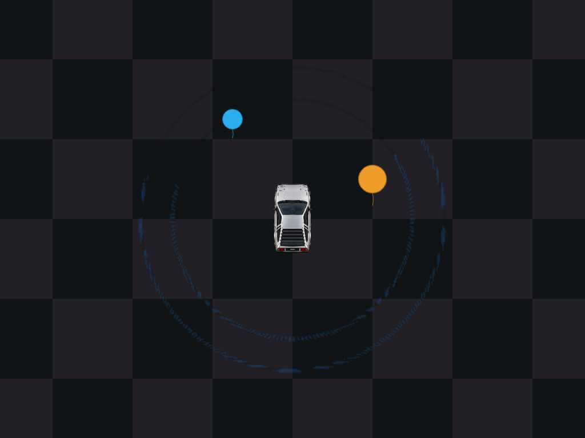
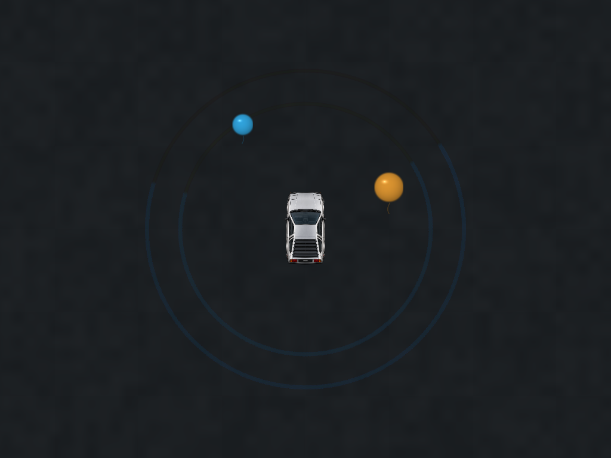
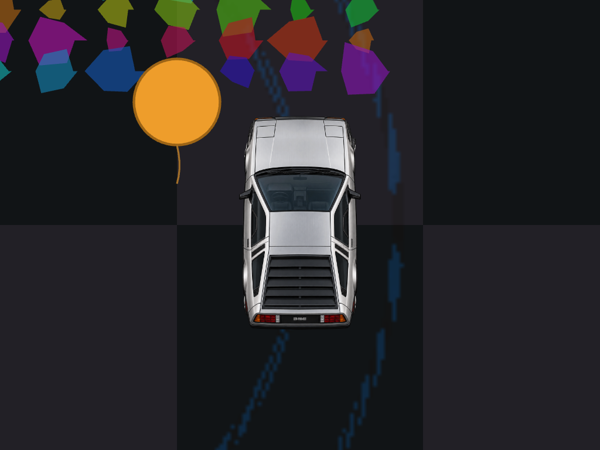
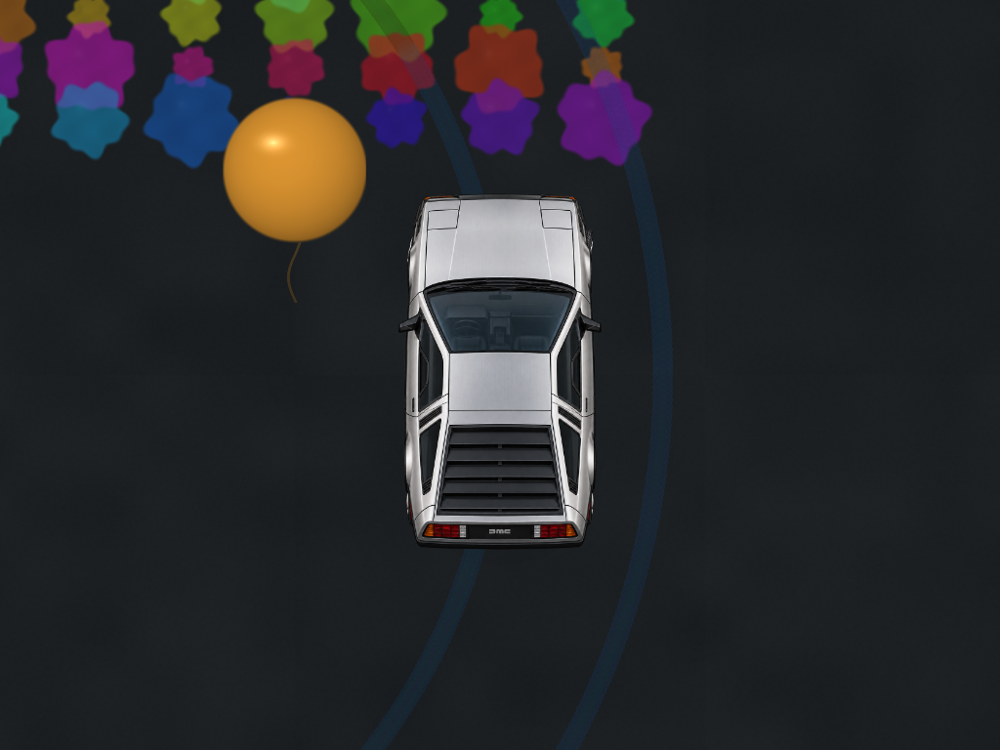
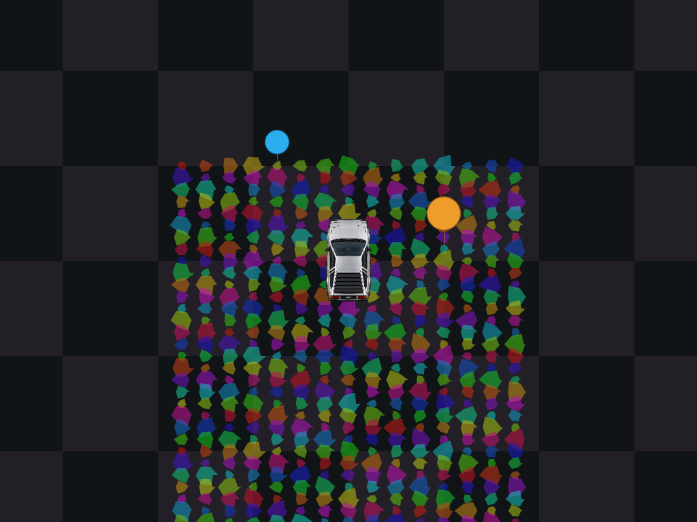
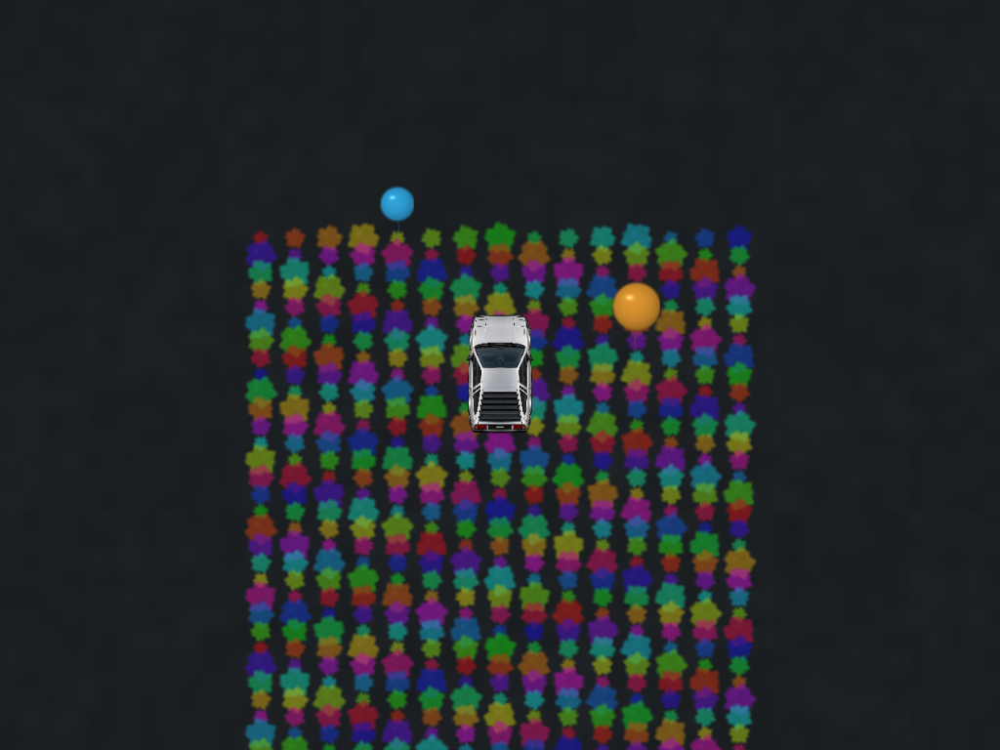

# GPU world rendering checkpoint

Development branch: `verlet_gpt_v21_gpu_rendering`. Baseline: `f4c9440` on
`verlet_gpt_v20_delorean_geometry`; v19 and v20 are preserved, with no merge or
push. Checkpoint `975b5d5` contains the initial pipelines; the follow-up fixes
optical density, resource bounds and backend selection.

**Status: correctness-validated development checkpoint. Final unit, full browser
and isolated GPU checks pass after correcting two browser fixture clocks. Native
hardware performance, live GPU presentation and high-refresh behavior remain
unqualified.** Software GPU rendering is materially
slower than the baseline, so auto-selection now uses Canvas on reported fallback
adapters. Native WebGPU is the primary path. Software GPU execution remains an
explicit diagnostic option. Passing correctness checks is not a hardware
performance claim or authorization to merge.

## Architecture and changes

The CPU remains authoritative for physics, vehicle geometry, wheel contacts,
controls, engine/drivetrain, collisions, gameplay paint pickup/depletion and all
existing emission conditions. Every physics module, constants, input, state
settings/defaults, DeLorean PNGs, sprite/geometry modules, UI and styles match the
baseline. The complete `runPhysicsStep()` body and ordering are byte-identical.
`main.js` changes only render-layer routing, Canvas smoke fallback and draining
the legacy render-only upload queue.

| System | CPU responsibility | GPU responsibility |
| --- | --- | --- |
| Ground | Camera and existing blur controls | Filtered checker/asphalt/studio/diagnostic materials, one fullscreen draw |
| Skids | Existing event generation/fade/cull; stable slot mapping; source opacity/order stream | Persistent geometry storage, vertex culling/expansion, analytic capsule AA and grain |
| Paint | Existing deposition, pickup, evaporation and depletion; bounded instance upload | Procedural smooth edges, pigment variation, alpha and wet sheen |
| Smoke | Unchanged slip-based emitter; seed uploads and slot recycling | Persistent particle buffer, curl-noise compute, lifetime/drag/advection, soft density shading |
| Sparks/splats | Existing emission/integration and instance packing | Batched antialiased soft particles; restrained luminous cores |
| Balloons/shadows | Existing collision/pop gameplay and instance packing | Shaded balloons/strings; balloon and vehicle grounding shadows |
| Vehicle/ghosts/debug/HUD | Existing Canvas paths | Browser compositing; no sprite replacement or geometry changes |

`gpu-renderer.js` owns pipelines and tracked buffers. `gpu-skid-cache.js` owns
geometry, opacity and draw-order storage. `gpu-timing.js` owns optional timestamp
resources. Each owner releases its resources, including partial allocation
failures. Generation guards prevent stale smoke-readback callbacks acting on a
replacement device. Device loss hides/unconfigures the GPU canvas, destroys the
owned device/resources and resumes Canvas; it retires transient GPU smoke instead
of moving it back to stale CPU spawn positions. Reload retries initialization;
there is no unbounded retry loop.

### Skids

The old 6144 x 4608 RGBA texture consumed **108 MiB** yet provided only 16 texels
per metre: about three texels across a front tire. Increasing full-map density
would cost gigabytes. The replacement retains up to 32768 event geometries
(the existing UI maximum is 20000), independent of map area, and rasterizes
analytic world-space capsules directly at viewport resolution. No large skid
texture, periodic clear/repaint or composite-texture border smearing remains.

Immutable endpoints, width and color upload once per event. Authoritative opacity
and source order stream on physics-state changes; high-refresh frames reuse
resident data. Slot recycling preserves source draw order, including pigment
overlap. Shader coverage is partitioned along adjacent caps and converted through
optical density, preventing short events from creating beaded/darker joins.
A real pixel test compares one long event with 200 adjacent short events, without
changing source alpha or adding any physical events.

### Smoke and particles

The old smoke buffer had a 44/48-byte stride mismatch, a float/u32 count mismatch,
wrong sparse dispatch extent, fixed render-frame dt, cumulative fade multiplication,
frame-dependent drag, squared-dt buoyancy and debug magenta output. These visual
particle defects are corrected. Compute uses elapsed simulation time, including
zero elapsed time between high-refresh renders and during freeze. It does not
change the CPU physics timestep. Spawn uploads coalesce adjacent dirty slots;
stale CPU positions never overwrite living GPU neighbors. CPU alive count is O(1).

Only alive flags return asynchronously for CPU slot recycling, every twelve
render frames; positions never round-trip. The old whole-queue fence and per-dead
slot zero uploads are removed. Optional render timestamps also map asynchronously;
no instrumentation fence is added to production. CPU fallback smoke uses the
existing emitter and cached soft sprites, with no added RNG calls.

The existing emitter still shares the project's seeded RNG with other systems.
No RNG implementation or emission formula was changed. Exact cross-backend or
cross-version random-stream equivalence under pool saturation is **not proven**;
this pre-existing coupling needs a dedicated long-run replay study before claiming
full gameplay replay equivalence. GPU noise is visual and not guaranteed bitwise
identical across vendors. No GPU values feed vehicle force/integration equations.

### Ground and compositing

Asphalt uses filtered, world-anchored noise, including integer hashing and
skipping noise octaves filtered out at the current scale. Checker remains
available and is analytically filtered. Paint variation is restrained and
filtered rather than a high-frequency checker-like pigment pattern. Balloons
receive consistent highlights, with soft shadows beneath them and the vehicle.
Ground paint now sits below skids inside the GPU layer, correcting the old
Canvas-paint-over-GPU-marks ordering.

Camera/shake uniforms use the existing shared metre/CSS-pixel conventions.
Backing resolution changes raster density only. Existing chassis/camera
interpolation and motion ghosts remain; raw wheel-position interpolation is an
existing limitation and was not changed. No TAA, fullscreen bloom, adaptive
physics tick or extra render interpolation latency was introduced.

## Visual comparisons

These are controlled synthetic event scenes, not new physical events generated
by the renderer. Baseline and new captures share the camera, vehicle geometry,
source trail coordinates, tire widths and paint data. Smoke has no valid visual
baseline because the old shader used debug magenta and invalid state layout.

| Scene | Baseline | New GPU renderer |
| --- | --- | --- |
| Retained curves |  |  |
| High zoom |  |  |
| Dense paint |  |  |

[Smoke capture](validation/after-smoke.png) ·
[Existing calibration overlay](validation/calibration.png) ·
[Empty scene before](validation/before-empty.png) /
[after](validation/after-empty.png).

The car artwork itself is deliberately unchanged. In particular, the calibration
continues to show the existing 3.481 m visible body inside its 4.267 m envelope;
this mission does not correct that separate artwork mismatch.

## Performance evidence and stopping point

See the raw JSON and images in [validation](validation/). These are **SwiftShader
software WebGPU**, not native hardware. Images use real offscreen WGSL rendering
and then the unchanged Canvas vehicle layer. The environment loses a GPU device
on swap-chain presentation even in a standalone clear-only probe, so live GPU
canvas presentation could not be qualified here.

The first producer-only benchmark showed an apparently steady 60 Hz rAF cadence
while queued GPU work accumulated. That is **not completed-render throughput**.
The final comparison fences completion in the benchmark only and uses identical
external asynchronous timestamp sampling for baseline and new main render passes.
It records CPU encoding, completion pacing, variance, p95/p99 and actual GPU
main-pass samples separately. Neither timing includes a complete application
physics/audio/UI frame, and GPU main-pass samples exclude compute, the baseline's
skid accumulation pass, Canvas and browser presentation. Samples are small and
software scheduling varies; no hardware extrapolation or 120/240 Hz claim follows.

| 1024 x 768, balanced | Baseline CPU encode median | New CPU encode median | Baseline software GPU main-pass median | New software GPU main-pass median |
| --- | ---: | ---: | ---: | ---: |
| Empty | ~0.1 ms | ~0.1 ms | ~17.1 ms | ~128.5 ms |
| 4000 skid events | ~0.1 ms | ~0.3 ms | ~17.3 ms | ~206.0 ms |

The CPU cost increase is small in these scenarios; the software GPU cost increase
is significant. Software completion-pacing p99 was roughly 0.48–0.53 seconds
versus about 0.05 seconds at baseline. It justifies automatic Canvas selection on fallback adapters,
not a claim of faster GPU rendering. Native GPU profiling is the remaining gate
before promoting this branch. No numerical tolerances or physical handling were changed
to mask a performance or numerical result.

The full-map texture is removed. Managed GPU buffers total about **4.3 MiB** at
the current capacities, excluding swap chain, driver/pipeline overhead and
benchmark-only resources. Buffers are allocated at initialization, not every
frame. The pixel budgets below bound GPU targets. A source-level lifetime audit,
partial-allocation test and repeated-frame/resize checks found no per-frame GPU
resource growth; an hours-long native-GPU soak was not performed.

Current budgets support all existing slider maxima: 20000 skid events (32768
storage slots), 10000 decals (16384 capacity), 500 balloons, 1200 trail arrows
(20000 capacity), and 300 sparks. Splat billboards have an 8000-instance budget;
`omittedSplats` exposes overflow. Extreme imported counts can exceed visual
budgets without changing gameplay arrays; skid overflow is also reported. Large
multi-vehicle populations are not yet implemented or performance-qualified.

## Controls and compatibility

No application UI, saved preset schema or parameter defaults changed. Visual
options are URL parameters applied on reload:

| Option | Values |
| --- | --- |
| `surface` | `asphalt` (GPU default), `checker`, `studio`, `diagnostic` |
| `quality` | `performance`, `balanced` (default), `high`, `ultra` |
| `renderer` | automatic by default; `canvas` forces fallback; `gpu` explicitly permits a software adapter for diagnostics |
| `gpuProfile` | `1` requests optional timestamp-query profiling when supported |

| Quality | Resolution multiplier | Pixel budget | Detail |
| --- | ---: | ---: | --- |
| Performance | 0.75 | 4 Mi pixels | Reduced material/smoke detail |
| Balanced | 1.00 | 8 Mi pixels | Filtered material detail and smoke lobes |
| High | 1.00 | 12 Mi pixels | Extra material octave and smoke density detail |
| Ultra | 1.25 | 16 Mi pixels | High detail with supersampling |

These multiply existing canvas/DPR/GPU resolution controls, within device and
pixel-budget limits. Logical world scale is unchanged. Existing smoke, sparks,
skid visibility and motion-blur controls retain their bindings. The historical
GPU skid-redraw interval remains import-compatible but is obsolete: analytic
marks now reflect authoritative opacity immediately rather than periodically.
Canvas fallback retains the original checker/world/vehicle/HUD and adds usable
smoke; optional GPU materials and advanced shading are not mirrored there.

For local inspection, serve the repository with `python3 serve.py` (Windows:
`py serve.py`) and open `http://localhost:8000/?surface=asphalt&quality=high`.
Use `?renderer=canvas` to compare fallback. Do not force a software GPU expecting
hardware performance. Existing calibration is available with
`&vehicleCalibration=1`; vehicle/art dimensions remain the previous conversion's
known mismatch, intentionally untouched.

Read diagnostics in the browser console:

```js
const gpu = await import('/js/gpu-renderer.js');
gpu.getGPURenderStats();
```

CPU encode time is explicitly separate from optional `gpuRenderMs` (main pass
only). Stats include adapter/backend, fallback reason, uploaded bytes, resource
count/budget, draw calls, dispatches and overflow counts.

## Validation and reproduction

Unit results: **151 passed**. Earlier full browser runs passed all 46, but a
later forced-software run passed 44 and failed two handling assertions. Controlled baseline comparisons reproduced a fixture-clock problem. The unchanged handbrake
test also failed against the preserved baseline: 2.2 wall-clock seconds advanced
only 0.3–0.9 simulation seconds, and the compared turns ran for different durations.
The shift/reverse test's wall braking watchdog could likewise expire early.

The fixture correction runs both turns for 2.2 **simulation** seconds and retains
the braking speed threshold of 0.05 m/s with a 10-simulation-second deadline.
Host watchdogs allow slow CI to finish; no physical thresholds, initial handling
parameters or production algorithms changed. Both corrected cases pass against
both baseline and new source trees (recorded logs in `validation/`).

Final validation: the full normal-browser run has **40 passes, six adapter
skips and zero failures**; isolated software-WebGPU validation has **nine passes,
zero skips and zero failures**, executing every skipped case. All 46 distinct
browser tests are therefore exercised across the two configurations. The other
three added browser cases cover Canvas driving/queue drainage, initialization
failure and automatic software-adapter selection. Earlier stock-Chromium runs
had 39 passes/six adapter skips; the final isolated GPU run executes all skipped cases.
Results and preservation fingerprints are recorded in `validation/test-results.json`.
Numerical physics tolerances are unchanged. Coverage includes geometry/steering, tires and
skid centres through camera/zoom/shake/DPR changes, ghosts, failed sprites,
controls, presets, import/export, storage failure, drivetrain, suspension,
handbrake drift, fault handling, actual WGSL/compute, sparse smoke slots, frozen
visual time, density joins, resource reuse, allocation failure, device loss,
software selection and all surface/quality presets.

```sh
npm test
npm run test:e2e
npx playwright test --config=playwright.gpu.config.js
```

For the full software-WebGPU browser suite, set `GPU_FULL_SUITE=1` before the last
command. `CHROMIUM_EXECUTABLE` optionally selects system Chromium. Cloud testing
uses Linux dependencies outside the checkout because tracked dependencies were
installed for Windows; package declarations/lockfiles remain unchanged.

Repeat the controlled benchmark against separate servers for each checkout:

```sh
node scripts/benchmark-renderer.mjs --url http://localhost:8000 --backend software --scenes empty,drift --frames 60 --fenced --output /tmp/render-new
node scripts/benchmark-renderer.mjs --url http://localhost:8000 --backend native --scenes empty,drift,paint,combined,zoom,smoke --frames 360 --fenced --output /tmp/render-native
```

`--fenced` serializes completion **only in the isolated benchmark** to avoid
mistaking a growing GPU queue for fast display output. Without it, frame metrics
are producer cadence, not completed frame rate. `adapterInfo` identifies the
actual adapter; requesting `native` does not prove a native adapter was obtained.
`--scenes smoke --frames 1800` supports a longer compute/emission soak. It has not
been completed on native hardware here. Native full-app presentation, long-run
memory, end-to-end latency, 1% low display FPS and 120/240 Hz behavior still require
real hardware/browser validation.

## Future work, separate from this checkpoint

- Native GPU profiling across zoom/resolution/quality, followed by evidence-based
  tuning or alternative cache strategies if analytic draw cost is excessive.
- Longer replay and saturation tests around the pre-existing shared RNG/emitter
  coupling; do not silently replace gameplay randomness.
- More efficient sparse particle allocation/compaction if many-vehicle profiling
  justifies it; remove flag readback only with a deterministic emission contract.
- GPU spark integration only if the tiny CPU pool becomes material at scale.
- Spatial bins/indirect draw and tiled persistent caches if retained event counts
  grow far beyond the current slider bounds.
- Native live compositing and long GPU soak remain unqualified. The current
  contact shadow is a soft footprint approximation, and the hybrid Canvas car
  remains above GPU smoke. Existing motion-ghost duration still depends on render
  sample cadence; high-refresh blur equivalence is not established.
- Vehicle interpolation/artwork correction as separate explicitly authorized
  projects; neither was included in this rendering mission.
