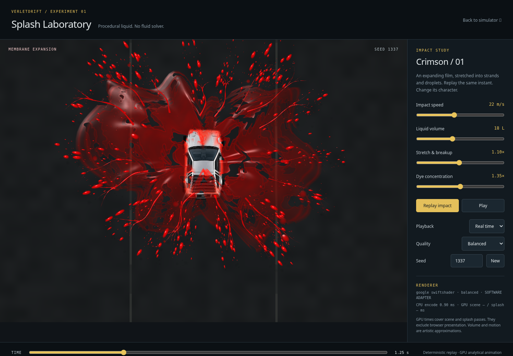
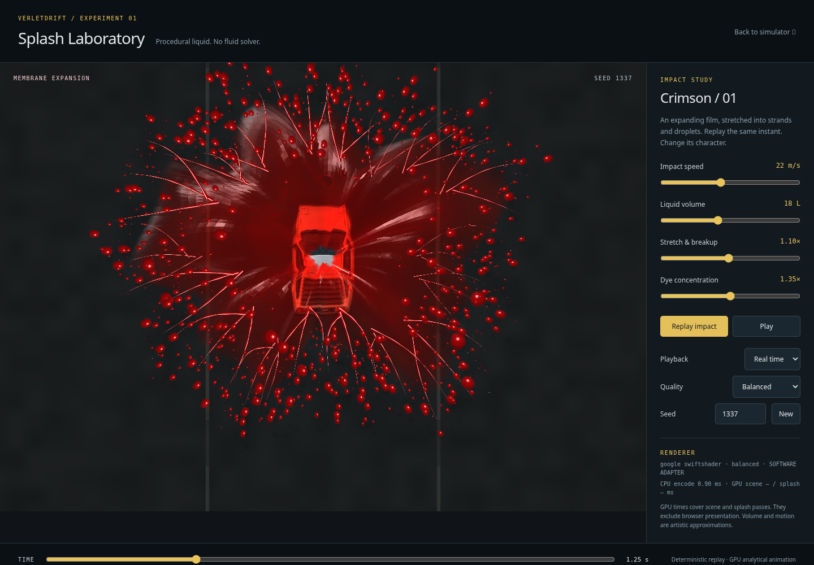

# Procedural Liquid Splash Laboratory

This is the historical report for the original `c279110` prototype, preserved on
`verlet_gpt_v23_splash_backup_c279110`. The current laboratory adds shared launch
momentum and persistent ground liquid; see the
[momentum/deposition follow-up](SPLASH_MOMENTUM_AND_DEPOSITION.md). Counts and
measurements below describe the original version.

Feature branch: `verlet_gpt_v23_liquid_splash`, based on `4b842b1`. The simulator
branch remains preserved; this experiment is not merged into main or connected
to gameplay. The reference guides the broad crimson membranes, glossy wet edges,
branching strands and fine spray. This is an art-directed 2.5D approximation,
not photoreal reconstruction of the supplied perspective image.



## Audit and architecture choice

The production renderer already owns a WebGPU world pass, resident skid storage,
instanced paint/balloons, GPU smoke integration and a separate Canvas vehicle/HUD.
`balloon.js` detects wheel hits, applies the existing vehicle impulse, updates
score/combo, spawns gameplay splat particles, affects paint pickup/traction, uses
the seeded physics RNG and plays audio. Replacing that emitter would risk changing
simulation behavior. Its original particles/deposition remain untouched.

A separate page/device was therefore selected. Reused components are the static
server, original crop metadata/artwork and the optional asynchronous GPU timestamp
helper. There are no new dependencies. The page does not import production main,
state, collisions, dynamics or input systems; browser tests verify that boundary.

The CPU supplies one 96-byte uniform block per rendered frame, draws fixed meshes
and instances, and manages controls/targets. Position, motion, breakup, optical
shading, droplet landing and replay variation execute in WGSL. No per-droplet CPU
update or per-frame instance upload is needed. No SPH, FLIP, Navier–Stokes or
particle-to-grid fluid solver is used. Compute is unnecessary for these closed-
form trajectories; no compute pipeline is included just to claim one.

## Rendering techniques

### Connected membranes

An immutable indexed polar parameter mesh is evaluated in the vertex shader.
Every sector shares its boundary vertices, forming connected films rather than
independent explosion sprites. The rim extent combines impact direction,
lateral throw, nominal volume, impact speed and seeded angular variation. A
saturating expansion curve and height folds produce stretching over time.
Overlapping films have slightly different folds and related perforations.

Material coordinates move with the film. A continuous seeded FBM field supplies
thickness and holes; the rupture threshold rises smoothly with elapsed time and
breakup. Derivative-sized edge smoothing avoids hard pixel transitions. Hole
rims and stretched outer lips carry greater optical thickness. Normals are
calculated from neighboring analytical surface positions at vertices and
interpolated, avoiding the coarse faceted highlights of the first iteration.

### Filaments and droplets

Each filament group has a main curved root and two children that begin at a
point on that root, then separate smoothly. Their endpoints follow the same
expanding rim as the film. Taper, moving necks and continuous fragmentation fade
strands into disconnected lengths. Droplets are born near the shared rim at
seeded times with outward/directional velocity. Analytical drag and a ballistic
height arc control trajectories. A broad size distribution favors fine spray,
with fewer larger elongated drops. At landing they squash and spread into wet
lenses, then dissipate. These are visual trajectories, not vehicle forces or
mass-conserving fluid transport.

### Translucent dye

First the asphalt, original car art and balloon are rendered into a sampled scene
texture. The liquid pass samples that image with a normal/thickness-dependent
screen offset, approximating refraction. RGB absorption coefficients suppress
green/blue more strongly than red. Thickness-dependent crimson scattering,
sharp directional highlights, a modest Fresnel term and premultiplied blending
provide wet translucent surfaces. This is artistically tuned RGB shading, not
spectral transport or an energy-conserving optical solver.

Draw order is fixed (scene/contact shadows, films, strands, drops), so replay
never randomly reorders transparent layers. Refraction sees the pre-liquid
scene, not previously drawn liquid: there is no true multiple refraction,
order-independent transparency, self-shadowing, volumetric absorption through
all layers or depth-buffer interaction with a 3D car. A soft laboratory roof-
height mask keeps low film/landed drops from obscuring the car. It is a visual
occlusion approximation, not collision handling. Small droplet shadows provide
contact cues. There is no bloom or full-screen motion blur hiding geometry.

## Visual iteration and reference comparison

The first functioning capture was too faceted and bead-heavy, with broad star-
like planes. It was not accepted as the finished experiment. Refinement included:

- Smooth analytical normals instead of per-triangle normal highlights.
- Irregular rim variation and denser, earlier membrane perforation.
- Shared parent/child filament curves rather than unrelated radial strokes.
- Fewer large circular droplets; finer elongated spray and flatter landed lenses.
- Controlled car occlusion and fewer overlapping films to improve readability.

| First functioning iteration | Refined prototype, same time/seed |
| --- | --- |
|  |  |

[Approach](splash-lab/approach.png) · [Rupture](splash-lab/rupture.png) ·
[Expansion](splash-lab/expansion.png) · [Breakup](splash-lab/breakup.png) ·
[Settlement](splash-lab/settling.png).

Compared with the reference, this delivers evolving connected films, perforated
silhouettes, glossy crimson transmission, directional strands and fine spray.
It remains more stylized and less geometrically/optically detailed. The reference
has perspective depth, lighting and thin-sheet complexity that this simple
orthographic/height-projected model does not reproduce. Filament-to-droplet
handoff is visually coordinated rather than true topology/mass transfer. A single
burst is supported; multi-event scheduling is a future integration concern.

## Performance and ownership

| Preset | Membrane layers | Filament strips | Droplets | Backing pixel cap |
| --- | ---: | ---: | ---: | ---: |
| Performance | 1 | 36 | 650 | 1.4 million |
| Balanced | 2 | 54 | 1200 | 2.4 million |
| High | 3 | 72 | 2000 | 4 million |

After impact, balanced draws about **20,210 triangles in six draw calls**, including
shadows and compositing. Mesh/index buffers and the car texture are allocated at
initialization. One refraction target is reused until size/quality changes.
Old targets are destroyed on resize; views/bind groups for the persistent scene
are reused. The raster budget and device limits cap resize allocations.

In the controlled cloud capture, 64 completed frames used the same 13 owned
GPU resources from beginning to end (buffers, textures and optional query sets).
Logical static buffer/art/timing-buffer storage is about 0.88 MiB, plus a 3.46 MiB
scene target at 1143×794. These counts exclude browser swapchain images, query
implementation storage, driver overhead and the test-only readback target.
They are not measured process VRAM. Partial allocation failures and device loss
release owned resources and stop submission. The standalone lab explains lack of
WebGPU rather than presenting a fake Canvas liquid fallback. The simulator's
Canvas path is unchanged.

[Raw measurements](splash-lab/measurements-software.json) use **SwiftShader software
WebGPU**, real WGSL and an offscreen target. CPU encode median was about **0.20 ms**;
completion-fenced frame median about **337 ms**. Sparse GPU samples averaged about
**129 ms scene / 202 ms liquid** (two samples each). This environment cannot
qualify native GPU presentation or high-refresh FPS. No RTX 5090 timing or speedup
claim is made. The benchmark uses GPU fences/readback solely for measurement and
captures; neither runs in the live laboratory frame loop. The lab's live GPU
readout uses bounded asynchronous timestamp sampling every 30 rendered frames.

## Validation and reproduction

The unit suite covers the deterministic clock, pause/rate handling, settings
bounds, and immutable mesh topology. Browser checks execute real WGSL and verify
changing silhouettes, identical same-seed/time replay, controls, bounded resource
reuse, resize, missing artwork, unavailable adapters, partial initialization
failure and device loss. Existing simulator regression tests remain intact.
See [validation results](splash-lab/validation.json) and the adjacent test logs.

Final results: **159 unit tests passed**; the complete ordinary browser run had
**44 passed / 11 adapter-dependent skips / 0 failures**. The software-WebGPU
focused run had **18 passed / 0 skipped / 0 failures**, including all five new
laboratory checks. A 390-pixel mobile viewport had a 390-pixel document width.
Every previously tracked baseline file remains byte-for-byte unchanged; all
feature changes are new files. The v19 UI, v20 geometry and v21 rendering branch
references remain preserved. No numerical tolerances or existing tests changed.

In this cloud browser, native WebGPU presentation has an external-memory import
failure. GPU tests therefore replace only the presentation texture with a real
offscreen GPU target, then read pixels for assertions/captures. They exercise the
actual shaders and rendering passes, but cannot certify native swapchain behavior
or this user's NVIDIA/Wayland/PRIME configuration. Pixel hashes are compared
within a single adapter/run, not asserted identical across GPU vendors.

From the repository root, install the development dependencies and Playwright
Chromium following the normal project setup, then:

```sh
python3 serve.py
# In a separate terminal:
npm test -- --run
npx playwright test
node scripts/capture-splash-lab.mjs --backend software --frames 64 --output /tmp/splash-capture
```

The capture tool accepts `--backend native` to remove software-adapter launch
flags, `--quality performance|balanced|high`, `--url`, and an optional
`CHROMIUM_EXECUTABLE` environment variable. Its captures remain offscreen even
with a native adapter. For native presentation and frame pacing, use the live
laboratory in the already verified NVIDIA browser session. Start with Balanced;
compare the same seed, time and viewport when changing quality. Timestamp GPU
scene/splash values exclude presentation; CPU encoding time is a separate metric.

Known limitations: no conserved liquid volume, fluid solver, true 3D refraction,
liquid self-shadowing, depth peeling, or physically sorted transparency. Stable
layer order and premultiplied alpha are approximations. The roof mask is an
artistic compositing approximation, not car/liquid collision geometry. The
balloon and car motion are scripted laboratory visuals. One impact is supported;
liquid deposits are temporary analytical shapes, not persistent simulator paint.
High quality increases fill cost as well as detail. Software timing above is not
evidence of native high-refresh performance. The lab requires WebGPU; the
simulator's existing Canvas fallback remains functional and unchanged.

## Future collision-event integration (not implemented)

Keep the existing balloon pop, impulse, scoring, paint/traction, audio and camera
shake logic authoritative. After that logic completes, publish an optional
read-only visual event, for example:

```js
{
  id,                 // stable visual event identifier
  position: { x, y }, // world metres at the original collision
  direction: { x, y },// normalized impact direction, captured at collision time
  speed,              // existing relative impact speed, metres/second
  bornAt,             // authoritative event time, not render-frame time
  volume,             // separately calibrated artistic amount
  seed                // hash of stable event ID; do not consume physics RNG
}
```

Copy values rather than retaining mutable particle/state references. The renderer
would map this event through the existing shared world/camera transform, evaluate
age from a consistent simulation/render clock, and retire it after its bounded
lifetime. Add a bounded event pool and shared meshes/pipelines, rather than a new
device or texture set per collision. Consolidate the laboratory's background and
refraction stage with the simulator's scene target before enabling many events.

Integration needs explicit decisions about overlap with existing decorative pop
particles and the cost of multiple translucent sheets; do not silently remove
gameplay deposition or replace existing arrays. Preserve the Canvas pop visuals
and scoring when WebGPU is unavailable or lost. Validate wheel/effect alignment,
camera zoom/DPR, replay/reset, pause, concurrent pops, quality switching and device
loss. Compare native CPU/GPU timing and allocation stability under sustained pop
load before enabling it by default. None of these integration changes are part
of this isolated experiment.
