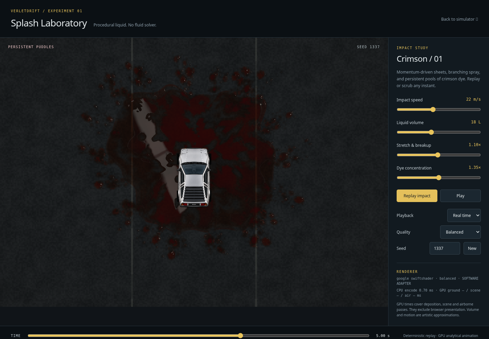
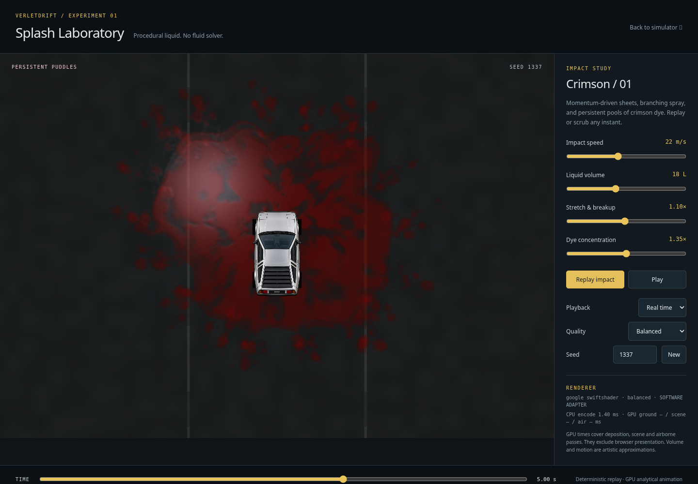
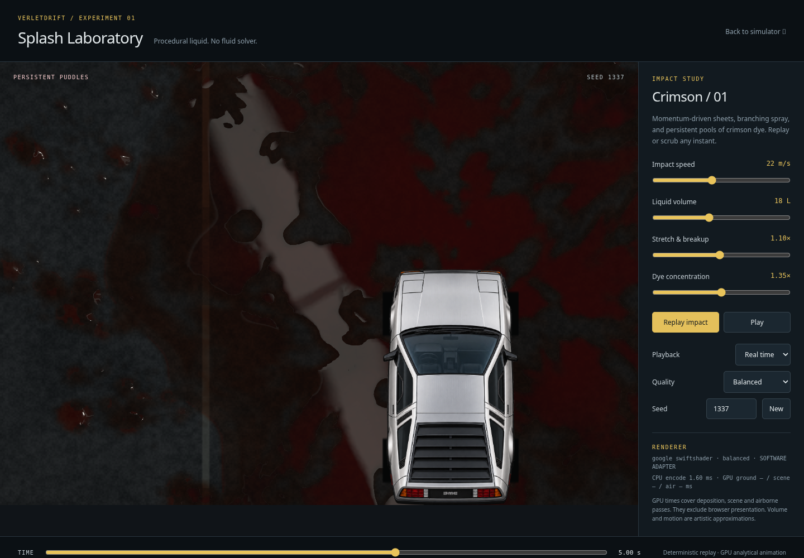
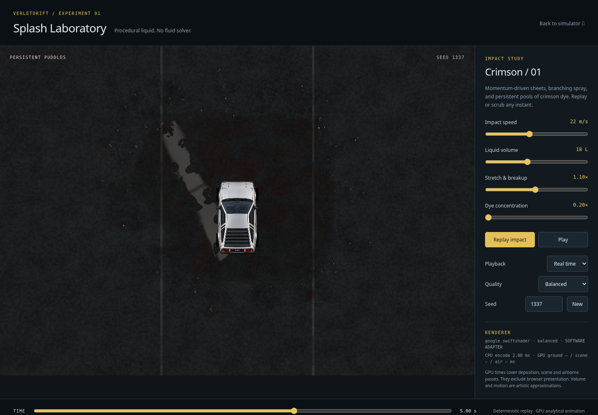
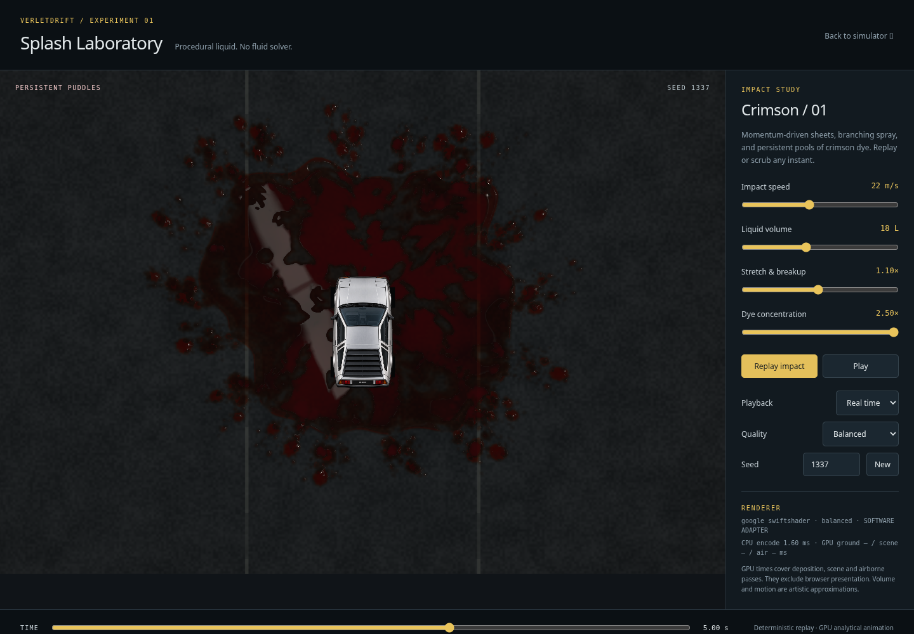

# Puddle optics: translucent water on wet asphalt

Feature branch: `verlet_gpt_v23_liquid_splash`. Baseline `d9e3be5` is preserved on
`verlet_gpt_v23_puddles_backup_d9e3be5`. This update changes laboratory ground
shading only. The airborne shaders, launch/contact geometry, deposition atlas,
timeline, existing UI parameters and all production simulator files are unchanged.



## Inspection and chosen approach

The existing R/G half-float atlas already provides deterministic, persistent
deposition and wet coverage. It was retained. The old ground shader added a
relatively uniform red scattering term across the footprint and a broad specular
power lobe. That obscured asphalt contrast and did not distinguish porous wet
ground, thin films and standing water. Treating its optical-depth gradients as
surface-height gradients also risked making broad pools look embossed or plastic.

The new `shaders/puddles.wgsl` is included in the existing scene shader module.
It reconstructs a layered material from the same atlas. No new render pass,
texture, particle system, fluid solver or material-control panel is introduced.

## Wet ground, films and connected pools

Seeded, coherent world-space height variation supplies a shallow pore-capacity
proxy. Low deposits first darken and stain the asphalt. Material above that
capacity becomes a thin film or a deeper pool. Small isolated deposits retain a
lower capacity to approximate pinned beads rather than instantly soaking away.
This creates standing pools interspersed with wetted aggregate instead of making
the entire splash footprint equally reflective. Wet residue remains in areas
without standing water; no contact event or stored deposit is removed.

Coverage used for pore/bead classification is normalized by the quality preset's
membrane-layer count. Visual preset comparisons caught the one-layer Performance
film being mistaken for isolated beads; normalization keeps broad pools level at
all presets. The optical GPU test checks this distinction explicitly.

This is an optical reconstruction, not a mass-conserving redistribution or terrain
flow simulation. Some original radial deposition structure remains. The proxy
terrain is procedural and is not an authoritative collision/traction surface.

The existing road markings and grain are retained. A modest band-limited aggregate
term makes road texture resolvable at the default view, where the old fine-grain
band was almost completely filtered away. Wetting darkens that substrate. The
transmitted road texture is not blurred and there is no screen-space refraction
offset for the millimetre-scale layer.

## Transmission and color

The shader converts the existing displayed asphalt color to linear light before
combining transmission and reflections, then converts the result back for the
existing `rgba8unorm` scene target. Airborne color handling remains unchanged.

Standing optical depth maps to an artistic shallow layer in metres. RGB
Beer–Lambert transmission uses an approximate two-way path through the dye:

```
path = depth * (1 + 1 / viewCosine)
transmission = exp(-RGB_extinction * path * dyeConcentration)
```

Green and blue are absorbed more strongly than red. Thin regions therefore reveal
more road detail, while deep regions become dark crimson. A small ambient-inspired
single-scattering term supplies dye body color; it was deliberately reduced after
visual inspection showed that a larger term recreated an opaque red coating.
The shader has no emissive red glow, bloom or opacity painted over the substrate.
Absorption coefficients and the proxy-to-depth conversion are artistic calibration,
not measured dye chemistry or conserved physical litres.

## Reflections, roughness and normals

Water Fresnel uses air/water IOR 1.333 (normal-incidence reflectance about 0.0204).
The viewing vector follows the laboratory's existing oblique height projection.
Standing water has perceptual roughness about 0.035–0.085, compared with roughly
0.58 for lightly wetted aggregate. Transitional coverage blends the materials.

The environment reflection traces the reflected view ray to a fixed overhead
rectangular luminaire with a crossbar. Reflection position follows world position,
view and surface normal. Roughness widens the emitter filter; a normalization
factor limits artificial energy gain from that widening. The lower-frequency sky
term is subdued so the whole wet footprint does not become uniformly gray.
A GGX/Smith/Schlick specular BRDF adds a small distant-source reflection. Finite
source width and footprint-derived variance filter tiny-drop highlights.

Broad pools have a nearly level free surface. Optical-depth variation largely
represents the substrate beneath them, not a thick mound of liquid. Small normal
variations provide coherent capillary structure; a restrained meniscus bends
normals at contact boundaries. Isolated beads retain curved contact normals and
small glints. High-frequency asphalt slopes are suppressed beneath standing water.

Residual settling waves are analytical, seeded/world-anchored and bounded by a
smooth envelope. Their amplitude is **exactly zero three seconds after impact**.
There is no random-per-frame normal noise and no permanently animated boiling.
Replay and scrubbing evaluate the same function of elapsed time.

The luminaire and sky are analytical lighting approximations. This is not an HDR
environment map, SSR, ray-traced scene reflection, exact microfacet integration or
full spectral transport. The rectangular reflection is intentional reflected
lighting; it is not a ground decal or arbitrary glowing patch.

## Visual iteration and comparisons

The first optical pass reflected too much light on rough stains and overemphasized
height variation. Refinement corrected the rough-filter energy, flattened broad
pool normals, reduced body scattering, made pore/standing-water separation more
pronounced, narrowed the reflected emitter, and filtered isolated-drop glints.
Default, close-up, low/high concentration and late settled frames were inspected.

| Previous settled material | Refined material |
| --- | --- |
|  |  |



The close-up changes capture camera framing only. It does not stretch artwork,
change the atlas or introduce UI controls. The capture tool accepts `--zoom`,
`--focus-x` and `--focus-y`; the camera override is recorded in its JSON output.

## Validation and cost

The laboratory suite continues to check real WGSL rendering, deterministic replay,
atlas accumulation, world anchoring, quality switching, contact/secondary landing
alignment, initialization failures and device-loss cleanup. Added GPU probes call
the actual optical shader functions to verify:

- Greater depth/concentration reduces transmission, with stronger green/blue absorption.
- Water Fresnel is bounded and increases toward grazing incidence.
- Standing-water roughness is lower than wet-asphalt roughness.
- A changed surface normal moves the defined emitter reflection.
- Wet-only ground, thin films and deeper pools remain distinct material states.
- Quality layer counts do not turn broad deposited films into curved beads.
- Settling-wave amplitude reaches zero and stays zero.
- GGX has a finite, sharper low-roughness peak.

Rendered settled ground is compared across late times and after scrubbing back
through the splash. Changing dye concentration changes the pixels without
rebuilding or changing the atlas. The old settled brightness test counted bright
red pixels, which favored the unwanted stain/paint appearance. It now compares
the actual wet render against an otherwise identical dry-ground render, without
moving the vehicle or removing stored deposition. No physics tests or tolerances
were changed.

The existing target sizes, 112-byte frame uniform, ten pipelines, 17 optional-
timing-inclusive owned resources and settled two-draw path are reused. Optical
work adds shader ALU, not additional targets or uploads. Empty wetness still exits
early. Five atlas samples per shaded wet pixel are retained; analytic noise slopes
avoid extra normal-map textures or repeated finite-difference noise samples.

Validation records and performance measurements are stored alongside the captures.
Cloud execution uses real WGSL on SwiftShader with an offscreen presentation target
because native presentation is unavailable here. It verifies shaders and image
output, not RTX 5090 frame pacing. Native performance is unmeasured. Numerical
optics checks do not substitute for visual review; the result remains a procedural
2.5D approximation whose appearance should also be inspected on the user's GPU.

Final regression results: **159 unit tests passed**; the complete ordinary browser
suite had **44 passed / 17 adapter-dependent skips / 0 failures**. The focused
software-WebGPU run executes all 11 laboratory cases plus existing renderer
checks: **24 passed / 0 skipped / 0 failures**, including the final preset
classification guard. See the adjacent logs and validation record.

The before/after settled benchmark used the preserved `d9e3be5` source and final
shader, Balanced quality, seed 1337, a 1440×1000 page and 1143×794 GPU target. Each
case ran 64 completion-fenced frames with six warmup frames excluded. No competing
test or capture job overlapped either measurement:

| Software WebGPU metric | Before | After |
| --- | ---: | ---: |
| CPU encode median / p95 | 0.20 / 0.80 ms | 0.20 / 0.70 ms |
| Completed-frame median / p95 | 177.1 / 434.1 ms | 220.4 / 440.1 ms |
| GPU scene mean (2 samples) | 143.7 ms | 178.8 ms |
| GPU composite mean (2 samples) | 26.1 ms | 35.4 ms |
| Owned resources across measured frames | 17 → 17 | 17 → 17 |
| Deposition rebuilds during measured frames | 0 | 0 |

See [before](puddle-optics/measurements-before-software.json) and
[after](puddle-optics/measurements-after-software.json). CPU/completion summaries
contain 58 samples; sparse GPU stage summaries contain only two. Different GPU
stages are sampled on a few frames and should not be summed into a total. The
software timings have substantial variance and do not measure browser display
FPS. GPU timestamps measure execution, not JavaScript submission time. Benchmark
fences/readbacks are absent from the production frame loop.

The richer material raises this software completed-frame median by about 24%;
there is no demonstrated native performance improvement. Native RTX 5090 cost
remains unknown. The controlled changes preserve cached deposition, draw count
and allocation bounds; native profiling should guide further shader simplification
if needed. Captured atlas hashes match the preserved version, and the fixed
ground pixel region is identical at five and eight seconds.

| Low dye concentration | High dye concentration |
| --- | --- |
|  |  |

Both use the same lighting and deposition. The source reflection remains in the
same place while absorption changes. Performance, Balanced and High presets were
also inspected after the bead-classification correction. The captures are
reproducible with the existing tool's quality, concentration and camera options.
