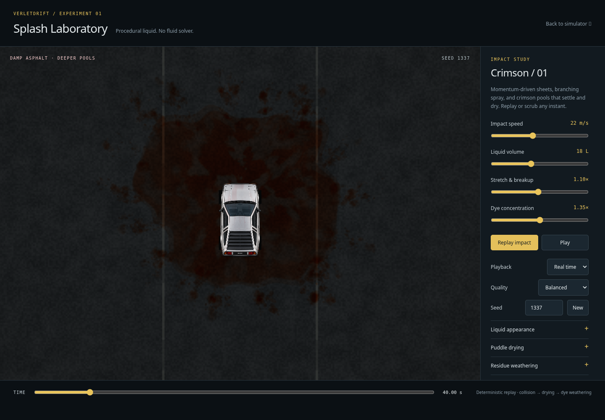
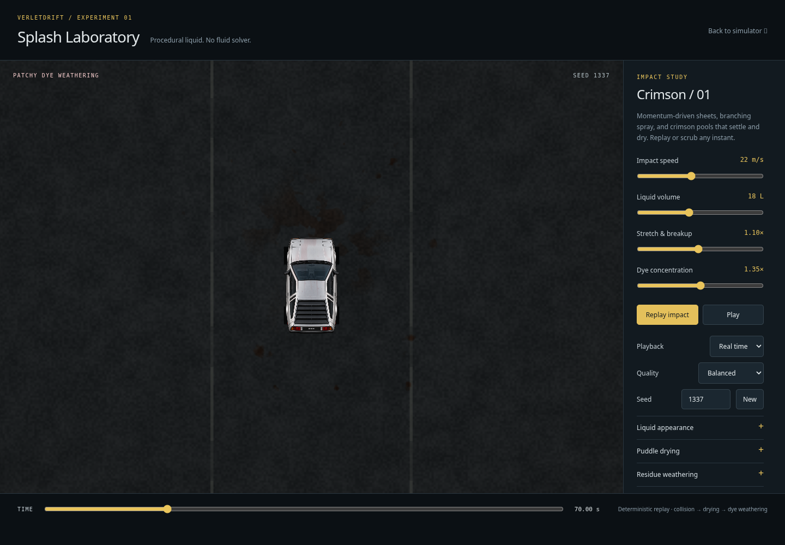
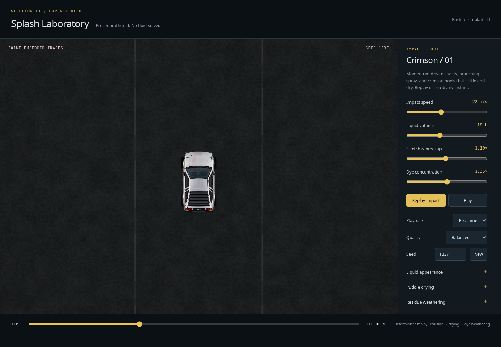
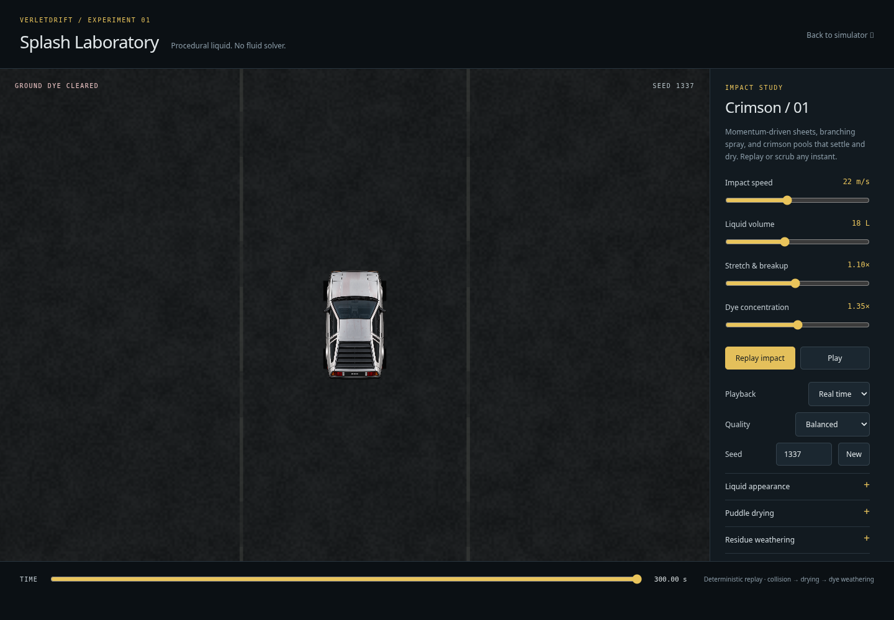

# Deterministic dry dye weathering

Branch: `verlet_gpt_v27_residue_weathering`, based on simulator integration commit `3cc0dc5`. No merge into the simulator branch.

## Material lifecycle

The lab now removes ground residue after local standing water and damp pores have dried. Existing deposited atlas mass remains immutable. At render time, local optical dye mass decreases according to elapsed dry time, original deposit strength, basin/pore protection and fixed world-space erosion fields. Thin deposits disappear first; stronger pools retain isolated remnants. Absorption shifts toward dull maroon/brown as the residue ages. Dry shading multiplies the underlying asphalt transmission without water reflections; zero remaining mass returns the exact clean asphalt colour.

Macro and mesoscopic fields split the deposit into patches; band-limited pore-scale variation embeds late traces in the road. Their coordinates never animate. No opacity fade, fluid solver, new texture, per-frame CPU particle updates or historical integration is involved. Arbitrary backward seeking reconstructs the same frame from time, seed and settings.

The compact controls are weathering enable, lifetime (20–100 seconds), erosion irregularity, and protected retention. Lifetime is a characteristic local erosion interval after drying, rather than a global removal deadline. The 300-second timeline covers the supported slow settings; 8× playback remains available. Disabling drying also prevents weathering. Disabling weathering restores indefinite dye. Reset restores the new defaults; material preset changes retain weathering settings.

## Scope and compatibility

Only the laboratory enables this feature. Four reserved uniform scalars carry the controls without changing buffer size or live event stride. The live simulator leaves the enable scalar zero and retains its previous dye behavior. Vehicle physics, input, geometry, artwork, airborne dynamics, deposition, gameplay paint and car-body dye are unchanged. Car-body residual dye is outside this ground-residue change.

## Visual review

Actual WGSL captures, seed 1337, balanced quality, identical camera:

| Fresh dry stain | Fragmented aging stain | Late traces | Clean endpoint |
| --- | --- | --- | --- |
|  |  |  |  |

[Intermediate 55-second view](residue-weathering/time-55.png) and [closer alternate-seed view](residue-weathering/detail-seed42.png) show the underlying road grain through remaining patches. Weak outer specks disappear while denser areas retain dull traces. The reference puddle and early splash retain their existing appearance.

Captures and automated GPU tests use Chromium/SwiftShader with an offscreen readable render target. They execute the actual WGSL but do not establish RTX 5090 performance or native presentation reliability. Weathering adds a few stable noise samples only where deposited dye exists; it allocates no resources. No hardware speedup is claimed.

## Validation results

- Unit suite: **166 passed**, 18 files; existing numerical tolerances unchanged.
- Focused WebGPU browser coverage: **35 distinct tests passed**, no skips (37 executions including two repeated weathering checks). Covers laboratory optics/drying, vehicle interaction, optimization/cache invariants and all 11 live simulator liquid tests.
- New tests execute the actual WGSL: weak stains reach zero while strong deposits survive; fixed positions have different erosion rates; remaining mass decreases and reaches zero. Rendered clean endpoint exactly equals the empty-atlas asphalt reference, including the slowest supported weathering settings and an alternate seed.
- Backward seeking reproduces exact image hashes; the deposition atlas hash stays unchanged; resource-allocation counters do not grow during weathering.
- Early airborne rendering is identical with aging enabled/disabled. Disabling weathering retains the old permanent stain. All three sliders independently change the rendered frame; resetting values restores the same frame.
- Visually inspected the 40, 55, 70, 85, 100, 130, 180 and 300-second stages, plus a closer seed-42 sequence. Ground progressively loses saturated regions, retains dull embedded fragments, then returns to clean asphalt without renewed gloss.

The procedural model approximates absorption/weathering; it does not simulate chemical bleaching, rainfall or conservation of dye. Its timing is artistic, not calibrated to real asphalt. Hardware-specific performance remains unmeasured in this cloud environment.
