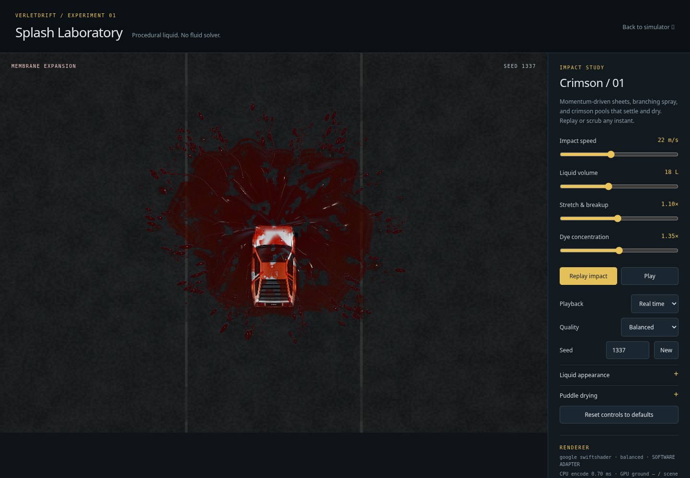
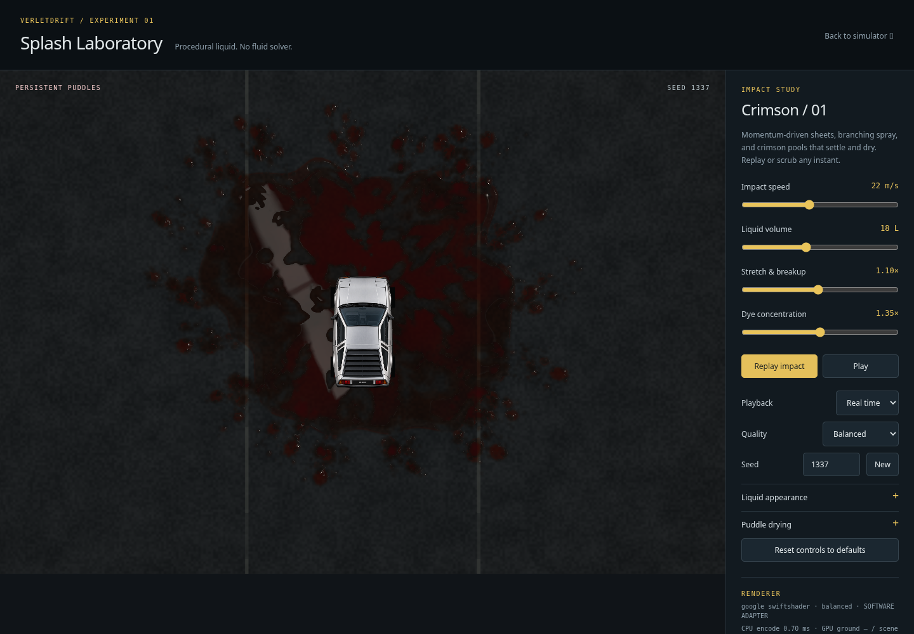
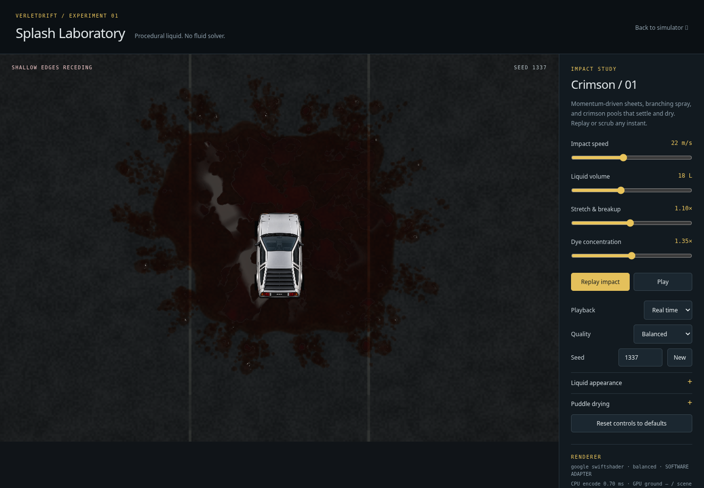
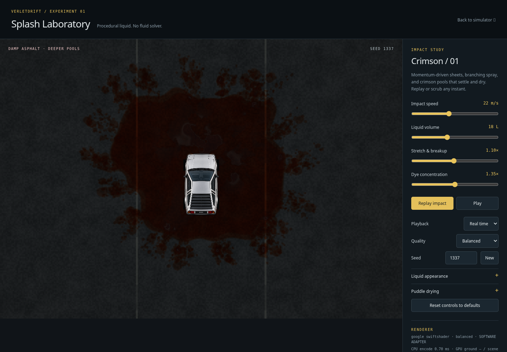
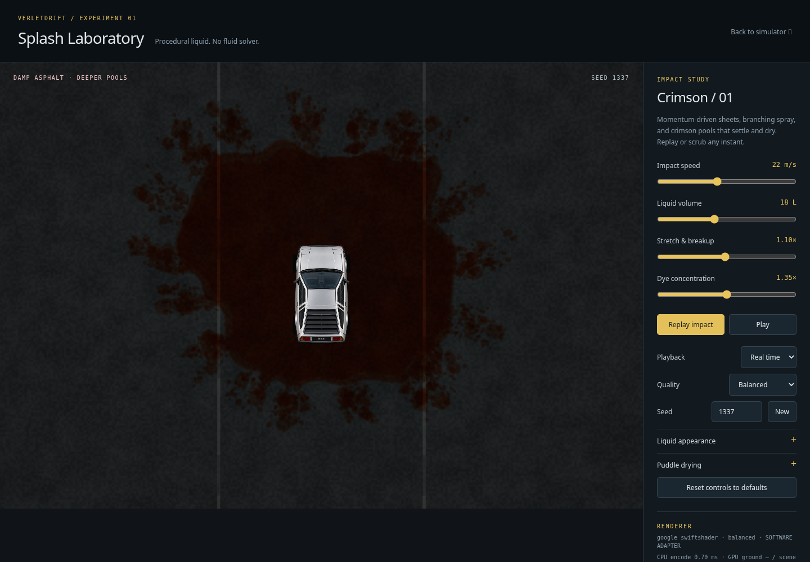
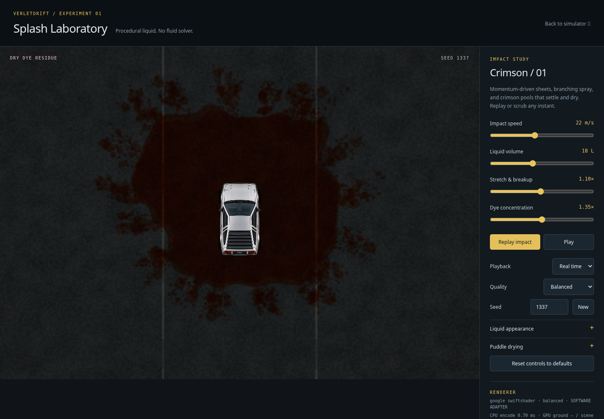

# Splash Laboratory: deterministic puddle drying

This update adds shader-derived drying to the standalone Splash Laboratory. It
reuses the existing depth/wetness deposition atlas and reconstructs the
appearance from absolute timeline age and seeded world-space surface variation.
No drying history, fluid solver, gameplay paint, vehicle state, texture, or
per-frame CPU particle work is added.

Drying starts six seconds after impact. Local standing-water depth falls over a
user-selected duration; deep pools retain water longer, while surface porosity,
terrain height, and stable microvariation change the local drying rate. The
standing-water boundary recedes before the slower damp-asphalt film clears.
Roughness rises as the water thins, removing the pool's gloss; the final state
can retain optional crimson dye staining. Because this is a pure function of
the deposited atlas, settings, and requested time, forward and backward seeks
reconstruct the same image.

The largest supported 24-second drying duration fits within the 72-second lab
timeline, including the damp-film tail, even with the slowest absorption
setting. Use 8× playback to review the complete lifecycle quickly.

## Visual review

Captured at 1440×1000 using Chromium's SwiftShader WebGPU adapter. These are real
WGSL render outputs; SwiftShader is useful for repeatable image inspection but
does not measure RTX 5090 performance. The reference image hashes at 1.25 s and
5 s match the pre-drying baseline exactly (`606630827` and `1776815284`), showing
that the original peak splash and pre-dry puddle appearance remain intact.

| Time | Stage | Capture |
| ---: | --- | --- |
| 1.25 s | Peak airborne membrane and droplets |  |
| 5 s | Original glossy standing water, before drying |  |
| 18 s | Shallow boundaries retreat |  |
| 26 s | Damp asphalt and deeper remaining pools |  |
| 34 s | Late damp phase with gloss gone |  |
| 58 s | Dry asphalt with optional crimson residue |  |

The rendered ground continues changing from 34 s to 58 s as the last damp
surface clears. At 58 s and the 72 s endpoint, the default settings produce
identical pixels, so the final timeline segment holds the completed residue.

## Validation

- 161 unit tests passed.
- The full browser suite passed: 44 passed, 20 skipped by its existing
  environment/browser conditions.
- All 14 focused Splash Laboratory WebGPU browser tests passed, including
  preset/reset repeatability, independent appearance/drying controls,
  deterministic backward seeks, unchanged deposition-atlas contents, spatial
  deep-versus-shallow retention, damp-film transition, residue, and completion
  at the 72-second endpoint with the slowest supported drying settings.
- Capture completed with no page errors. The software adapter confirms shader
  behavior and visual output only; it is not a hardware performance result.
