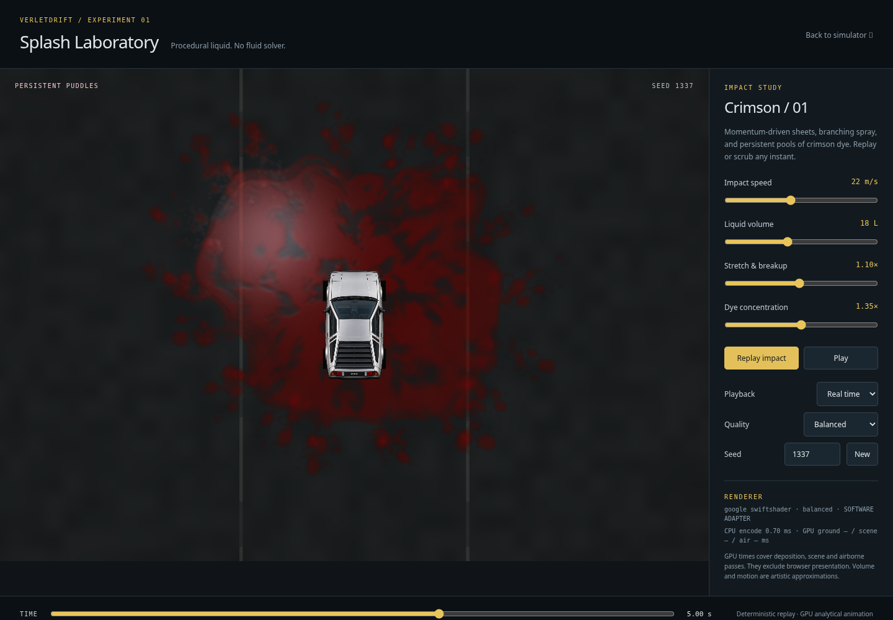
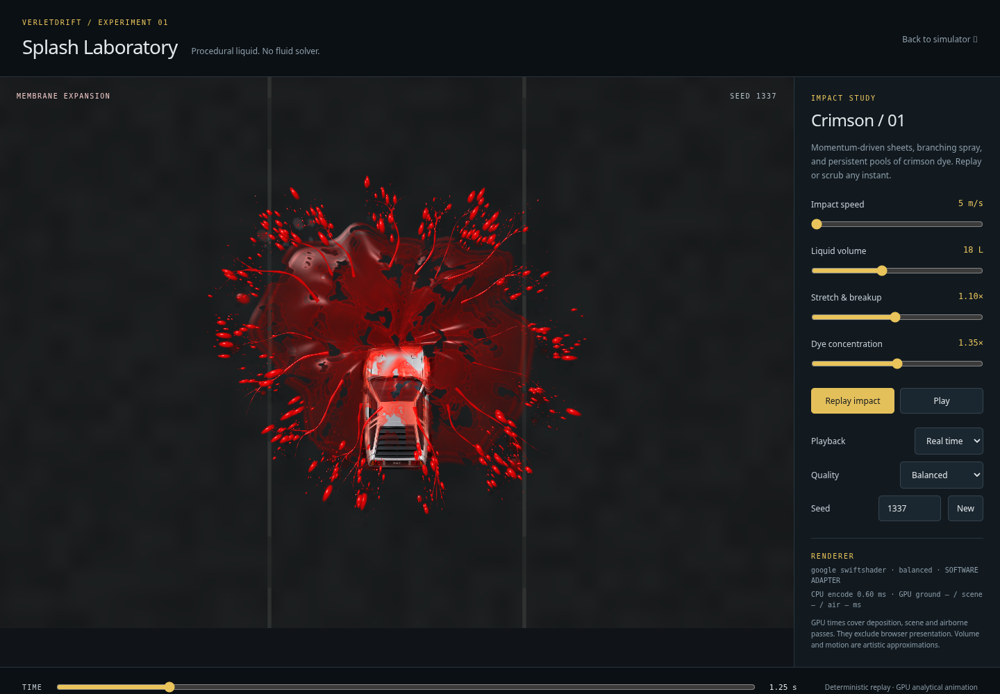
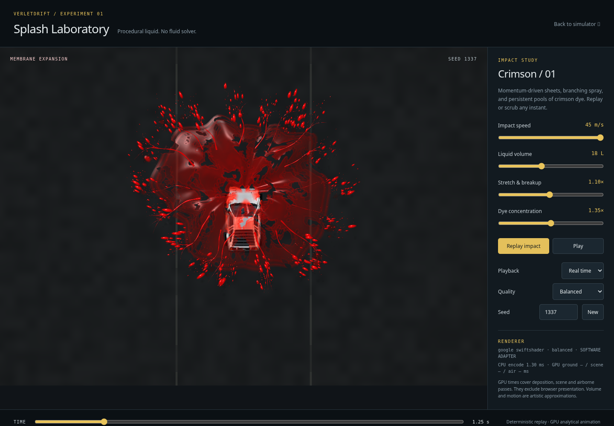
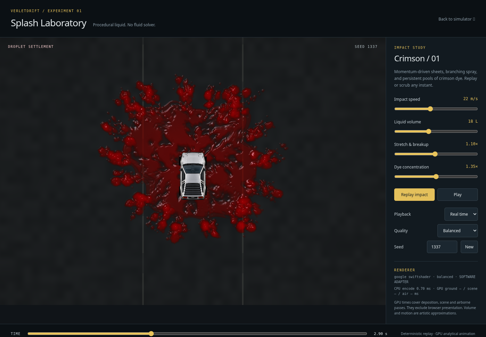
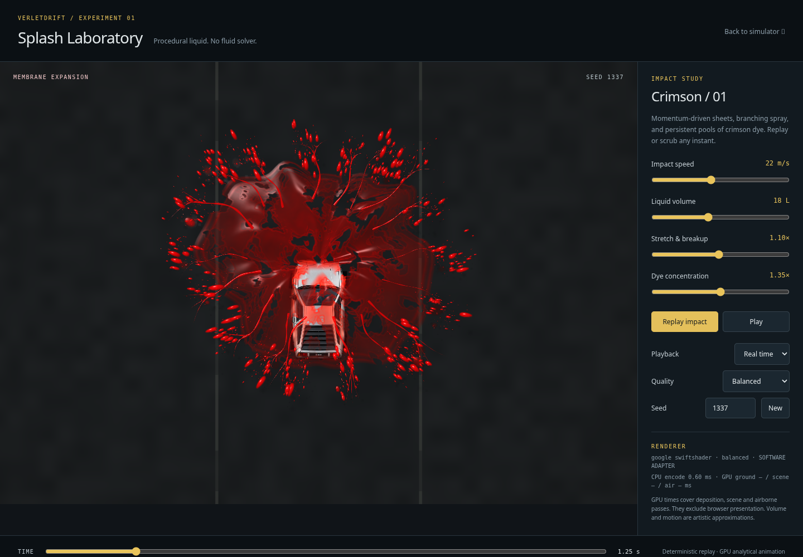
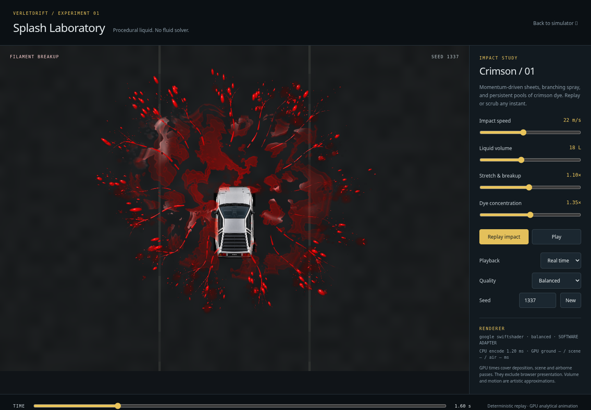
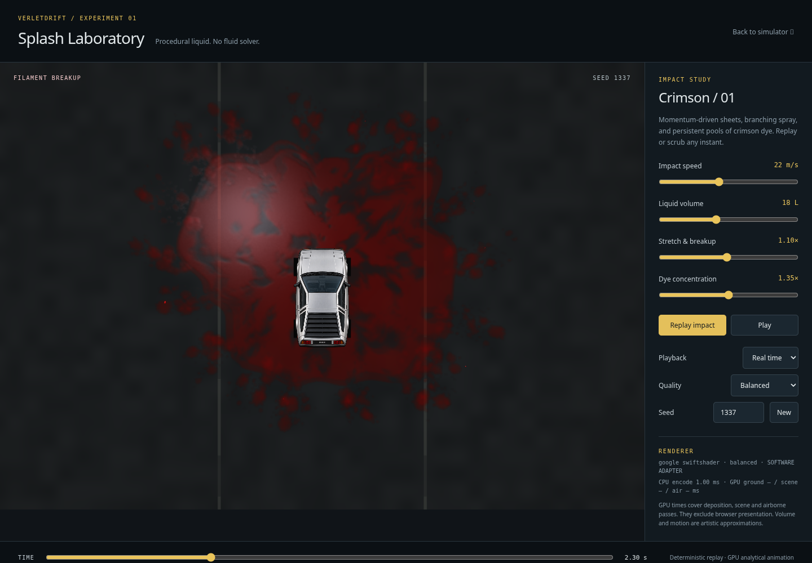

# Splash Laboratory: momentum and persistent ground liquid

This report records the `d9e3be5` deposition implementation, retained on
`verlet_gpt_v23_puddles_backup_d9e3be5`. Its optical shading has since been refined;
see [puddle optics](PUDDLE_OPTICS.md) for the current material and validation.

Work remains on `verlet_gpt_v23_liquid_splash`. The complete original `c279110`
state is preserved on `verlet_gpt_v23_splash_backup_c279110`; an additional archive
of its laboratory directory is saved outside the checkout. No merge into a stable
branch, production renderer, vehicle simulation or gameplay paint system is involved.



## Inspection and motion change

Originally `extent()` increased the radius approximately linearly with impact
speed, with static lateral/forward angular weights. Droplets received only
`0.035 * speed` of additional forward velocity. Sheets and droplets therefore
did not share a substantial transferred momentum. Landed droplets flattened,
then faded away; there was no persistent deposition target.

The replacement superposes two launch velocities in world space:

```
pressure speed = sqrt(10.8² + (0.16 * impactSpeed)²) * cbrt(volume / 18)
bulk velocity  = impactDirection * 0.18 * impactSpeed
position       = origin + (irregularRadialVelocity + bulkVelocity)
                         * (1 - exp(-drag * age)) / drag
```

The sheet drag is 2.15 inverse seconds. Radial pressure retains the seeded angular
variation and grows sublinearly with impact speed. Transferred forward speed grows
linearly, so its relative importance increases with impact speed. This is a
physically inspired launch model, not a measured car/balloon momentum exchange or
energy-conserving fluid calculation. Parameters are confined to the experiment.
There is no direction-dependent scale transform of the finished shape.

Sheets and filament roots share this advancing rim. Each drop starts on that rim
and inherits the film's damped launch velocity at its birth time, plus a small
radial shedding impulse. Analytical drag and a gravity-like vertical arc determine
the exact primary landing coordinate and time. Larger drops emit two short
secondary hops from that coordinate. Those use the same geometry for their own
ground footprints. All random variation is a pure seed/index hash.

The GPU test probes the actual WGSL functions at 5 and 45 m/s. It checks increased
forward translation, retained backward/outward spread at nominal volume, and an
unchanged ratio of centered X/Y variance (no axis stretching). It also checks that
the closed polar sheet seam and coincident center join after contact. Contact-time
variation tapers to zero at the polar center, avoiding a folded center as different
sectors settle. The high/low screenshots use
the same seed, volume, viewport and time:

| 5 m/s | 45 m/s |
| --- | --- |
|  |  |

The laboratory camera uses one uniform scale to fit larger volume/speed settings
and a time-independent forward framing offset. This preserves proportions and
keeps the ground fixed while time advances; it is not the directional effect.
The car's pre-existing scripted approach/deceleration and original artwork remain.

## Deterministic deposition instead of a fluid solver

One fixed world-space **32 × 32 metre** atlas, centered on the impact, stores:

- **R:** accumulated optical depth (an artistic liquid-thickness proxy).
- **G:** accumulated wet coverage, including a broader thin perimeter.

It is `rg16float`, sampled linearly. An additive render pass rasterizes flattened
sheet patches, primary drop footprints, and secondary landing footprints. Optical
depth adds where they overlap, allowing deeper pools and thin transparent films.
No CPU particle array, per-drop upload, compute fluid grid or frame readback is used.
The shader's original height arc and shared per-patch contact time coordinate the
sheet's airborne fade with growth of its footprint. Primary droplets squash and
crossfade into irregular footprints at the exact computed contact position.

Spread uses a continuous exponential curve; arrival opacity is smoothed. Seeded
outline variation avoids circular stamp edges. A minimum footprint relative to
atlas texel size prevents tiny deposits disappearing between texels. Larger drop
contacts throw short-lived small splashes; their final positions become additional
residue, rather than vanishing without a ground contribution.

The atlas is cleared and reconstructed for a **requested time**, using only
contacts that have arrived by that time. It does not integrate from the last
rendered frame. Consequently direct seeking, coarse playback, fine playback,
replay, and backward scrubbing produce the same field at a given time/settings.
No future residue leaks into earlier frames. Texture storage remains GPU-resident.

The field is cached for an unchanged contact history; concentration and viewport
changes do not require changing the deposits. The shaders clamp deposition time
to three seconds after impact. All defined primary/secondary flights and footprint
growth settle before this conservative boundary. Later frames reuse exactly that
same field. Dye does not fade or evaporate, and remains visible at the eight-second
timeline endpoint. A quality change replaces the atlas and reconstructs it; old
textures are destroyed. Returning to the same quality restores the same field.

## Wet optical shading and visual refinement

The scene pass shades ground liquid before drawing the car, so deposits cannot
paint over its roof. Asphalt markings and grain are transmitted through thin dye.
Depth/concentration control RGB absorption and crimson scattering. Thin wet areas
darken the asphalt. Depth gradients supply small meniscus normals, with reduced
asphalt micro-normal response beneath wetter areas. A localized overhead light
and a softer environment lobe provide specular reflections. The light is an
artistic point/area-light approximation, not scene ray tracing.

The first ground pass was too embossed and gelatinous. Visual refinement reduced
the optical contribution of tiny drops, reduced the height implied by depth
gradients, and replaced uniform shoreline highlights with a localized reflection.
The final surface is a shallow wet film rather than rounded glossy beads.

| First ground iteration | Refined shallow pools |
| --- | --- |
|  |  |

The images above show settled stages at different elapsed times and with the
earlier/final camera framing; this is a qualitative material comparison. For continuity,
the final captures below hold seed 1337, 22 m/s, 18 L and Balanced quality constant:

| Airborne at 1.25 s | Landing at 1.60 s | Settled at 2.30 s |
| --- | --- | --- |
|  |  |  |

The [original endpoint](splash-deposition/before-endpoint.png), captured by serving
the preserved original source, loses its liquid. The [new endpoint at 8 seconds](splash-deposition/persistent-endpoint.png)
retains the ground liquid. The old timeline ended at 4.8 seconds; the comparison
is between settled endpoints, not identical time/framing. Historical captures and
measurements are preserved alongside the original report.

## Cost and resource ownership

| Preset | Atlas resolution | Atlas storage |
| --- | ---: | ---: |
| Performance | 512² | 1 MiB |
| Balanced | 768² | 2.25 MiB |
| High | 1024² | 4 MiB |

The scene target remains bounded by the existing pixel budget. Buffers, original
car texture and the atlas are reused. Only a 112-byte uniform block is uploaded
per rendered frame; there is no growing history texture or event list. The
deposition pass uses three instanced/indexed draws when contact history changes.
With active air effects, Balanced peaks at ten draw calls and about 43,730
triangles including deposition. Once settled, cached ground needs only the scene
and composite fullscreen draws (two triangles/two draws), with no deposition or
airborne work. Pausing stops GPU submissions until a control or size changes.

With timestamps available, there are 17 owned buffers/textures/query sets: six
static resources, two render targets, and nine optional timing resources. Disposal,
initialization failure and device loss release them. Atlas size changes replace
storage; viewport-only resize preserves it. The asphalt shader bypasses expensive
wet shading where atlas wetness is zero. GPU deposition, scene and airborne times
are reported separately from CPU encoding and presentation.

## Validation, measurements and limitations

See the adjacent test logs, capture records and `validation.json` for final
outcomes. Tests read actual half-float atlas values, compare replay/seek hashes,
probe WGSL motion directly, check landing/secondary footprint alignment, preserve
world coordinates through resizing, and verify bounded resource reuse and settled
cache behavior. Existing numerical tests and tolerances are unchanged.

All 159 unit tests passed. The complete ordinary browser suite passed 44 tests
with 15 adapter-dependent skips on the serial run. An earlier run, overlapped
with software-GPU captures, failed the existing fault-event-buffer startup check:
`#simCanvas` was present but `window.eventBuffer` was not yet available. The test
checks the global immediately after finding the DOM element; it does not wait
for the module to finish exposing it. The failure did not recur in the serial
full-suite rerun. Both logs are retained; no change was made to that test or to
simulator startup code. This is a test-readiness limitation under load, not a
proven production behavioral regression from the isolated laboratory.
The final focused WebGPU run passed all 22 tests without skips or failures,
including the nine laboratory tests.

The cloud uses SwiftShader and an offscreen WebGPU target because native browser
presentation has the previously diagnosed external-memory import problem. These
are real WGSL executions, but they do not qualify native RTX 5090 presentation,
frame pacing or throughput. Pixel replay equality is verified within an adapter;
cross-vendor bitwise equality is not promised.

Fresh sequential measurements used the preserved original and updated source,
Balanced quality, a 1440×1000 page / 1143×794 render target, seed 1337, and 64
completion-fenced frames per case (six warmup frames excluded from CPU/latency
summaries). No other test/capture job overlapped these measurements:

| Software WebGPU case | CPU encode median / p95 | Completed-frame median / p95 | GPU stage means |
| --- | --- | --- | --- |
| Original active splash | 0.20 / 0.40 ms | 350.8 / 403.9 ms | Scene 116.6, air 199.3 ms |
| Updated active splash + deposition | 0.20 / 3.60 ms | 564.4 / 676.1 ms | Deposition 173.1, scene 142.0, air 238.5 ms |
| Updated settled/cached ground | 0.20 / 0.30 ms | 143.4 / 167.4 ms | Scene 100.0, composite 9.9 ms; deposition omitted |

GPU stage means have only **two timestamp samples each**, not 58. They cover
different sampled frames and should not be summed to infer a total frame time.
Completed-frame latency includes an explicit diagnostic fence; this is not
display FPS. GPU timestamps measure execution separately from CPU command
encoding. The benchmark-only fences and texture readbacks do not run in the live
frame loop. See [original](splash-deposition/measurements-before-software.json),
[updated active](splash-deposition/measurements-after-software.json) and
[settled](splash-deposition/measurements-settled-software.json) raw records.

Active software rendering is about **61% slower** in this run because of the new
deposition, wet shading and landing spray; no general performance improvement is
claimed. The settled case demonstrates omitted deposition/airborne work, not a
comparison against the original's empty ground. It retained 17 owned resources,
and its deposition-rebuild counter stayed at 2 over all 64 benchmark frames.
Native RTX 5090 cost and high-refresh suitability remain unmeasured. A native
profile should guide any further descriptor caching or resolution tuning.

The effect remains art-directed 2.5D. Nominal litres are not conserved mass; there
is no runoff, pressure solve, terrain slope response, tire interaction, evaporation,
multiple-vehicle deposition or liquid collision with car geometry. The original
soft airborne roof mask remains an approximation. The bounded single-event atlas
does not constitute a general world paint system. No tests or fixtures were
weakened, and no production physics, controls, constraints, input, paint, skid,
smoke or spark code was changed.

For local viewing, use the existing static server and open the laboratory path.
Inspect `?time=1.6&paused=1` for landing and `?time=8&paused=1` for persistent residue.
The capture tool now accepts `--times`, `--speed`, `--volume`, `--breakup`,
`--concentration`, `--seed`, and `--frames 0` for captures without benchmarking.
The original report's future collision-event integration outline still applies;
none of that gameplay integration is enabled here.
