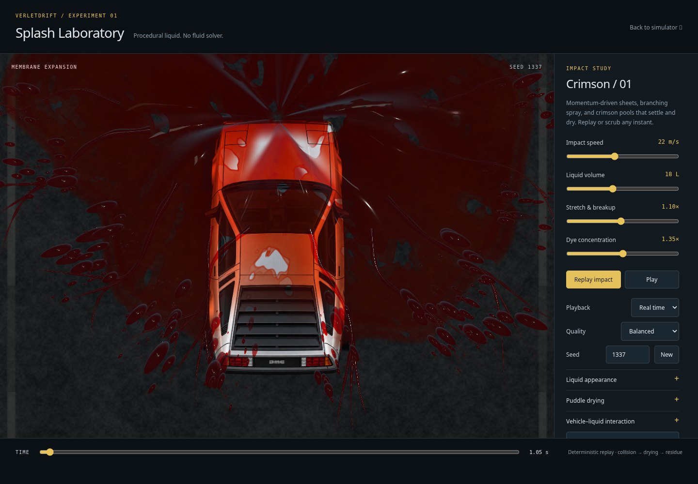
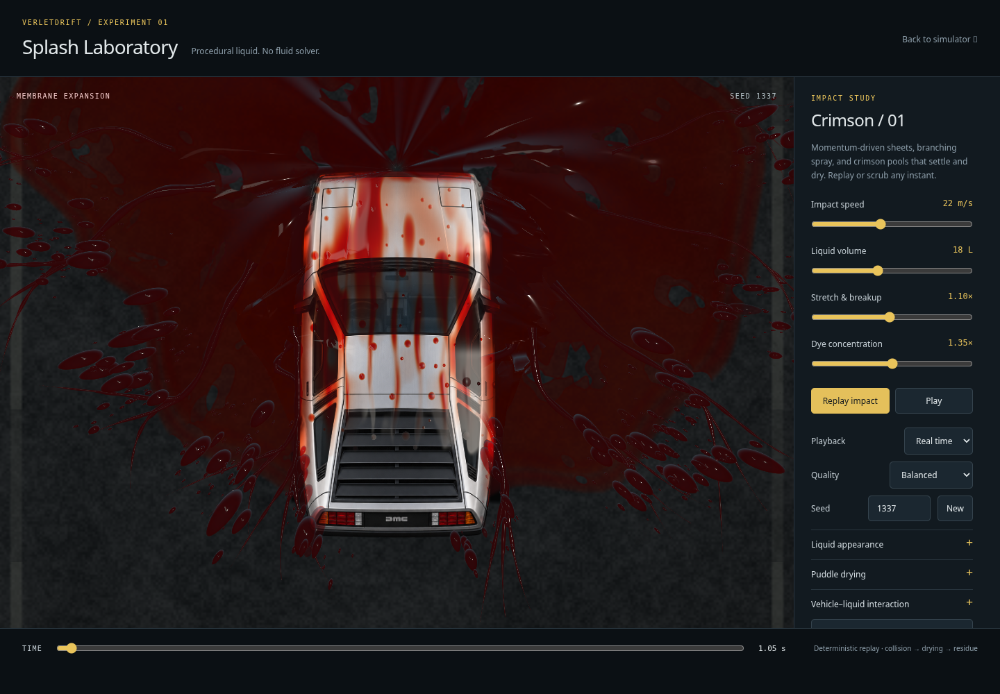
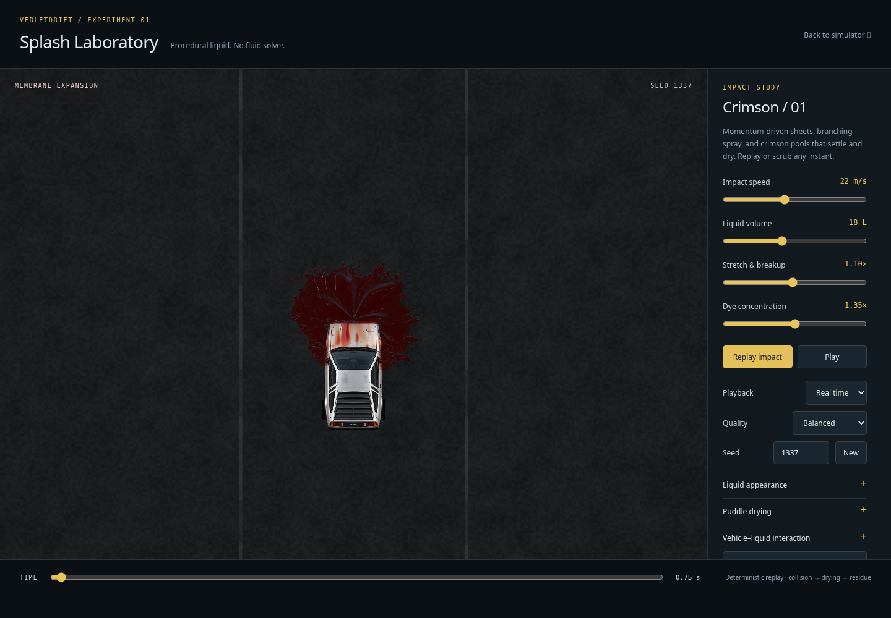
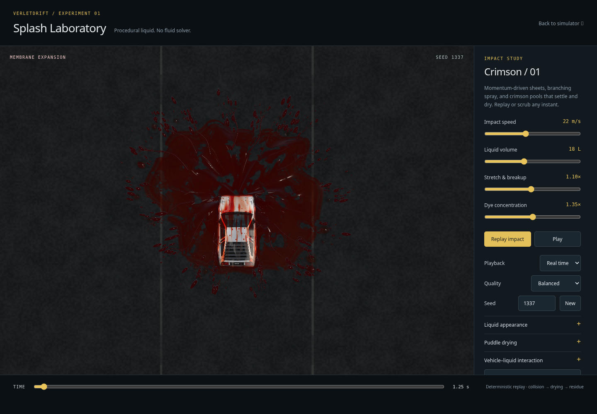
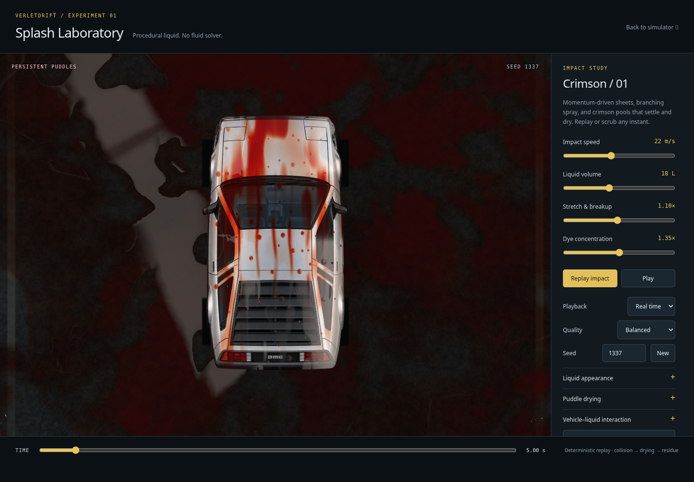
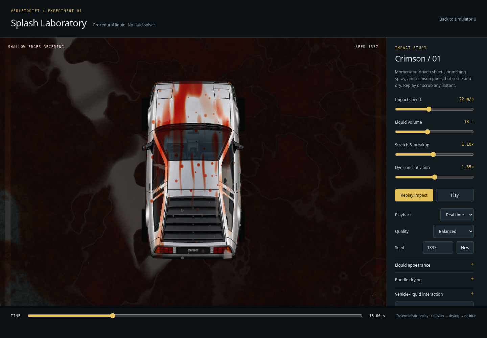
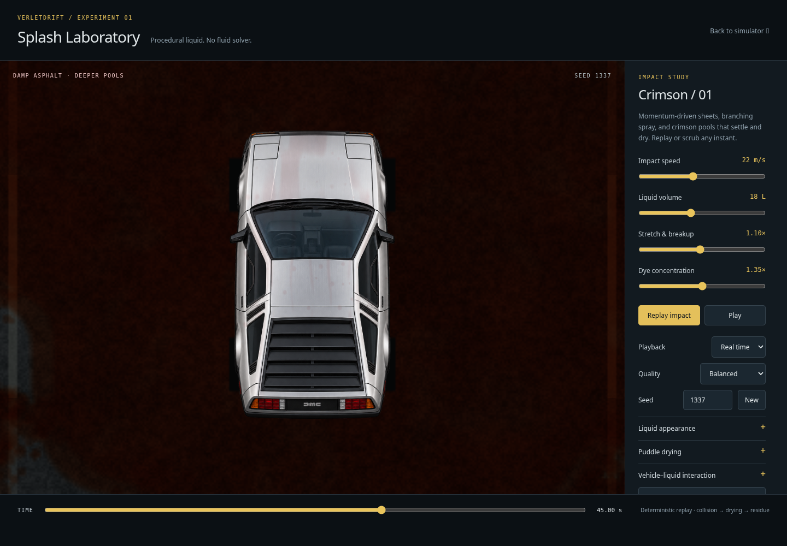

# Vehicle–liquid interaction prototype

Development branch: `verlet_gpt_v24_vehicle_liquid`, based on the completed
drying checkpoint `7a4838a`. The original `verlet_gpt_v23_liquid_splash` branch
is preserved. This remains a standalone Splash Laboratory experiment.

## Contact and body liquid

`experiments/splash-lab/shaders/vehicle.wgsl` defines a shared, deterministic
encounter wave from the front bumper across the hood, windshield and upper body.
It uses the laboratory impact speed, volume, seed, car position and artwork scale.
The coarse hood/glass regions are authored in normalized sprite coordinates;
they are a visual surface proxy, not reconstructed 3D geometry.

The splash's displayed membrane, filaments and droplets receive a localized
response near that surface. The hood's stagnation region divides flow left and
right; the windshield region adds lift and a rearward tangent component. Normals
are reconstructed from the redirected sheet/strand geometry. Droplet elongation
and shadows follow their displayed displacement. Low intercepted liquid is
absorbed by the contact mask instead of simply tinting the entire car; high
airborne droplets can still pass above it.

The same encounter timing fills an analytic car-local field containing wetness,
film thickness, thicker beads, uneven rivulets and optional retained dye. Paired
hood flow paths feed side gutters; rearward advection shifts breakup and runoff
patterns before they settle. Bead sizes, positions and streak widths vary with
the seed. The field stays attached to the sprite as the car moves.

Body shading uses the existing shared water transmission, dyed-medium response,
water Fresnel, GGX specular and fixed reflected lights. Thin films transmit the
original artwork. Thicker deposits absorb more light. Evaporation reduces local
water thickness while concentrating retained dye, then removes wet reflections.
Residual staining uses partial dye coverage so its intensity can decrease without
turning the whole silver car into an orange filter. All changes leave the source
artwork intact.

The encounter, runoff and drying are functions of absolute event age. There is no
previous-frame liquid state, fluid solver, velocity feedback or readback in the
application. Arbitrary forward/backward seeks therefore reconstruct the same body
and splash state.

## Controls and rendering cost

The collapsible **Vehicle–liquid interaction** group provides:

- An enable switch that restores the prior rendering path for comparison.
- Body wetness: deposited optical thickness and bead/run intensity.
- Streaking/runoff: channel strength, rearward advection and drainage.
- Hood deflection: local sideways/lift response, with no scaling of the distant
  radial splash.
- Body drying duration: 8–30 seconds, with local retention based on deposit depth.
- Body dye residue: optional final staining; zero restores clean artwork after
  the water has cleared.

Reset controls restores the prototype defaults. The existing material presets
also affect body roughness/reflections through their shared optical settings.
Desktop controls scroll independently of the canvas so the timeline remains
accessible when the sections are expanded.

This adds eight floats (32 bytes) to the existing uniform upload. There are no
additional textures, render passes, draw calls or per-frame CPU particle updates.
Body liquid is evaluated only where the car artwork is drawn. Analytic bead and
rivulet slopes avoid four extra field samples per shaded car pixel; splash
vertices outside the contact region return immediately.

## Scope and remaining limitations

- This is a coarse procedural interaction, not a mass-conserving collision or
  flow solver. The contact wave drives a plausible body deposit rather than
  accounting for every intercepted particle.
- Deflection is a local displayed response. Outside the vehicle region, the
  established ballistic launch/contact model and ground deposition remain intact.
  The ground atlas and puddle material/drying code are unchanged.
- The lab uses an upright sprite with approximate hood/cabin heights. It does
  not provide accurate 3D occlusion, glass refraction, wiper behavior or arbitrary
  vehicle orientation.
- Optional wheel spray is deferred. The existing lab car rapidly decelerates as
  the splash lands; it has no steering/slip state or sustained traversal of formed
  puddles. A later wheel-spray milestone should sample wetness at emission time,
  rather than reading future deposits from the current atlas during a seek.
- No simulator vehicle physics, wheel particles, controls, gameplay paint or
  production simulator rendering modules are changed.

## Visual comparison and validation

All figures use seed 1337, the reference liquid material and balanced quality.
They are real WGSL renders captured through offscreen SwiftShader targets.
Close-ups use a capture-only camera at 3× zoom; there is no change to liquid or
car geometry between the reference and interaction images. This environment
does not provide an RTX 5090, so these captures do not qualify hardware GPU
performance or native browser presentation.

| Original visibility-only path, 1.05 s | Vehicle contact and body film, 1.05 s |
| --- | --- |
|  |  |

| Stage | Capture |
| --- | --- |
| Early impact, 0.75 s |  |
| Whole splash and car, 1.25 s |  |
| Persistent body wetness, 5 s |  |
| Thinning body film, 18 s |  |
| Dry body with faint optional dye, 45 s |  |

[Capture metadata](vehicle-liquid/captures.json) records the comparable pixel
hashes and ground-atlas contents. The interaction-off hashes at 1.25 s and 5 s
are exactly the original `606630827` and `1776815284`. At 0.3 s, before impact,
the enabled and disabled images match as well. At 1.25 s and 5 s, the images
differ while their deposition atlases are identical.

The original splash red-pixel-area test keeps its existing threshold on the
reference path. The enabled path intentionally intercepts some of those pixels;
separate production-WGSL probes and image comparisons check its contact response,
body wetness and replay instead. No numerical physics tolerance is changed.

Final checks:

- **162 unit tests passed** across 17 files.
- **44 browser tests passed, 23 skipped** under the normal cloud browser
  configuration. Skips retain their existing capability/environment conditions.
- **All 17 focused Splash Laboratory WebGPU tests passed**, with no skips, on
  the real WGSL software-GPU path. These cover the existing airborne/puddle/drying
  behavior plus the new vehicle contact, retained body liquid, independent
  controls, original-path comparison, unchanged atlas, resource reuse and exact
  backward/forward reconstruction.
- The screenshot runs completed without page errors. Full-scene and close-up
  images were inspected at impact, peak interaction, wet, thinning and dry stages.
- The seek test helper now pauses/seeks atomically and waits for the requested
  float32 render time. This corrects a reset/playback race without weakening
  image-equality assertions or altering application animation.

Native RTX 5090 frame time, GPU execution time and browser presentation remain
unmeasured here. Resource/pass counts are unchanged; this is not a measured
hardware speedup claim.
