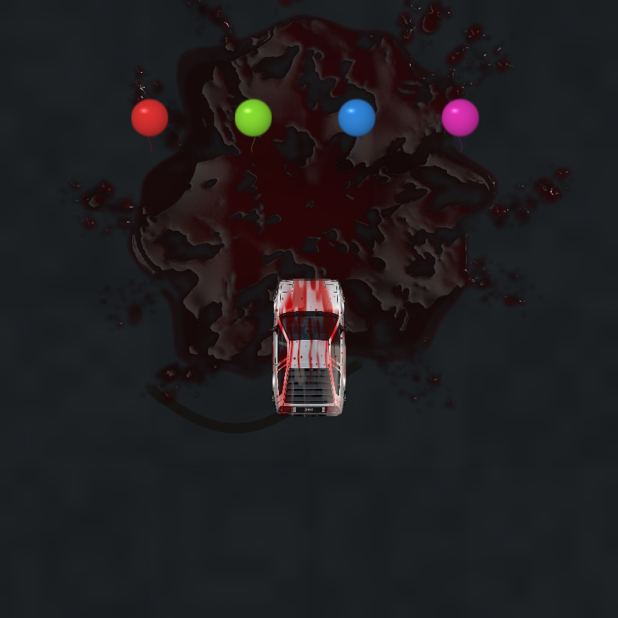
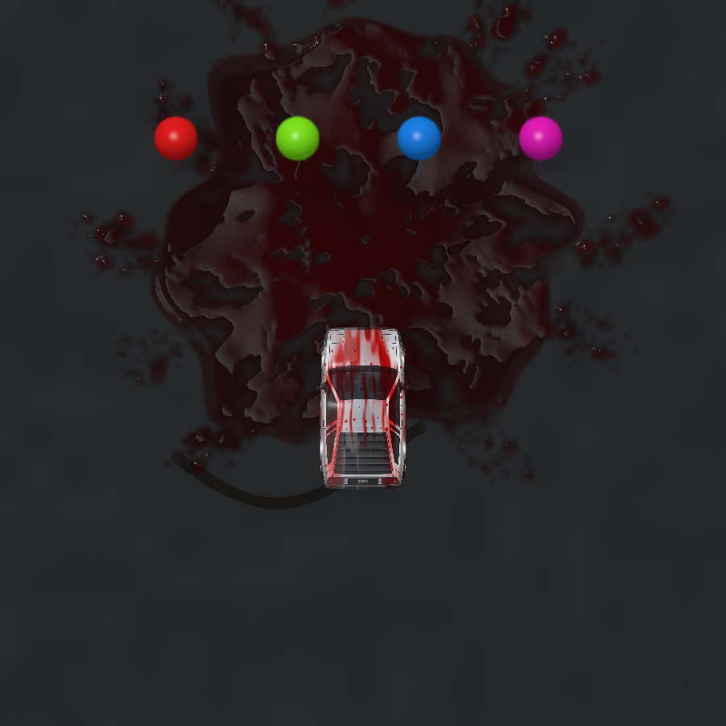
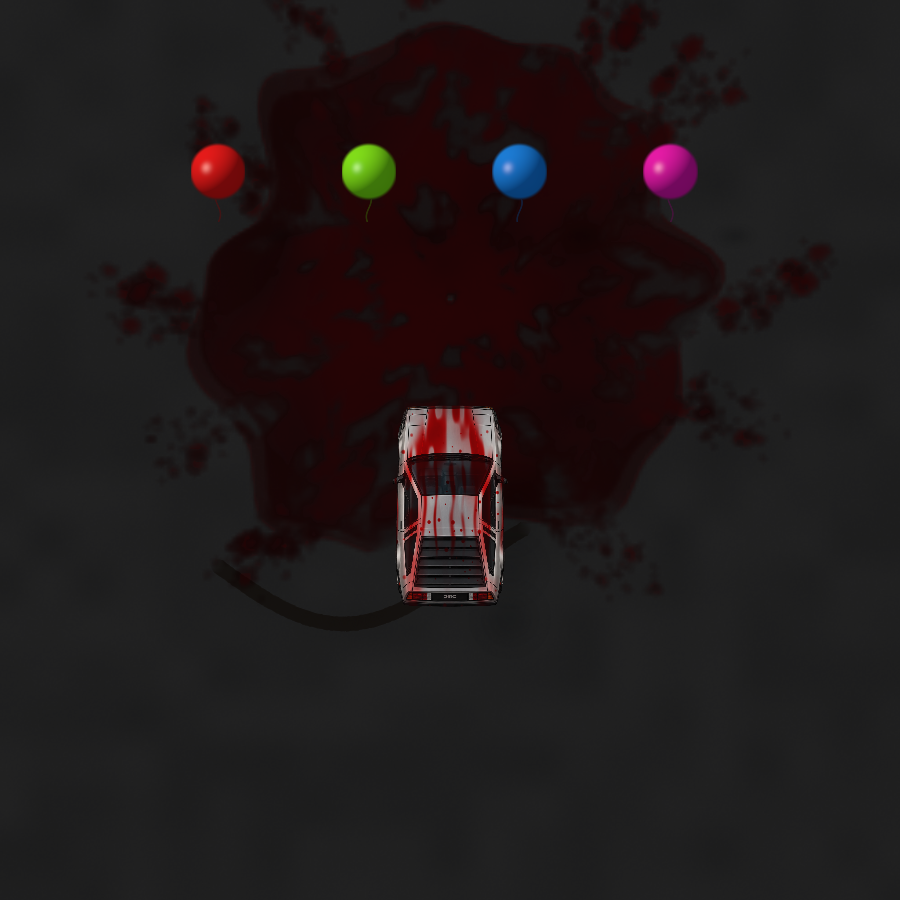
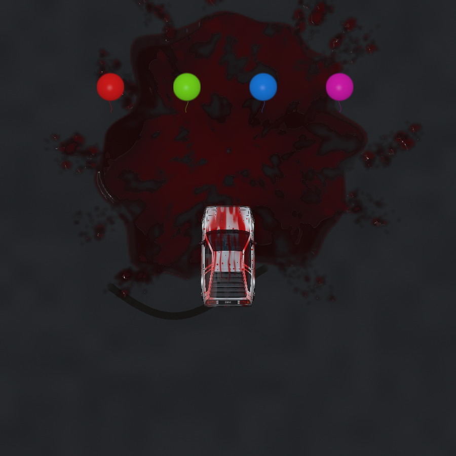

# Coherent scene materials and environment lighting

Feature branch: `verlet_gpt_v29_visual_coherence`.
Recoverable baseline: `8002bd3`, retained on `verlet_gpt_v28_complete_liquid_integration` and `backup/v28-before-visual-coherence`. No merge into the stable simulator/UI branches.

## Audit and artistic decisions

The existing liquid had convincing absorption and curved wet reflections, but the rest of the scene used unrelated lighting: a fixed balloon glint, an almost featureless asphalt field, fixed chassis-shadow offsets, unlit vehicle art and a different direct-light direction inside the water shaders. Tire marks had smooth geometric coverage with little connection to road texture.

This pass preserves the liquid breakup, water optics and dyed transparency. It adds a consistent soft key/ambient rig instead of making every material glossy. Asphalt and rubber remain rough; latex balloons, painted/stainless bodywork and water have different highlight models. Diagnostic arrows, smoke and sparks retain their established readable presentation.

The comparison switch is **Coherent lighting** in Rendering → Environment Lighting. Disabling it restores the original shading paths. Captures of the dry scene, peak splash and settled pool reproduced the original v28 pixel hashes with this switch off. No original artwork or physical vehicle geometry was replaced.

## Shared lighting

World coordinates use x right, y down. Azimuth is measured clockwise from +x and points **toward** the light; elevation is above the road. Shadows move in the opposite projected direction. Direct light, ambient illumination, softness and temperature form a compact rig. Daylight is calibrated to the existing elongated liquid key so that introducing coherent lighting does not throw away its best reflections. Overcast and low warm sun are alternative presets.

- `renderer/environment.js` owns parameter defaults, presets, direction/temperature conversion and deterministic balloon appearance mapping.
- `shaders/environment.wgsl` supplies the terrain, skid and surface-object pipelines with the same 32-byte light/ambient data. It has a dedicated bind group alongside the existing camera/event buffers.
- The liquid common uniform now uses its already reserved final 32 bytes for the same lighting data. The live event stride stays **256 bytes**, so there is no larger per-event allocation. Ground-layer visibility moves to an existing simulator-only scalar. The lab grows its small uniform from 224 to 256 bytes and leaves lighting disabled to preserve its reference appearance.
- Live puddles, airborne membranes, drops and body film use the shared light direction and colour. The existing finite elongated reflection source rotates and moves with the rig; roughness broadens it. The sky provides ambient return. This is a finite studio/environment key approximation, not an astronomical sun/atmosphere model.
- A coarse receiver shadow suppresses reflections under the projected car footprint. The substrate already contains the world shadow. This prevents a bright reflection from ignoring the vehicle above it.

## Terrain, marks and vehicle grounding

Asphalt now combines broad tonal variation, embedded aggregate and finer mineral detail. Frequency filtering uses the actual world-to-pixel footprint, so distant texture averages out instead of shimmering. Small analytical aggregate slopes influence diffuse light. There is no animated noise, checker overlay on asphalt, extra full-screen texture or terrain simulation.

Tire-mark density and edges sample the same stable world-space aggregate field. Coverage still comes from the original rounded, antialiased vector segments and partitioned caps; wheel alignment, opacity aging, width controls and pigment accumulation remain authoritative. Lighting modulates the pigment, while transparency retains underlying road grain. The skid geometry/storage cache is unchanged and does not re-upload geometry for lighting changes.

The car has three directional chassis-shadow slices, three tight chassis contacts and four wheel contacts. The same light drives balloon-shadow displacement; culling includes long low-elevation shadows. Direct shadows disappear when direct illumination is zero; contact occlusion remains. The 0.65 m chassis / 0.7 m balloon heights are **artistic shadow proxies**, not changes to physics or dimensions. Soft ellipse proxies do not reconstruct an exact 3D silhouette.

The GPU vehicle receives restrained diffuse/clearcoat response based on coarse body/glass normals. Its tires receive diffuse light. The original baked detail and alpha mask remain intact. When the Canvas vehicle path owns the car, one cached 384×672 relit body bitmap provides a restrained approximation. Cache keys include quantized orientation and all lighting settings; calculation uses the same quantized angle, so cache history cannot alter a replayed pose. Replaced bitmaps are closed. A single immutable 128² shadow stamp is reused for the fallback contacts/casters instead of building gradients each frame.

Canvas continues to use its simpler ground/balloon rendering and original motion ghosts. It supports the palette, vehicle tint and fallback grounding, but does not reproduce WebGPU water/terrain optics or full material response. Sprite calibration, fallback art and steering geometry retain their existing paths. Rendering skips invalid poses so transient diagnostic faults cannot enter the lighting cache.

## Balloon appearance and liquid colour

Rendering → Balloon Appearance offers **Colorful**, **Crimson**, and **Mixed**, plus the mixed crimson proportion. Selection uses a deterministic hash of the original hue, with no random-number draws. Changing the preset updates existing unpopped balloons immediately. Source balloon hues, positions and radii remain intact.

At collision, the mapped hue is captured in the immutable liquid event and used as the base hue for the existing legacy pigment particles. Their established jitter/random draws and count/lifetime behavior are retained. Paint pickup/depletion therefore keeps its existing mechanics while carrying the selected colour. Scoring, collision impulses, sound, screen shake, drivetrain and tire dynamics are untouched.

Liquid uses hue-derived **absorption coefficients**, not a simple RGB tint over crimson. Existing liquid keeps its captured colour when the appearance preset changes. Modern weathered residue retains the ordering of its source dye's absorption channels, so blue/green dye does not incorrectly age into the crimson reference's maroon. The standalone crimson laboratory and comparison mode retain their original optical model.

## Controls and persistence

The nine additional settings use the existing binding, import/export, range validation and reset paths. Scene preferences are stored with the existing local-storage convention under `sceneParam_…`. Environment presets change only lighting; Reset environment restores lighting and balloon appearance. The material/vehicle interface is not redesigned. There are now 212 bound controls in total: 193 ranges and 19 toggles.

## Cost and ownership

The changes add one 32-byte GPU uniform buffer and three initialization-time bind groups, with 32 bytes of extra world upload per frame. Live liquid event-buffer sizes, atlas allocations, meshes and render-pass count are unchanged. At most seven additional small chassis/tire shadow instances are submitted in the existing surface draw. Procedural material shading adds filtered noise and light arithmetic, but no fluid solve, compute dispatch, full-screen shadow map or production readback.

The fallback caches one body bitmap (~1.0 MB RGBA payload) and one shadow stamp (64 KiB); these are reused, and replaced body bitmaps are explicitly closed. The first fallback version rebuilt radial gradients and sampled a mutable Canvas source. It caused the unchanged wall-clock clutch test to miss its deadline. Reusable immutable bitmaps removed that avoidable cost; the original assertion and timeout were kept.

These are resource/payload descriptions, not measured driver VRAM. Native RTX performance, total GPU frame time and display pacing cannot be established by this cloud's software adapter. No hardware speedup is claimed.

## Comparisons and reproduction

Comparable fixed-camera, fixed-seed scenes (same car, marks, balloons and impact):

| Preserved v28 rendering | Coherent daylight | Low warm key | Overcast |
| --- | --- | --- | --- |
|  |  |  |  |

[Dry road/car](visual-coherence/daylight-dry.png),
[close-up dry aggregate and tire mark](visual-coherence/detail-dry.png),
[close-up wet receiver](visual-coherence/detail-wet.png),
[airborne material](visual-coherence/daylight-impact.png),
[rotated car with steering](visual-coherence/rotated-wet.png),
[Crimson appearance](visual-coherence/crimson-wet.png),
[Mixed appearance](visual-coherence/mixed-wet.png).

The final comparison-mode settled image has hash **3288114930**, identical to the pre-change v28 capture; the peak image likewise retains **1330147879**. The initial no-event dry comparison also matched before the tool was extended to include a zero-age event, allowing the GPU-only capture to include the dry car. The saved final dry pair uses that same zero-age route on both sides.

```sh
CHROMIUM_EXECUTABLE=/usr/bin/chromium node scripts/capture-environment.mjs \
  --mode daylight --output /tmp/scene-daylight
# Other modes: legacy, sunset, overcast, detail, rotated, crimson, mixed.
```

These are offscreen captures of the actual simulator WGSL, not recreated renders. They use a held simulation clock for comparable stages (0 / 0.7 / 5 seconds), not real-time FPS measurements. The car and all wheel anchors rotate together in the orientation scenario. Per-scenario diagnostics alongside the images record no shader validation errors. The original baseline branch remains available for independent review.

## Validation results

- **169 unit tests passed**, 20 files; no numerical tolerances, solver/integration settings or handling parameters changed.
- **95 distinct browser tests validated** across the full 93-test WebGPU run and targeted reruns/additional coverage. The initial full run had 90 passes and three failures: two asynchronous fault-injection races, and the Canvas clutch deadline regression. The corrected fault fixtures retained their detector/event assertions; the immutable bitmap caches restored the unchanged clutch/reverse test. The final 17 affected rendering/vehicle/braking checks passed, as did the 14-test fault/sprite rerun and additional GPU material/blue-residue checks.
- All six lighting sliders independently change the live image and restore its exact hash when reset. They do not invalidate deposition or increase retained liquid resource counts. Preset changes persist through reload and Reset environment restores defaults.
- The same real balloon collision has the same score in Colorful and Crimson modes; source hue is unmodified, while the captured event and emitted pigment use the selected appearance. The mixed selection is deterministic with tested 0%/100% endpoints and a representative distribution.
- A GPU body-only pixel test verifies that ambient light actually reaches dry bodywork, rather than merely changing the surrounding road. A rendered aged-blue test verifies that residue does not inherit the crimson reference's red absorption.
- Existing coverage exercises main-simulator controls, driving/braking/clutch/steering, suspension, skid contact alignment, source-art fallback, motion ghosts, camera/DPR scaling, smoke, overlapping liquid, drying/scrubbing, allocation failure and device loss. Visual-scale and sprite instrumentation now recognizes the cached body bitmap while preserving all geometry assertions.
- The two fault fixtures previously injected derived values then waited for a later frame: interpolation can restore the centre and physics can recompute angular velocity before the diagnostic samples them. They now invoke the real non-finite detector immediately after injection, before that normal recovery can race it. Production fault detection and physics are unchanged. Other tests still exercise ongoing fault detection, freeze behavior and event recording.
- `git diff --check` passed. Vehicle artwork, wheel geometry, physical constants and numerical physics algorithms have no edits. Changes at the balloon pop site are limited to selecting/capturing appearance hue; the main loop change only tells the Canvas car whether the GPU already supplied its shadow.

## Remaining limits

The rig is a procedural cinematic approximation, not full scene ray tracing. Body normals and shadow heights/silhouettes are proxies. Baked sprite lighting cannot be removed or fully reconstructed without new normal/material maps. Canvas uses approximate tint/grounding and simpler terrain; its motion ghosts preserve the original artwork exposure. Optional source shadows and direct reflections are coherent but do not resolve every small occlusion or tyre contact in 3D. Native RTX 5090 performance and browser presentation must still be checked on hardware.
