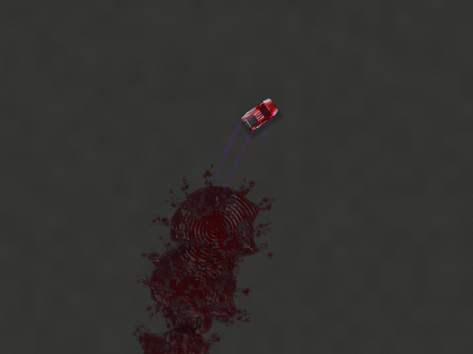
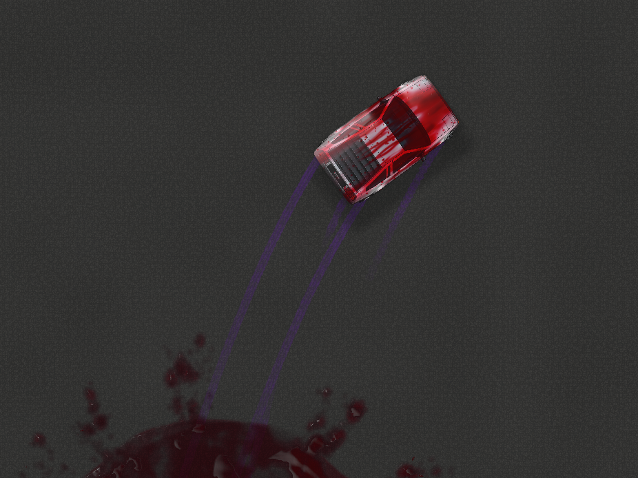
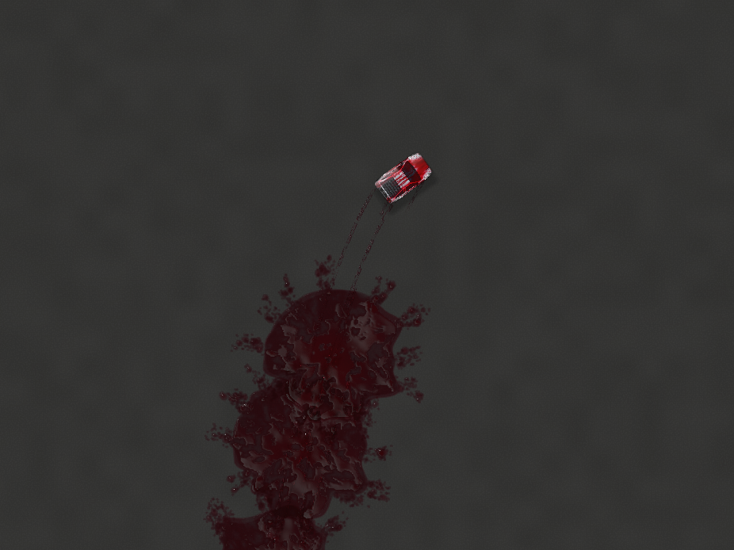
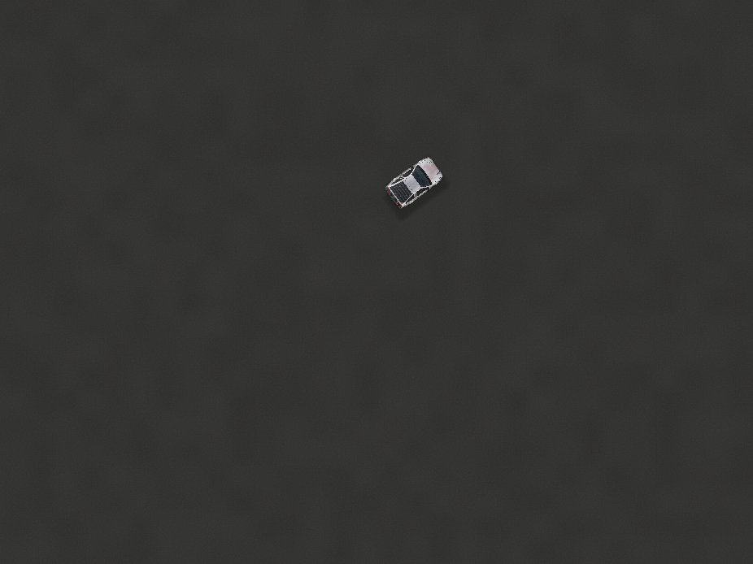

# Balloon dye consistency and liquid tire films

Corrective branch: `verlet_gpt_v31_wet_tire_liquid`, based on `88457bf` on
`verlet_gpt_v30_reference_rendering`. The v30 branch remains recoverable and unchanged.
The color correction is independently checkpointed in `5c2523c`.

## What was wrong

Balloon appearance and advanced liquid used the palette-resolved impact hue, but
native tire contamination received the balloon's original generated hue. A Crimson
balloon could therefore generate red liquid and blue, green or purple tire tracks.

`balloon.js` now resolves the impact hue once, then sends that value to the liquid
event, original particle emitter and traction contamination state. Existing particle
hue jitter, tire mixing/depletion rates, collision impulses and random sampling
remain unchanged. Original balloon hue is retained for future palette selection.

Historical dye keeps its captured identity: changing the balloon preset affects
future impacts, not existing puddles or tracks. Existing tires still mix toward a
new impact hue at their original rate; legitimate earlier Colorful contamination
is not retrospectively erased. New retained trail events store resolved hue and
initial dose independently of later native skid mutations.

## Matched running-simulator comparison

The capture script drives the real main loop with a deterministic clock/seed,
steering, coasting and a handbrake. Three balloon collisions use original source
hues 210, 120 and 270 under the Crimson palette. Both revisions run the same maneuver.
At 2.66 simulation seconds both produced **935 native skid segments**; the corrected
run retained **847 colored liquid transfers**. Chassis state, wheel state, segment
endpoints, widths, alpha and paint saturation are exactly equal. Splash hue is 350
in both runs. Native dyed mark hues change from 120/210/270 to **approximately 350 throughout** (the original gradual tire mixing is preserved).
[Machine-readable equality proof](wet-tire-liquid/native-proof.json).

The main-loop snapshots are then replayed without changing their physics, events,
initial doses or geometry, for full-resolution material comparisons. The camera is
identical at **20 pixels/metre, zoom 1, 926 × 694**, followed by a matched detail view
at 58 pixels/metre. Diagnostic trajectory arrows are hidden in these captures only:
their green/yellow colors are independent of balloon dye and remain unchanged in
the application. Captures use balanced quality and real WebGPU shaders on SwiftShader.

| v30 before | Corrected wet film |
| --- | --- |
|  |  |
|  |  |

The new tracks show deep crimson transmission, exposed asphalt through thin and
broken regions, shoulder accumulation and directional wet highlights. They share
the puddle material rather than the earlier flat purple stroke color. Dry rubber
is a matte substrate beneath the film, preserving asphalt/rubber where coverage
is incomplete rather than replacing those layers with opaque dye.

## Material lifecycle

For these material comparisons the vehicle and camera are frozen. Native skids are
removed in the aged frames to represent their normal five-second culling; retained
liquid history is not removed. Simulation time alone reconstructs the material.
The existing puddles evolve alongside the new tire films.

| Additional time | Result |
| --- | --- |
| +9 seconds |  |
| +35 seconds |  |
| +120 seconds |  |

Film thickness decreases locally using stable world-space pores and retention,
leaving disconnected wet regions. Dry dye has absorption without the water reflection
term; weaker residue erodes before retained pockets. In this fixture, thin tire
residue disappears before the much deeper puddle staining. The final image hash
matches the old revision's clean surface exactly. Backward seeking reconstructs
earlier film and dye states from birth time, without replaying incremental evaporation.

## Rendering architecture

1. A read-only observer snapshots each colored native skid at creation, using the
   simulation clock. It does not change wheel paths, paint quantities or native aging.
   A bounded ring holds at most 16,384 transfers. Resetting the world resets this history.
2. `WetTrails` uploads only new 48-byte snapshots into a persistent GPU storage ring.
   Wraparound updates use at most two contiguous uploads; width changes rebuild the
   packed data. Ordinary frames do not repack every retained transfer.
3. One instanced additive pass reconstructs an `rgba16float` optical field: RGB stores
   integrated dye absorption mass, A stores remaining water thickness. Capsule weighting
   avoids artificial buildup from short, overlapping samples along the native paths.
   Footprint variation stays within the existing tire width. Offscreen, future and
   fully weathered transfers are culled in the vertex shader using conservative bounds.
4. The existing liquid ground compositor shades that field over actual rubber/asphalt,
   before puddles and upper-world objects. It uses the shared dye absorption mapping,
   Beer–Lambert transmission, water medium, Fresnel, GGX reflections, environment,
   sun direction and ground shadow visibility. Roughness and meniscus normals respond
   to local thickness; world-fixed coverage, beads and shoulder deposits break up the film.
5. Native dry skid geometry, alpha decay and gameplay generation stay intact. With
   advanced liquid disabled or unavailable, the prior colored skid path remains usable,
   with the corrected collision hue. Canvas retains its earlier material rendering.

Existing liquid concentration, roughness, reflection, drying and residue controls also
control the films. No additional sliders or new graphics device are introduced.
`showSkidMarks` hides both rubber and liquid tracks. Puddle and airborne geometry,
vehicle artwork, physics, handling parameters and numerical tolerances are unchanged.

### Ownership and cost

The renderer owns and destroys one 786,432-byte storage buffer and one view-sized
8-byte/pixel field. Empty history uses a 1 × 1 field. Textures resize with the existing
render targets; steady frames allocate no additional GPU resources. The CPU ring and
Float32 upload mirror are bounded too. GPU resource counters now include the film.

At 926 × 694, the added buffer plus field is **5,927,584 bytes (5.65 MiB)**. The measured
fresh-frame draw count changes from 28 to 29 and tracked resources from 28 to 30.
At 3840 × 2160 the field alone would cost about 63.3 MiB. The compositor adds texture
reads and optical shading; this is a visual-quality feature with real rendering cost.
There is no fluid solver, CPU particle update, GPU-to-CPU readback or synchronization
added to production rendering.

## Performance measurements and limits

The isolated before/after fixture benchmark runs sequentially, with four warmup frames
and 20 timed frames, on **forced software SwiftShader**. It measures JS command encoding
and CPU-observed `queue.onSubmittedWorkDone()` completion separately. No screenshot
readback occurs within its timing loop. These are not native GPU execution timings.

| Metric | v30 | Wet films |
| --- | ---: | ---: |
| CPU encoding median | 0.45 ms | 0.40 ms |
| CPU encoding p95 | 1.70 ms | 0.50 ms |
| Queue completion median | 1190.95 ms | 1291.95 ms |
| Queue completion p95 | 1333.10 ms | 1437.00 ms |

Software queue completion regressed about **8.5% at the median**. The small CPU-encoding
variation does not establish a speedup. RTX 5090 frame pacing, GPU execution time and
high-resolution cost still require measurement on that machine. Existing GPU timestamp
statistics cover the base world/smoke passes and explicitly exclude liquid passes;
they must not be presented as measurements of this new material.

Raw [before measurements](wet-tire-liquid/before/measurements.json) and
[after measurements](wet-tire-liquid/after/measurements.json) include resource counts,
backend identity, frame hashes and all timing samples. The live driving fixture
also exercises the main-loop integration; isolated timing is intentionally taken
from its frozen replay so rendering comparisons use identical geometry.

## Validation

- Complete unit suite: **172 passed, 21 files**.
- Complete browser suite: **101 passed**.
- After final material refinement: **21 affected browser checks passed** across
  environment rendering, simulator liquid and wet tire liquid.
- After moving boundary derivatives before divergent exits: all **4 wet tire browser
  tests passed again**, including shader compilation and readback.
- New coverage: actual Crimson collisions with different original hues; preset switch
  to Colorful; retained prior dye; immutable bounded history; GPU ring wrap uploads;
  independent water/dye lifecycle readback; mixed absorption; native-skid culling;
  backward seeks; camera/zoom restoration; visibility toggles and stable resource count.
- Matched native capture proof: exact physical state and skid geometry/dose equality.
- Visual inspection: fresh normal/detail, drying, residue and final clean surface.

No production physics, solver, control, geometry, artwork or test-tolerance changes.

### Remaining limitations

Optical depth is an artistic proxy derived from existing paint dose/saturation, not
measured fluid volume. Transfers are generated by the existing sliding/skid logic;
this does not introduce new pure-rolling pickup gameplay. Overlapping cohorts add
water and optical mass but dry independently; there is no hydraulic redistribution
or real surface fluid simulation. Different hues mix through absorption, not pigment
chemistry. Very dense overlap can become optically dark, as thicker dyed water does.

Oldest history is evicted after 16,384 transfers, including when drying is disabled.
Arbitrary time reconstruction is limited to retained events; this is not a new full
simulation replay recorder. Imported legacy marks without a birth time use time zero
rather than an invented current age. Already contaminated live tires from a previously
buggy session are not retroactively recolored: reset that session to compare cleanly.
Canvas users receive corrected dye identity but not this WebGPU liquid-film material.

## Shader-cache compatibility correction

A reported `unresolved call target opticalTransmission` error was reproduced by
serving v30's unversioned `material.wgsl` alongside the new trail shader. The base
world renderer stayed available, but advanced liquid initialization failed. This
establishes a mixed-source failure mode; the user's actual browser/CDN cache has
not been inspected directly.

The simulator now loads all eight liquid shader fragments through
`liquid-shader-source.js`, using one shared interface revision in their URLs and
`cache: no-cache` to require revalidation. Bump the revision whenever shader interfaces
change. The same deliberately stale unversioned response no longer prevents liquid
initialization. A browser regression checks the stale-source case, shared revision
across all eight fragments, compilation and actual wet-film rendering.
Validation after this correction: all 172 unit tests and all 16 simulator-liquid /
wet-tire browser tests passed, including the preserved HTTP-404 fallback check.

This correction changes resource loading only; liquid optics, physics and geometry
are unchanged. After deploying it, a hard refresh may still be needed once to replace
the previously cached JavaScript loader. This is version separation and revalidation,
not an atomic deployment protocol: a partially published site can still fail safely.

## Files and reproduction

Color propagation: `js/balloon.js`. Native observation/reset: `js/main.js`,
`js/renderer/wet-trail-events.js`, `js/renderer/liquid-events.js`. GPU material and
ownership: `wet-trails.js`, `liquid-world.js`, `liquid-settings.js`, `gpu-skid-cache.js`,
`gpu-renderer.js`, plus `wet-trails.wgsl`, `trail-material.wgsl`, `material.wgsl` and
`simulator.wgsl`. Tests live in `tests/wet-trail-events.test.js` and
`tests/e2e/wet-tire-liquid.spec.js`, with `helpers/live-gpu.js` for the actual loop.

With the repository served at localhost:8000 and Playwright/Chromium installed:

```bash
node scripts/capture-wet-tire-driving.mjs --ref 88457bf --output /tmp/tire-before
node scripts/capture-wet-tire-driving.mjs --output /tmp/tire-after
node scripts/replay-wet-tire-fixture.mjs --ref 88457bf --fixture docs/rendering/wet-tire-liquid/before/fixture.json --output /tmp/tire-replay-before --samples 20
node scripts/replay-wet-tire-fixture.mjs --fixture docs/rendering/wet-tire-liquid/after/fixture.json --output /tmp/tire-replay-after --samples 20
```

The reference capture uses `git show` to serve baseline source without changing the
working checkout. Both raw native fixtures are preserved alongside the screenshots.
