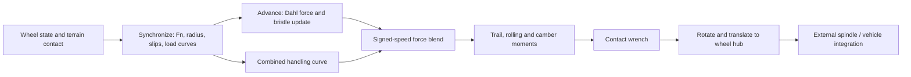

# Mission 20 — TMeasy source and license audit

Branch `scientific-rebuild/07-tmeasy-evaluation`, created directly from Mission 19 commit `9f60a9931c6c9dc08f5b4095aa901193b6ed5a9b`. Gate Zero was recorded before harness implementation: **CONDITIONALLY READY**. This permits bounded prescribed-contact constitutive tests, not production adoption or a complete Chrono simulation.

## Provenance and evidence classes

Authoritative target: [Project Chrono revision 9a5072b5324e012a66d9fb7eaac0c679b8465e73](https://github.com/projectchrono/chrono/tree/9a5072b5324e012a66d9fb7eaac0c679b8465e73). No newer release was substituted. Downloaded through Git HTTPS with a shallow, filtered, no-checkout fetch. SHA-256 of `ChTMeasyTire.cpp` is `4e254282b6e45eeb17e7206d08eb512b08f1c5e20402b198b26de7026b93322a`; header `8c33511b9310156f507f3b582230777f8433688f3d3038fe5871ae4ed25cdf96`. These agree with Mission 17's recorded identities.

All code links below use that revision. SOURCE-EXACT means inspected executable expressions, not independently validated physics. DERIVED means explicit mathematical consequences. ASSUMED means declared experiment/adapter choices. UNRESOLVED identifies a missing interpretation or evidence.

|Source inspected|Role and exact locations|
|---|---|
|[`ChTMeasyTire.cpp`](https://github.com/projectchrono/chrono/blob/9a5072b5324e012a66d9fb7eaac0c679b8465e73/src/chrono_vehicle/wheeled_vehicle/tire/ChTMeasyTire.cpp)|Constructor 62–82, Initialize 86–109, Synchronize 113–192, Advance 194–276, CombinedCoulombForces 278–340, tmxy_combined 342–385, AlignmentTorque 387–416, normal force 420–433, GuessTruck80Par 507–572, parameter checks at end.|
|[`ChTMeasyTire.h`](https://github.com/projectchrono/chrono/blob/9a5072b5324e012a66d9fb7eaac0c679b8465e73/src/chrono_vehicle/wheeled_vehicle/tire/ChTMeasyTire.h)|Coefficient/state structures, inline interpolation and vertical setter; bristle defaults and trapezoidal integration flag. Leading comments list differences from commercial TMeasy.|
|`ChForceElementTire.cpp/.h`|Contact-frame output, `GetTireForce` cpp 50–65 rotates force/moment and translates moment to wheel center. Contact data/checkpoint access is outside the two principal files.|
|`ChTire.cpp/.h`|Constructor default stepsize .001 s; SetStepsize header 64; CalculateKinematics cpp 78–103; disc/terrain collision, area/depth table and framework wheel association. Tire mass/inertia is added to spindle.|
|`ChWheel.cpp`, `ChSubsysDefs.h`|GetState cpp 124–137 obtains spin from local angular-velocity y component; Synchronize applies the hub wrench to the spindle. WheelState includes full angular velocity; TerrainForce identifies force, point and moment.|
|`ChFunctionSineStep.cpp/.h`; `ChConstants.h`, `ChVector2.h`, `ChUtils.h`|Static Eval at cpp 114–126: bounded sinusoidal ramp. Needed for blend and optional startup. Scalar constants, vector norm/normalization and clamp behavior were also checked against pinned helpers.|
|`TMeasyTire.cpp/.h`|JSON parser: full parameter pairs or guessed load-index/bearing-capacity configuration; geometry, damping and friction settings. Not exercised by the harness.|
|`Generic_TMeasyTire.cpp/.h`|SetTMeasyParams cpp 48–67: source-described 37×12.5×16.5 Load Range D tire, 3850 lb at 50 psi, original GuessTruck80Par call; mass 37.6 kg and inertia (3.84,6.69,3.84) kg m². This is a **guessed engineering parameterization**, not new measured calibration.|
|`data/vehicle/VW_microbus/json/van_TMeasyTireFull.json`|Available full force/trail pairs and spring curve example, inspected but not selected. Its bottoming radius .396 m exceeds unloaded radius .376 m; this example is not used to invent a preferred fixture. Other available JSON/model paths were inventoried, not independently calibrated.|
|`doxygen/documentation/manuals/vehicle/wheeled_tire.md`, lines 50–57,86–94|Official pinned guide describes basic TMeasy, absent belt/dynamic-parking features, and KRC/FED-alpha cornering comparisons. These are project validation claims, not reproduced data.|
|Root LICENSE; root and Vehicle CMake files|License and dependency/build boundary. Full original classes pull in Chrono core/vehicle/geometry, Eigen, serialization/RapidJSON, assets, wheel/body/terrain, generated configuration and linking infrastructure. They are not two self-contained files.|

The official documentation website and the source-linked ResearchGate paper request returned proxy HTTP 403. The pinned official Markdown guide was accessible through Git. Rill/Castro's book and the original parameter-guessing paper were **not obtained/read in full**; their citation in code does not independently prove equations, passivity or experimental accuracy. No substitute secondary literature or new release is used as authority.

## Constitutive inventory and closure

|Quantity/law|Classification and finding|
|---|---|
|Contact depth/frame, road friction, hub velocities/spin|SOURCE-EXACT external framework inputs. Experiment ASSUMED upright flat frame, supplied depth/contact flag; no terrain algorithm execution.|
|Normal force|SOURCE-EXACT `Fn=d1*depth+d2*depth²+bottoming+dz*(-Vz)`; negative Fn disables contact. Zero boundary defect is retained.|
|Effective radius and patch length|SOURCE-EXACT `r_stat=R0-depth`, `R_eff=R0-depth/3`, `P_len=2 sqrt(R0*depth)`.|
|Slip|SOURCE-EXACT `vta=R_eff*abs(Omega)+.01`, `vsx=Vx-Omega*R_eff`, `vsy=Vy`, `sx=-vsx/vta`, `sy=-vsy/vta`. Dimensionless slips, SI velocities.|
|Load dependence|SOURCE-EXACT `q=clamp(Fn,0,pn_max)/pn`; linear `L=w1+(w2-w1)(q-1)`, quadratic `Q=q[2w1-w2/2-(w1-w2/2)q]`. Handling load capped; actual normal force is not.|
|Combined handling force|SOURCE-EXACT resultant slip direction; directional hypotenuse combinations of longitudinal/lateral slope, peak and sliding coefficients; piecewise rational/parabolic/cubic scalar curve. Not independent saturated Fx plus Fy.|
|Friction scaling|SOURCE-EXACT road coefficient clamped [.1,1]; `muscale=mu_road/mu_0`. Low-speed cap is `min(Fn,pn_max)*muscale`, not automatically `mu_road*Fn`.|
|Memory and blend|SOURCE-EXACT two scalar Dahl bristles, explicit old-state force then closed-form implicit trapezoidal update; force-circle projection. Blend on **signed** Vx from 1 to 3 m/s. m_vcoulomb exists but is not used in this path.|
|Moments|SOURCE-EXACT empirical trail Mz, tanh rolling resistance My, camber stiffness Mx; optional startup ramp. No local yaw/spin-slip constitutive input, belt or distributed contact deformation state.|
|Units|DERIVED forces/slopes N, moments Nm, bristles m, sigma0 N/m, sigma1 Ns/m. Header [kN] comments on some coefficients conflict with guessed formulas/JSON [N]; actual fixture evaluates in N. No factor 1000 applied.|
|Fixture inputs|SOURCE-EXACT original generic sizing, load conversion and guessing function; defaults sigma0=100000, sigma1=5000, mu0=.8; dt=.001 and benchmark states ASSUMED. No fitted new tire parameters.|
|Physical validity/passivity|UNRESOLVED beyond inspected approximations. Complete power ports are identified, but no full energy/storage theorem is claimed.|

State flow:

## License and minimal execution boundary

Pinned root LICENSE SHA-256 `5f625eb4c9e0ddf86db9d1ed9b6adb5b30296ea81919282b2f38c977136bf079` is BSD-3-Clause. Source reuse retains copyright/conditions/disclaimer, binary redistribution reproduces them, and names cannot imply endorsement. This does not license the commercial TMeasy product or an unrelated proprietary tire dataset.

Five small unmodified upstream files, including LICENSE, are retained under [upstream](../../research/scientific-rebuild/tmeasy-evaluation/upstream/). A [manifest](../../research/scientific-rebuild/tmeasy-evaluation/source-manifest.json) verifies every byte before extraction. No constitutive compatibility patch is applied. `build.py` extracts original constructor, Synchronize, Advance, Coulomb, combined curve, aligning/normal methods, double-load GuessTruck80Par, coefficient/state declarations, interpolation and SineStep Eval without changing their bodies. Generic SetTMeasyParams is likewise original.

A minimal C++ adapter supplies identity-frame vectors, upright wheel/contact data and zero camber; its no-op CalculateKinematics is valid **only** because the consumed camber is zero. Initialize bottoming defaults and source fixture mass are explicitly supplied. Collision, quaternion/frame transport, JSON, actual spindle, external wheel integration and whole Chrono linking are excluded. This is execution of original **method slices**, not an instantiated production Chrono vehicle or an independent implementation of TMeasy. The full build was not attempted (CMake/Eigen unavailable here); no large dependency installation was necessary.

Gate limitations do not prevent constitutive closure in this declared boundary. [Numerical results](tmeasy-numerical-validation.md) and [power audit](tmeasy-mechanical-power-audit.md) preserve all observed failures. All production and historical source remains unchanged.

Local documentation links and authored-file whitespace checks pass. Upstream LICENSE retains its three original trailing-space lines to preserve the verified source bytes.
