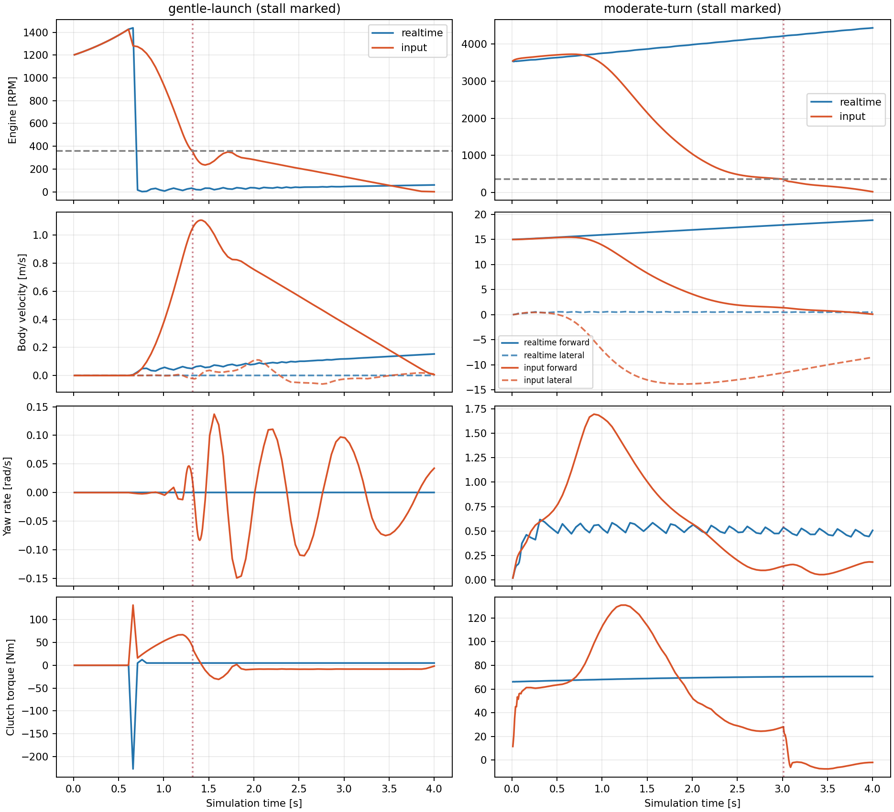
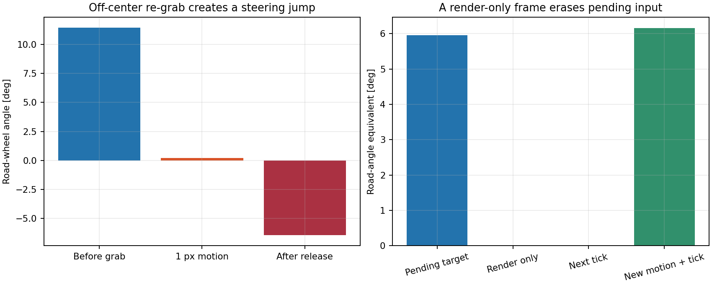
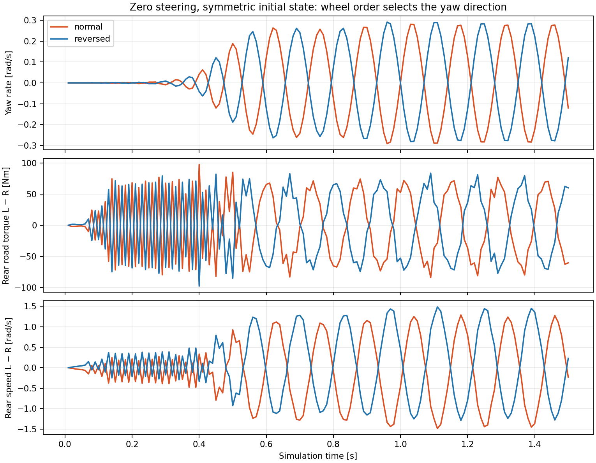
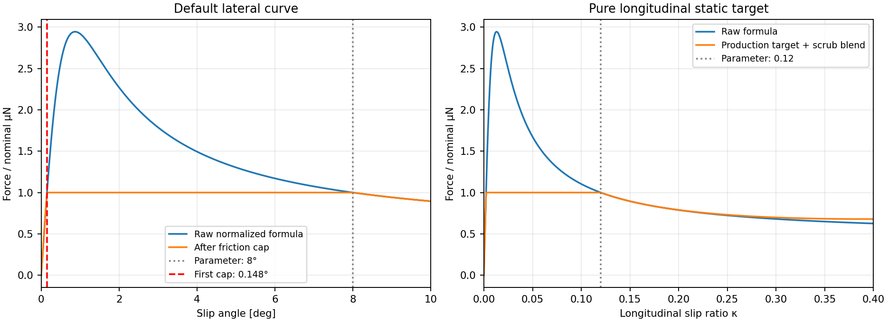
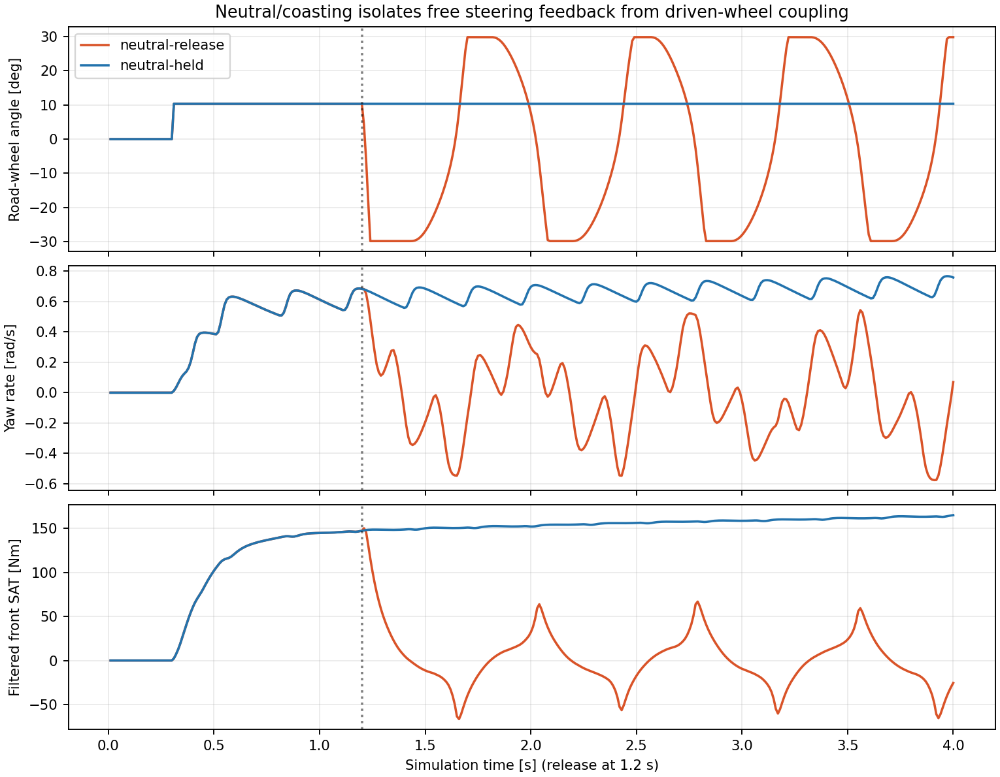
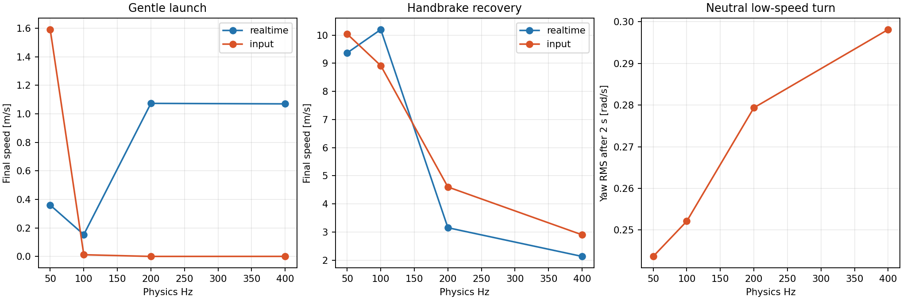
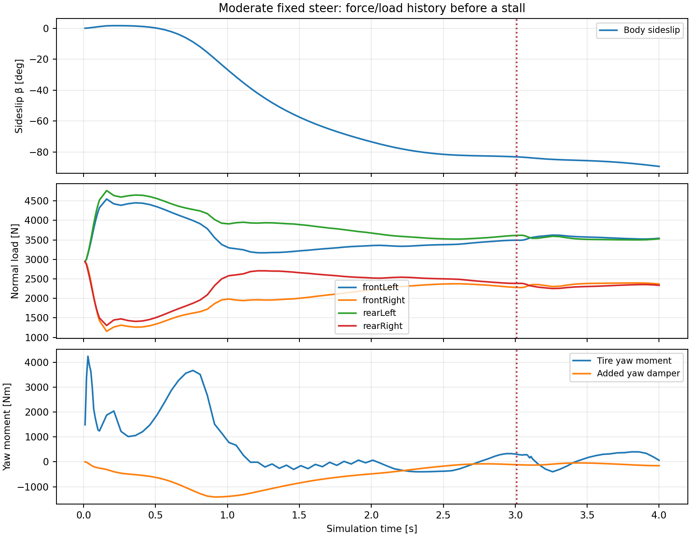

# Mission 5 — Vehicle behavior audit and recovery plan

## 1. Executive diagnosis

**The reported unpredictability has several reproducible causes. It is not explained solely by difficult manual-transmission operation or lost keyboard input.** The most consequential confirmed findings are:

1. **Mouse steering can be discarded by rendering.** A render-only frame restores the old `wheelAngle` snapshot over an input event that has not reached a physics tick. This makes command acceptance depend on render/physics scheduling.
2. **Re-grabbing steering creates an angle discontinuity and release impulse.** The drag origin preserves pointer position but not the existing steering angle. One pixel of motion from a 0.2 rad road angle reset it to 0.00347 rad; the next free-column update went to −0.113 rad.
3. **The repair drivetrain introduces an order-dependent straight-line oscillation.** At zero steering with symmetric initial conditions, rear contact forces lose symmetry and yaw reaches ±0.291 rad/s, with peak lateral acceleration 4.99 m/s². Reversing only the rear contact evaluation order mirrors the oscillation to within 5.3e−8 rad/s. The earlier playable branch stays symmetric in this test.
4. **The tire parameters do not mean what their names suggest.** The default raw formula peaks at 0.869° and κ=.0130, despite parameters named peak angle 8° and peak ratio .12. Its raw peak is 2.945 μN, so the combined-force cap creates a broad plateau starting near 0.148° / κ=.00221. This produces extremely stiff near-zero response; it is not a validated tire characteristic.
5. **Free steering oscillates to both locks even in neutral.** That removes driven-wheel torque and the new shared rear inertia as necessary causes of this particular instability. The tire/column feedback loop remains unvalidated; the audit does not assign the entire instability to a single coefficient or sign.
6. **Timestep changes alter whole maneuver outcomes.** The same launch succeeds at 50 Hz but stalls at 100–400 Hz in the repair/input branches. Handbrake recovery differs greatly across rates. Passing free-chassis invariants has not validated the coupled vehicle.
7. **Browser and Node defaults differ.** Startup control bindings change redline, clutch curve, stall resistance and other parameters. The actual browser stall threshold is **360 RPM**, not the 264 RPM used by earlier source-default fixtures.

The input/starter branch and repair branch have **bit-identical mechanical telemetry, excluding timing, in all 33 matched scenarios**. Keyboard/starter work did not repair or cause their shared handling regressions. The older playable branch remains a useful behavior reference, **not a physically correct oracle**: it permits running below the stall threshold, immediate loaded shifts, RPM overwrites and unaccounted starts.

No production file was changed. No repair, tuning, merge, artwork change, assist, or drift script was introduced.

## 2. Scope, revisions and evidence quality

Audit branch: `research/vehicle-behavior-audit`, based on `fix/input-and-starter`.

| Reference | Audited commit | Role |
|---|---|---|
| `recovery/realtime` | `b23935b2b98b3474bf7d178283a0450724febb81` | Earlier playable comparison |
| `recovery/drivetrain-repair` | `214cda94f09614eca3c5e5980283720e9668d2df` | Unfinished mechanical changes |
| `fix/input-and-starter` | `b28e8133be95c069c1c98e7818b0e13d8c491dee` | Current audit base |
| `research/drivetrain-coupled-solver` | `6e8d2ee` | Prior isolated research; not integrated |

The audit ran **99 primary mechanical replays in actual system Chromium**: 33 scenarios on each of three read-only archived branches, totaling 39,300 primary ticks. It also ran 36 timestep-refinement replays, repeated the flick on every branch, reversed contact order in a dedicated probe, and exercised neutral steering and actual keyboard/mouse/RAF behavior. No primary replay threw a solver exception or produced nonfinite telemetry. Flick repetition was bit-exact per branch; this checks one challenging reset sequence, not every possible trajectory.

The mechanical harness initializes the actual application and its UI defaults, intercepts RAF scheduling, then executes the exact source-extracted production mechanical prefix through sleep, in Chromium. Wrappers observe existing functions without changing their return values. Camera, rendering, trails, faults and audio after that prefix are excluded from these mechanical traces. **These replays are not browser frame-rate or real-time input tests.** Separate live and controlled-frame experiments exercise the actual input handlers and main loop.

All common browser parameter values are identical across compared branches. New input-shaft/clutch/starter parameters have no counterpart in the older model. Initial force histories are zero, suspension is at its static equilibrium, and rolling states are explicitly seeded into pose history and wheel speeds. Synthetic sideslip/yaw/wheelspin seeds are labeled in scenario definitions; they are not claimed to have emerged from a previous maneuver. In neutral the added input shaft starts at rest; a released clutch can therefore produce an initial input-shaft spin-up transient absent from the old model. Do not interpret that transient alone as an idle defect. Maps are enlarged to 20 km × 20 km to exclude walls; no driving physics parameter is tuned in the primary replays.

`scenarios.mjs` preserves input events, initial conditions and durations. Compressed telemetry preserves every fifth tick (20 Hz) plus 100 Hz windows around driver/mode/gear events. Branch comparisons and summaries use every primary tick before downsampling. `--full` preserves all ticks. Metadata contains complete startup parameters, source hashes, geometry and the column schema.

### Telemetry contract

Time is the interval **end**; events at .50 s first affect the .51 s row at 100 Hz. World coordinates use +X right / +Y down. Heading zero points up. Body forward/right velocities are world velocity projected onto those axes; β=`atan2(v_right,v_forward)`. Sideslip at nearly zero speed is not a useful handling metric. Steering/yaw/slip angles are radians, speeds m/s or rad/s, forces N, loads N, moments Nm, work J, tick durations ms.

Data includes driver commands; requested/engaged gear; mode/RPM/signed crank/input speed; engine-phase crank speed; transmitted clutch/starter/combustion torque where exported; pedal/capacity/slip; pre-final-clutch and final wheel speeds; stored slip angles/ratios; individual world forces, normal loads, brake/road torques; world/body velocities, pose, yaw, accelerations; actual pre-tick yaw-damper moment; tire yaw moment; constraint correction; drag; solver anomalies and measured tick duration. `finalRotorKappa_*` uses final rotor speed with the contact pass's cached body velocity, making its time level explicit. Legacy missing torque fields are null, not fabricated.

The older branch has no independent signed crank state: its telemetry fallback is RPM×π/30, not a measurement of otherwise absent signed mechanics. Stored slip/forces and final wheel speeds are deliberately kept at their different update stages rather than presented as simultaneous quantities.

## 3. Actual physical architecture

Classification: **P** recognizable physical model; **A** intentional approximation; **E** empirical/convenience behavior; **I** inconsistent coupling; **F** incorrect or incomplete. Multiple labels can apply. Simplification alone is not a defect.

| Mechanism and ownership | Actual implementation and consequence | Class |
|---|---|---|
| Engine — `physics/engine.js` | Parabolic torque curve around 4500 RPM, additive proportional idle governor, fuel cut, Ie=.25 kgm², constant-plus-viscous drag. These are uncalibrated map approximations, not measured engine data. Current combustion modes retain signed mechanical motion after stall/off. | P/A; calibration incomplete |
| Clutch/pedal — `engine.js`, `drivetrain-rotation.js` | Capacity 350 Nm × nonlinear engagement, finite slipping impulses and holding states. A/S controls are binary; the modeled pedal travels over .3 s. Bite begins at .35 travel and reaches full capacity at .55: full capacity arrives about **165 ms** after release, with only a 60 ms bite window. Pedal release is not instantaneous input loss. The engine/contact/clutch split misaccounts work. | P/A/I/F |
| Gearbox/differential | Signed ideal ratios; neutral input inertia .02 kgm²; finite 20 Nm synchronizer; dog release uses an assumed 15 Nm unloading limit from fork force/radius/friction. Ideal open differential, equal input torque to both rears, independent wheel speeds; no LSD. A pending loaded shift can be mechanically justified. Actual reverse is −first gear, despite a separate unused −3 constant. | P/A/E; calibration/config incomplete |
| Wheel rotation | Iw=1.2 kgm² per wheel. Scalar implicit contact integration with bounded bisection and adaptive step doubling. New analytic shared input inertia has correct off-diagonal terms, but one sequential contact pass changes the opposite rotor without recomputing its previous contact solution. | P/I/F |
| Static tires — [tires.js:43](../js/physics/tires.js#L43) | Simplified E=0 Magic Formula, normalized by the force at the configured slip parameter, then combined-force cap and scrub blend toward .85 kinetic grip. Four tires share generic B/C/peak settings. No measured cornering stiffness or tire map. Peak-parameter semantics are inconsistent with the resulting curve. | P/A/E/F |
| Transient tires | 25 ms lateral-velocity EMA; distance-based longitudinal/lateral force lag τ=max(.3/|v_long|, using a .5 m/s floor); current-load force-vector projection; averaged contact impulses. Lagged force can return contact energy after reversal without an explicit recoverable-energy state. | A/I/incomplete |
| Steering — `physics/steering.js`, `input.js` | Driver dragging imposes both front road angles directly, with about 15.1:1 visual/road ratio; no Ackermann. When released, a free column uses I=.08, viscous damping 5.5, gated Coulomb friction .05, front tire SAT and low-speed spring. Trail=.035 exp(−|α|/(π/12)); SAT has another 80 ms filter. The driver is an ideal position source while dragging; SAT cannot override held countersteer. Feedback stability and energy are unvalidated. | P/A/E; input ownership F |
| Load transfer/suspension — `suspension.js`, `weight.js` | Default enabled: sprung heave/pitch/roll, front/rear springs/dampers/bars, roll-center geometry, algebraic 35 kg/wheel unsprung terms, bump/droop stops and nonnegative contact loads. Previous-tick body acceleration drives ≤1 ms internal steps; acceleration input is capped at ±2g. Disabled mode uses algebraic transfer instead. Static CoM is centered, 50/50 load; no measured reference calibration. | P/A/E |
| Chassis — `integrator.js`, `planar-motion.js`, `kinematics.js` | Four physical corner markers at 2.408 m wheelbase and 1.589 m track; centered 1200 kg body. Three planar generalized coordinates use symplectic kick-drift and exact free rigid rotation. Pose history owns its dt. Yaw inertia is 832.3385 kgm² from a uniform **wheel-rectangle** plate, not measured body mass distribution. Markers are not four literal 300 kg point masses. | P/A; yaw calibration incomplete |
| Constraints/collisions | Six rest-distance constraints, six browser-default iterations per pass, two passes; .8 history correction with .05 floor. Interior corrections measured at ≤1.45e−13 m, so they do not explain these interior maneuvers. Per-corner map-wall restitution is .3; collision work/rigid impact remains unvalidated and was excluded here. | A/E; impact behavior incomplete |
| S brake/F handbrake — `wheel.js`, `engine.js` | Nominal brake force 9800 N split 80% front / 20% rear into torque capacities. Rear handbrake adds capacity with .25 s rise / .15 s decay. Engaged rear braking is deferred to final joint clutch/brake impulses after contact. No special handbrake yaw kick. | P/A/I |
| Resistance — [tires.js:481](../js/physics/tires.js#L481) | Crr=.012 mg plus .4 v² opposite total velocity, disabled below .001 m/s. Isotropic whole-body drag approximates aero/rolling effects; no separate wheel rolling-drag torque. At 15 m/s nominal magnitude is 231.3 N. | P/A/E |
| Added yaw damper — `main.js` | `T=−yawDamping I yawRate`, default 1/s, independent of speed. It adds yaw dissipation beyond tire forces. No identified aero or stability-control calibration justifies calling it realistic. | E |
| Sleep — `engine.js:156` | With no throttle/brake/mouse throttle and speed/yaw below .02, position histories are zeroed. Clutch/handbrake are not part of that no-input predicate. A .019 m/s, .019 rad/s probe loses all pose motion. Tiny settle convenience, not an explanation for highway-speed spin. | E |
| Loop — `main.js:411` | 100 Hz default, simulation dt=(1/Hz)×timeScale; maximum six ticks/frame and 250 ms frame-time cap, then whole ticks are dropped. This prevents backlog but loses simulated time relative to wall-clock inputs. Main-thread input events cannot run during blocking work. | A/E |
| Feedback/rendering | Drift intensity, grip labels, paints, smoke, camera jerk and sound mostly consume state; they do not script a drift. Rendering's restoration of `steering.wheelAngle` is an exception: it overwrites the input field. Grip hysteresis/visual semantics are also inconsistent. | E; state ownership F |

### Overlap and inactive code

The algebraic and suspension load-transfer paths are alternatives, **not simultaneous load transfer**. `computeBrakeForce()` and `clampParticleDisplacements()` remain in source but are not called by the current mechanical prefix; braking is not doubled by their presence. The new `mechanicalActive` path disables the old direct engine-to-wheel drive-force path. Friction-circle capping limits force rather than adding another force. Lateral filtering, force relaxation and SAT filtering do stack delays. The extra yaw damper stacks dissipation with tire-generated yaw resistance. These distinctions prevent blaming inactive code or legitimate approximations for every symptom.

## 4. Reproducible scenarios and branch comparison

All 33 definitions are preserved in [scenarios.mjs](../research/vehicle-audit/scenarios.mjs). Coverage includes start/idle, neutral throttle, clutch opening, gentle/aggressive launch, unloaded up/down shifts and loaded shift requests, engine braking, brake-to-stop, single and legacy two-click restart; acceleration/coast/hard braking/wheelspin/burnout/traction recovery; low/moderate turns, steering step/reversal/release, lift-off; power-oversteer/weight-transfer/flick/countersteer/donut attempts, left/right transition, excess/lifted throttle and handbrake recovery.

These are open-loop attempts, not successful-maneuver assertions. Countersteer/drift-transition fixtures seed β/yaw explicitly. The donut attempt never establishes a sustained high-sideslip circle; it mainly turns under power with about 4.3° maximum β. Its failure to become a donut does not prove an open-differential vehicle can never perform one. Conversely, 60–90° body sideslip and an eventual stall are not evidence of a realistic controlled drift.

| 100 Hz scenario | Realtime → input final speed, m/s | Important causal result |
|---|---:|---|
| Start/idle | 0 → 0 | Old button instantaneously runs at 800 RPM; new finite starter first tick 10.60 RPM. Divergence at .01 s is intentional improvement. |
| Gentle launch, 20% throttle | .154 → .0127 | New mode stalls at 1.32 s, 355.5 RPM. Old remains running near 60 RPM under throttle, itself incoherent. First >50 RPM divergence .66 s. |
| Aggressive launch | 11.781 → 9.902 | New mechanics are not validated merely because this launch continues running. |
| Acceleration from 15 m/s | 29.849 → 23.268 | First >50 RPM divergence .03 s; whole-model comparison, not a calibrated acceleration target. |
| Engine-braking straight | 13.251 → 13.281 | Similar final speed hides new ±.291 rad/s yaw oscillation. First yaw difference >.02 rad/s at .37 s. |
| Coast in neutral | 14.267 → 14.267 | Body traces agree; new input-shaft spin-up transient has no old-model counterpart. |
| Hard brake from 25 m/s, 3 s | 4.346 → 4.640 | Correct slowing direction; average deceleration about .69g in input branch is plausible, not reference-validated. |
| Moderate turn, δ=.08, throttle=.25 | 18.858 → 8.503 | New peak yaw 1.697 rad/s vs .63 old; nearly sideways before stall at 3.01 s. First yaw divergence .04 s. |
| Power-oversteer attempt | 17.607 → 12.939 | New max β≈62.5°; no calibrated proof of realistic oversteer. |
| Flick attempt | 15.124 → 11.942 | Repeat is bit-exact per branch; final paths differ substantially. |
| Handbrake recovery | 10.200 → 8.917 | New transient differs and is strongly timestep-sensitive. |

Significance criteria in `summary.json`: >50 RPM, >.1 m/s world velocity difference, >.02 rad/s yaw difference, or mode/engaged-gear mismatch. Tiny differences precede these thresholds. Every scenario's first significant event and final metrics are preserved; no claim is made that the first RPM mismatch is necessarily the cause of its entire later path.

Normal upshift: request at 1.30 s; old engages at 1.31 s, new passes through neutral and engages at 1.45 s. Normal downshift engages at 1.42 s in the new model. The loaded request at 1.00 s remains in gear 2 with request 3 through 4 s; at 1.01 s clutch torque is about 141 Nm, above the assumed 15 Nm dog-release limit. That pending request is **not evidence of a missed number key**. The precise force threshold is uncalibrated.



## 5. Confirmed causal defects

### 5.1 Input/renderer ownership and steering re-grab

[main.js:792](../js/main.js#L792) interpolates steering into shared state, and [main.js:875](../js/main.js#L875) restores `curr.wheelAngle` rather than the pending pre-render command. In a controlled actual-application Chromium schedule:

| Event | Simulated time | Visual command | Road angle |
|---|---:|---:|---:|
| Actual mouse motion, pending | .01 s | 1.570796 rad | 0 |
| Render-only frame | .01 s | **0** | 0 |
| Next physics frame | .02 s | 0 | 0 |
| Another motion immediately followed by physics | .03 s | 1.623156 rad | .107467 rad |

The drag flag stays true and held D stays true. This isolates steering command loss from keyboard loss. Higher refresh/physics ratios create more render-only opportunities; the audit does not measure the user's actual monitor/event distribution.

[input.js:265](../js/input.js#L265) stores `dragStartX`; [input.js:282](../js/input.js#L282) reconstructs angle solely from displacement since that origin. Existing steering angle is omitted. With RAF queued to isolate real mouse events, a .2 rad road angle becomes .0034667 rad after one pixel, implying −19.653 rad/s column velocity in one tick. Releasing gives −.112962 rad. This is an input discontinuity with a mechanical consequence, not ordinary tire countersteer behavior.



### 5.2 Rear contact order and force/speed inconsistency

[tires.js:264](../js/physics/tires.js#L264) solves each contact independently; [tires.js:282](../js/physics/tires.js#L282) applies an off-diagonal change to the other rear rotor. The next solve changes that first rotor again without re-solving its force. Then [engine.js:117](../js/physics/engine.js#L117) applies a further clutch/brake correction after forces and stored slip were calculated.

The shared inertia matrix is locally correct; its **sequential temporal use is not a simultaneous contact solution**. A symmetric straight engine-braking run develops alternating rear torque/speed differences and yaw up to .290966 rad/s. Reversing only rear evaluation order mirrors the yaw within 5.3e−8 rad/s. Interior constraint correction stays around 1e−13 m. There is no road asymmetry, steering input or keyboard replay in this experiment. The observation implicates evaluation order; it does not partition every joule/error between contact splitting and the later clutch projection.



### 5.3 Tire-force shape and transient/steering feedback

For the actual raw formula, `F/(μN)=sin(C atan(B s/s_peak))/sin(C atan B)`. At B=10, C=1.9 its maximum occurs at `s/s_peak=tan(π/(2C))/B=.10863`, not at 1. Normalization is .33956; the raw maximum is 2.94498. The cap is already reached at s/s_peak=.018439. Small-angle stiffness is approximately **1.20 MN/rad per 3000 N tire** before capping. These are properties of the implemented curve, not externally measured tire targets. A valid UI setting C=2.5 makes the normalizer negative and the function returns zero; configured C extends to 3.0. This conditional domain defect is distinct from the default-shape problem.

The friction cap prevents that raw 2.945 μN maximum from being applied. A saturation plateau is not inherently unphysical: the confirmed findings are its unexpected parameter mapping, large initial stiffness and invalid allowed parameter domain. No replacement stiffness or uniquely shaped peak is declared realistic without reference data.



With neutral/coasting, holding δ=.18 rad stays held. Releasing it at 1.2 s produces free steering excursions to **both ±.52 rad locks**. The loop contains a very stiff lateral curve, smoothed lateral velocity, force relaxation, filtered SAT, explicit column forcing and assumed column properties. This reproduces the oscillation independently of driven-wheel torque. A sign error alone is not established: near straight running the SAT sign does return the wheel toward alignment. The next investigation must separate tire memory/force shape from column discretization and calibration.



### 5.4 Drivetrain work and transient tire energy remain unresolved

The prior source-default isolated static fixture records 5.349 J false clutch heat at 100 Hz. Its configuration is **not** the browser's 7000 RPM/default-clutch-curve configuration, so do not reuse that number as a measured browser heat error. The defect is structural: independent engine work is evaluated before contact and final clutch reaction. It is not fixed by zeroing the heat counter.

The [Mission 4 report at `6e8d2ee`](https://github.com/QuantumEther/VerletDrift/blob/6e8d2ee/docs/drivetrain-coupled-solver.md) corrects static holding in a standalone candidate but fails within-tick slip-to-lock work. Its neutral starter example needs an event at 1/700 s; endpoint-only work misses it. It also exposes signed contact-port energy return from the unchanged force lag. Real tire elasticity could return stored energy, but the current force-only lag has no constitutive storage account. **That research candidate must not be promoted as the finished drivetrain correction.** This audit does not invent a closed full-vehicle energy budget from incompatible journals.

## 6. Stalls, input reliability and timestep evidence

Browser startup [controls.js:153](../js/ui/controls.js#L153) writes control/HTML defaults into state. Important differences from `state.js` are redline 9000→7000, stall resistance .7→.5, clutch bite exponent 1.8→2.5, constraint iterations 12→6, constraint history damping .85→.8, brake force 9810→9800, and grip thresholds .9/.8→.7/.85. Full differences are in `model-probes.json`. Identical code tests with different startup parameters cannot establish browser parity.

The current threshold is `600(1−.5×.8)=360 RPM`. The observed stalls apply that criterion without the old throttle/speed exemptions:

| Scenario/event | State at first stall | Interpretation |
|---|---|---|
| Gentle launch, 1.32 s | 355.5 RPM; throttle .20 held; A released; forward 1.05 m/s | Input reaches mechanics. Load defeats available engine torque; plausibility depends on uncalibrated clutch/engine and unresolved numerics. |
| Moderate turn, 3.01 s | 359.1 RPM; throttle .25; forward 1.38, lateral −11.59 m/s; β≈−83.2° | Engine stall follows near-sideways vehicle motion, rather than unexplained throttle loss at ordinary forward road speed. Cause of the preceding loss of control is not validated. |
| Drift lift, 3.35 s | 357.2 RPM; throttle zero; forward 1.26, lateral 11.91 m/s | Low driven-wheel/shaft speed under a sideways-moving body can mechanically stall. Total vehicle speed alone is not a valid engine-speed oracle. |
| Loaded shift | Throttle valid, gear 2 engaged/request 3 pending | Mechanically ineffective/delayed request, not an absent key event. |

A single restart button click with A held restarts the new model through finite starter torque. A second legacy click at 3 s then stops it; the same two-click workaround is not equivalent across modes/branches. No anti-stall, hidden clutch opening or automatic restart is recommended.

Live actual-browser tests showed D works while a slider is focused and raises engine RPM; search-field D/R produce text without driving; A/S/D/F combinations reach all held flags; synthetic blur clears them and later real presses work. A separate-page focus attempt in headless Chromium **did not produce visibility/focus loss** (the document stayed visible); it cannot verify desktop focus behavior. Existing handler tests cover synthetic blur/hidden-tab paths. Real stalled D remains held with zero combustion. Frozen physics likewise retains D but cannot respond. An intentional 200 ms main-thread block delays a key round trip about 202 ms and causes dropped simulation ticks. That probe demonstrates a scheduling limitation, not proof of the user's normal hardware load.

**Ctrl+R and Ctrl+Shift+R are confirmed broken:** actual Chromium reload shortcuts are prevented and do not reload. Ctrl+R while stopped also requests the starter. Minimal correction plan: before `KeyR` default suppression/held-state mutation/start dispatch, return for Ctrl/Meta/Alt-modified R. Tests must cover Ctrl+R, Ctrl+Shift+R, Meta+R, unmodified R, repeat, text entry and running/starting modes; browser reload should occur and no starter/held-R side effect should remain. This is a small independent input mission, not a physics repair. No correction is implemented here.

### Refinement at fixed input event times

| Scenario | 50 Hz | 100 Hz | 200 Hz | 400 Hz |
|---|---:|---:|---:|---:|
| Input gentle-launch final speed, m/s | 1.590 | .0127 | .0008 | .0010 |
| Input gentle-launch first stall, s | none | 1.320 | 1.285 | 1.2775 |
| Realtime gentle-launch final speed, m/s | .360 | .154 | 1.073 | 1.069 |
| Input handbrake final speed, m/s | 10.041 | 8.917 | 4.603 | 2.902 |
| Realtime handbrake final speed, m/s | 9.371 | 10.200 | 3.154 | 2.133 |
| Input steering-reversal final heading, rad | −.911 | −.544 | −.544 | −.549 |
| Neutral low-turn yaw RMS after 2 s, rad/s | .244 | .252 | .279 | .298 |

These rates preserve event times. The last row shows that oscillatory handling is not eliminated merely by finer integration in this range. No 400 Hz result is declared ground truth. Brake/contact/clutch event sensitivity and model-loop behavior require separate investigation.





## 7. Corrective mechanisms and physical expectations

The default added yaw damper takes a force-free 1 rad/s spin to .366032 rad/s in one second; disabling only that term gives 1.000000 rad/s. Rotational energy falls by about **86.6%** from that imposed term. This is explicit empirical yaw dissipation, not tire physics or a measured aerodynamic law. The probe disables tires/rolling/aero only to isolate the term; these are diagnostic controls, not proposed tune changes. Sleep zeroes .019 m/s / .019 rad/s histories; its effect is confined to very slow motion. The inactive displacement cap must not be blamed for speed loss in these runs.

Grip loss/recovery thresholds have inverted hysteresis: at utilization .8, labels alternate stable/slipping every tick under browser defaults .7/.85. The UI pair constraint enforces the wrong ordering for this state machine. `smoothedGrip` stores utilization while a Canvas wheel-color consumer interprets it as available grip. These are feedback/visual inconsistencies; the actual tire-force law does not consult these labels, so they are not traction recovery forces. Drift-intensity EMA coefficients are per tick, affecting visual timing as Hz changes. Do not diagnose their animation as a hidden drift controller.

Classical expectations used here are **symmetry, torque/work balance, sign consistency, finite friction capacity, normal-load balance, input ownership and convergence**. Kinematic low-speed yaw `r≈v tan δ/L` is a conditional no-sideslip benchmark, not a target during saturation/drift. A plate using the visual shell envelope would have a different inertia than the wheel rectangle, but neither is a measured yaw-inertia target; choosing the larger value to calm the car would be tuning without evidence. The generic 50/50 vehicle, ideal open differential and common tire parameters are not validated DeLorean dynamics merely because the image is a DeLorean.

External NASA drag-equation, OpenStax rotation and tire-model reference pages were attempted; this session's network proxy returned tunnel HTTP 403. No external vehicle measurement was verified. No identified reference vehicle, tire test dataset, skidpad, braking or steering-column measurement was supplied. Therefore plausible acceleration/deceleration numbers, convincing drift images and passing free-body tests are not evidence of calibrated realism.

## 8. Performance and validation limits

Mechanical-prefix durations include audit wrappers but exclude telemetry packing/render/audio. These Chromium timings are quantized and include host scheduling noise; there is no GPU/frame-rate claim:

| 100 Hz scenario | Realtime mean / p95 / worst, ms | Input mean / p95 / worst, ms |
|---|---|---|
| Acceleration | 1.940 / 3.1 / 7.4 | 1.397 / 2.5 / 4.3 |
| Steering reversal | .756 / 2.2 / 5.6 | 1.438 / 2.5 / 3.7 |
| Moderate turn | .520 / 1.5 / 2.7 | 1.489 / 2.5 / 4.5 |
| Handbrake | 1.259 / 2.2 / 3.1 | 1.622 / 2.4 / 3.8 |
| Burnout | .050 / .1 / .6 | .065 / .2 / 1.0 |

The full existing unit suite reports **274 passed / 7 failed**: four known static-clutch work failures and three existing `wheel-omega-audit` expectations (exact idle, immediate over-rev synchronization, pre-contact creep torque). No assertion was changed. Preserved-data integrity checks pass; seven explicit behavior expectations fail normally in `check.mjs` (symmetry, order independence, render ownership, drag continuity, modified-R reload, hysteresis and launch outcome across rates). None is marked an expected failure to make the audit look green.

Remaining limits: no original user input recording or exact deployed Pages commit was matched; actual desktop focus loss was not recreated in this headless environment; full real-time renderer/GPU/hardware driving and wall collisions are unverified. Maneuver names describe test inputs, not proven maneuvers. Configuration/initial conditions constrain each comparison. Coupled vehicle energy closure, tire stored energy, chassis inertia and steering response remain unvalidated. Thus the audit reproduces several consequential abnormal behaviors but cannot claim to reproduce every detail of the user's experience.

## 9. Ranked, dependency-aware recovery missions

Impact rank is not implementation order. Separate easy input defects from numerical and constitutive work; do not stabilize an incorrect contact system by reducing torque or increasing yaw damping.

| Problem | Impact / diagnosis confidence | Dependencies / implementation risk / runtime cost |
|---|---|---|
| Lost/discontinuous steering commands | Very high / confirmed real event and actual-frame probes | Independent; low–medium risk around render-state ownership; O(1) cost |
| Contact-order asymmetry and split drivetrain work | Very high / confirmed symmetry and prior work failures | Depends on an explicit contact/work contract; high risk; small bounded joint method required, production cost unproven |
| Tire-force semantics, lag energy and free-column instability | High / curve and symptoms confirmed; realism calibration unknown | Static contract first; medium–high risk; constitutive/solver cost must be bounded |
| Browser/Node configuration mismatch | High for diagnosis / confirmed | Independent; low–medium risk preserving current default behavior; negligible runtime |
| Uncalibrated yaw inertia/damper/steering assumptions | Potentially high / measured damping, unknown reference realism | Stable force/coupling first plus identified vehicle; medium risk; O(1) mechanics |
| Stall/gear policy and difficult launches | High perceived impact / criterion and pending load reproduced, physical calibration unresolved | Depends on coupling/tires/config; medium risk; O(1) policy, no assists |
| Ctrl+R and inverted feedback labels | Modest motion impact / confirmed | Independent; low risk and negligible cost |

Recommended smallest sequence:

1. **Restore control ownership and continuity.** Boundary: `input.js` plus the small render interpolation/restore boundary in `main.js`. Before editing, automate the exact pending-command and re-grab probes as failing browser tests. Preserve pending input outside render snapshots or save/restore the actual pre-render command; preserve drag-start angle. Add the modifier guard above. Afterward require identical event acceptance with 100 Hz physics and render-only frames at 60/120/240 Hz, continuous one-pixel re-grabs at both locks/off-center, no fake release impulse, correct browser reload/text entry and unchanged A/S/D/F. Expected change: reliable steering/countersteer; risk: existing muscle memory around the erroneous zero-based drag. No tire/engine tuning. Runtime change should be constant and unmeasurable against normal frame variance.
2. **Make the physical configuration reproducible.** Boundary: authoritative defaults, control bindings, test initialization and exported audit configuration. Before: assert and record present browser/Node differences and grip-state chatter. After: browser and Node load the same explicitly versioned mechanical configuration; do not silently choose new parameter values. Correct semantic hysteresis/pair validation and grip display units in a separately reviewable change. Expected change: tests predict the vehicle users run; indicator flicker disappears. Risk: accidental retuning if defaults migrate carelessly. No measurable physics-cost increase.
3. **Specify and test the tire contract before calibration.** Boundary: pure static force law/parameter semantics and a small explicit transient state contract. Before: retain curve, load/circle, reversal and neutral-turn/column traces. Decide what the peak parameters mean and whether force lag represents stored deformation or purely empirical memory; derive its energy/port accounting rather than clipping force signs. After: peak semantics, valid B/C domain, finite load response, combined-force bounds and accounted reversal work must pass at 50–400 Hz. Identify reference tire data before fitting. Expected change: less pathological stiffness/feedback; risk: major changes to grip onset and existing drift initiation. No general-purpose tire/steering nonlinear framework; benchmark callback/evaluation counts.
4. **Finish isolated coupled rotational research with physical event work.** Boundary: crank/input/rear rotors and two contact callbacks, no production replacement yet. Before: retain original static-work, Mission 4 slip-event, signed momentum, asymmetric contact and new symmetry/order tests. After: static zero-work hold, finite passive slip/lock transitions with correctly integrated source work, brake/starter/off/stalled back-drive, joint contact residuals and order independence must all pass. Bound event count and nonlinear work; reject exhaustion explicitly. Research can use prescribed passive contacts while mission 3 defines the final contract, but production acceptance requires both. Expected change: trustworthy mechanical reactions; risk: corrected loads may expose real stalls/spins previously concealed. Do not promote the rejected Mission 4 candidate or add substeps merely to hide failure.
5. **Integrate that accepted boundary, then diagnose remaining stalls/shifts.** Boundary: `engine.js` supplies torques/capacities/policy; rear solver owns speeds/impulses; `tires.js` supplies contacts and consumes the same impulses; `wheel.js` retains front integration. Stall detection/readouts follow the accepted mechanical update. Before: retain all browser stall/shift/launch traces. After: symmetry, final-speed slip/force telemetry, finite starts, pending shifts, full work accounting and rate-refined launch/brake/recovery outcomes. Classify stalls by signed crank speed/load; do not add anti-stall or automatic rev matching. Risk: burnout/drift wheelspin and previously easy launches change; compare every preserved maneuver, without declaring old trajectories correct.
6. **Validate steering/yaw assumptions against one identified vehicle model.** Boundary: steering column/trail/driver ratio, explicit yaw-assist policy, calibrated mass geometry/inertia and differential choice. Before: retain neutral lock-to-lock oscillation, input-release derivatives, no-sideslip low-speed turn, yaw-decay and held-countersteer cases. After: supported steady/transient tire/column response, measured or defensible yaw inertia/load split, and an explicitly declared assist if retained. Do not choose inertia or damping to conceal prior numerical defects. Expected changes may include greater free rotation when artificial damping is removed or reclassified; risk to familiar drift feel is substantial. O(1) mechanics; no drift-specific yaw code or automatic LSD substitute.
7. **Run the full vehicle realism acceptance set.** Boundary: replay/measurement suite and one documented configuration, before any multi-vehicle presets. Collect real/reference acceleration, coast, braking, steady-turn, step-steer and transient traction data where available. Repeat normal manual operation and drift attempts with real event-driven input, fixed simulation-time replay, and 50–400 Hz convergence. Judge demanding manual behavior by mechanics and measured response, not ease of driving or visual effect. Only then expand vehicle choices or handling development.

For missions 3–7, propose a **100 Hz engineering budget** on named reference hardware: p95 mechanical time ≤5 ms and p99 below the 10 ms tick interval, with bounded evaluation counts, explicit allocation/GC measurements and no unexplained >20% regression from the matched protected workload. These are proposed performance gates, not established hardware guarantees or physical target values. New numerical correctness must not be traded away to meet the budget.

## 10. Reproduction and artifacts

```sh
node research/vehicle-audit/run.mjs          # read-only archives, 3-branch Chromium replay
node research/vehicle-audit/keyboard.mjs     # live app/input, including known Ctrl+R failure
node research/vehicle-audit/causal.mjs       # controlled actual RAF/mouse + neutral probes
node research/vehicle-audit/model-probes.mjs # source-default parity and actual force law
python3 research/vehicle-audit/plots.py
node research/vehicle-audit/check.mjs        # intentionally nonzero for seven listed failures
node node_modules/vitest/vitest.mjs run     # existing seven mechanical-audit failures remain
```

Use `CHROMIUM_EXECUTABLE` for another installed browser executable; this run used `/usr/bin/chromium` in headless Canvas mode. Node dependencies needed local Linux Rollup/esbuild optional binaries in this Windows-populated checkout; manifests were unchanged. The full replay can be generated with `--full`. No always-on instrumentation is added to gameplay.

Preserved under `docs/vehicle-audit/`: three compressed telemetry files, source/parameter/metric `summary.json`, `browser-input.json`, controlled `causal-input.json`, full `order-probe.json.gz` and `steering-probe.json.gz`, `model-probes.json`, seven figures and `checks.json`. All experimental scripts are under `research/vehicle-audit/`. The uncontrolled live steering fixture is explicitly annotated because rendering can overwrite it; use the controlled-RAF evidence for numerical re-grab values.

**The audit stops here.** The car is not repaired, calibrated or accepted as realistic. The evidence establishes a focused correction sequence and preserves the failures needed to verify it.
