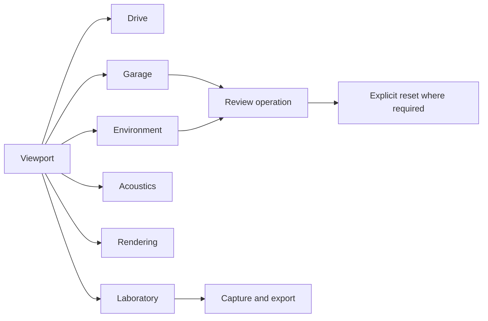
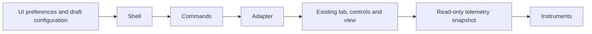

# VerletDrift Studio design exploration

Audit source `515c4523aa8ecf3dbd80b8e044193b54d79ceacf` on PERFORMANCE_2. The checkout also carried a local balloon renderer edit. Browser observations below describe the checkout as rendered. This directory contains an isolated, mock-only design study.

Serve the repository root with `python3 -m http.server 8777`, then open [the study index](index.html). Each concept uses the same mock control data so its layout and interaction can be compared directly.

## Audit

| Viewport | Canvas top | Canvas size | Document height |
|---|---:|---:|---:|
| 1440 × 900 | 1816 px | 895 × 559 px | 3212 px |
| 1920 × 1080 | 1798 px | 1255 × 784 px | 3420 px |

Captured in desktop Chromium using SwiftShader and the default laboratory URL. See [1440 capture](captures/current-1440.jpg), [1920 capture](captures/current-1920.jpg) and [driving canvas](captures/live-viewport.jpg). These are layout observations. Hardware performance, assistive technology behavior, perceived input latency and every asset/backend combination remain unverified.

The controls above the canvas obscure the primary driving task. The repeated renderer, diagnostic and operating settings compete for attention with ignition, gear and throttle. Labels such as submission, scene updates and empty pass are meaningful to researchers but need context in general driving mode. The live application does have named controls and keyboard/pointer driving. A focused select or range can overlap global driving bindings because the input guard explicitly excludes text/number inputs and editable text, but does not cover every interactive element. Focus transitions, reduced motion and pointer cancellation should be checked with real devices in migration.

The [DOM inventory](inventory.md) records source lines, IDs, defaults and literal handlers. Dynamic families include clutch presets via `data-clutch`, pointer controls via `data-drive`, the throttle/engagement value outputs and repeated diagnostic switches. The inventory is a source snapshot, not a guarantee that every setting was exercised.

## Workspaces and workflows

| Workspace | Owns | Main workflows |
|---|---|---|
| Drive | Camera, ignition, starter, gear, clutch and essential instruments | Enter scene, start engine, select gear, drive, pause, resume |
| Garage | Vehicle, appearance, drivetrain | Preview configuration, confirm incompatibility or reset, switch vehicle |
| Environment | Terrain, route, seed, amplitude, roughness, HDR and daylight | Select road, preview changes, regenerate or load |
| Acoustics | Audio activation, samples, starter, master/layer mix, listener and capture | Enable audio, compare mixes, record |
| Rendering | Backend, quality, exposure, environment, shading and effects | Adjust in place where supported, explicitly request renderer rebuild |
| Laboratory | Contact overlays, traces, diagnostics, audit and exports | Arm capture, drive test, stop, compare and export |

Immersive keeps the cockpit instruments and workspace escape route. Studio opens a contextual inspector. Research adds a persistent telemetry region. Switching these modes should preserve driving state, camera, open panels and recording unless the driver invokes a specific destructive command. Mobile should stack the inspector below the viewport and retain access to commands without covering the scene.

## Concepts

| Concept | Structure | Strength | Tradeoff |
|---|---|---|---|
| [Automotive Atelier](studio.html?concept=atelier) | Persistent viewport with right inspector and bottom instruments | Balanced tuning and driving in one screen | Inspector costs width at smaller desktop sizes |
| [Precision Engineering](studio.html?concept=engineering) | Left inspector and dedicated telemetry under a shorter viewport | Fast access to repeatable test settings and analysis | Smaller driving image |
| [Cinematic Immersion](studio.html?concept=cinema) | Full-width viewport and floating inspector, telemetry on demand | Strong driving focus and useful screenshots | Overlay can cover scene information |

Start the review with Automotive Atelier as the general configuration workspace. Use the Precision Engineering layout for Research density and the Cinematic layout for Immersive where users prefer a clear view. The prototypes deliberately keep instruments and sampled values stable apart from direct mock interactions. Warning, loading and error examples use the state selector. No setting is written to the simulator.

## Visual and interaction system

| Role | Proposal |
|---|---|
| Surfaces | Graphite page #17191b, work surface #222528, separator #3b4146 |
| Text | Warm white #f1eee7, secondary #b8bfc5, tabular numerals for measurements |
| Accents | Champagne #e1c59b for Atelier and Cinema, pale cyan #ade0dc for Research selections |
| Status | Use icon plus text for warning, error and loading, with amber/red semantic color in production |
| Geometry | 8 px base grid, 4 px control corners, 1 px dividers, 32–44 px interaction targets |
| Components | Native range with synchronized unit-aware numeric editor, select, toggle, tactile gear matrix, trace with current value and unit |
| Accessibility | Visible focus ring, keyboard access and focus return, programmatic labels, live status reserved for meaningful events |
| Motion | Immediate command, focus, value and warning responses. Optional critically damped interpolation for panel transforms only. With natural frequency 24 rad/s, settle within roughly 250 ms. Respect reduced motion and keep telemetry values raw |

Precision editors should preserve unit/step/range metadata from settings. Range drag offers preview and commits on release when updates are expensive. Numeric input supports direct entry and keyboard stepping. The gearbox should distinguish requested, engaged and synchronization pending states. Provide rejection feedback in text and make keyboard shortcuts available from Drive. The study demonstrates requested gear locally but does not model synchronization.

## Runtime dependency and migration

Today `main.js` owns the lab, view, clock, captures and frame loop. It directly reads IDs each frame and `controls.js` reads gear, throttle, clutch and ignition at step sampling. W/S/A/D/Space hold driving inputs, R holds starter in lifecycle mode, 1–7 request gears, N requests neutral and Backspace resets. Pointer hold uses capture and cancels on release or lost capture. Blur and visibility clear held inputs. Camera and audio have their own input paths. Preserve input ordering and clear held inputs on focus changes.

Reset disposes/recreates the view and simulation. Terrain selection, vehicle selection, drivetrain selection, rest, coast, regeneration and Backspace reach reset. Quality, graphics, smoke, appearance, camera and audio controls dispatch updates to their existing owners. Contact recording can break trace continuity and clear tracks resets its observatory. Existing diagnostic and telemetry exports are explicit downloads. No localStorage/sessionStorage calls were found in the audited top-level JS. Runtime defaults are seeded from HTML and session state. Any future UI preference persistence should be versioned and independent of simulation settings.

Introduce a small command facade over existing methods with explicit live, rebuild and reset commands. Maintain a read-only snapshot boundary and retain the current DOM IDs and exported test hooks until parity coverage exists. Keep fixed-step input sampling on the authoritative path. Use event-driven control updates with a separate dirty-check telemetry cadence. The current dashboard already gates updates at 200 ms and spatial audio at 50 ms. Avoid introducing per-frame DOM layout reads. Use native modules and CSS grid for the first migration.

## Roadmap and acceptance

1. Review the concepts and choose a direction.
2. Inventory contracts and capture hardware baselines with the existing runner.
3. Add the command facade and viewport shell behind an opt-in route with the existing browser tests.
4. Migrate Drive and non-resetting controls, then Garage and Environment with explicit reset confirmation.
5. Migrate diagnostics and telemetry with exported raw values and compare against existing fixtures.

Replay the same deterministic driving inputs and compare state snapshots, gear outcomes, resets and exports across shells. Exercise all six workspaces at 390, 1440 and 1920 px, keyboard-only navigation, pointer cancellation, zoom and reduced motion. Require viewport, drive actions and clear warning/status feedback on first screen. Require switch-away/return to preserve configuration and recording, and verify live controls and disabled state by backend.

For each backend, use the same hardware, viewport/DPR, resolution, scene, camera and inputs. Warm up, then record at least three matched 30-second paused and driving runs using the existing A/B export. Report mean/P95/P99 frame times, debt and real-time ratio alongside dashboard cost, main-thread activity, heap trend and input-to-render latency. Include ten workspace switch cycles with cold and warm samples. Proposed budgets pending hardware baseline are no more than 5% regression in frame-time percentiles or dashboard cost, zero added simulation debt in the replay, no monotonic heap growth after warmup, one-frame immediate-driving feedback within baseline variance, and workspace switch P95 below 100 ms. Measure software and GPU results separately. The prototype captures do not establish these budgets as achieved.
