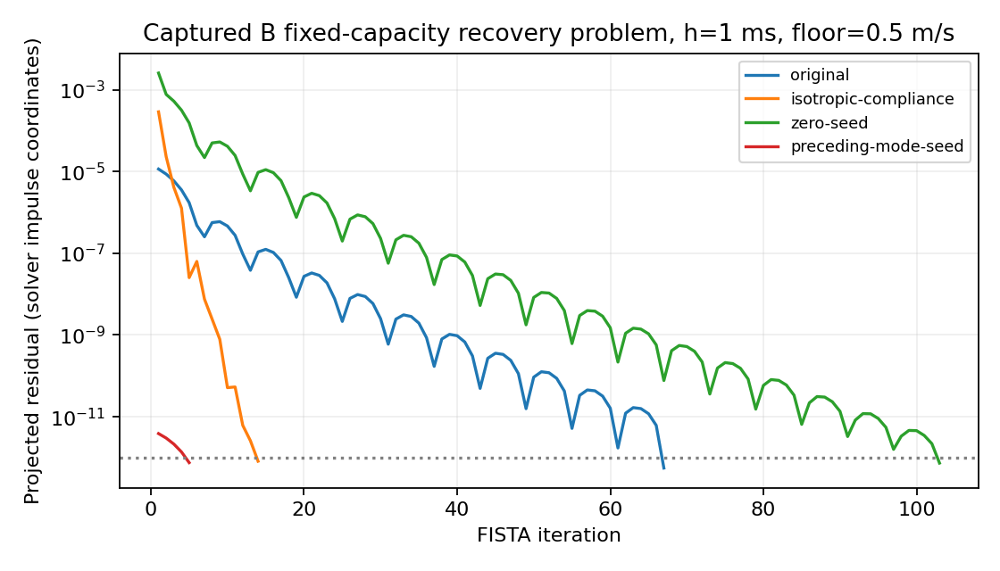

# Mission 13 — contact optimization, conditioning and preservation

**Decision: retain measured low-risk improvements; keep tire strategy A as the
application default and B as an opt-in headless experiment. B still fails its
1.10 CPU-retention gate.** No new tire physics, solver algorithm, preconditioner,
outer acceleration, UI selector, suspension propagator or historical experiment
is introduced. All changes are within Experiment 11.

Figures below are explicitly **measured** unless called **derived** or **unknown**.
Timing improvements apply to their stated workload and host; they are not a
universal speedup promise. Neither iteration reduction nor a closed energy ledger
alone establishes physical fidelity.

## Provenance and protocol

Starting branch: `scientific-rebuild/12-braking-and-tire-contact`, clean HEAD
`59a6ed8`. Before production changes, Experiment 11's 63 tests, Experiment 10's 24
tests, and both default/explicit Mission 12 reference replays passed. Original
Mission 12 results remain unchanged in `../tire-strategy-ab/`.

`b-baseline.json.gz` was captured against unchanged `59a6ed8` production code,
before adding profiling or optimization: seven scenarios × three timesteps ×
four floors, 20 complete accepted states each (**84 fixtures, 1,680 states**).
Sorted paths and IEEE-754 bytes retain signed zero and complete relevant
mechanical state, impulses, constitutive/energy diagnostics and iteration counts.
The comparison tool reports the first mismatching field; it never regenerates
expectations during replay. The historical A fixture is still the immutable
Mission 12 baseline from `9eb20e4` (**1,080 accepted states**, initial states,
invalid-step and physical gear-event rollback).

Runtime: **Node v24.19.0**, Linux x64, AMD EPYC 9V74 80-Core Processor, managed shared
cloud host. CPU frequency, host isolation and external load are **unknown**.
CPU cost uses `process.cpuUsage` user+system divided by actual simulated time;
wall cost uses `performance.now`. Initialization and JSON serialization are
excluded. Common lightweight timers/invariant checks are included. No GPU results
are claimed.

Before/after throughput sweeps each contain **840 runs**: acceleration, straight
braking, steering, combined braking/steering, lateral recovery, rear-wheel
overspeed recovery and unloaded-corner recontact × 1/2/4 ms × floors 0.25/0.5/1/2
m/s × A/B × five repeats. The first repeat is warm-up; four measured pairs
alternate AB/BA order. Each case advances 0.3 simulated seconds with deterministic
Mission 12 inputs and identical non-tire initial states/parameters. These short
probes measure cost; longer validation is reported separately.

The recovery replication additionally uses nine repeats (one warm-up, eight
measured pairs) of nominal 0.25 s at floor 0.5 m/s and every timestep. At 4 ms this
is 63 whole steps/0.252 s; all rates normalize by actual time.

Candidate ablations rotate and reverse variant order within each repeat, nine
repeats/one warm-up, 0.3 s recovery at 1 ms and floors 0.25/0.5. Both the initial
126-run investigation and follow-up 144-run bundle-isolation run are retained.
The latter separates the warm/matrix bundle from the faster diagnostic. In this
recovery probe the entry speed is above both 0.25/0.5 m/s floors, so these two
blocks largely replicate the same physical law; they are not independent evidence
of different low-speed regularizations. The full sweep covers the distinct
near-rest behavior at all four floors.

Intervals are paired-bootstrap 95% intervals, 3,000 resamples, seed 13 (see the
summarizer for deterministic iteration order). Broad sweeps have only four
measured pairs; many conclusions are intentionally **inconclusive**. These
intervals describe within-run sampling variation, not all shared-host uncertainty
or multiplicity-corrected universal guarantees. Before/after sweeps are separate
runs and can drift with host conditions; within-process rotated ablations provide
the stronger attribution of individual changes.

## Actual cost decomposition

Profiling is opt-in and outside mechanical state: `vehicle.profile` provides
candidate-stage times; `vehicle.contactProfile` provides solver details;
`vehicle.contactCapture` provides private, deep-cloned problem snapshots. Matrix
snapshots cannot mutate current cached operators, impulses or velocities.

Detailed profiling adds microtimers and must **not** be interpreted as production
throughput. `reference-profile.json.gz` and `final-profile.json.gz` repeat all
168 scenario/timestep/floor/strategy combinations at 0.3 s with one repeat. The
reference variant uses the exact pre-optimization arithmetic, verified by replay.
Per-call counts/timings are aggregated without dropping unsuccessful clutch-mode
attempts. `baseline-profile.json.gz` preserves the earlier 36-run raw-event and
matrix/history capture used to choose candidates; its 0.12 s protocol differs.

Measured stages:

- **T1:** inertia/free-velocity preparation, row construction, inverse-inertia /
  Jacobian products and Hessian assembly, Lipschitz/free-index preparation,
  projection of the initial impulse and warm-start preparation. Matrix products
  and assembly are timed together, not assigned invented individual costs.
- **T2:** actual FISTA optimization, gradient multiplication, projection and
  residual comparison sub-times, then scalar polish/post-residual/velocity
  reconstruction. Child gradient/projection/residual times are included in, not
  added again to, optimization time. The original convergence and polish remain.
- **T3:** constitutive function calls, saturation, root bracketing and iteration
  counts/time; tire observations and force-law comparisons are reported separately.
- **T4:** accepted-candidate setup, trial cloning, terrain/reactions, contact ledger
  and endpoint energy/work/convergence checks. Outer trials and clutch retries
  are counted separately from macro attempts and selector safety substeps.

`cost-breakdown.csv` reconciles T1–T4, other tire observations, remaining unified
work and time outside candidate marks against total observed wall time. These are
**wall-stage measurements**, not per-function CPU samples; whole-run CPU is
measured separately. Remaining time includes callbacks, wrapper publication and
instrumentation overhead, rather than being silently attributed to optimization.
`benchmarks.csv` joins each throughput combination to a deterministic matched
profile for actual solver-call counts and component timing. Those call counts
are measured in the matching profile, not inferred from a single final stage.

The initial raw profile measured B constitutive diagnostics at **20.657 ms** and
inner optimization at **1,399.255 ms**. Only **2,112 / 33,048** diagnostic calls
were saturated (168,960 old bisection iterations). Making bisection faster cannot
remove most of that workload. B executed **8,262 locked plus 8,262 fixed-capacity
solves**; locked solves used **835,137** inner iterations and retries **183,990**.
This identified a worthwhile private seed opportunity and a larger remaining
locked-mode cost. It did not justify claiming diagnostics were the bottleneck.

## Conditioning and convergence

`baseline-profile.json.gz` retains 144 captured production problems with inverse
inertia, free velocity, actual rows/compliance, constraint bounds, Hessian, RHS,
Lipschitz bound, projected warm seed, complete residual history, impulses and
result velocities. Some adjacent captures span different clutch modes. No
unrelated unconstrained matrix is substituted for the contact problem.

The unchanged objective and physical map are:

```
min_z  0.5*zᵀ D z - rhsᵀ z
D = J M⁻¹ Jᵀ + C
v_new = v_free - M⁻¹ Jᵀ z
||z_tire|| <= h*mu*max(N,0)
```

Scalar brake/clutch intervals, fixed kinetic clutch impulses and steering bounds
remain in the feasible product. The non-diagonal drivetrain inverse-inertia
block is retained. `C_tire = diag(1/(h*kx),1/(h*ky))` is unchanged physically.

**Derived from captured matrices:** the free-coordinate Hessian has two numerical
null directions from redundant steering rows in these cases. Its full condition
number is therefore not reported as a finite stiffness ratio. The analyzer also
forms the local active-manifold Lagrangian Hessian: remove fixed/active scalar
coordinates, retain tangents to saturated circles, and include their nonnegative
KKT multiplier curvature. This is a *local* conditioning indicator with a
numerically classified active set, not a global convergence guarantee. These eigenvalues/condition indicators depend on
the existing generalized-coordinate units and row scaling (including steering
scaling); they describe this implemented numerical problem, not a coordinate-
invariant physical condition number.

Measured/derived medians across the captured configurations:

| Scenario | A local positive condition | B local positive condition | A/B median inner iterations |
|---|---:|---:|---:|
| Acceleration | 2.507 | 12.337 | 67.5 / 67.5 |
| Lateral recovery | 1.299 | 5.159 | 76.5 / 169.0 |
| Rear-wheel overspeed recovery | 1.299 | 1.231 | 89.5 / 87.5 |

The recovery correlation supports a conditioning contribution; acceleration and
overspeed show why stiffness ratio alone is insufficient. A poorly conditioned
lateral direction need not increase iterations when a longitudinal input/warm
seed scarcely excites it; at higher forward speed B's coefficients can also be
close to A's. At differing A/B
trajectories, warm-seed quality and active sets also differ. The captured global
bound is about 1.04–1.07 times the maximum free-space eigenvalue in representative
cases: a grossly conservative global step size is not demonstrated.

`controlled-conditioning.json.gz` isolates changes on the **same captured B
problem**, keeping inertia/free velocity and bounds fixed. For fixed-capacity
recovery, median iterations are **83 original**, **42.5 isotropic-compliance**,
**129 zero-seed**, and **5 preceding-mode-seed**. The isotropic case is an offline
constitutive counterfactual, not a new vehicle or an equivalent B solution.
The preceding-mode seed tests the identical fixed-capacity problem.



An independent normal-cone KKT calculation gives maximum stationarity residual
**1.029e-11** and raw feasibility excess **8.674e-19** in the implemented row coordinates across all 144 original
captures. The PSD objective plus feasibility and normal-cone stationarity is the
applicable convex optimality certificate; it is independent of the production
solver's scaled projected-residual calculation.

The analyzer also attempted cold-start SciPy SLSQP. All calls reported success,
but only **104/144** matched the production objective within 1e-10; the remaining
40 were insufficiently accurate (production objective was lower by up to
1.483e-5). These comparisons are **not** promoted to a high-accuracy oracle.
All outcomes remain in `conditioning.json.gz`. Independent angular-minimization
tire-law tests remain the high-accuracy constitutive reference.

## Candidate derivations, scope and decisions

### 1. Safeguarded diagnostic Newton — experimental only

The existing KKT multiplier obeys
`r(lambda)=hypot(sx/(1/kx+lambda), sy/(1/ky+lambda))=mu*N`.
Its derivative is
`r' = -(x/r)*(x/(1/kx+lambda))-(y/r)*(y/(1/ky+lambda))`.
Because `r(lambda)<=||s||/lambda`, `||s||/(mu*N)` supplies a dimensionally correct
upper bracket. Newton steps outside the bracket are replaced by bisection;
termination requires force-norm error at floating-point precision, with the
original 80-iteration bound and explicit nonconvergence. Zero-load/unsaturated
branches remain explicit. No second force is applied.

Independent KKT/angular tests, original-bisection comparisons, saturated and
unsaturated boundaries, signed slips, zero grip and tested loads 0 through 1e6 N
pass. However the rotated whole-vehicle diagnostic-only CPU result is
**inconclusive**, with nominal ratios slightly above one. It is therefore not
selected for the production B path. It remains an opt-in tested research variant;
the original 80-bisection diagnostic is the selected default.

### 2. Private clutch-mode warm seed — selected for B

After a converged locked-mode box-constrained solve is physically inadmissible
as zero slip, its numerical impulse vector is a useful seed for the next
fixed-capacity solve. Both solves have the same inertia, geometry, compliance,
free velocity and all other constraints; only the clutch group's feasible set
changes. The seed is projected onto that next set and the **same full solver,
polish, clutch admissibility, energy and constitutive checks run again**.
No iteration or mode is bypassed, and no inadmissible mode is applied physically.

The seed is local to one `stepPlanar` call. It does not survive a rejected
candidate or cross a timestep, endpoint geometry, material or stiffness change.
The existing accepted-impulse timestep scaling still seeds the first mode.
Trials and observers remain transactional. Initial impulses are copied before
optimization, so solving the next mode cannot mutate the preceding result.
B's finite-tolerance solution may round differently; numerical equivalence, not
bitwise identity, is claimed. A never uses this changed seed path.

### 3. Intra-call matrix reuse — selected for A and B

`support`, `M⁻¹Jᵀ` and `D` depend on current inverse inertia, contact rows and
compliance, all invariant within the current clutch-mode loop. They are assembled
once and reused in subsequent modes of that *same call*. RHS, free-variable
indices, bounds, Lipschitz bound, seed projection and every solve are still
computed per mode. Prepared data enforce inverse/row object scope; they are
never shared across endpoint trials or timesteps. Changing terrain, loads,
steering, h or coefficients creates a fresh scope. There is no global cache or
persistent mechanical-state workspace.

Reusing identical computed doubles preserves original arithmetic, including
A's complete diagnostic/iteration replay. Matrix-only B also replays bit-exactly.
The separate A ablation first had noisy intervals; the follow-up supported
matrix reuse at both tested floors. Both raw runs are retained.

### 4. Scaling/preconditioning — investigated, not implemented

**Derived:** for positive diagonal `S` and `z=S*y`, the objective becomes
`0.5*yᵀ Sᵀ D S*y-rhsᵀ S*y`, while each tire disc becomes
`(Sx*yx)^2+(Sy*yy)^2 <= (h*mu*N)^2`. An arbitrary diagonal scale followed by radial
projection onto a circle would solve the wrong feasible problem. Correct
elliptical/metric projection and a stopping certificate mapped back to the
original impulse coordinates would be required.

The measured bound is already fairly tight. The remaining locked-mode work and
its local conditioning warrant future investigation, but no validated total-cost
benefit from transformed projections is established here. No preconditioner,
solver replacement, tighter unproven bound, Newton/Anderson outer acceleration,
or speculative speedup is introduced. The current low-risk measured gains do not
justify an unvalidated scientific-path change merely to force retention.

## Selection API and unsupported conditions

A remains the default tire strategy. The selected numerical backends are
`matrix` for A and `warm-matrix` for opt-in B. Optional outside-state property
`vehicle.contactOptimization` can select `reference`, `diagnostic`, `warm`,
`matrix`, `warm-matrix` or `all` for reproducible ablations. `all` includes the
experimental Newton diagnostic; neither it nor `diagnostic` is the selected B
default. Configuration is copied once per candidate; mechanical state contains
no functions or reusable operator caches.

B's inherited flat-ground dispatch remains explicitly rejected. Non-flat
gear-selector event crossings remain unsupported/rejected; fixed selected-gear
engine/clutch/brake interaction is tested. Road seed 42, 0.001 m amplitude,
roughness 0.1 is the controlled terrain domain. Arbitrary aggressive terrain,
calibrated real-car handling, long non-flat gear-changing drives and universal
latency guarantees remain unvalidated. No public application/UI changes are made.

## Measured outcomes and retention

### Individually controlled ablations

Ratio is variant CPU / unoptimized CPU, in the rotated 0.3 s / 1 ms recovery
probe. Intervals quantify sampling variability; they are not a universal speedup.

| Tire | Floor | Candidate | CPU ratio [95% interval] | Interpretation |
|---|---:|---|---|---|
| A | 0.25 | matrix | 0.912 [0.882, 0.977] | improves |
| B | 0.25 | diagnostic | 1.055 [0.933, 1.182] | inconclusive |
| B | 0.25 | warm | 0.928 [0.833, 0.994] | improves |
| B | 0.25 | matrix | 0.905 [0.810, 1.113] | inconclusive |
| B | 0.25 | warm-matrix | 0.823 [0.729, 0.970] | improves |
| B | 0.25 | all | 0.800 [0.728, 0.917] | improves |
| A | 0.5 | matrix | 0.876 [0.807, 0.921] | improves |
| B | 0.5 | diagnostic | 1.015 [0.960, 1.064] | inconclusive |
| B | 0.5 | warm | 0.945 [0.893, 0.995] | improves |
| B | 0.5 | matrix | 0.925 [0.882, 0.981] | improves |
| B | 0.5 | warm-matrix | 0.833 [0.786, 0.884] | improves |
| B | 0.5 | all | 0.853 [0.793, 0.921] | improves |

Selected B warm/matrix reduces median CPU by **16.7–17.7%** in these two measured
recovery blocks. A matrix reuse reduces CPU by **8.8–12.4%** in those blocks.
B warm-only reduces CPU by 5.5–7.2%; matrix-only is supported at floor 0.5 and
inconclusive at 0.25. These effects are not additive: their interaction and
uncertainty are measured by the bundle. Diagnostic-only is not demonstrated to
improve throughput and is not selected.

In this 0.3 s probe, B inner iterations/step fall **731.073→581.153** while outer
trials remain **5.3033**. A remains **252.493 inner / 5.1867 outer** with identical
physical and diagnostic results. The bundle does not omit contact solves.

### Recovery replication at every timestep

These nominal 0.25 s runs match the Mission 12 recovery protocol, with eight
measured A/B pairs per step. The baseline and selected sweeps are separate runs;
the table must not be read as a randomized source-version comparison.

| Build | Step | A CPU s / simulated s | B CPU s / simulated s | B/A [95% interval] |
|---|---:|---:|---:|---|
| baseline-recovery | 1 ms | 1.149 | 1.689 | 1.471 [1.341, 1.749] |
| baseline-recovery | 2 ms | 0.825 | 1.196 | 1.451 [1.351, 1.740] |
| baseline-recovery | 4 ms | 0.691 | 0.970 | 1.405 [1.172, 1.467] |
| final-recovery | 1 ms | 0.961 | 1.379 | 1.434 [1.250, 1.720] |
| final-recovery | 2 ms | 0.713 | 0.952 | 1.336 [1.249, 1.734] |
| final-recovery | 4 ms | 0.590 | 0.779 | 1.321 [1.075, 1.507] |

**B fails the 1.10 retention target at all three recovery timesteps.** Optimizing
A fairly also lowers the denominator; improved B is not automatically retained
merely because it beats old B.

The full per-combination data, including median/p95/p99/worst step times,
CPU/wall rates, average iterations, attempts/faults, actual matched-profile calls,
assembly/optimization/diagnostic/copy/endpoint times, finite-state checks and
friction-circle excess are in `benchmarks.csv`. Before/after ratios and tail
ratios are in `before-after.csv`; no unsuccessful scenario is removed.

| Sweep | B/A upper interval <=1.10 | Lower interval >1.10 | Inconclusive |
|---|---:|---:|---:|
| baseline-sweep | 24 | 32 | 28 |
| final-sweep | 38 | 23 | 23 |

All **840 + 840** broad runs and both **54-run** recovery replications complete
without numerical faults. Before/after comparisons show supported CPU reductions
in 54/84 A combinations and 77/84 B combinations; the others are inconclusive,
with no supported CPU regression in these samples. This does not replace the
stronger within-process candidate attribution or certify every host.

Maximum broad-sweep energy residual remains **1.094e-8 J**; maximum constitutive
impulse residual is **7.118e-11 N s before / 7.052e-11 N s after**, far below the
unchanged **2e-8 N s** guard. Maximum measured friction-circle excess is
**8.527e-14 N**, floating-point projection rounding, unchanged before/after.
No energy tolerance, iteration limit, physical parameter or force limit changes.

### Component work: matched full-sweep profiles

**Measured instrumented wall seconds per simulated second**, not production CPU
throughput. Non-overlapping named costs plus the two reported remainder columns
reconcile total wall time. See `cost-breakdown.csv` for exact counts and times.

| Build / tire | T1 preparation | T2 optimize/polish | T3 diagnostic | T4 coupled work | Other/remainder | Total wall |
|---|---:|---:|---:|---:|---:|---:|
| reference-profile / A | 0.256 | 0.491 | 0.0000 | 0.231 | 0.052 | 1.030 |
| reference-profile / B | 0.258 | 0.731 | 0.0024 | 0.250 | 0.064 | 1.306 |
| final-profile / A | 0.191 | 0.485 | 0.0000 | 0.224 | 0.049 | 0.949 |
| final-profile / B | 0.191 | 0.608 | 0.0024 | 0.241 | 0.062 | 1.105 |

Across the matched 0.3 s profiles, A inner iterations remain **8,408,600**, B falls
**13,211,862→10,884,486**. Outer trials remain **88,160 A / 88,240 B**, and solver
calls remain **173,604 A / 173,764 B** before and after. Thus trials are not skipped
and no second physical impulse is applied: each mode solves from the **same free
velocity**, with a different initial iterate only. B's larger remaining T2 cost is
dominated by the locked-mode problem, not diagnostic bisection. Full matrix
assembly reuse also benefits A even though its iteration count cannot change.

The optional diagnostic-only profile is retained as `diagnostic-profile.json.gz`.
It measures root counts/time separately; it is not substituted for the
low-overhead throughput result.

### Tail latency: measured limitations

Broad p99 after/before exceeds 1.10 in **11 A and 4 B** combinations. These are
retained, not called passes. At 4 ms the 0.3 s probe has only 75 samples, so its
nearest-rank p99 equals its worst step and is particularly noisy.

`tail-probe.json.gz` remeasures the largest observed p99 increase for each tire,
one-second duration, nine alternating old/selected repetitions with one warm-up:
A acceleration / 4 ms / floor 0.25, and B acceleration / 2 ms / floor 1.0.
Selection is explicitly post hoc; it does not erase other flags or certify all
cases. All 36 follow-up runs complete without faults.

| Tire | Metric | Selected/control ratio [95% interval] |
|---|---|---|
| A | cpuMs | 1.032 [0.898, 1.110] |
| A | p95Ms | 0.946 [0.820, 1.110] |
| A | p99Ms | 1.022 [0.851, 1.240] |
| B | cpuMs | 0.899 [0.851, 1.023] |
| B | p95Ms | 0.898 [0.832, 1.072] |
| B | p99Ms | 0.944 [0.814, 1.035] |

The large short-probe p99 increases are not reproduced as a supported material
regression in this follow-up. **A's tail result remains inconclusive**, and no
universal no-tail-regression certificate is claimed. Together with the failed
CPU gate, this prevents describing B as production-ready. B's candidate recovery
p95/p99 point ratios improve, but that is a different case, not a reason to hide
acceleration uncertainty.

## Scientific preservation and longer validation

- **70 Experiment 11 tests pass**, no failures/skips: 63 original plus seven new
  optimization/capture/transition tests. **24 unchanged Experiment 10 tests pass**
  both before and after.
- Default and explicit reference A each retain **1,080 bit-exact accepted states**
  plus initial and rollback fixtures. Profiling/capture is separately tested for
  zero effect on accepted state. Matrix-only B reproduces its **1,680** states
  bit-exactly; `reference` backend B does too.
- Selected B is **numerically equivalent, not bit-identical**. The short replay's
  maximum physical-field difference is **1.284e-8 N** (`wheel[1].fy`); differences
  in iteration counters are intentional. The comparator preserves the original
  first differing field and a separate physical-field maximum. No tolerance in
  the scientific solver is relaxed to accept this comparison.
- **198 longer matched A/B runs complete**, eight one-second scenarios across
  all timesteps/floors plus six-second near-steady-speed cornering at floor 0.5.
  All 99 A final states match the immutable Mission 12 JSON values. That JSON
  equality is not presented as a signed-zero-preserving bit test.
- Against the same old 99 B final states, maximum final position difference is
  **9.541e-13 m**, velocity **9.384e-13 m/s**, tire/normal force **1.486e-8 N**,
  wheel speed **1.518e-12 rad/s**, engine speed **2.416e-13 rad/s**, and steering
  angle **1.648e-11 rad**. Raw unit-separated results are in
  `long-regression.json.gz`; original and new final states/traces are preserved.
- Longer-run maximum energy residual is **1.820e-8 J** and constitutive impulse
  residual **7.052e-11 N s**. The original per-step **1e-7 J** energy guard still
  applies; accumulated residual remains explicitly recorded in every raw ledger
  and is not set to zero. These are numerical-equivalence/stability results,
  not calibrated tire realism.
- Adversarial tests exercise static capture near zero from both signs, overload
  to sliding, torque reversal, service braking and steering, changing timestep,
  floor/stiffness, material grip down to zero, suspension unloading, matrix scope
  rejection, rejected gear-event rollback and unchanged accepted observer history.
- The 608-point isolated A/B force grid is rerun: **all measured fx/fy values equal
  Mission 12**, including saturation and combined slip. Existing independent
  angular oracle/KKT tests still pass at unchanged thresholds.
- Chromium **154.0.8037.57** inherited application test: **PASS**, no page/console
  errors. It checks start/throttle, real first-gear propulsion, steering,
  service/handbrake, twelve camera/inspection modes, physical/render transforms,
  track clearing, resource stability and laboratory reset. Controlled RAF and
  software rendering are not a GPU or throughput benchmark; wall-budgeted runs
  need not stop at identical simulation times.

`verification.json` records commands/results and `source-sha256.json` identifies
measured production code. The original simulator, renderer, navigator, experiment
URLs and Experiments 1–10 are unchanged.

## Reproduction

From repository root:

```sh
node --test --test-isolation=none research/scientific-rebuild/procedural-terrain/tests/*.test.mjs
node --test --test-isolation=none research/scientific-rebuild/four-corner-load-transfer/tests/*.test.mjs
node research/scientific-rebuild/procedural-terrain/tools/tire-baseline.mjs
node research/scientific-rebuild/procedural-terrain/tools/tire-baseline.mjs --explicit
VARIANT=reference node research/scientific-rebuild/procedural-terrain/tools/contact-replay.mjs
VARIANT=matrix node research/scientific-rebuild/procedural-terrain/tools/contact-replay.mjs
node research/scientific-rebuild/procedural-terrain/tools/contact-replay.mjs --equivalent
CHROMIUM_PATH=/usr/bin/chromium QUICK=1 node research/scientific-rebuild/procedural-terrain/tests/browser-inherited.mjs
```

Do not run `--capture` against new code to replace the expected baseline.
To regenerate B's original fixture independently, archive `59a6ed8`'s
`research/scientific-rebuild` tree into a temporary checkout, copy only
`tools/contact-replay.mjs` there, make the result directory, and capture there.
The immutable A fixture continues to use `9eb20e4` as documented in Mission 12.

From `research/scientific-rebuild/procedural-terrain` (redirect JSON stdout):

```sh
# Old arithmetic for comparison; new selected default omits VARIANT.
VARIANT=reference DURATION=.3 REPEATS=5 node tools/contact-benchmark.mjs
DURATION=.3 REPEATS=5 node tools/contact-benchmark.mjs
VARIANT=reference DURATION=.25 REPEATS=9 FLOORS=.5 CASES=recovery node tools/contact-benchmark.mjs
DURATION=.25 REPEATS=9 FLOORS=.5 CASES=recovery node tools/contact-benchmark.mjs
node tools/contact-candidates.mjs
PROFILE=1 VARIANT=reference DURATION=.3 REPEATS=1 node tools/contact-benchmark.mjs
PROFILE=1 DURATION=.3 REPEATS=1 node tools/contact-benchmark.mjs
PROFILE=1 TRACE=1 VARIANT=reference DURATION=.12 REPEATS=1 FLOORS=.25,.5,2 STEPS=.001,.004 CASES=acceleration,recovery,drift-recovery node tools/contact-benchmark.mjs
node tools/contact-condition-replay.mjs
python3 tools/contact-conditioning.py results/contact-optimization/baseline-profile.json.gz
node tools/contact-tail-probe.mjs
AB_DURATION=1 AB_REPEATS=1 AB_CASES=acceleration,braking,steering,combined,recovery,recontact,steering-release,drift-recovery node tools/tire-ab.mjs
AB_DURATION=6 AB_REPEATS=1 AB_FLOORS=.5 AB_CASES=near-steady node tools/tire-ab.mjs
node tools/tire-curves.mjs
python3 tools/contact-long-regression.py
MPLCONFIGDIR=/tmp/m13-mpl python3 tools/summarize-contact-optimization.py
```

Save/gzip JSON outputs under the matching artifact names before summarization.
The original pre-change `baseline-sweep/recovery` files are from `59a6ed8`, not
recaptured after optimization. The reference-variant command reproduces numerical
outputs but includes new inactive profiling dispatch, so timing should be
remeasured rather than asserted identical across revisions/hosts. Python analysis
uses NumPy/SciPy and matplotlib; application physics acquires no dependency on
them. *The Arithmetic Floor* was not found in this checkout; available frequency
studies were consulted, and no external recommendation is treated as measurement.

## Final decision

**Retain A matrix reuse and B's private warm/matrix bundle. Keep A the default
application tire strategy.** Keep safeguarded diagnostic Newton opt-in because
whole-vehicle benefit is inconclusive. Preserve the full failed-retention evidence.
The remaining B cost is mainly locked-mode optimization with different active
conditioning and warm residuals; no validated low-risk change here brings it
within 10% of optimized A across the supported sweep. Tail confidence is also
incomplete. B is **not production-ready**, and no Mission 14, GPU migration,
preconditioned solver or accelerated endpoint method is silently added.
