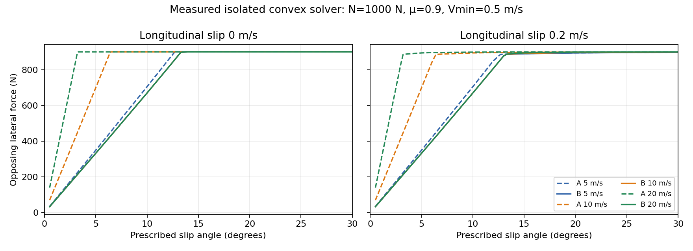

# Mission 12: tire-constitutive A/B experiment

Status: **experimental result; retain reference A as the application default**.
B removes the prescribed-slip law's first-order speed dependence in the registered
unsaturated domain, but fails the 10% CPU-overhead retention gate. No UI selector
is added. This is a tire-law comparison within Experiment 11, not Experiment 12
or a replacement vehicle/application. No historical experiment is modified.

## Model and dispatch

`src/tire-strategy.js` owns configuration validation, immutable coefficients,
row compliance, friction limit and constitutive diagnostics. The existing contact
solver, its iteration caps, clutch mode logic, inertia blocks, energy/work ledger,
terrain endpoint iteration, and acceptance tolerances are unchanged.

A (`reference`) uses the literal original `1/(h*800)` expression in both rows,
the original operation ordering for `h*mu*max(0,N)`, and the inherited `tireForce`
diagnostic. A still delegates flat terrain to Experiment 10. No new diagnostic
fields are attached to A's mechanical state.

B (`speed-normalized-anisotropic`) uses:

- `kx = 800 N s/m`.
- `ky = C_alpha / max(Vref,Vmin)`, with illustrative `C_alpha = 3800 N/rad`.
- `Cii = 1/(h*ki)` (inverse mass), one shared `||z|| <= h*mu*max(N,0)` circle.
- Configurable, positive, representable `C_alpha,Vmin`; predeclared floors
  0.25, 0.5, 1 and 2 m/s. None is selected retrospectively as a winning floor.

`Vref` is the magnitude of the **accepted-entry contact-point ground velocity**
projected onto the terrain-forward tangent. The actual contact Jacobian includes
chassis translation/yaw, steering-trail motion and vertical pitch/roll/wheel
motion; all wheel-spin slots are explicitly zeroed for this measurement. It is
not wheel circumferential speed or the final slip velocity. Coefficients and a
copy of the strategy configuration are frozen before the first endpoint trial
and reused in every trial of that internal timestep. A new internal substep uses
its own accepted-entry speed. Configuration is outside mechanical state; accepted
B diagnostics contain only cloneable immutable numeric records, including actual
row compliance and circle limits. Failed candidates publish none of those records.

**Flat B is explicitly unsupported.** Selecting B on the inherited flat dispatch
throws before publication; it never silently runs A. B is tested on the existing
supported road terrain, seed 42, amplitude 0.001 m, roughness 0.1. That same terrain
is used for both A and B; no perturbation is inserted to bypass dispatch.
Regeneration validates the selected strategy privately and preserves original
state/configuration/history on failure. Unsupported non-flat gear-selector event
crossings remain unsupported; fixed first-gear driving is tested here.

Headless API (after importing from `src/`):

```js
const v = createTerrainVehicle({preset:'road',seed:42,amplitude:.001,roughness:.1});
v.tireStrategy = createTireStrategy({
  id:'speed-normalized-anisotropic', corneringStiffness:3800, minSpeed:.5
});
const reset = respawnTerrain(v, v.terrainSettings);
if (!reset.success) throw Error(reset.message);
stepTerrainVehicle(v, {throttle:.2}, .001);
```

Omit `tireStrategy` or select `reference` for A. The browser application continues
to do that. B has no calibrated real-vehicle parameter claim, carcass relaxation,
peaked tire curve, or new stored-energy state.

## Discrete objective and independent saturation check

The unchanged solver minimizes
`0.5*z^T*(J*M^-1*J^T+C)*z - (J*v_free)^T*z` over its existing constraint groups,
with `v_new=v_free-M^-1*J^T*z`. Positive `z` opposes positive slip. For one tire,
`F=-z/h`, final slip is `s=J*v_new`, and the circle's KKT equations reduce to

```
t = -F
s_i = t_i/k_i + lambda*t_i
||t|| <= L = mu*max(N,0)
lambda >= 0; lambda*(||t||-L) = 0
```

Equivalently minimize `0.5*(tx²/kx+ty²/ky)-s·t` on that circle. The force
multiplier is `h` times the impulse-objective multiplier and has units m/(N s).
Unsaturated `t_i=ki*s_i`; saturated `t_i=s_i/(1/ki+lambda)` with a unique scalar
root. The diagnostic brackets that root and bisects 80 times. It is not a radial
clamp of `(-kx*sx,-ky*sy)`, and it applies **no second force** to the vehicle.
The solver's existing projected optimization is unchanged.

Independent tests minimize the angular boundary objective, locating all stationary
points on a 256-bracket grid with 70 bisections, then selecting the global minimum.
Across 720 combinations of speed/floor/load/signed slips, diagnostic disagreement
is bounded below 1e-7 N; the actual isolated convex solver agrees within 2e-5 N.
A separate 100,000-angle objective inequality checks saturation. Pure longitudinal
force retains the 800 law including saturation, zero grip and unloading (1e-9 N
assertion); combined-slip saturation and nonnegative dissipation are checked.

## Baseline provenance and preservation

The baseline is from immutable commit `9eb20e4`, Node v24.19.0, not newly generated
from the strategy implementation. Initial 52-test Experiment 11 and 24-test
Experiment 10 runs passed before implementation. The capture tool was also copied
into a `git archive 9eb20e4` checkout and run against those unmodified production
sources. Capture was expanded to all three timesteps using that same archive.

`baseline.json.gz` contains complete initial and accepted mechanical states,
contacts, impulses, residuals, modes and diagnostics as sorted field paths with
IEEE-754 double bytes, including signed zero and reference/object topology.
There are 36 driving fixtures: flat/road × rest, powered, braking, steering,
combined brake-steer and unloading × 1/2/4 ms, each with 30 accepted states
(**1,080 accepted-state comparisons**). Invalid-step and real gear-event rollback
fixtures additionally check history isolation. Default and explicit reference
selection both replay exactly. A negative test deliberately changes +0 to -0 and
requires the comparator to identify the first differing step/field.

To independently regenerate the old fixture, archive `9eb20e4`'s
`research/scientific-rebuild` tree into a temporary checkout, copy only
`tools/tire-baseline.mjs` there, create the results directory, and run it with
`--capture`. Do not use current production code as the expected baseline.
The regular replay commands below never overwrite expected values.

## Measured force curves



`curves.json.gz` and `curves.csv` contain 608 prescribed-slip input points, both
strategies, the shared load 1000 N and mu=0.9, 0/5/10/20 m/s, all four floors,
longitudinal slips 0/0.2 m/s, and 19 angles from 0.5° through 30° including points
near each law's saturation transition. These are measurements of the existing
convex solver with zero inverse body inertia (prescribed slip), not vehicle yaw
or transient cornering measurements. Zero-speed rows characterize conditioning;
a slip angle at zero speed has no physical handling interpretation.

The preregistered overlap domain is **0.5°, 1°, 2° at 5/10/20 m/s**, for both
longitudinal slips and every floor. All those points are unsaturated for both
laws. `overlap.csv` reports each normalized maximum speed-pair difference.
At pure lateral slip the measured force magnitudes are:

| Angle | A at 5 / 10 / 20 m/s (N) | B at all three speeds (N) |
|---|---|---|
| 0.5° | 34.907 / 69.815 / 139.630 | 33.162 |
| 1° | 69.820 / 139.641 / 279.281 | 66.329 |
| 2° | 139.683 / 279.366 / 558.732 | 132.699 |

This confirms `Fy≈-C_alpha*tan(alpha)` above the floor, rather than A's
`Fy≈-800*V*tan(alpha)`. It does not imply equal vehicle trajectories, load
sensitivity, real-car calibration, or a nonlinear high-angle tire response.

The isolated compliance ratio `max(kx,ky)/min(kx,ky)` is a conditioning proxy,
**not the condition number of the full 18-velocity Hessian**. At rest it is
19, 9.5, 4.75, 2.375 for the four respective floors. At 5/10/20 m/s, ky is
760/380/190 N s/m and the ratio is 1.053/2.105/4.211 for every floor. `curves.csv`
records solver iterations and residuals as well as these indicators.

## Vehicle validation and limits

`vehicle.json.gz` has seven one-second matched scenarios at all three timesteps
and four floors: acceleration from rest, braking from 1 m/s, steering step,
combined brake-steer, unloaded-corner recontact, small-sideslip recovery and
steering release. `drift.json.gz` adds a controlled rear-wheel-overspeed recovery:
5 m/s forward, 0.2 m/s lateral, rear circumferential speed 6 m/s, braking after
0.2 s and countersteering release at 0.5 s. This is a supported modest recovery
fixture, not proof of realistic sustained high-angle drifting.

`cornering.json.gz` runs six seconds at floor 0.5 m/s and all three timesteps.
A common constant engine/brake trim is calculated from existing engine torque and
brake capacity at 5 m/s, independent of tire law. Final-second speed remains near
4.998 m/s; yaw is still evolving. It is near-steady-**speed** cornering, not a
claim of fully settled yaw equilibrium. Other floors are covered by the shorter
cases and dispatch tests, not six-second cornering.

Inputs, common initial geometry, selected gear, torque paths and trim are in
`tools/tire-ab-fixtures.mjs`; a test compares complete non-tire initial states and
input schedules. B's actual compliance and friction limits are asserted for every
fixture × timestep × floor, and a matched steering test confirms different
physical tire forces. Accepted samples record vehicle motion, individual tire
slips/angles/forces/load/utilization, full contact diagnostics and energy ledgers;
final states and per-run iteration/residual maxima are retained. No faulty step
is replaced with a fallback. Rejected flat B, invalid steps, physical gear-event
failures, and failed regeneration preserve state and observer history.

`refinement.csv` records final u/v/yaw and differences relative to 1 ms; these are
model-dependent discrete trajectories, not required A/B equality. See the measured
summary below for iteration/error bounds. Validation is limited to these durations,
inputs and terrain; it does not establish long non-flat gear-changing drives,
arbitrary seeds/amplitudes, large rotations or real tire fidelity.

## Performance protocol

`performance.json.gz`: Node v24.19.0, Linux x64, AMD EPYC 9V74 80-Core Processor
in a managed shared cloud environment. No controlled CPU frequency or dedicated
host is claimed. Nine repetitions of each 0.25-second case, repetition zero as
warm-up, alternating AB/BA order, eight measured pairs per case. Initialization
is outside timing. The final low-overhead run ran without concurrent local
simulation/browser/profile jobs. CPU is `process.cpuUsage` user+system, normalized
by actual simulated time; wall time and per-step median/p95/worst are independent
measurements. There is no GPU throughput claim.

`performance-summary.csv` includes paired-bootstrap 95% intervals for the ratio
of median CPU cost per simulated second (3,000 resamples, seed 12). Upper bound
<=1.10 is a pass, lower bound >1.10 a failure, overlapping the target is
inconclusive. These quantify repeat variability on this shared host, not universal
hardware confidence. Tail and worst timing remain separate from the median gate.

`profile.json.gz` / `profile-summary.csv` use the existing stage timer in a
**separate instrumented run**. Copy, terrain/reactions, unified solve and
energy/endpoint stages are reported independently. Profiling timing is not used
for the CPU retention gate. Contact iteration totals include rejected mode/trial
solves inside a successful candidate; outer totals include all endpoint trials.
The macro attempt count is distinct from endpoint trials and selector substeps.
No iteration cap, solver tolerance, endpoint limit or physical parameter was tuned
to pass a benchmark. This mission does not optimize the solver.

## Reproduction

From repository root:

```sh
node --test --test-isolation=none research/scientific-rebuild/procedural-terrain/tests/*.test.mjs
node --test --test-isolation=none research/scientific-rebuild/four-corner-load-transfer/tests/*.test.mjs
node research/scientific-rebuild/procedural-terrain/tools/tire-baseline.mjs
node research/scientific-rebuild/procedural-terrain/tools/tire-baseline.mjs --explicit
CHROMIUM_PATH=/usr/bin/chromium QUICK=1 node research/scientific-rebuild/procedural-terrain/tests/browser-inherited.mjs
```

From `research/scientific-rebuild/procedural-terrain` (redirect outputs to files):

```sh
node tools/tire-curves.mjs
AB_DURATION=1 AB_REPEATS=1 AB_CASES=acceleration,braking,steering,combined,recontact,recovery,steering-release node tools/tire-ab.mjs
AB_DURATION=1 AB_REPEATS=1 AB_CASES=drift-recovery node tools/tire-ab.mjs
AB_DURATION=6 AB_REPEATS=1 AB_FLOORS=.5 AB_CASES=near-steady node tools/tire-ab.mjs
AB_DURATION=.25 AB_REPEATS=9 AB_FLOORS=.5 AB_CASES=acceleration,steering,recovery node tools/tire-ab.mjs
PROFILE=1 AB_DURATION=.25 AB_REPEATS=1 AB_FLOORS=.5 AB_CASES=steering,recovery node tools/tire-ab.mjs
python3 tools/summarize-tire-ab.py
```

Save each JSON result with gzip as the corresponding filename above before
running the summarizer. The summarizer uses Python standard library plus
matplotlib for the figure. Raw data include runtime/configuration metadata;
`source-sha256.json` identifies measured production sources. Baseline replay is
runtime-specific, and timing must be remeasured rather than compared across hosts.

## Measured gate results

| Metric | A reference | B experimental | Verdict |
|---|---|---|---|
| Maximum unsaturated cross-speed ΔFy/(mu N) | 0.4656103 | 0.0 on this solver grid | B passes <0.02; A has expected speed dependence |
| Pure longitudinal behavior | 800 N s/m, shared saturation | Same, tested difference <1e-9 N | Regression passes |
| Combined-grip/KKT | Original isotropic law retained | Independent angular oracle <1e-7 N; isolated solver agreement <2e-5 N | Pass tested bounds; max isolated diagnostic impulse residual 3.153e-12 N s |
| Numerical failure rate | 0/99 | 0/99 | Parity in the declared domain; 114 simulated seconds per law |
| Maximum vehicle per-step energy / constitutive-impulse residual | 1.82e-08 J / 3.662e-11 N s | 1.82e-08 J / 7.136e-11 N s | Pass unchanged 1e-7 J / 2e-8 N s guards |
| Recovery CPU cost per simulated second, 1 / 2 / 4 ms | 1.035 / 0.841 / 0.678 s | 1.532 / 1.162 / 1.029 s | Fails 10% retention gate at every timestep; exact values below |
| Mean endpoint / contact iterations per macrostep, seven 1-second cases | 5.558 / 452.4 | 5.560 / 717.3 | Extra inner work, nearly identical outer work |

Energy figures are measured residuals, not asserted exact conservation. Maximum
absolute accumulated residual is 7.49e-9 / 7.77e-9 J in the one-second suites,
1.053e-5 / 1.053e-5 J in the six-second cornering runs, and 4.743e-7 / 4.621e-7 J
in overspeed recovery (A/B respectively). The accumulated values are not the
per-step acceptance threshold; they are retained in raw ledgers, not corrected
away. `numerical-summary.csv` separates these cases and includes total simulated
time. No residual is silently reset to satisfy the comparison.

Maximum B final-state differences relative to 1 ms, over the same inputs/floors:

| Case | Timestep | Δ forward speed (m/s) | Δ lateral speed (m/s) | Δ yaw rate (rad/s) |
|---|---|---|---|---|
| Seven 1-second cases | 2 ms | 9.47e-5 | 2.45e-5 | 5.58e-6 |
| Seven 1-second cases | 4 ms | 2.75e-4 | 9.92e-5 | 1.73e-5 |
| Six-second cornering | 2 ms | 7.83e-6 | 2.49e-4 | 4.90e-6 |
| Six-second cornering | 4 ms | 2.35e-5 | 7.47e-4 | 1.47e-5 |
| Overspeed recovery | 2 ms | 2.74e-5 | 2.26e-4 | 3.24e-5 |
| Overspeed recovery | 4 ms | 8.55e-5 | 6.74e-4 | 9.62e-5 |

These aggregate errors decrease with refinement in this tested domain, consistently
with the existing first-order integration. They do not establish continuum error
bounds. A's corresponding results are also in `refinement.csv`.

### CPU retention, with uncertainty

Values are ratios of median CPU cost per simulated second; bracketed values are
the paired-bootstrap 95% interval. Warm-up is excluded.

| Step | Scenario | A CPU s / simulated s | B CPU s / simulated s | B/A [interval] | Gate |
|---|---|---|---|---|---|
| 1 ms | acceleration | 1.132 | 1.253 | 1.107 [0.988, 1.446] | inconclusive |
| 1 ms | steering | 0.974 | 1.213 | 1.246 [0.942, 1.332] | inconclusive |
| 1 ms | recovery | 1.035 | 1.532 | 1.479 [1.416, 1.534] | fail |
| 2 ms | acceleration | 0.804 | 0.734 | 0.914 [0.671, 1.083] | pass |
| 2 ms | steering | 0.693 | 0.826 | 1.193 [1.137, 1.242] | fail |
| 2 ms | recovery | 0.841 | 1.162 | 1.381 [1.336, 1.541] | fail |
| 4 ms | acceleration | 0.554 | 0.611 | 1.104 [0.963, 1.348] | inconclusive |
| 4 ms | steering | 0.563 | 0.655 | 1.164 [1.138, 1.210] | fail |
| 4 ms | recovery | 0.678 | 1.029 | 1.518 [1.468, 1.574] | fail |

The recovery gate fails decisively; noisy acceleration and 1 ms steering results
are not promoted to passes. The passing 2 ms acceleration result is not a general
speedup claim. Raw wall/median/p95/worst timings and attempts are all preserved
in `performance-summary.csv`, including outliers rather than removing them.
The common timer and 10 Hz diagnostic sampling are included in the low-overhead
measurement; initialization and final JSON serialization are excluded. Nominal 0.25-second
runs complete 0.252 s at 4 ms (63 whole steps); costs use actual completed time.

The stage profile puts 73.5% of A's timed stage work and 78.3% of B's in the unified
solve. For the 1 ms recovery benchmark, outer iterations/macrostep rise only
5.224→5.364, while inner iterations rise 256.436→738.024. At 2 and 4 ms both
strategies do more outer and inner work per macrostep; fewer steps can still
reduce CPU per simulated second. This is measured in the CSV, not an assumed
benefit of coarser steps. B's stronger low-speed lateral coefficients change
conditioning and the iteration workload. The 80-bisection diagnostic also runs
inside the unified stage; this profile cannot separately attribute its cost from
the optimization cost. No solver optimization is attempted.

`floor-sweep.csv` reports sampled effective ky ranges, outer/inner averages and
failure counts separately for all four floors and timesteps. Larger floors
reduce maximum low-speed ky but change the hypothesis below that speed; numerical
survival is insufficient reason to select a floor or claim low-speed calibration.
Keep 0.5 m/s as the documented experimental API default, not a production
recommendation. A remains the production default.

### Verification and decision

- Experiment 11: **63 tests passed**, zero failures or skips (52 original + 11 new).
- Experiment 10: **24 tests passed**, zero failures or skips; source unchanged.
- Default and explicit A: **1,080 accepted states each bit-exact** versus the old
  commit, plus initial states and invalid/gear-event rollback fixtures.
- Chromium **154.0.8037.57**, inherited browser test: **PASS**, no console/page
  errors; engine start/throttle, actual first-gear propulsion, steering,
  service/handbrake, twelve inspection/camera views, numerical-to-render pose,
  tracks clearing and laboratory mode checked. See `browser.json`. This uses
  controlled RAF/software rendering and is not a graphics throughput benchmark.
- Numerical comparisons: **198 runs, zero faults**, plus **162** low-overhead
  timing runs and **12** instrumented profile runs, also without faults.
- All modified production/test/tool/result paths are inside Experiment 11;
  no solver implementation, historical experiment, renderer or UI changes.

**Decision:** the constitutive/cross-speed/stability gates pass within the declared
headless domain; the CPU retention gate fails. Preserve B as an opt-in research
strategy, leave A default, and defer UI exposure. Flat B, non-flat gear-event
crossings, arbitrary aggressive terrain and calibrated high-angle tire handling
remain unsupported/unvalidated. A follow-up retention decision or performance
mission requires explicit scope; it is not part of this change.
